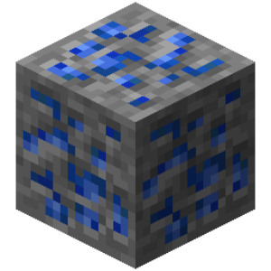
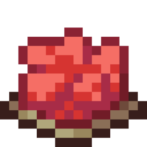
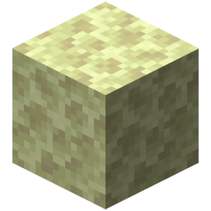
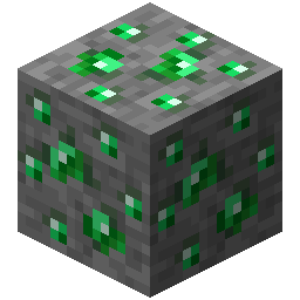

# Code actions

| Icon | ID | Name | Description | Category | Works with | Additional info | Unused | Deprecated | Subcategory | Type | Arguments |
| --- | --- | --- | --- | --- | --- | --- | --- | --- | --- | --- | --- |
|  | call_function | Call Function | Calls a function code string. | call_function |  |  | false | false |  | basic | function_name: text args: map |
|  | control_break_label | Break From Labeled Block | Interrupts the code labeled with the specified name. | control | Action "Label Code" |  | false | false |  | basic | label: text |
|  | control_call_exception | Call Error | Calls a specific error with the specified ID and message. | control |  | It is recommended to use this in the Catch Error action. | false | false |  | basic | id: text message: text type: enum |
|  | control_end_thread | Stop Sequence | Stops the current code block sequence. Any code after this block will not be executed. | control |  | If the action was used in functions, it will stop the parent line where the function was called. | false | false |  | basic |  |
|  | control_return_function | Return From Function | Stops the current sequence of code blocks in a function and returns to the function call block. | control |  | Returns up to the current function call block in the parent row. | false | false |  | basic |  |
|  | control_skip_iteration | Skip Iteration | Skip one iteration in the current iteration. | control |  |  | false | false |  | basic |  |
|  | control_stop_repeat | Stop Repeat | Completely stops the current repeat. | control |  |  | false | false |  | basic |  |
|  | control_wait | Wait | Pauses the current sequence of code blocks for a certain amount of time. | control |  | Minimum delay is 1 tick; in Tiki mode, only whole numbers can be set. | false | false |  | basic | duration: number time_unit: enum |
|  | else | Else | ... | else |  |  | false | false |  | container |  |
|  | start_process | Start Process | Starts a line of process code. | start_process |  |  | false | false |  | basic | process_name: text target_mode: enum local_variables_mode: enum args: map |
