# Entity actions

| Icon | ID | Name | Description | Category/Subcategory | Arguments | Works with | Additional info | Unused/Deprecated |
| --- | --- | --- | --- | --- | --- | --- | --- | --- |
|  | entity_attach_lead | Attach Lead | Tethers an entity to a fence or entity. | entity/movement | name_or_uuid: text location: location |  |  | false/false |
|  | entity_celar_potion_effects | Clear All Potion Effects | Clears all effects on an entity. | entity/parameters |  |  |  | false/false |
|  | entity_clear_merchant_recipes | Clear Merchant Recipes | Clears all trades to a Villager. | entity/settings |  | Villagers Wandering Traders |  | false/false |
|  | entity_complete_using_active_item | Complete Item Use | Completes the use of the current item in hand with a result. | entity/goals |  | Mobs |  | false/false |
|  | entity_damage | Deal Damage | Deals damage to an entity. | entity/parameters | damage: number source: text |  |  | false/false |
| 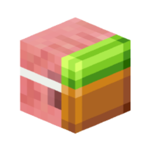 | entity_disguise_as_block | Disguise as Block | Disguise an entity as a block. | entity/appearance | block: block |  |  | false/false |
| 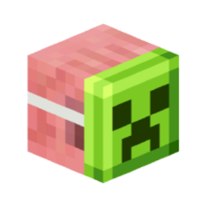 | entity_disguise_as_entity | Disguise as Entity | Disguise an entity as an entity. | entity/appearance | entity_type: item |  |  | false/false |
|  | entity_disguise_as_item | Disguise as Item | Disguises an entity as an item. | entity/appearance | item: item |  |  | false/false |
| 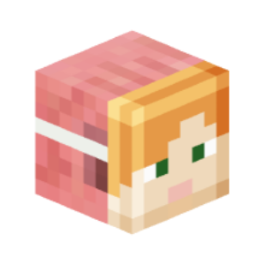 | entity_disguise_as_player | Disguise as Player | Disguises an entity as a player. | entity/appearance | name_or_uuid: text display_name: text server_type: enum &nbsp;&nbsp;- MOJANG &nbsp;&nbsp;- SERVER &nbsp;&nbsp;- SERVER_DEFAULT |  |  | false/false |
| 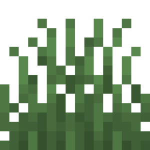 | entity_eat_grass | Eat Grass | Makes a sheep eat grass. | entity/goals |  | Sheep |  | false/false |
| 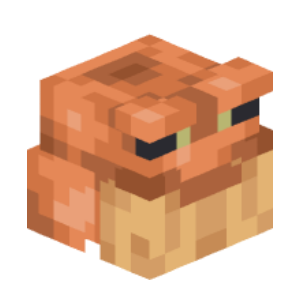 | entity_eat_target | Set Eat Target | Sets a target for an entity to eat. | entity/goals | name_or_uuid: text | Toads |  | false/false |
|  | entity_explode | Explode | Causes an entity to explode. | entity/goals |  | Creepers Dynamite TNT minecart Fireworks Sulfur cube |  | false/false |
| 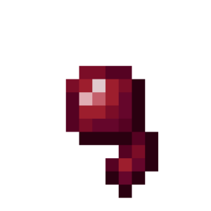 | entity_face_location | Face to Location | Turns an entity towards a location. | entity/movement | location: location |  |  | false/false |
|  | entity_get_attribute | Get Entity Attribute Value | Gets the value of the specified attribute of an entity and assigns the result to a variable. | entity/parameters | variable: variable attribute_type: enum &nbsp;&nbsp;- GENERIC_MAX_HEALTH &nbsp;&nbsp;- GENERIC_MAX_ABSORPTION &nbsp;&nbsp;- GENERIC_FOLLOW_RANGE &nbsp;&nbsp;- GENERIC_KNOCKBACK_RESISTANCE &nbsp;&nbsp;- GENERIC_MOVEMENT_SPEED &nbsp;&nbsp;- GENERIC_FLYING_SPEED &nbsp;&nbsp;- GENERIC_ATTACK_DAMAGE &nbsp;&nbsp;- GENERIC_ATTACK_KNOCKBACK &nbsp;&nbsp;- GENERIC_ATTACK_SPEED &nbsp;&nbsp;- GENERIC_ARMOR &nbsp;&nbsp;- GENERIC_ARMOR_TOUGHNESS &nbsp;&nbsp;- GENERIC_LUCK &nbsp;&nbsp;- GENERIC_JUMP_STRENGTH &nbsp;&nbsp;- ZOMBIE_SPAWN_REINFORCEMENTS &nbsp;&nbsp;- GENERIC_FALL_DAMAGE_MULTIPLIER &nbsp;&nbsp;- GENERIC_SAFE_FALL_DISTANCE &nbsp;&nbsp;- GENERIC_SCALE &nbsp;&nbsp;- GENERIC_STEP_HEIGHT &nbsp;&nbsp;- GENERIC_GRAVITY &nbsp;&nbsp;- PLAYER_BLOCK_INTERACTION_RANGE &nbsp;&nbsp;- PLAYER_ENTITY_INTERACTION_RANGE &nbsp;&nbsp;- PLAYER_BLOCK_BREAK_SPEED &nbsp;&nbsp;- GENERIC_BURNING_TIME &nbsp;&nbsp;- GENERIC_EXPLOSION_KNOCKBACK_RESISTANCE &nbsp;&nbsp;- GENERIC_MOVEMENT_EFFICIENCY &nbsp;&nbsp;- GENERIC_OXYGEN_BONUS &nbsp;&nbsp;- GENERIC_WATER_MOVEMENT_EFFICIENCY &nbsp;&nbsp;- PLAYER_MINING_EFFICIENCY &nbsp;&nbsp;- PLAYER_SNEAKING_SPEED &nbsp;&nbsp;- PLAYER_SUBMERGED_MINING_SPEED &nbsp;&nbsp;- PLAYER_SWEEPING_DAMAGE_RATIO &nbsp;&nbsp;- TEMP_RANGE &nbsp;&nbsp;- WAYPOINT_TRANSMIT_RANGE &nbsp;&nbsp;- WAYPOINT_RECEIVE_RANGE &nbsp;&nbsp;- CAMERA_DISTANCE &nbsp;&nbsp;- BOUNCINESS &nbsp;&nbsp;- FRICTION_MODIFIER &nbsp;&nbsp;- AIR_DRAG_MODIFIER &nbsp;&nbsp;- NAME_TAG_DISTANCE &nbsp;&nbsp;- BELOW_NAME_DISTANCE return_value: enum &nbsp;&nbsp;- VALUE &nbsp;&nbsp;- BASE_VALUE &nbsp;&nbsp;- DEFAULT_VALUE |  |  | false/false |
|  | entity_get_custom_tag | Get Custom Tag | Gets a creature's custom nbt tag. | entity/miscellaneous | variable: variable name: text default: any |  |  | false/false |
|  | entity_get_custom_tags | Get Custom Tags | Retrieves the custom tags of an entity and assigns the result to a variable. | entity/miscellaneous | variable: variable |  |  | false/false |
| 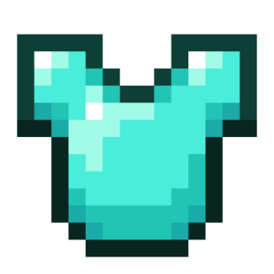 | entity_get_equipment_item | Get Entity Equipment | Gets the equipment of an entity from the specified slot and assigns the result to a variable. | entity/miscellaneous | variable: variable slot: enum &nbsp;&nbsp;- CHEST &nbsp;&nbsp;- FEET &nbsp;&nbsp;- HAND &nbsp;&nbsp;- HEAD &nbsp;&nbsp;- LEGS &nbsp;&nbsp;- OFF_HAND |  |  | false/false |
|  | entity_get_nbt | Get Entity NBT Tags | Gets the NBT tags of an entity at the specified path and assigns the result to a variable. | entity/miscellaneous | variable: variable path: text value_type: enum &nbsp;&nbsp;- ANY_VALUE &nbsp;&nbsp;- NBT_STRING |  |  | false/false |
| 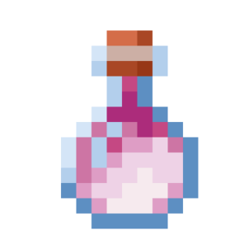 | entity_give_potion_effects | Give Potion Effect | Gives the selected effects to the creature. | entity/parameters | potions: potion overwrite: enum &nbsp;&nbsp;- TRUE &nbsp;&nbsp;- FALSE show_icon: enum &nbsp;&nbsp;- TRUE &nbsp;&nbsp;- FALSE particle_mode: enum &nbsp;&nbsp;- REGULAR &nbsp;&nbsp;- AMBIENT &nbsp;&nbsp;- NONE |  |  | false/false |
| 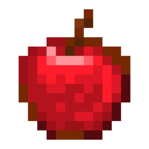 | entity_heal | Heal Entity | Heals an entity. | entity/parameters | heal: number |  |  | false/false |
|  | entity_ignite_creeper | Ignite Creeper | Sets a creeper on fire, causing it to explode after a certain period. | entity/goals |  | Creepers TNT minecart Sulfur cube |  | false/false |
| 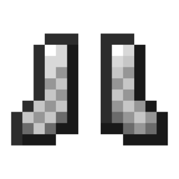 | entity_jump | Jump | Makes an entity jump. | entity/goals |  | Mobs |  | false/false |
|  | entity_launch_forward | Launch Forward | Launches an entity forward or backward in the direction it is facing based on its power. | entity/movement | power: number increment: enum &nbsp;&nbsp;- TRUE &nbsp;&nbsp;- FALSE launch_axis: enum &nbsp;&nbsp;- YAW_AND_PITCH &nbsp;&nbsp;- YAW |  |  | false/false |
|  | entity_launch_projectile | Launch Projectile | Launch a projectile from an entity's location. | entity/miscellaneous | projectile: item location: location name: text speed: number inaccuracy: number trail: particle |  |  | false/false |
|  | entity_launch_to_location | Launch To Location | Launches creatures to the selected location. | entity/movement | location: location power: number increment: enum &nbsp;&nbsp;- TRUE &nbsp;&nbsp;- FALSE |  |  | false/false |
|  | entity_launch_up | Launch Up | Tosses an entity up or down based on strength. | entity/movement | power: number increment: enum &nbsp;&nbsp;- TRUE &nbsp;&nbsp;- FALSE |  |  | false/false |
|  | entity_leave_vehicle | Dismount | Dismounts an entity from another entity or vehicle. | entity/movement |  |  |  | false/false |
|  | entity_mimic_disguise_from_entity | Disguise Entity as World Entity | Disguises the entity as the specified entity from the world. | entity/appearance | name_or_uuid: text include_disguise: enum &nbsp;&nbsp;- TRUE &nbsp;&nbsp;- FALSE remove_original_entity: enum &nbsp;&nbsp;- TRUE &nbsp;&nbsp;- FALSE |  |  | false/false |
|  | entity_modify_piglin_barter_materials | Modify Piglin Barter Materials | Modify the items a Piglin gives after bartering. | entity/settings | materials: item modification_mode: enum &nbsp;&nbsp;- ADD &nbsp;&nbsp;- REMOVE | Piglin | You cannot modify the items a Piglin gives by default. | false/false |
|  | entity_modify_piglin_interested_materials | Modify Piglin Interested Materials | Modify the items a Piglin is interested in. | entity/settings | materials: item modification_mode: enum &nbsp;&nbsp;- ADD &nbsp;&nbsp;- REMOVE | Piglin | You cannot modify the items a Piglin is interested in by default. | false/false |
|  | entity_move_to_location | Move To Location | Instructs the entity AI to always find its way to a certain location at a certain speed. | entity/goals | location: location speed: number | Mobs |  | false/false |
| 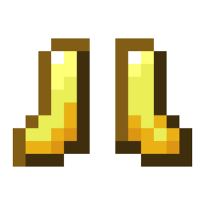 | entity_move_to_location_stop | Stop Moving To Location | Stops an entity moving to a location. | entity/goals |  | Mobs |  | false/false |
|  | entity_play_damage_animation | Play Damage Animation | Displays an entity damage animation. | entity/appearance | damage_type: enum &nbsp;&nbsp;- DAMAGE &nbsp;&nbsp;- CRITICAL_DAMAGE &nbsp;&nbsp;- MAGICAL_DAMAGE |  |  | false/false |
| 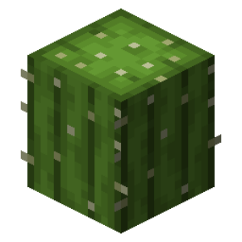 | entity_play_hurt_animation | Play Hurt Animation | Plays the damage animation. | entity/appearance | yaw: number |  |  | false/false |
|  | entity_ram_target | Ram Entity | Causes goats to ram the target entity. | entity/goals | name_or_uuid: text | Goat |  | false/false |
|  | entity_remove | Remove Entity | Removes an entity from the world. | entity/miscellaneous |  |  |  | false/false |
|  | entity_remove_custom_tag | Remove Custom Tag | Removes a custom NBT tag from an entity. | entity/miscellaneous | name: text |  |  | false/false |
|  | entity_remove_custom_tags | Remove Custom Tags | Removes all custom tags of the entity. | entity/miscellaneous |  |  |  | false/false |
| 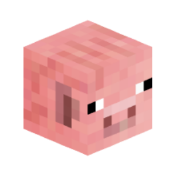 | entity_remove_disguise | Remove Disguise | Removes an entity's disguise. | entity/appearance |  |  |  | false/false |
|  | entity_remove_merchant_recipe | Remove Merchant Recipe | Removes an item to the Villager at the specified index. | entity/settings | recipe_index: number | Villager Wandering Traders |  | false/false |
|  | entity_remove_potion_effect | Remove Potion Effect | Removes the selected effects from an entity. | entity/parameters | effects: potion |  |  | false/false |
| 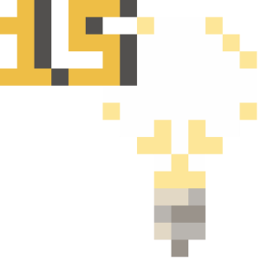 | entity_reset_display_brightness | Reset Brightness | Reset the brightness of an entity renderer. | entity/display_entity |  | Any Display Entity |  | false/false |
|  | entity_reset_display_glow_color | Reset Glow Color | Reset the glow color of the render entity. | entity/display_entity |  | Item Renderers Block Renderers |  | false/false |
|  | entity_reset_mannequin_description | Clear Mannequin Description | Clears the mannequin's description. | entity/appearance |  | Mannequins |  | false/false |
| 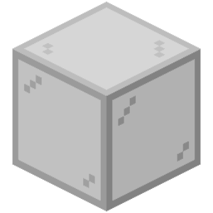 | entity_reset_text_display_background | Reset Background Color | Reset the background color and transparency of the text renderer. | entity/display_entity |  | Text Renderers |  | false/false |
|  | entity_reset_waypoint_color | Reset Waypoint Icon Color | Resets the color of the icon displayed on the locator bar for the entity to default. | entity/settings |  | Mobs | For this action to work, the "Locator Bar Visibility" game rule must be enabled. | false/false |
|  | entity_retrieve_fishing_hook | Retrieve Fishing Hook | Retracts the cast fishing hook of the fishing rod held in the specified hand of the entity. | entity/goals | slot: enum &nbsp;&nbsp;- MAIN_HAND &nbsp;&nbsp;- OFF_HAND | Fishing Rods |  | false/false |
|  | entity_ride_entity | Ride an Entity | Rides an entity onto another entity or player. | entity/movement | name_or_uuid: text |  |  | false/false |
| 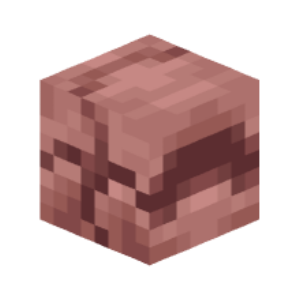 | entity_roll_armadillo | Set Armadillo Roll State | Sets the roll state of an armadillo (whether the armadillo is rolled up). | entity/goals | roll: enum &nbsp;&nbsp;- ROLL_OUT &nbsp;&nbsp;- ROLL_UP | Armadillos |  | false/false |
|  | entity_set_absorption_health | Set Extra Health | Sets an entity's bonus health. | entity/parameters | health: number |  |  | false/false |
|  | entity_set_age_lock | Set age lock | Set age lock to entity. | entity/settings | age_lock: enum &nbsp;&nbsp;- TRUE &nbsp;&nbsp;- FALSE | Ageable |  | false/false |
| 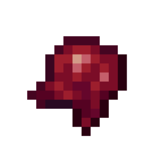 | entity_set_ai | Set Entity Intelligence | Sets the intelligence of an entity. | entity/settings | ai: enum &nbsp;&nbsp;- TRUE &nbsp;&nbsp;- FALSE |  |  | false/false |
|  | entity_set_allay_dancing | Set Allay Dancing | Sets the Quiet Entity to display a dancing animation. | entity/goals | dance: enum &nbsp;&nbsp;- TRUE &nbsp;&nbsp;- FALSE | Allays |  | false/false |
| 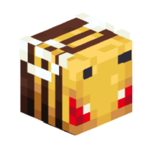 | entity_set_angry | Set Anger Mode | Sets an entity to anger mode on a specific target. | entity/settings | angry: enum &nbsp;&nbsp;- TRUE &nbsp;&nbsp;- FALSE target: text | Bees Wolf Zombie Piglins Endermen Mobs | An entity needs a target to work properly. | false/false |
|  | entity_set_animal_age | Set Animal Age | Sets the age of an animal. | entity/parameters | age: number lock: enum &nbsp;&nbsp;- ENABLE &nbsp;&nbsp;- DISABLE &nbsp;&nbsp;- DONT_CHANGE |  |  | false/false |
|  | entity_set_armor_items | Set Armor | Sets an entity's armor. | entity/miscellaneous | helmet: item chestplate: item leggings: item boots: item silent: enum &nbsp;&nbsp;- TRUE &nbsp;&nbsp;- FALSE |  | Any item or block will appear on the head when placed in a helmet slot. | false/false |
| 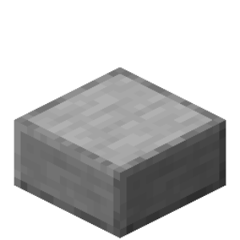 | entity_set_armor_stand_parts | Set Armor Stand Parts | Set armor stand parts. | entity/appearance | arms: enum &nbsp;&nbsp;- ENABLE &nbsp;&nbsp;- DISABLE &nbsp;&nbsp;- DONT_CHANGE base_plate: enum &nbsp;&nbsp;- ENABLE &nbsp;&nbsp;- DISABLE &nbsp;&nbsp;- DONT_CHANGE | Armor Stands |  | false/false |
|  | entity_set_armor_stand_pose | Set Armor Stand Pose | Sets the pose of an armor stand. | entity/appearance | x_rotation: number y_rotation: number z_rotation: number body_part: enum &nbsp;&nbsp;- HEAD &nbsp;&nbsp;- BODY &nbsp;&nbsp;- LEFT_ARM &nbsp;&nbsp;- RIGHT_ARM &nbsp;&nbsp;- LEFT_LEG &nbsp;&nbsp;- RIGHT_LEG | Armor Stands |  | false/false |
|  | entity_set_arrow_hit_sound | Set Projectile Hit Sound | Sets the sound a projectile makes when it hits an entity or player. | entity/miscellaneous | sound: sound | Arrows Tridents |  | false/false |
|  | entity_set_arrow_pierce | Set Arrow Pierce Count | Sets the amount of times an arrow can pierce an entity (from 0 to 127). | entity/parameters | pierce: number |  |  | false/false |
|  | entity_set_attribute | Set Attribute | Sets the specified attribute to the specified entity value. | entity/parameters | value: number attribute_type: enum &nbsp;&nbsp;- GENERIC_MAX_HEALTH &nbsp;&nbsp;- GENERIC_MAX_ABSORPTION &nbsp;&nbsp;- GENERIC_FOLLOW_RANGE &nbsp;&nbsp;- GENERIC_KNOCKBACK_RESISTANCE &nbsp;&nbsp;- GENERIC_MOVEMENT_SPEED &nbsp;&nbsp;- GENERIC_FLYING_SPEED &nbsp;&nbsp;- GENERIC_ATTACK_DAMAGE &nbsp;&nbsp;- GENERIC_ATTACK_KNOCKBACK &nbsp;&nbsp;- GENERIC_ATTACK_SPEED &nbsp;&nbsp;- GENERIC_ARMOR &nbsp;&nbsp;- GENERIC_ARMOR_TOUGHNESS &nbsp;&nbsp;- GENERIC_LUCK &nbsp;&nbsp;- GENERIC_JUMP_STRENGTH &nbsp;&nbsp;- ZOMBIE_SPAWN_REINFORCEMENTS &nbsp;&nbsp;- GENERIC_FALL_DAMAGE_MULTIPLIER &nbsp;&nbsp;- GENERIC_SAFE_FALL_DISTANCE &nbsp;&nbsp;- GENERIC_SCALE &nbsp;&nbsp;- GENERIC_STEP_HEIGHT &nbsp;&nbsp;- GENERIC_GRAVITY &nbsp;&nbsp;- PLAYER_BLOCK_INTERACTION_RANGE &nbsp;&nbsp;- PLAYER_ENTITY_INTERACTION_RANGE &nbsp;&nbsp;- PLAYER_BLOCK_BREAK_SPEED &nbsp;&nbsp;- GENERIC_BURNING_TIME &nbsp;&nbsp;- GENERIC_EXPLOSION_KNOCKBACK_RESISTANCE &nbsp;&nbsp;- GENERIC_MOVEMENT_EFFICIENCY &nbsp;&nbsp;- GENERIC_OXYGEN_BONUS &nbsp;&nbsp;- GENERIC_WATER_MOVEMENT_EFFICIENCY &nbsp;&nbsp;- PLAYER_MINING_EFFICIENCY &nbsp;&nbsp;- PLAYER_SNEAKING_SPEED &nbsp;&nbsp;- PLAYER_SUBMERGED_MINING_SPEED &nbsp;&nbsp;- PLAYER_SWEEPING_DAMAGE_RATIO &nbsp;&nbsp;- TEMP_RANGE &nbsp;&nbsp;- WAYPOINT_TRANSMIT_RANGE &nbsp;&nbsp;- WAYPOINT_RECEIVE_RANGE &nbsp;&nbsp;- CAMERA_DISTANCE &nbsp;&nbsp;- BOUNCINESS &nbsp;&nbsp;- FRICTION_MODIFIER &nbsp;&nbsp;- AIR_DRAG_MODIFIER &nbsp;&nbsp;- NAME_TAG_DISTANCE &nbsp;&nbsp;- BELOW_NAME_DISTANCE |  |  | false/false |
| 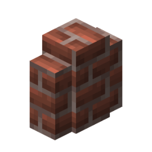 | entity_set_aware | Set Mob Awareness | When disabled, disables the AI of the mob, but leaves interaction with gravity, pushing, etc. | entity/goals | aware: enum &nbsp;&nbsp;- TRUE &nbsp;&nbsp;- FALSE | Mobs |  | false/false |
| 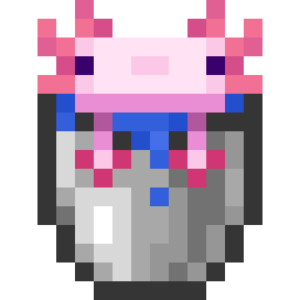 | entity_set_axolotl_type | Set Axolotl Type | Sets the axolotl type. | entity/appearance | axolotl_type: enum &nbsp;&nbsp;- BLUE &nbsp;&nbsp;- CYAN &nbsp;&nbsp;- GOLD &nbsp;&nbsp;- LUCY &nbsp;&nbsp;- WILD | Axolotl |  | false/false |
|  | entity_set_baby | Set Child Mode | Sets an entity to child mode. | entity/settings | baby: enum &nbsp;&nbsp;- TRUE &nbsp;&nbsp;- FALSE |  |  | false/false |
|  | entity_set_base_arrow_damage | Set Projectile Base Damage | Sets the projectile's base damage, which will be used in the projectile's damage formula when it hits. | entity/parameters | damage: number | Arrows Tridents | Formula for arrows: Base Damage * Projectile Speed = Damage Dealt Formula for tridents: Base Damage = Damage Dealt | false/false |
| 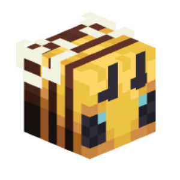 | entity_set_bee_has_stinger | Set Bee Stinger | Toggles whether a bee has a stinger. | entity/settings | stinger: enum &nbsp;&nbsp;- TRUE &nbsp;&nbsp;- FALSE | Bee |  | false/false |
| 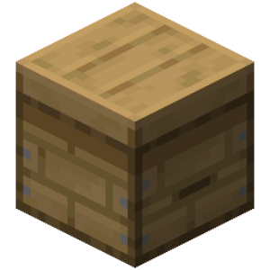 | entity_set_bee_nectar | Set Bee Pollen | Sets the visibility of pollen to the bee. | entity/appearance | nectar: enum &nbsp;&nbsp;- TRUE &nbsp;&nbsp;- FALSE | Bees |  | false/false |
|  | entity_set_block_display_block | Set Display Block | Sets the display block to the block renderer. | entity/display_entity | displayed_block: block | Block Renderers |  | false/false |
|  | entity_set_camel_dashing | Set Camel Dashing Animation | Sets the dashing animation for the camel. | entity/settings | dashing: enum &nbsp;&nbsp;- TRUE &nbsp;&nbsp;- FALSE | Camels |  | false/false |
|  | entity_set_carrying_chest | Set Chest Visibility | Sets the visibility of the chest on the entity. | entity/settings | carrying: enum &nbsp;&nbsp;- TRUE &nbsp;&nbsp;- FALSE | Donkeys Mules Lamas |  | false/false |
| 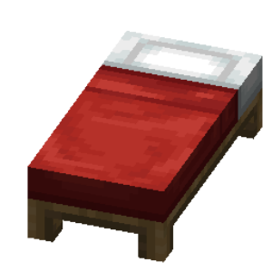 | entity_set_cat_lying_down | Set Cat Lying Down | Sets the lying down mode for the cat. | entity/appearance | lying_down: enum &nbsp;&nbsp;- TRUE &nbsp;&nbsp;- FALSE | Cats |  | false/false |
| 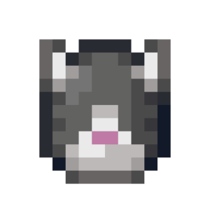 | entity_set_cat_type | Set Cat Type | Sets the type of cat. | entity/appearance | cat_type: enum &nbsp;&nbsp;- TABBY &nbsp;&nbsp;- BLACK &nbsp;&nbsp;- RED &nbsp;&nbsp;- SIAMESE &nbsp;&nbsp;- BRITISH_SHORTHAIR &nbsp;&nbsp;- CALICO &nbsp;&nbsp;- PERSIAN &nbsp;&nbsp;- RAGDOLL &nbsp;&nbsp;- WHITE &nbsp;&nbsp;- JELLIE &nbsp;&nbsp;- ALL_BLACK | Cats |  | false/false |
| 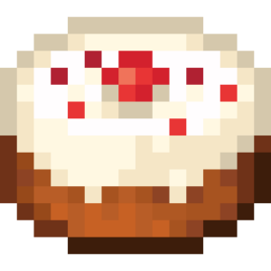 | entity_set_celebrating | Set Celebrating Mode | Sets the entity's celebrating mode. | entity/goals | celebrating: enum &nbsp;&nbsp;- TRUE &nbsp;&nbsp;- FALSE | Piglin Raiders |  | false/false |
| 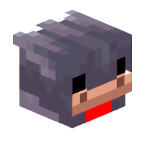 | entity_set_chicken_type | Set Chicken Type | Sets the color variant of a chicken. | entity/appearance | variant: enum &nbsp;&nbsp;- COLD &nbsp;&nbsp;- WARM &nbsp;&nbsp;- TEMPERATE | Chickens |  | false/false |
|  | entity_set_collidable | Set Collidable Mode | Sets an entity to collide with other entities. | entity/settings | collidable: enum &nbsp;&nbsp;- TRUE &nbsp;&nbsp;- FALSE |  |  | false/false |
| 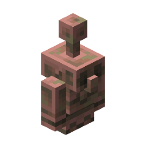 | entity_set_copper_golem_oxidizing | Set Copper Golem Waxed State | Sets the waxed state of the copper golem. | entity/settings | oxidizing_state: enum &nbsp;&nbsp;- WAXED &nbsp;&nbsp;- Material &nbsp;&nbsp;- UNSET &nbsp;&nbsp;- Material | Copper Golems |  | false/false |
| 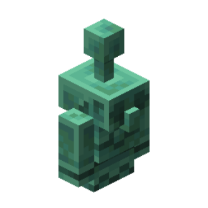 | entity_set_copper_golem_oxidizing_at_time | Set Copper Golem Oxidation Time | Sets the time it takes for the copper golem to increase its oxidation level in the rain. | entity/settings | time: number | Copper Golems |  | false/false |
| 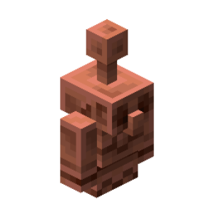 | entity_set_copper_golem_weathering | Set Copper Golem Oxidation Level | Sets the oxidation level of the copper golem. | entity/settings | weathering_state: enum &nbsp;&nbsp;- UNAFFECTED &nbsp;&nbsp;- EXPOSED &nbsp;&nbsp;- WEATHERED &nbsp;&nbsp;- OXIDIZED | Copper Golems |  | false/false |
| 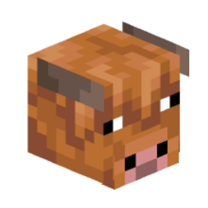 | entity_set_cow_type | Set Cow Type | Sets the color variant of a cow. | entity/appearance | variant: enum &nbsp;&nbsp;- COLD &nbsp;&nbsp;- WARM &nbsp;&nbsp;- TEMPERATE | Cows |  | false/false |
| 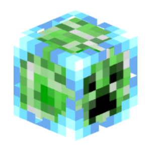 | entity_set_creeper_charge | Set Creeper Charge | Sets whether the creeper will be charged. | entity/settings | charged: enum &nbsp;&nbsp;- TRUE &nbsp;&nbsp;- FALSE | Creepers |  | false/false |
| 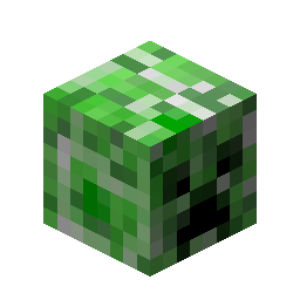 | entity_set_creeper_fuse | Set Creeper Max Fuse Time | Sets the creeper's time before it explodes. | entity/parameters | fuse_ticks: number | Creepers |  | false/false |
|  | entity_set_current_health | Set Entity Health | Sets an entity's health to the selected amount. | entity/parameters | health: number |  |  | false/false |
|  | entity_set_custom_name | Set Name | Sets a name for an entity. | entity/settings | custom_name: text |  |  | false/false |
|  | entity_set_custom_name_visibility | Set Name Visibility | Sets the visibility of the entity name. | entity/settings | visibility: enum &nbsp;&nbsp;- TRUE &nbsp;&nbsp;- FALSE |  |  | false/false |
|  | entity_set_custom_tag | Set Custom Tag | Sets a custom nbt tag to an entity. | entity/miscellaneous | name: text value: text |  |  | false/false |
|  | entity_set_death_drops | Set Drops Items | Sets whether an entity will drop loot. | entity/settings | drops: enum &nbsp;&nbsp;- TRUE &nbsp;&nbsp;- FALSE |  |  | false/false |
|  | entity_set_death_time | Set Death Time | Sets the death duration for an entity. | entity/parameters | death_time: number |  |  | false/false |
| 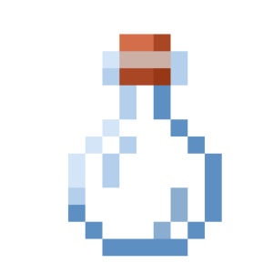 | entity_set_default_visible | Set Visibility | Sets whether an entity is visible. | entity/settings | default_visible: enum &nbsp;&nbsp;- TRUE &nbsp;&nbsp;- FALSE |  |  | false/false |
|  | entity_set_despawning | Set Entity Despawning | Sets whether an entity will despawn. | entity/settings | despawning: enum &nbsp;&nbsp;- TRUE &nbsp;&nbsp;- FALSE |  |  | false/false |
|  | entity_set_display_billboard | Set Display Mode | Sets the display mode of the billboard entity. | entity/display_entity | billboard_type: enum &nbsp;&nbsp;- CENTER &nbsp;&nbsp;- FIXED &nbsp;&nbsp;- HORIZONTAL &nbsp;&nbsp;- VERTICAL | Any renderer entity |  | false/false |
|  | entity_set_display_brightness | Set Brightness | Sets the brightness of the renderer entity. | entity/display_entity | block_light_level: number sky_light_level: number | Any Display Entity |  | false/false |
|  | entity_set_display_correct_transformation_matrix | Set Transformation Matrix | Sets the transformation matrix of a display entity. | entity/display_entity | matrix: number | Any Display Entity |  | false/false |
|  | entity_set_display_culling_suze | Set Visibility Size | Sets the size of the visualizer entity's model scope. | entity/display_entity | width: number height: number | Any Visualizer Entity |  | false/false |
|  | entity_set_display_glow_color | Set Glow Color | Sets the glow color for the render entity. | entity/display_entity | color_hexadecimal: text | Item Renderers Block Renderers |  | false/false |
|  | entity_set_display_interpolation | Set Interpolation | Sets the interpolation duration for the renderer entity. | entity/display_entity | interpolation_duration: number interpolation_delay: number | Any Display Entity |  | false/false |
| 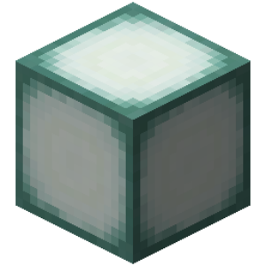 | entity_set_display_rotation_from_axis_angle | Set Rotation From Axis Vector | Sets left or right rotation by axis vector and angle of the renderer entity. | entity/display_entity | axis_vector: vector angle: number mode: enum &nbsp;&nbsp;- SET &nbsp;&nbsp;- ADD &nbsp;&nbsp;- ADD_LOCAL input: enum &nbsp;&nbsp;- DEGREES &nbsp;&nbsp;- RADIANS rotation: enum &nbsp;&nbsp;- LEFT_ROTATION &nbsp;&nbsp;- RIGHT_ROTATION | Any Render Entity |  | false/false |
|  | entity_set_display_rotation_from_euler_angles | Set Rotation From Euler Angles | Sets left or right Euler angle rotation for the renderer entity. | entity/display_entity | yaw: number pitch: number roll: number mode: enum &nbsp;&nbsp;- SET &nbsp;&nbsp;- ADD &nbsp;&nbsp;- ADD_LOCAL input: enum &nbsp;&nbsp;- DEGREES &nbsp;&nbsp;- RADIANS rotation: enum &nbsp;&nbsp;- LEFT_ROTATION &nbsp;&nbsp;- RIGHT_ROTATION | Any renderer entity |  | false/false |
|  | entity_set_display_rotation_from_vector | Set Rotation From Vector | Sets the rotation of the renderer entity by the given direction vector and "Up" vector. | entity/display_entity | direction: vector up: vector rotation: enum &nbsp;&nbsp;- LEFT_ROTATION &nbsp;&nbsp;- RIGHT_ROTATION | Any renderer entity |  | false/false |
|  | entity_set_display_scale | Set Scale | Sets the size of the renderer entity. | entity/display_entity | scale_vector: vector mode: enum &nbsp;&nbsp;- SET &nbsp;&nbsp;- ADD | Any Render Entity |  | false/false |
| 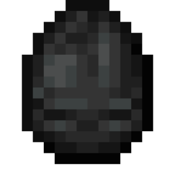 | entity_set_display_shadow | Set Shadow Settings | Sets the size and transparency of the shadow of the entity renderer. | entity/display_entity | shadow_radius: number shadow_opacity_percentage: number | Any Display Entity |  | false/false |
|  | entity_set_display_teleport_duration | Set Display Teleport Duration | Sets the interpolation duration for display entity teleports. | entity/display_entity | duration: number | Any display entity |  | false/false |
| 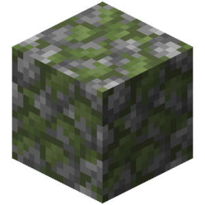 | entity_set_display_transformation_matrix | Set Transformation Matrix | Sets the transformation matrix (row-column) of the renderer entity. | entity | row_major_matrix: number |  |  | false/true |
|  | entity_set_display_translation | Set Translation | Sets an offset to the renderer entity. | entity/display_entity | translation_vector: vector mode: enum &nbsp;&nbsp;- SET &nbsp;&nbsp;- ADD | Any Display Entity |  | false/false |
|  | entity_set_display_view_range | Set Visibility Range | Sets the visibility range of the renderer entity. | entity/display_entity | view_range: number | Any Viewer Entity |  | false/false |
| 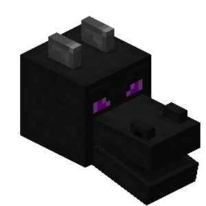 | entity_set_dragon_phase | Set Ender Dragon Phase | Sets a specific phase for an Ender Dragon. | entity/goals | phase: enum &nbsp;&nbsp;- BREATH_ATTACK &nbsp;&nbsp;- CHARGE_PLAYER &nbsp;&nbsp;- CIRCLING &nbsp;&nbsp;- DYING &nbsp;&nbsp;- FLY_TO_PORTAL &nbsp;&nbsp;- HOVER &nbsp;&nbsp;- LAND_ON_PORTAL &nbsp;&nbsp;- LEAVE_PORTAL &nbsp;&nbsp;- ROAR_BEFORE_ATTACK &nbsp;&nbsp;- SEARCH_FOR_BREATH_ATTACK_TARGET &nbsp;&nbsp;- STRAFING | Ender Dragons |  | false/false |
| 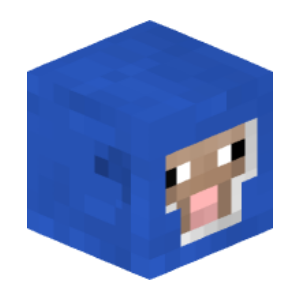 | entity_set_dye_color | Set Entity Color | Sets a specific color for an entity. | entity/appearance | color: enum &nbsp;&nbsp;- BLACK &nbsp;&nbsp;- BLUE &nbsp;&nbsp;- BROWN &nbsp;&nbsp;- CYAN &nbsp;&nbsp;- GRAY &nbsp;&nbsp;- GREEN &nbsp;&nbsp;- LIGHT_BLUE &nbsp;&nbsp;- LIGHT_GRAY &nbsp;&nbsp;- LIME &nbsp;&nbsp;- MAGENTA &nbsp;&nbsp;- ORANGE &nbsp;&nbsp;- PINK &nbsp;&nbsp;- PURPLE &nbsp;&nbsp;- RED &nbsp;&nbsp;- WHITE &nbsp;&nbsp;- YELLOW | Sheep Shulkers Dog Collars Cat Collars |  | false/false |
| 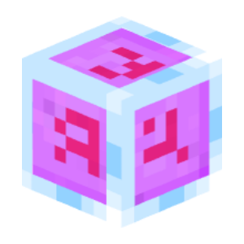 | entity_set_end_crystal_beam | Set End Crystal Beam | Points an End Crystal Beam to a specific location. | entity/settings | beam: location | End Crystals |  | false/false |
|  | entity_set_enderman_block | Set Block to Enderman | Sets the rendered block to the enderman. | entity/appearance | block: block | Endermen |  | false/false |
| 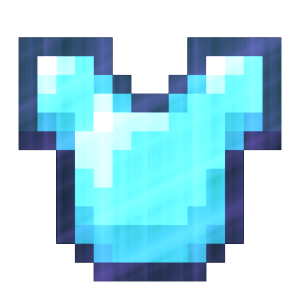 | entity_set_equipment_item | Set Equipment | Sets an item to one of the equipment slots (armor and items in hands) of an entity. | entity/miscellaneous | item: item slot: enum &nbsp;&nbsp;- CHEST &nbsp;&nbsp;- FEET &nbsp;&nbsp;- HAND &nbsp;&nbsp;- HEAD &nbsp;&nbsp;- LEGS &nbsp;&nbsp;- OFF_HAND |  |  | false/false |
|  | entity_set_explosive_power | Set Explosive Power | Sets the power of an entity's explosion. | entity/parameters | power: number | Creepers TNT Fireballs |  | false/false |
|  | entity_set_fall_distance | Set Fall Distance | Sets the distance at which an entity falls. | entity/parameters | fall_distance: number |  |  | false/false |
|  | entity_set_falling_block_type | Set Falling Block Type | Sets a block type to a Falling block | entity/miscellaneous | block: block | Falling blocks |  | false/false |
| 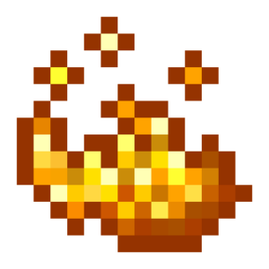 | entity_set_fire_ticks | Set on Fire | Sets an entity on fire for the selected amount of time. | entity/parameters | ticks: number |  |  | false/false |
| 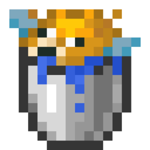 | entity_set_fishing_wait | Set Fishing Delay | Sets the entity's fishing delay in ticks. | entity/parameters | time: number wait_type: enum &nbsp;&nbsp;- MIN_MAX_WAIT &nbsp;&nbsp;- WAIT &nbsp;&nbsp;- MIN_WAIT &nbsp;&nbsp;- MAX_WAIT | Fish Hook |  | false/false |
| 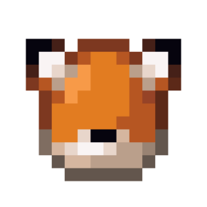 | entity_set_fox_leaping | Set Fox Leaping Animation | Sets the fox's jumping animation. | entity/appearance | leaping: enum &nbsp;&nbsp;- TRUE &nbsp;&nbsp;- FALSE | Foxes |  | false/false |
|  | entity_set_fox_type | Set Fox Type | Sets the fox type. | entity/appearance | fox_type: enum &nbsp;&nbsp;- RED &nbsp;&nbsp;- SNOW | Foxes |  | false/false |
|  | entity_set_freeze_ticks | Set Freeze Time | Sets the freeze time for an entity (the number of ticks an entity has spent in powder snow). | entity/parameters | ticks: number ticking_locked: enum &nbsp;&nbsp;- TRUE &nbsp;&nbsp;- FALSE |  |  | false/false |
| 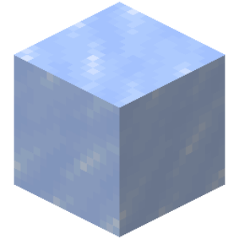 | entity_set_friction | Set Friction | Sets whether the entity will experience friction. | entity/movement | friction: enum &nbsp;&nbsp;- TRUE &nbsp;&nbsp;- FALSE &nbsp;&nbsp;- NOT_SET |  |  | false/false |
| 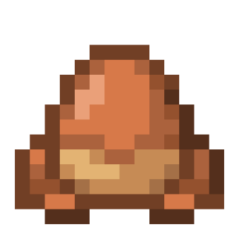 | entity_set_frog_type | Set Frog Type | Sets the color of the frog. | entity/appearance | frog_variant: enum &nbsp;&nbsp;- TEMPERATE &nbsp;&nbsp;- WARM &nbsp;&nbsp;- COLD | Toads |  | false/false |
|  | entity_set_fuse_ticks | Set Fuse Time | Sets the entity's time before it explodes. | entity/parameters | fuse_ticks: number | Creepers TNT TNT minecart Fireworks Sulfur cube |  | false/false |
|  | entity_set_gliding | Set Elytra Flying | Sets the creature's elytra flying state. | entity/movement | is_gliding: enum &nbsp;&nbsp;- TRUE &nbsp;&nbsp;- FALSE |  |  | false/false |
|  | entity_set_glow_squid_dark | Set Squid Glow Time | Sets the duration of darkness in ticks for the glowing octopus. | entity/appearance | dark_ticks: number | Glowing Octopuses |  | false/false |
| 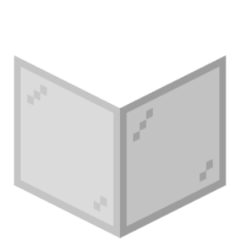 | entity_set_glowing | Set Entity Glowing | Sets an entity to a glowing effect. | entity/appearance | glowing: enum &nbsp;&nbsp;- TRUE &nbsp;&nbsp;- FALSE |  |  | false/false |
| 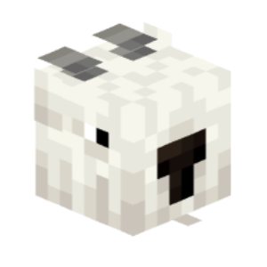 | entity_set_goat_screaming | Set Goat Screaming | Sets the "screaming" goat tag. | entity/settings | screams: enum &nbsp;&nbsp;- TRUE &nbsp;&nbsp;- FALSE | Goat |  | false/false |
| 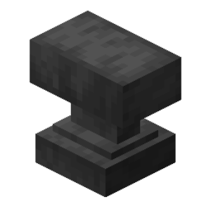 | entity_set_gravity | Set Gravity | Sets whether an entity will obey gravity. | entity/movement | gravity: enum &nbsp;&nbsp;- TRUE &nbsp;&nbsp;- FALSE |  |  | false/false |
|  | entity_set_hanging_facing_location | Set Hanging Entity Block Face | Sets the block face a hanging entity is attached to. | entity/settings | facing: enum &nbsp;&nbsp;- NORTH &nbsp;&nbsp;- EAST &nbsp;&nbsp;- SOUTH &nbsp;&nbsp;- WEST &nbsp;&nbsp;- UP &nbsp;&nbsp;- DOWN force: enum &nbsp;&nbsp;- TRUE &nbsp;&nbsp;- FALSE | Item frames Glow item frames Paintings | Paintings cannot be placed on the top or bottom of a block. | false/false |
|  | entity_set_horse_jump | Set Horse Jump Power | Sets the horse's jump power. | entity/parameters | power: number | Horses Donkeys Mules Lamas |  | false/false |
|  | entity_set_horse_pattern | Set Horse Pattern | Sets the color and pattern of the horse. | entity/appearance | horse_color: enum &nbsp;&nbsp;- WHITE &nbsp;&nbsp;- CREAMY &nbsp;&nbsp;- CHESTNUT &nbsp;&nbsp;- BROWN &nbsp;&nbsp;- DARK_BROWN &nbsp;&nbsp;- GRAY &nbsp;&nbsp;- BLACK &nbsp;&nbsp;- DO_NOT_CHANGE horse_style: enum &nbsp;&nbsp;- NONE &nbsp;&nbsp;- WHITE &nbsp;&nbsp;- WHITEFIELD &nbsp;&nbsp;- WHITE_DOTS &nbsp;&nbsp;- BLACK_DOTS &nbsp;&nbsp;- DO_NOT_CHANGE | Horses |  | false/false |
|  | entity_set_immune_to_zombification | Set Immune To Zombification | Sets entity immunity to zombification. | entity/settings | is_immune: enum &nbsp;&nbsp;- TRUE &nbsp;&nbsp;- FALSE | Piglins Brute piglins Hoglins |  | false/false |
|  | entity_set_interaction_responsive | Set Interaction Entity Responsiveness | Sets whether an interaction entity will be responsive to interactions. | entity/settings | responsive: enum &nbsp;&nbsp;- TRUE &nbsp;&nbsp;- FALSE |  |  | false/false |
|  | entity_set_interaction_size | Set Interaction Entity Size | Sets the horizontal and vertical sizes of an interaction entity. | entity/settings | width: number height: number |  |  | false/false |
|  | entity_set_invisible | Set Invisible Mode | Sets an entity to invisible mode. | entity/settings | invisible: enum &nbsp;&nbsp;- TRUE &nbsp;&nbsp;- FALSE |  |  | false/false |
|  | entity_set_invulnerability_ticks | Set Invulnerability Duration | Sets the invulnerability duration for a creature. | entity/parameters | ticks: number |  |  | false/false |
|  | entity_set_invulnerable | Set Entity Invulnerable | Sets an entity's invulnerability, but can deal damage in creative mode. | entity/settings | invulnerable: enum &nbsp;&nbsp;- TRUE &nbsp;&nbsp;- FALSE |  |  | false/false |
|  | entity_set_item | Set Entity Item Type | Sets a specific type (ID) to an Item entity. | entity/miscellaneous | item: item | Items |  | false/false |
|  | entity_set_item_display_item | Set Display Item | Sets the display item to the item renderer. | entity/display_entity | displayed_item: item | Item Renderers |  | false/false |
|  | entity_set_item_display_model_type | Set Item Model Type | Sets the type of the item's display model to the item renderer. | entity/display_entity | display_model_type: enum &nbsp;&nbsp;- FIRSTPERSON_LEFTHAND &nbsp;&nbsp;- FIRSTPERSON_RIGHTHAND &nbsp;&nbsp;- FIXED &nbsp;&nbsp;- GROUND &nbsp;&nbsp;- GUI &nbsp;&nbsp;- HEAD &nbsp;&nbsp;- NONE &nbsp;&nbsp;- THIRDPERSON_LEFTHAND &nbsp;&nbsp;- THIRDPERSON_RIGHTHAND | Item Renderers |  | false/false |
|  | entity_set_item_frame_item_drop_chance | Set Item Frame Item Drop Chance | Sets the drop chance of the item in an item frame when destroyed. | entity/miscellaneous | drop_chance: number | Item frames Glow item frames |  | false/false |
|  | entity_set_item_in_frame | Set Item in Frame | Sets the specified item in a frame. | entity/appearance | item: item play_sound: enum &nbsp;&nbsp;- TRUE &nbsp;&nbsp;- FALSE | Within Frames |  | false/false |
|  | entity_set_item_owner | Set Item Owner | Sets the owner of an item entity. | entity/settings | name_or_uuid: text | Items |  | false/false |
|  | entity_set_llama_type | Set Llama Color | Sets the color of the llama. | entity/appearance | type: enum &nbsp;&nbsp;- BROWN &nbsp;&nbsp;- CREAMY &nbsp;&nbsp;- GRAY &nbsp;&nbsp;- WHITE | Lamas |  | false/false |
|  | entity_set_location | Launch By Vector | Launches an entity at the specified vector. | entity/movement | velocity: vector increment: enum &nbsp;&nbsp;- TRUE &nbsp;&nbsp;- FALSE |  |  | false/false |
|  | entity_set_mannequin_description | Set Mannequin Description | Sets the mannequin's description. | entity/appearance | description: text | Mannequins |  | false/false |
|  | entity_set_mannequin_immovable | Set Mannequin Movement | Sets whether the mannequin can move. | entity/settings | immovable: enum &nbsp;&nbsp;- TRUE &nbsp;&nbsp;- FALSE | Mannequins |  | false/false |
|  | entity_set_mannequin_main_hand | Set Mannequin Main Hand | Sets the main hand of the mannequin. | entity/appearance | hand: enum &nbsp;&nbsp;- RIGHT &nbsp;&nbsp;- LEFT | Mannequins |  | false/false |
|  | entity_set_mannequin_skin | Set Mannequin Skin | Sets the mannequin's skin. | entity/appearance | name_or_uuid: text server_type: enum &nbsp;&nbsp;- MOJANG &nbsp;&nbsp;- SERVER &nbsp;&nbsp;- SERVER_DEFAULT | Mannequins |  | false/false |
|  | entity_set_mannequin_skin_model | Set Mannequin Skin Model Type | Sets the skin model type of the mannequin. | entity/appearance | model: enum &nbsp;&nbsp;- CLASSIC &nbsp;&nbsp;- SLIM &nbsp;&nbsp;- UNSET | Mannequins |  | false/false |
|  | entity_set_mannequin_skin_parts | Set Mannequin Skin Layers | Sets the visibility of the mannequin's skin layers. | entity/appearance | hat: enum &nbsp;&nbsp;- TRUE &nbsp;&nbsp;- FALSE &nbsp;&nbsp;- NOT_SET jacket: enum &nbsp;&nbsp;- TRUE &nbsp;&nbsp;- FALSE &nbsp;&nbsp;- NOT_SET left_sleeve: enum &nbsp;&nbsp;- TRUE &nbsp;&nbsp;- FALSE &nbsp;&nbsp;- NOT_SET right_sleeve: enum &nbsp;&nbsp;- TRUE &nbsp;&nbsp;- FALSE &nbsp;&nbsp;- NOT_SET left_pants: enum &nbsp;&nbsp;- TRUE &nbsp;&nbsp;- FALSE &nbsp;&nbsp;- NOT_SET right_pants: enum &nbsp;&nbsp;- TRUE &nbsp;&nbsp;- FALSE &nbsp;&nbsp;- NOT_SET cape: enum &nbsp;&nbsp;- TRUE &nbsp;&nbsp;- FALSE &nbsp;&nbsp;- NOT_SET | Mannequins |  | false/false |
|  | entity_set_mannequin_skin_patch | Set Mannequin Skin Patch Texture | Sets the texture for the specified part of the mannequin. | entity/appearance | texture_key: text patch_target: enum &nbsp;&nbsp;- BODY &nbsp;&nbsp;- CAPE &nbsp;&nbsp;- ELYTRA | Mannequins | If the "Texture Key" argument is not specified, the default texture will be applied. | false/false |
|  | entity_set_marker | Set Marker Mode | Sets the armor rack marker mode. | entity/settings | marker: enum &nbsp;&nbsp;- TRUE &nbsp;&nbsp;- FALSE | Armor Stands |  | false/false |
|  | entity_set_max_health | Set Max Health | Sets the maximum amount of health for an entity. | entity/parameters | max_health: number heal_to_max: enum &nbsp;&nbsp;- TRUE &nbsp;&nbsp;- FALSE |  |  | false/false |
|  | entity_set_max_invulnerability_ticks | Set Max Invulnerability | Sets the maximum invulnerability duration for the entity. | entity/parameters | ticks: number |  |  | false/false |
|  | entity_set_merchant_recipe | Set Merchant Recipe | Sets an item to a Villager for certain items at the specified index. | entity/settings | result: item ingredient_one: item ingredient_two: item index: number mode: enum &nbsp;&nbsp;- MERGE &nbsp;&nbsp;- APPEND uses: number max_uses: number villager_experience: number price_multiplifier: number demand: number special_price: number ignore_discounts: enum &nbsp;&nbsp;- TRUE &nbsp;&nbsp;- FALSE experience_reward: enum &nbsp;&nbsp;- TRUE &nbsp;&nbsp;- FALSE | Villagers Wandering Traders |  | false/false |
|  | entity_set_minecart_block | Set Block to Minecart | Sets the specified block into the Minecart. | entity/appearance | block: block block_offset: number | Minecarts |  | false/false |
|  | entity_set_mob_aggressive | Set Mob Aggressive | Sets the agression of the mob. | entity/appearance | aggressive: enum &nbsp;&nbsp;- TRUE &nbsp;&nbsp;- FALSE |  |  | false/false |
|  | entity_set_mushroom_cow_type | Set Mushroom Cow Type | Sets the mushroom cow type. | entity/appearance | cow_type: enum &nbsp;&nbsp;- BROWN &nbsp;&nbsp;- RED | Mushroom Cows |  | false/false |
|  | entity_set_no_physics | Set Entity Physics | Toggles whether an entity is affected by physics. | entity/settings | no_physics: enum &nbsp;&nbsp;- TRUE &nbsp;&nbsp;- FALSE |  |  | false/false |
|  | entity_set_painting_art | Set Painting Art | Sets the art for a painting. | entity/miscellaneous | art: text force: enum &nbsp;&nbsp;- TRUE &nbsp;&nbsp;- FALSE | Paintings |  | false/false |
|  | entity_set_panda_gene | Set Panda Gene | Sets the panda gene. This affects their behavior and appearance. | entity/settings | gene: enum &nbsp;&nbsp;- MAIN &nbsp;&nbsp;- HIDDEN &nbsp;&nbsp;- BOTH gene_type: enum &nbsp;&nbsp;- NORMAL &nbsp;&nbsp;- LAZY &nbsp;&nbsp;- WORRIED &nbsp;&nbsp;- PLAYFUL &nbsp;&nbsp;- BROWN &nbsp;&nbsp;- WEAK &nbsp;&nbsp;- AGGRESSIVE | Pandas |  | false/false |
|  | entity_set_panda_on_back | Set Panda Sitting | Toggles whether a panda is sitting. | entity/settings | on_back: enum &nbsp;&nbsp;- TRUE &nbsp;&nbsp;- FALSE | Panda |  | false/false |
|  | entity_set_panda_rolling | Set Panda Rolling | Set whether a panda is rolling. | entity/goals | rolling: enum &nbsp;&nbsp;- TRUE &nbsp;&nbsp;- FALSE | Panda |  | false/false |
|  | entity_set_panda_sad_ticks | Set Panda Sad Time | Sets how long a panda is sad for in ticks. | entity/parameters | sad_ticks: number | Panda |  | false/false |
|  | entity_set_parrot_type | Set Parrot Type | Sets the parrot type. | entity/appearance | parrot_type: enum &nbsp;&nbsp;- BLUE &nbsp;&nbsp;- CYAN &nbsp;&nbsp;- GRAY &nbsp;&nbsp;- GREEN &nbsp;&nbsp;- RED | Parrots |  | false/false |
|  | entity_set_pathfinder_settings | Set pathfinder settings | Sets parameters and restrictions for the entity's pathfinding | entity/goals | can_float: enum &nbsp;&nbsp;- TRUE &nbsp;&nbsp;- FALSE &nbsp;&nbsp;- NOT_SET can_open_door: enum &nbsp;&nbsp;- TRUE &nbsp;&nbsp;- FALSE &nbsp;&nbsp;- NOT_SET can_pass_door: enum &nbsp;&nbsp;- TRUE &nbsp;&nbsp;- FALSE &nbsp;&nbsp;- NOT_SET | Mobs |  | false/false |
|  | entity_set_persistence | Set Entity Persistence | Sets whether an item or falling block will persist. | entity/settings | persistence: enum &nbsp;&nbsp;- TRUE &nbsp;&nbsp;- FALSE | Entity Falling Blocks |  | false/false |
|  | entity_set_persistent | Set Entity Persistence | Sets whether the entity will be saved after the world is unloaded. | entity/settings | persistent: enum &nbsp;&nbsp;- TRUE &nbsp;&nbsp;- FALSE |  |  | false/false |
|  | entity_set_pickup | Entity Set Pickup | Sets which entities can pick up. | entity/settings | can_mob_pickup: enum &nbsp;&nbsp;- TRUE &nbsp;&nbsp;- FALSE can_player_pickup: enum &nbsp;&nbsp;- TRUE &nbsp;&nbsp;- FALSE | Item Entities |  | false/false |
|  | entity_set_pickup_delay | Set Pickup Delay | Sets the number of ticks an item cannot be picked up. | entity/parameters | delay: number | Items |  | false/false |
|  | entity_set_pig_type | Set Pig Type | Sets the color variant of a pig. | entity/appearance | variant: enum &nbsp;&nbsp;- COLD &nbsp;&nbsp;- WARM &nbsp;&nbsp;- TEMPERATE | Pigs |  | false/false |
|  | entity_set_piglin_able_to_hunt | Set Piglin Able To Hunt | Sets the status of the Piglin's hunting state. | entity/goals | able: enum &nbsp;&nbsp;- TRUE &nbsp;&nbsp;- FALSE | Piglin |  | false/false |
|  | entity_set_piglin_charging_crossbow | Set Pigling Charging Crossbow | Sets the Piglin's crossbow loaded status. | entity/goals | charging: enum &nbsp;&nbsp;- TRUE &nbsp;&nbsp;- FALSE | Piglin |  | false/false |
|  | entity_set_piglin_dancing | Set Piglin Dancing | Plays the dancing animation for a Piglin. | entity/goals | dancing_time: number | Piglin | If the value is less than zero, the Piglin dances forever. | false/false |
|  | entity_set_pose | Set Entity Pose | Sets a specific pose for an entity. | entity/appearance | pose: enum &nbsp;&nbsp;- CROAKING &nbsp;&nbsp;- DIGGING &nbsp;&nbsp;- DYING &nbsp;&nbsp;- EMERGING &nbsp;&nbsp;- FALL_FLYING &nbsp;&nbsp;- LONG_JUMPING &nbsp;&nbsp;- ROARING &nbsp;&nbsp;- SLEEPING &nbsp;&nbsp;- SNEAKING &nbsp;&nbsp;- SNIFFING &nbsp;&nbsp;- SPIN_ATTACK &nbsp;&nbsp;- STANDING &nbsp;&nbsp;- SWIMMING &nbsp;&nbsp;- USING_TONGUE |  |  | false/false |
|  | entity_set_potion_cloud_radius | Set Effect Cloud Radius | Sets the radius of the effect cloud and how fast it expands. | entity/parameters | radius: number shrinking_speed: number | Effect Cloud |  | false/false |
|  | entity_set_primed_tnt_block | Set Primed Tnt Block | Disguises the Primed TNT as another block. | entity/appearance | block: block | Primed TNT |  | false/false |
|  | entity_set_projectile_display_item | Set Projectile Item | Sets the projectile's visible item. | entity/appearance | item: item |  |  | false/false |
|  | entity_set_projectile_power | Set Projectile Vector Power | Sets the projectile's motion vector. | entity/parameters | power: vector | Fireball Dragon Fireball Wither Skull |  | false/false |
|  | entity_set_projectile_shooter | Set Projectile Shooter | Sets the specified creature as a projectile shooter. | entity/settings | uuid: text |  |  | false/false |
|  | entity_set_rabbit_type | Set Rabbit Type | Sets the rabbit type. | entity/appearance | rabbit_type: enum &nbsp;&nbsp;- BLACK &nbsp;&nbsp;- BLACK_AND_WHITE &nbsp;&nbsp;- BROWN &nbsp;&nbsp;- GOLD &nbsp;&nbsp;- SALT_AND_PEPPER &nbsp;&nbsp;- THE_KILLER_BUNNY &nbsp;&nbsp;- WHITE | Rabbits |  | false/false |
|  | entity_set_rearing | Set Horse Pose | Sets whether the horse will stand on its hind legs. | entity/settings | rearing: enum &nbsp;&nbsp;- TRUE &nbsp;&nbsp;- FALSE | Horses |  | false/false |
|  | entity_set_riptiding | Set Riptiding Animation | Sets the animation for an entity to use the Riptiding Trident Enchantment. | entity/settings | riptiding: enum &nbsp;&nbsp;- TRUE &nbsp;&nbsp;- FALSE |  |  | false/false |
|  | entity_set_rotation | Set Rotation | Sets the rotation of an entity. | entity/movement | yaw: number pitch: number |  |  | false/false |
|  | entity_set_rotation_by_vector | Set Rotation By Vector | Sets the entity rotation by vector. | entity/movement | vector: vector |  |  | false/false |
|  | entity_set_sheep_sheared | Set Sheep Wool | Sets whether sheep will have wool. | entity | sheared: enum &nbsp;&nbsp;- TRUE &nbsp;&nbsp;- FALSE |  |  | false/true |
|  | entity_set_shulker_bullet_target | Set Shulker Bullet Target | Sets an attack target for a Shulker projectile. | entity/goals | target: text | Shulker Bullets |  | false/false |
|  | entity_set_shulker_peek | Set Shulker Open Percentage | Sets the percentage of which a shulker is peeking out of its shell. | entity/appearance | rolling: number silent: enum &nbsp;&nbsp;- TRUE &nbsp;&nbsp;- FALSE | Shulker |  | false/false |
|  | entity_set_silenced | Silence Entity | Removes entity sounds. | entity/settings | silenced: enum &nbsp;&nbsp;- TRUE &nbsp;&nbsp;- FALSE |  |  | false/false |
|  | entity_set_sitting | Set Sitting Mode | Sets the entity's sitting mode. | entity/settings | sitting: enum &nbsp;&nbsp;- TRUE &nbsp;&nbsp;- FALSE | Wolf Cats Parrot Foxes Pandas |  | false/false |
|  | entity_set_size | Set Entity Size | Sets the size of an entity. | entity/settings | size: number | Slime Phantoms |  | false/false |
|  | entity_set_sniffer_state | Set Sniffer State | Sets a specific state for the sniffer. | entity/settings | state: enum &nbsp;&nbsp;- DIGGING &nbsp;&nbsp;- FEELING_HAPPY &nbsp;&nbsp;- IDLING &nbsp;&nbsp;- RISING &nbsp;&nbsp;- SCENTING &nbsp;&nbsp;- SEARCHING &nbsp;&nbsp;- SNIFFING | Sniffer |  | false/false |
|  | entity_set_snowman_pumpkin | Set Pumpkin to Snow Golem | Sets the visibility of the pumpkin to the Snow Golem. | entity/appearance | pumpkin: enum &nbsp;&nbsp;- TRUE &nbsp;&nbsp;- FALSE | Snow Golems |  | false/false |
|  | entity_set_tame | Tame Entity | Sets an entity's tame to the specified owner. | entity/settings | name_or_uuid: text | Wolf Cats Horses Mules Lamas Parrot |  | false/false |
|  | entity_set_target | Set Target | Instructs the entity AI to target a specific entity. | entity/goals | name_or_uuid: text | Mobs | Leave an empty slot in the Text field to remove the target. | false/false |
|  | entity_set_text_display_alignment | Set Text Alignment | Sets the text alignment of the text renderer. | entity/display_entity | text_alignment: enum &nbsp;&nbsp;- CENTER &nbsp;&nbsp;- LEFT &nbsp;&nbsp;- RIGHT | Text Renderers |  | false/false |
|  | entity_set_text_display_background | Set Background Color | Sets the background color and transparency of the text renderer. | entity/display_entity | color_hexadecimal: text opacity: number | Text Renderers |  | false/false |
|  | entity_set_text_display_line_width | Set Line Width | Sets the maximum line width for the text renderer. | entity/display_entity | line_width: number | Text Renderers |  | false/false |
|  | entity_set_text_display_opacity | Set Text Opacity | Sets the transparency of text to the text renderer. | entity/display_entity | text_opacity: number | Text Renderers |  | false/false |
|  | entity_set_text_display_see_through | Set Visibility Through Blocks | Sets the visibility of text through blocks to the text renderer. | entity/display_entity | enable_see_through: enum &nbsp;&nbsp;- TRUE &nbsp;&nbsp;- FALSE | Text Visualizers |  | false/false |
|  | entity_set_text_display_text | Set Display Text | Sets the display text for the text renderer. | entity/display_entity | displayed_text: text merging_mode: enum &nbsp;&nbsp;- SPACES &nbsp;&nbsp;- CONCATENATION &nbsp;&nbsp;- SEPARATE_LINES | Text Renderers |  | false/false |
|  | entity_set_text_display_text_shadow | Set Text Shadow | Sets the visibility of the text shadow to the text renderer. | entity/display_entity | enable_text_shadow: enum &nbsp;&nbsp;- TRUE &nbsp;&nbsp;- FALSE | Text Renderers |  | false/false |
|  | entity_set_tropical_fish_pattern | Set Fish Pattern | Sets the color and pattern of a tropical fish. | entity/appearance | pattern_color: enum &nbsp;&nbsp;- WHITE &nbsp;&nbsp;- ORANGE &nbsp;&nbsp;- MAGENTA &nbsp;&nbsp;- LIGHT_BLUE &nbsp;&nbsp;- YELLOW &nbsp;&nbsp;- LIME &nbsp;&nbsp;- PINK &nbsp;&nbsp;- GRAY &nbsp;&nbsp;- LIGHT_GRAY &nbsp;&nbsp;- CYAN &nbsp;&nbsp;- PURPLE &nbsp;&nbsp;- BLUE &nbsp;&nbsp;- BROWN &nbsp;&nbsp;- GREEN &nbsp;&nbsp;- RED &nbsp;&nbsp;- BLACK &nbsp;&nbsp;- DO_NOT_CHANGE body_color: enum &nbsp;&nbsp;- WHITE &nbsp;&nbsp;- ORANGE &nbsp;&nbsp;- MAGENTA &nbsp;&nbsp;- LIGHT_BLUE &nbsp;&nbsp;- YELLOW &nbsp;&nbsp;- LIME &nbsp;&nbsp;- PINK &nbsp;&nbsp;- GRAY &nbsp;&nbsp;- LIGHT_GRAY &nbsp;&nbsp;- CYAN &nbsp;&nbsp;- PURPLE &nbsp;&nbsp;- BLUE &nbsp;&nbsp;- BROWN &nbsp;&nbsp;- GREEN &nbsp;&nbsp;- RED &nbsp;&nbsp;- BLACK &nbsp;&nbsp;- DO_NOT_CHANGE pattern: enum &nbsp;&nbsp;- KOB &nbsp;&nbsp;- SUNSTREAK &nbsp;&nbsp;- SNOOPER &nbsp;&nbsp;- DASHER &nbsp;&nbsp;- BRINELY &nbsp;&nbsp;- SPOTTY &nbsp;&nbsp;- FLOPPER &nbsp;&nbsp;- STRIPEY &nbsp;&nbsp;- GLITTER &nbsp;&nbsp;- BLOCKFISH &nbsp;&nbsp;- BETTY &nbsp;&nbsp;- CLAYFISH &nbsp;&nbsp;- DO_NOT_CHANGE | Tropical Fish |  | false/false |
|  | entity_set_vex_charging | Set Vex Charging | Sets if the Vex is currently charging. | entity/goals | charging: enum &nbsp;&nbsp;- TRUE &nbsp;&nbsp;- FALSE | Vex |  | false/false |
|  | entity_set_vex_limited_lifetime_ticks | Set Vex Limited Lifetime | Sets the Vex's life time in ticks. | entity/parameters | lifetime: number | Vex |  | false/false |
|  | entity_set_villager_biome | Set Villager Biome | Sets a villager's color based on the selected biome. | entity/appearance | biome: enum &nbsp;&nbsp;- DESERT &nbsp;&nbsp;- JUNGLE &nbsp;&nbsp;- PLAINS &nbsp;&nbsp;- SAVANNA &nbsp;&nbsp;- SNOW &nbsp;&nbsp;- SWAMP &nbsp;&nbsp;- TAIGA | Villagers |  | false/false |
|  | entity_set_villager_experience | Set Villager Experience | Sets the villager experience amount. | entity/parameters | experience: number | Villagers |  | false/false |
|  | entity_set_villager_profession | Set a Villager's Profession | Sets a specific profession for a villager. | entity/settings | profession: enum &nbsp;&nbsp;- NONE &nbsp;&nbsp;- ARMORER &nbsp;&nbsp;- BUTCHER &nbsp;&nbsp;- CARTOGRAPHER &nbsp;&nbsp;- CLERIC &nbsp;&nbsp;- FARMER &nbsp;&nbsp;- FISHERMAN &nbsp;&nbsp;- FLETCHER &nbsp;&nbsp;- LEATHERWORKER &nbsp;&nbsp;- LIBRARIAN &nbsp;&nbsp;- MASON &nbsp;&nbsp;- NITWIT &nbsp;&nbsp;- SHEPHERD &nbsp;&nbsp;- TOOLSMITH &nbsp;&nbsp;- WEAPONSMITH | Villager Zombie Villagers |  | false/false |
|  | entity_set_visual_fire | Display Fire | Displays fire on a creature. | entity/appearance | visual_fire: enum &nbsp;&nbsp;- TRUE &nbsp;&nbsp;- FALSE &nbsp;&nbsp;- NOT_SET |  |  | false/false |
|  | entity_set_warden_anger_level | Set Warden Anger Level | Sets the Guardian's anger level to the specified creature. | entity/parameters | name_or_uuid: text anger: number | Guardians | If an entity's anger level reaches 80, the Guardian will actively pursue it. | false/false |
|  | entity_set_warden_digging | Set Warden Digging | Set a warden's digging type | entity/miscellaneous | digging: enum &nbsp;&nbsp;- EMERGE &nbsp;&nbsp;- DIG_DOWN | Warden |  | false/false |
|  | entity_set_waypoint_color | Set Waypoint Icon Color | Sets the color of the icon displayed on the locator bar for the entity. | entity/settings | red: number green: number blue: number | Mobs | For this action to work, the "Locator Bar Visibility" game rule must be enabled. | false/false |
|  | entity_set_waypoint_style | Set Waypoint Icon Style | Sets the style of the icon displayed on the locator bar for the entity. | entity/settings | style: text | Mobs |  | false/false |
|  | entity_set_wearing_saddle | Set Saddle Visibility | Sets a saddle to an entity. | entity/settings | wearing: enum &nbsp;&nbsp;- TRUE &nbsp;&nbsp;- FALSE | Pigs Horses Lavomers |  | false/false |
|  | entity_set_wither_invulnerability_ticks | Set Wither Invulnerability | Sets the duration of the Wither's invulnerability. | entity/parameters | ticks: number | Wither |  | false/false |
|  | entity_set_wolf_sound_variant | Set Wolf Sound Variant | Sets the sound variant for a wolf. | entity/settings | sound_variant: enum &nbsp;&nbsp;- ANGRY &nbsp;&nbsp;- BIG &nbsp;&nbsp;- CLASSIC &nbsp;&nbsp;- CUTE &nbsp;&nbsp;- GRUMPY &nbsp;&nbsp;- PUGLIN &nbsp;&nbsp;- SAD | Wolves |  | false/false |
|  | entity_set_wolf_type | Set Wolf Type | Sets the wolf type. | entity/appearance | wolf_type: enum &nbsp;&nbsp;- ASHEN &nbsp;&nbsp;- SNOWY &nbsp;&nbsp;- RUSTY &nbsp;&nbsp;- BLACK &nbsp;&nbsp;- CHESTNUT &nbsp;&nbsp;- SPOTTED &nbsp;&nbsp;- STRIPED &nbsp;&nbsp;- PALE &nbsp;&nbsp;- WOODS | Wolf |  | false/false |
|  | entity_set_zombie_arms_raised | Set Zombie Arms Raised | Sets the zombie arm raise animation. | entity | arms_raised: enum &nbsp;&nbsp;- TRUE &nbsp;&nbsp;- FALSE |  |  | false/true |
|  | entity_set_zombie_nautilus_variant | Set Zombie Nautilus Variant | Sets the variant of the zombie nautilus. | entity/appearance | variant: enum &nbsp;&nbsp;- TEMPERATE &nbsp;&nbsp;- WARM | Zombie Nautiluses |  | false/false |
|  | entity_shear | Shear Entity | Shears the entity. | entity/miscellaneous |  | Sheep Mooshroom Bogged Snow Golem |  | false/false |
|  | entity_shear_sheep | Shear Sheep | Shears a sheep. | entity |  |  |  | false/true |
|  | entity_sleep | Set Sleep Animation | Sets an entity's sleep animation. It is best to use this action in a loop. | entity/goals | sleep: enum &nbsp;&nbsp;- TRUE &nbsp;&nbsp;- FALSE | Foxes |  | false/false |
|  | entity_swing_hand | Play Swing Hand Animation | Plays a swinging hand animation for the entity. | entity/appearance | hand_type: enum &nbsp;&nbsp;- MAIN &nbsp;&nbsp;- OFF |  |  | false/false |
|  | entity_teleport | Teleport | Teleports an entity to the selected location. | entity/movement | location: location keep_rotation: enum &nbsp;&nbsp;- TRUE &nbsp;&nbsp;- FALSE |  |  | false/false |
|  | entity_use_item | Use an Item | Instructs the AI creature to use the item in its hand. | entity/goals | hand: enum &nbsp;&nbsp;- MAIN_HAND &nbsp;&nbsp;- OFF_HAND enable: enum &nbsp;&nbsp;- TRUE &nbsp;&nbsp;- FALSE | Mobs |  | false/false |
|  | if_entity_collides_at_location | Collidies At Location | Checks if an entity collides with blocks, shulkers, boats and worldborder on a given location. | if_entity | location: location |  |  | false/false |
|  | if_entity_collides_using_hitbox | Collides Using Custom Hitbox | Checks if an entity collides with blocks, shulkers, boats and worldborder using a custom hitbox. | if_entity | min: location max: location |  |  | false/false |
|  | if_entity_collides_with_entity | Collidies With Entity | Check if a hitbox of an entity collides with a hitbox of another entity. | if_entity | name_or_uuid: text check_type: enum &nbsp;&nbsp;- OVERLAPS &nbsp;&nbsp;- CONTAINS |  |  | false/false |
|  | if_entity_exists | Exists | Checks if an entity is in the world. | if_entity |  |  |  | false/false |
|  | if_entity_has_available_path | Has available path | Checks if the entity can find or build a valid path to a destination | if_entity |  |  |  | false/false |
|  | if_entity_has_custom_tag | Has Custom Tag | Checks if an entity has a custom tag with the specified value. | if_entity | tag: text tag_value: text compare_type: enum &nbsp;&nbsp;- EQUALS &nbsp;&nbsp;- CONTAINS &nbsp;&nbsp;- STARTS_WITH &nbsp;&nbsp;- ENDS_WITH |  |  | false/false |
|  | if_entity_has_potion_effect | Has Potion Effect | Checks if an entity has the effect of a potion. | if_entity | potions: potion check_mode: enum &nbsp;&nbsp;- ANY &nbsp;&nbsp;- ALL |  |  | false/false |
|  | if_entity_in_area | Inside Region | Checks if an entity is in a certain region. | if_entity | location_1: location location_2: location ignore_y_axis: enum &nbsp;&nbsp;- TRUE &nbsp;&nbsp;- FALSE intersect_type: enum &nbsp;&nbsp;- POINT &nbsp;&nbsp;- HITBOX check_type: enum &nbsp;&nbsp;- OVERLAPS &nbsp;&nbsp;- CONTAINS |  |  | false/false |
|  | if_entity_is_disguised | Disguised | Checks if an entity is disguised. | if_entity |  |  |  | false/false |
|  | if_entity_is_grounded | Is On Ground | Checks if an entity is touching the surface of a block. | if_entity |  |  |  | false/false |
|  | if_entity_is_item | Is an Item | Checks if an entity is an item. | if_entity |  |  |  | false/false |
|  | if_entity_is_minecraft_tagged | Has Minecraft Tag | Checks whether the entity has the specified Minecraft tag (e.g. "aquatic"). | if_entity | namespace: text |  | The Minecraft tag must start with "#minecraft:" | false/false |
|  | if_entity_is_mob | Is a Mob | Checks if an entity is a mob. | if_entity |  |  |  | false/false |
|  | if_entity_is_near_location | Near location | Checks if an entity is near the specified location. | if_entity | ignore_y_axis: enum &nbsp;&nbsp;- TRUE &nbsp;&nbsp;- FALSE location: location range: number |  |  | false/false |
|  | if_entity_is_projectile | Is a Projectile | Checks if an entity is a projectile. | if_entity |  |  |  | false/false |
|  | if_entity_is_riding_entity | Riding Entity | Checks if an entity is riding any of the other specified entities. | if_entity | entity_ids: text compare_mode: enum &nbsp;&nbsp;- TYPE &nbsp;&nbsp;- NAME_OR_UUID |  |  | false/false |
|  | if_entity_is_standing_on_block | Standing On a Block | Checks if an entity is standing on a block of a certain category or a certain location. | if_entity | blocks: block locations: location only_solid: enum &nbsp;&nbsp;- TRUE &nbsp;&nbsp;- FALSE |  |  | false/false |
|  | if_entity_is_type | Entity Type Is | Checks if the entity type is equal to the type in the chest. | if_entity | entity_types: item |  |  | false/false |
|  | if_entity_is_undead | Is Undead | Checks if the entity is undead. | if_entity |  |  |  | false/false |
|  | if_entity_is_vehicle | Is a Vehicle | Checks if an entity is a vehicle. | if_entity |  |  |  | false/false |
|  | if_entity_name_equals | Name Equals | Checks if an entity's name is equal to the name in the chest. | if_entity | names_or_uuids: text |  |  | false/false |
|  | if_entity_spawn_reason_equals | Spawn Reason Is | Checks if the entity spawn reason is equal to a certain value. | if_entity | reason: enum &nbsp;&nbsp;- BEEHIVE &nbsp;&nbsp;- BREEDING &nbsp;&nbsp;- BUILD_IRONGOLEM &nbsp;&nbsp;- BUILD_SNOWMAN &nbsp;&nbsp;- BUILD_WITHER &nbsp;&nbsp;- COMMAND &nbsp;&nbsp;- CURED &nbsp;&nbsp;- CUSTOM &nbsp;&nbsp;- DEFAULT &nbsp;&nbsp;- DISPENSE_EGG &nbsp;&nbsp;- DROWNED &nbsp;&nbsp;- EGG &nbsp;&nbsp;- ENDER_PEARL &nbsp;&nbsp;- EXPLOSION &nbsp;&nbsp;- FROZEN &nbsp;&nbsp;- INFECTION &nbsp;&nbsp;- JOCKEY &nbsp;&nbsp;- LIGHTNING &nbsp;&nbsp;- MOUNT &nbsp;&nbsp;- NATURAL &nbsp;&nbsp;- NETHER_PORTAL &nbsp;&nbsp;- OCELOT_BABY &nbsp;&nbsp;- PATROL &nbsp;&nbsp;- PIGLIN_ZOMBIFIED &nbsp;&nbsp;- RAID &nbsp;&nbsp;- REINFORCEMENTS &nbsp;&nbsp;- SHEARED &nbsp;&nbsp;- SHOULDER_ENTITY &nbsp;&nbsp;- SILVERFISH_BLOCK &nbsp;&nbsp;- SLIME_SPLIT &nbsp;&nbsp;- SPAWNER &nbsp;&nbsp;- SPAWNER_EGG &nbsp;&nbsp;- TRAP &nbsp;&nbsp;- VILLAGER_DEFENSE &nbsp;&nbsp;- VILLAGE_INVASION |  |  | false/false |
