# Player actions

| Icon | ID | Name | Description | Category | Works with | Additional info | Unused | Deprecated | Subcategory | Type | Arguments |
| --- | --- | --- | --- | --- | --- | --- | --- | --- | --- | --- | --- |
|  | if_player_chat_colors_enabled | Chat Colors Enabled | Checks if the player enabled "Chat Colors" in settings. | if_player |  |  | false | false | toggleable | container |  |
|  | if_player_chat_message_equals | Chat Message Equals | Checks if the player's message is equal to the selected one. | if_player |  |  | false | false | misc | container | chat_messages: text ignore_case: enum |
|  | if_player_collides_at_location | Collidies At Location | Checks if a player collides with blocks, shulkers, boats and worldborder on given location. | if_player |  |  | false | false | location | container | location: location |
|  | if_player_collides_using_hitbox | Collides Using Custom Hitbox | Checks if a player collides with blocks, shulkers, boats and worldborder using a custom hitbox. | if_player |  |  | false | false | location | container | min: location max: location |
|  | if_player_collides_with_entity | Collidies With Entity | Checks if player's hitbox collides with a hitbox of given entity. | if_player |  |  | false | false | location | container | name_or_uuid: text check_type: enum |
| 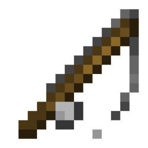 | if_player_cursor_item_equals | Cursor Item Is Equal To | Checks if the item at the player's cursor is equal to the selected item. | if_player |  |  | false | false | item | container | items: item comparison_mode: enum |
| 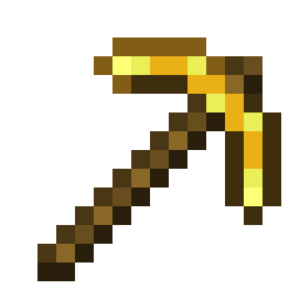 | if_player_gamemode_equals | Game Mode Equals | Checks if the player's gamemode is equal to the selected one. | if_player |  |  | false | false | misc | container | gamemode: enum |
|  | if_player_has_input | Movement Key Is Pressed | Checks whether the selected movement key is pressed for the player. | if_player |  |  | false | false | misc | container | input_type: enum |
|  | if_player_has_item | Has an Item | Checks if the player has an item in their inventory. | if_player |  |  | false | false | item | container | items: item check_mode: enum comparison_mode: enum |
|  | if_player_has_item_at_least | Has an Item in Quantity | Checks if a player has an item in a certain quantity. | if_player |  |  | false | false | item | container | item: item count: number comparison_mode: enum |
|  | if_player_has_item_in_slot | Has an Item In Slot | Checks if a player has an item in a specific inventory slot. | if_player |  |  | false | false | item | container | items: item slots: number comparison_mode: enum |
|  | if_player_has_potion_effect | Has Potion Effect | Checks if a player has the effect of a potion. | if_player |  |  | false | false | misc | container | potions: potion check_mode: enum |
| 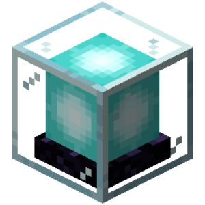 | if_player_has_privilege | Has Permission | Checks if a player has certain rights in the world. | if_player |  | If the "Check Accuracy" marker is enabled, building and development permissions will be checked even if the player is a world operator. | false | false | misc | container | privilege: enum exact: enum |
|  | if_player_has_room_for_item | Has a Room For Item | Checks if the player has room for one or more items in their inventory. | if_player |  |  | false | false | item | container | items: item check_mode: enum checked_slots: enum |
|  | if_player_hotbar_slot_equals | Hotbar Slot Equals | Checks if the player's current hotbar slot matches slot 1 to 9 in the chest. | if_player |  |  | false | false | misc | container | slot: number |
|  | if_player_in_area | Inside Region | Checks if the player is in a certain region. | if_player |  |  | false | false | location | container | location_1: location location_2: location ignore_y_axis: enum intersect_type: enum check_type: enum |
|  | if_player_inventory_menu_slot_equals | Inventory Slot Contains | Checks if a player with an open inventory currently has a specific item in a slot. | if_player |  |  | false | false | item | container | items: item slots: number comparison_mode: enum |
| 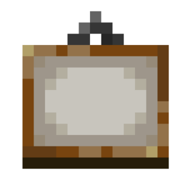 | if_player_inventory_type_open | Open Inventory Type Equals | Checks if a player's inventory type is open. | if_player |  |  | false | false | misc | container | inventory_type: enum |
|  | if_player_is_allow_server_listing | Is Allow Server Listing | Checks if the player enabled "Allow Server Listing" in settings. | if_player |  |  | false | false | toggleable | container |  |
| 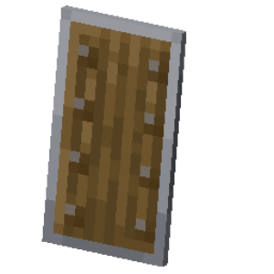 | if_player_is_blocking | Uses a Shield | Checks if the player is using a shield. | if_player |  |  | false | false | toggleable | container |  |
|  | if_player_is_disguised | Disguised for Everyone | Checks if the player is disguised to other players. | if_player |  |  | false | false | toggleable | container |  |
|  | if_player_is_flying | Flying | Checks if the player is flying. | if_player |  |  | false | false | toggleable | container |  |
|  | if_player_is_gliding | Gliding | Checks if the player is gliding on elytras. | if_player |  |  | false | false | toggleable | container |  |
|  | if_player_is_holding | Holding an Item | Checks if the player is holding an item in their hands. | if_player |  |  | false | false | item | container | items: item hand_slot: enum comparison_mode: enum |
| 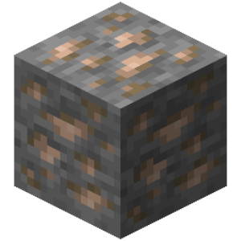 | if_player_is_looking_at_block | Looks at a Block | Checks if the player is looking at a specific block or location. | if_player |  |  | false | false | location | container | blocks: block locations: location distance: number fluid_mode: enum |
|  | if_player_is_near | Near Location | Checks if the player is near the specified location (Default: 5 blocks). | if_player |  |  | false | false | location | container | ignore_y_axis: enum location: location range: number |
|  | if_player_is_on_ground | Is On Ground | Checks if the player is not in the air. | if_player |  |  | false | false | toggleable | container |  |
|  | if_player_is_online_mode | Has a Premium Account | Checks if the player has a premium account. | if_player |  |  | false | false | toggleable | container |  |
|  | if_player_is_riding_entity | Riding an Entity | Checks if the player has ridden an entity (including vehicles). | if_player |  |  | false | false | misc | container | entity_ids: text compare_mode: enum |
| 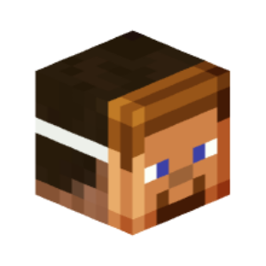 | if_player_is_self_disguised | Self Disguised | Checks if the player is disguised to himself. | if_player |  |  | false | false | toggleable | container |  |
|  | if_player_is_sleeping | Sleeping | Checks if the player is sleeping. | if_player |  |  | false | false | toggleable | container |  |
| 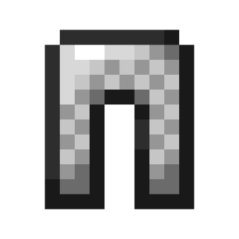 | if_player_is_sneaking | Sneaking | Checks if the player is sneaking. | if_player |  |  | false | false | toggleable | container |  |
|  | if_player_is_sprinting | Running | Checks if the player is running or using the sprint key when swimming. | if_player |  |  | false | false | toggleable | container |  |
| 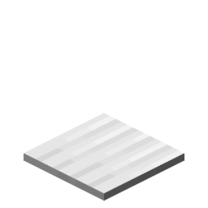 | if_player_is_standing_on_block | Standing on a Block | Checks if the player is standing on a block of a certain category or a certain location. | if_player |  |  | false | false | location | container | blocks: block locations: location only_solid: enum |
|  | if_player_is_swimming | Swimming | Checks if the player is swimming in water or lava. | if_player |  |  | false | false | toggleable | container |  |
|  | if_player_is_transferred | Player Transferred to Server | Checks if the player was transferred from another server. | if_player |  |  | false | false | toggleable | container |  |
| 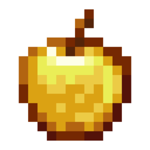 | if_player_is_using_item | Using Item | Checks if the player is using a bow, shield, or any other usable item. | if_player |  |  | false | false | item | container | items: item comparison_mode: enum |
|  | if_player_is_wearing_item | Wearing an Item | Checks if the player is wearing an item. | if_player |  |  | false | false | item | container | items: item check_mode: enum comparison_mode: enum |
|  | if_player_item_group_is_not_on_cooldown | creative_plus.action.if_player_item_group_is_not_on_cooldown.name | creative_plus.action.if_player_item_group_is_not_on_cooldown.description | if_player |  |  | false | false | item | container | item_keys: text check_mode: enum |
|  | if_player_item_is_not_on_cooldown | Item Has No Cooldown | Checks if the player's item has a cooldown applicable to a specific item type. | if_player |  |  | false | false | item | container | items: item check_mode: enum |
|  | if_player_name_equals | Name Equals | Checks if the player's name is equal to the name in the chest. | if_player |  |  | false | false | misc | container | names_or_uuids: text |
|  | if_player_text_filtering_enabled | Text Filtering Enabled | Checks if the player have Mojang word filters enabled. | if_player |  |  | false | false | toggleable | container |  |
|  | player_add_inventory_menu_row | Add Inventory Menu Row | Adds a row with the specified items to the "Chest" type inventory. | player |  |  | false | false | inventory_menus | basic | items: item position: enum |
| 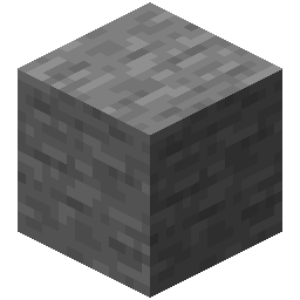 | player_allow_placing_breaking_blocks | creative_plus.action.player_allow_placing_breaking_blocks.name | creative_plus.action.player_allow_placing_breaking_blocks.description | player |  |  | true | false | settings | basic | allow: enum blocks: block |
| 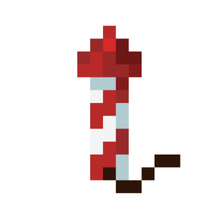 | player_boost_elytra | Boost Elytra | Accelerates the flight of an Elytra player with the power of the specified firework. | player |  |  | false | false | movement | basic | firework: item |
|  | player_clear_active_item | Interrupt Item Use | Interrupts the use of the current item. | player |  |  | false | false | item_management | basic |  |
|  | player_clear_chat | Clear Chat | Clears all messages from the selected player's chat window. | player |  |  | false | false | communication | basic |  |
|  | player_clear_debug_markers | Clear Debug Markers | Removes all debug markers for the player. | player |  |  | false | false | world | basic |  |
| 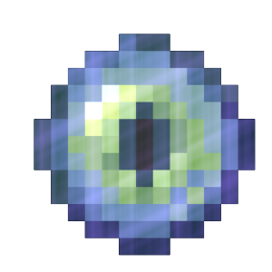 | player_clear_ender_chest_contents | Clear Ender Chest Contents | Clears items in a player's Ender Chest inventory. | player |  |  | false | false | item_management | basic |  |
|  | player_clear_inventory | Clear Inventory | Clears the player's inventory. | player |  |  | false | false | item_management | basic | clear_mode: enum |
|  | player_clear_items | Clear Items | Removes all selected items from the player's inventory. | player |  |  | false | false | item_management | basic | items: item |
|  | player_clear_potion_effects | Clear Effects | Clears all player effects. | player |  |  | false | false | parameters | basic |  |
| 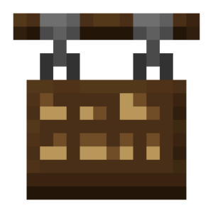 | player_close_dialog_menu | Close Dialog Menu | Closes the current dialog menu for the player. | player |  |  | false | false | communication | basic |  |
| 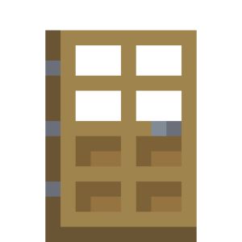 | player_close_inventory | Close Inventory Menu | Closes a player's opened inventory menu. | player |  |  | false | false | inventory_menus | basic |  |
| 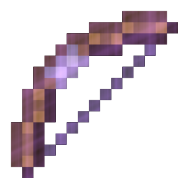 | player_complete_using_active_item | Complete Item Use | Completes the use of the current item in hand with a result. | player |  |  | false | false | item_management | basic |  |
|  | player_connect_to_server | Send Player to Another Server | Sends the player to the server with the specified name (e.g. "cr-0"). | player |  |  | false | false | miscellaneous | basic | server_name: text |
|  | player_damage | Deal Damage | Deals damage to a player. | player |  |  | false | false | parameters | basic | damage: number source: text |
|  | player_disguise_as_block | Disguise as Block | Maxes the player under the selected block. | player |  |  | false | false | appearance | basic | block: block visible_to_self: enum |
|  | player_disguise_as_entity | Disguise as Entity | Maximizes the player to the selected entity. | player |  |  | false | false | appearance | basic | entity_type: item visible_to_self: enum |
| 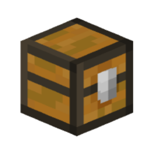 | player_disguise_as_item | Disguise player as item | Maxes the player as an item. | player |  |  | false | false | appearance | basic | item: item visible_to_self: enum |
|  | player_display_bell_ring | Display Bell Ring | Displays the Bell ringing animation. | player | Bell | The "Down" direction stops the punch animation. | false | false | world | basic | location: location direction: enum |
| 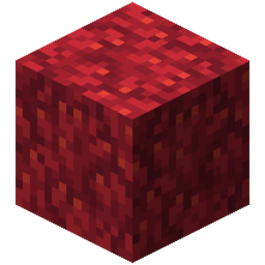 | player_display_block | Display Block | Display a block to a player without affecting other players. | player |  |  | false | false | world | basic | location: location block: block |
|  | player_display_end_gateway_beam | Display End Gateway Beam Animation | Displays an End Gateway beam animation at a specific location. | player |  |  | false | false | world | basic | location: location color: enum |
|  | player_display_hologram | Display Hologram | Shows the player a hologram. To remove a hologram at a location, leave the text blank. | player |  | To wrap text on a new line, use "\n", eg : "Line1\nLine2". | false | false | world | basic | location: location text: text |
| 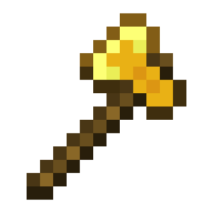 | player_display_lightning | Display Lightning Effect | Display lightning to the player without showing it to other players or setting the area on fire. | player |  |  | false | false | particle | basic | location: location |
| 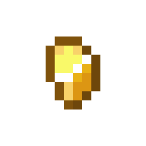 | player_display_particle | Display Particle Effect | Displays the particle effect at the selected location to the player. | player |  |  | false | false | particle | basic | particle: particle location: location |
|  | player_display_particle_circle | Display Particle Circle | Shows a player a circle out of particles with given parameters. | player |  |  | false | false | particle | basic | particle: particle center: location radius: number points: number start_angle: number perpendicular: vector angle_unit: enum |
| 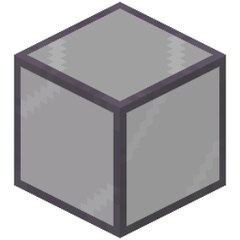 | player_display_particle_cube | Display Particle Cube | Displays a particle cuboid to the player. | player |  |  | false | false | particle | basic | particle: particle first_corner: location second_corner: location spacing: number type: enum |
| 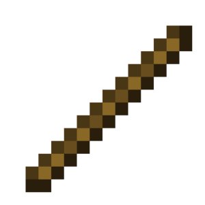 | player_display_particle_line | Display Particle Line | Displays a particle effect line to the player from the start location to the end location at a specified distance. | player |  |  | false | false | particle | basic | particle: particle start: location end: location divider: number unit_of_measurement: enum |
|  | player_display_particle_ray | Display Particle Ray | Displays a particle effect ray to the player from the starting location along the specified vector with the specified distance. | player |  |  | false | false | particle | basic | particle: particle start: location ray: vector divider: number unit_of_measurement: enum |
| 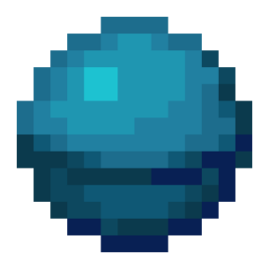 | player_display_particle_sphere | Display Particle Sphere | Displays a particle sphere to the player. | player |  |  | false | false | particle | basic | particle: particle center: location radius: number points: number |
| 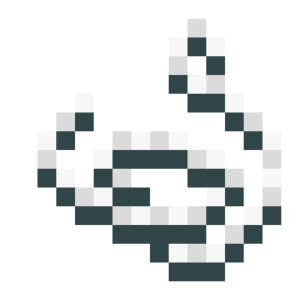 | player_display_particle_spiral | Display Particle Spiral | Displays a particle spiral to the player. | player |  |  | false | false | particle | basic | particle: particle center: location distance: number radius: number points: number rotations: number start_angle: number angle_unit: enum |
|  | player_display_pick_up_animation | Show Pick Up Animation | Shows the player a pickup animation. | player |  | This action works with any entity, not just the player. | false | false | world | basic | collected_name_or_uuid: text collector_name_or_uuid: text amount: number |
|  | player_display_sign_text | Display Sign Text | Show the sign's text change to the player without changing its text for other players. | player |  |  | false | false | world | basic | location: location line_1: text line_2: text line_3: text line_4: text side: enum |
| 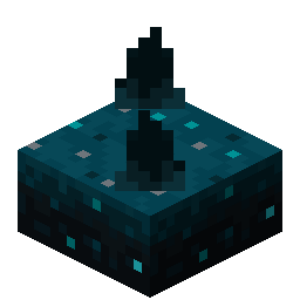 | player_display_vibration | Display Vibration Particle | Displays to the player a particle of vibration moving from one point to another. | player |  |  | false | false | particle | basic | from: location to: location destination_time: number |
|  | player_expand_inventory_menu | Expand Inventory Menu | Expands the player's opened inventory menu by the selected number of lines and populates it with the specified items. | player |  |  | false | false | inventory_menus | basic | items: item size: number |
|  | player_face_location | Turn to Location | Turns the player towards the location. | player |  |  | false | false | movement | basic | location: location |
| 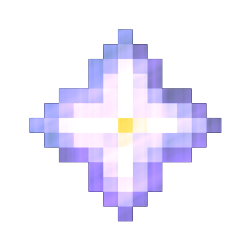 | player_get_attribute | Get Player Attribute Value | Gets the value of the specified player attribute and assigns the result to a variable. | player |  |  | false | false | parameters | basic | variable: variable attribute_type: enum return_value: enum |
|  | player_get_nbt | Get Player NBT Tags | Gets the NBT tags of a player at the specified path and assigns the result to a variable. | player |  |  | false | false | miscellaneous | basic | variable: variable path: text value_type: enum |
|  | player_give_experience | Give Experience | Gives a player an experience. | player |  |  | false | false | parameters | basic | experience: number mode: enum |
| 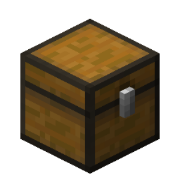 | player_give_items | Give Item | Gives players items from a chest. | player |  |  | false | false | item_management | basic | items: item amount: number |
|  | player_give_potion_effect | Give Potion Effect | Gives the selected effects to a player. | player |  |  | false | false | parameters | basic | potions: potion overwrite: enum show_icon: enum particle_mode: enum |
| 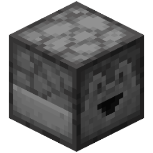 | player_give_random_item | Give a Random Item | Gives a player a random item or a stack of items in a chest. | player |  |  | false | false | item_management | basic | items: item |
|  | player_heal | Heal Player | Heals a player. | player |  |  | false | false | parameters | basic | heal: number |
| 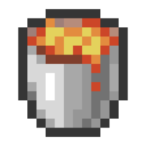 | player_hide_custom_recipe | Hide custom recipe | Hide recipe from player. | player |  |  | false | false | miscellaneous | basic | names: text is_vanilla_recipe: enum |
|  | player_hide_entity | Hide Entity From Player | Hides the specified entity from the player. | player |  |  | false | false | world | basic | name_or_uuid: text hide: enum |
|  | player_hide_scoreboard | Hide Scoreboard | Hides the player's current scoreboard. | player |  |  | false | false | miscellaneous | basic |  |
|  | player_kick | Kick Player | Kicks the player out of the world. | player |  |  | false | false | miscellaneous | basic |  |
| 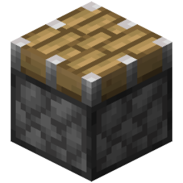 | player_launch_forward | Launch Forward | Launches the player forward or backward in the direction they are looking, depending on their strength. | player |  |  | false | false | movement | basic | power: number increment: enum launch_axis: enum |
|  | player_launch_projectile | Launch Projectile | Launch a projectile from the player's location. | player |  |  | false | false | world | basic | projectile: item location: location name: text speed: number inaccuracy: number trail: particle |
|  | player_launch_to_location | Launch to Location | Launches the player to the selected location. | player |  |  | false | false | movement | basic | location: location power: number increment: enum |
|  | player_launch_up | Launch Up | Tosses the player up or down based on strength. | player |  |  | false | false | movement | basic | power: number increment: enum |
|  | player_leave_vehicle | Dismount | Dismounts a player from a vehicle or entity. | player |  |  | false | false | movement | basic |  |
| 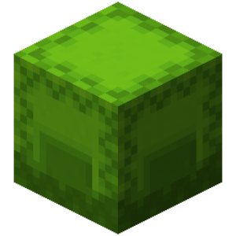 | player_load_inventory | Load Saved Inventory | Loads the selected saved inventory. | player |  |  | false | false | item_management | basic |  |
| 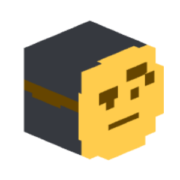 | player_mimic_disguise_from_entity | Disguise Player as World Entity | Disguises the player as the specified entity from the world. | player |  |  | false | false | appearance | basic | name_or_uuid: text include_disguise: enum disguise: enum remove_original_entity: enum |
|  | player_open_book | Open Book | Opens a book to a specific player. | player |  |  | false | false | communication | basic | book: item |
|  | player_open_container_inventory | Open Container Menu | Opens the block menu for the player at the specified location. | player |  |  | false | false | inventory_menus | basic | location: location |
| 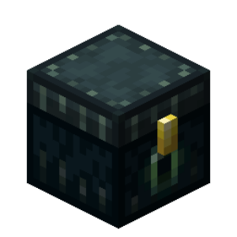 | player_open_ender_chest | Open Ender Chest | Opens the Ender Chest for the player. | player |  |  | false | false | inventory_menus | basic |  |
|  | player_open_working_menu | Open Working Menu | Opens a functional menu for the player. | player |  |  | false | false | inventory_menus | basic | title: text menu_type: enum |
|  | player_play_animation_action | Play Animation to Player | Plays a specific animation for the player. | player |  |  | false | false | appearance | basic | animation: enum |
|  | player_play_hurt_animation | Play Hurt Animation | Plays a hurt animation for the player with a given angle. | player |  |  | false | false | appearance | basic | yaw: number |
|  | player_play_sound | Play Sound | Plays a sound to the player. | player |  |  | false | false | communication | basic | sound: sound location: location |
| 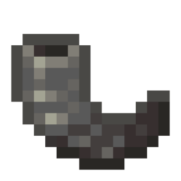 | player_play_sound_from_entity | Play sound from entity | Plays a sound from the specified entity to the player. | player |  | Stereo sounds will not play. | false | false | communication | basic | sounds: sound name_or_uuid: text |
| 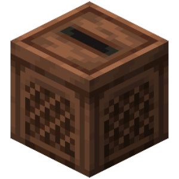 | player_play_sound_sequence | Play Sound Sequence | Plays a sequence of sounds to the player with a delay between each sound. | player |  |  | false | false | communication | basic | sounds: sound delay: number location: location |
| 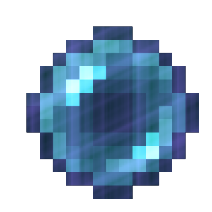 | player_randomized_teleport | Randomized Teleport | Teleports the player to a random location. | player |  |  | false | false | movement | basic | locations: location keep_rotation: enum keep_velocity: enum dismount: enum |
|  | player_redirect_world | Send to Another World | Redirects the player to the world with the given ID. | player |  |  | false | false | miscellaneous | basic | world_id: text |
| 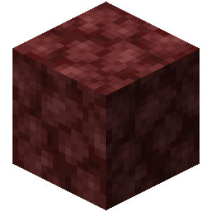 | player_remove_boss_bar | Remove Boss Bar | Removes an existing boss bar from a specific player. | player |  |  | false | false | communication | basic | id: text |
|  | player_remove_disguise | Remove Disguise | Removes a player's disguise. | player |  |  | false | false | appearance | basic |  |
| 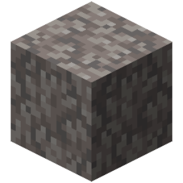 | player_remove_display_blocks | Remove Display Blocks | Removes all client-sided display blocks (maximum size: 500). | player |  |  | false | false | world | basic | pos_1: location pos_2: location |
| 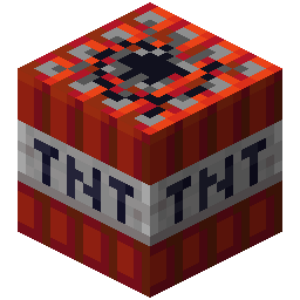 | player_remove_inventory_menu_row | Remove Inventory Menu Rows | Removes one or more rows from the "Chest" inventory. | player |  |  | false | false | inventory_menus | basic | size: number position: enum |
|  | player_remove_items | Remove Items | Removes the specified items from the player's inventory. | player |  |  | false | false | item_management | basic | items: item |
|  | player_remove_pose | Reset Player Pose | Resets a player's pose. | player |  |  | false | false | appearance | basic |  |
|  | player_remove_potion_effect | Remove Potion Effect | Removes the selected effects from a player. | player |  |  | false | false | parameters | basic | potions: potion |
|  | player_remove_self_disguise | Remove Self Disguise | Removes a player's disguise that only they can see. | player |  |  | false | false | appearance | basic |  |
|  | player_remove_skin | Clear Skin | Returns the normal skin of the event target. | player |  |  | false | false | appearance | basic |  |
| 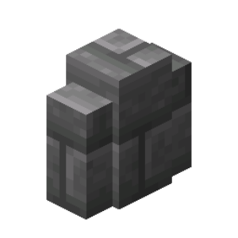 | player_remove_world_border | Remove World Border | Set the player's world border to the default value. | player |  |  | false | false | world | basic |  |
| 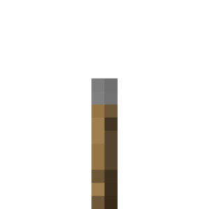 | player_replace_items | Replace Items | Replaces the specified items in the inventory with a specific item. | player |  |  | false | false | item_management | basic | items: item replace: item count: number |
| 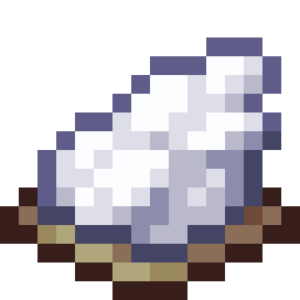 | player_reset_waypoint_color | Reset Waypoint Icon Color | Resets the color of the icon displayed on the player's location bar to the default. | player |  | For this action to work, the "Location Bar Visibility" game rule must be enabled. | false | false | settings | basic |  |
| 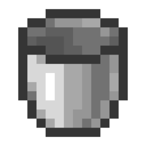 | player_reset_weather | Reset Weather | Resets player weather | player |  |  | false | false | world | basic |  |
|  | player_ride_entity | Ride an Entity | Rides the player on an entity or another player. | player |  |  | false | false | movement | basic | name_or_uuid: text |
| 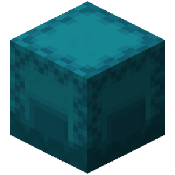 | player_save_inventory | Save Current Inventory | Saves the player's current inventory. It can be loaded later using 'Load Saved Inventory'. | player |  |  | false | false | item_management | basic |  |
| 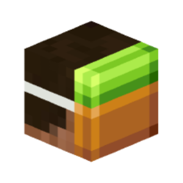 | player_self_disguise_as_block | Disguise Self as a Block | Disguises the player as a block, but this disguise is only visible to that player. | player |  |  | false | false | appearance | basic | block: block |
| 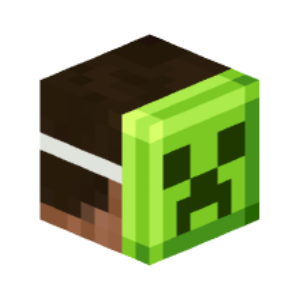 | player_self_disguise_as_entity | Disguise Self as an Entity | Maximizes the player as an entity, but this disguise is only visible to that player. | player |  |  | false | false | appearance | basic | entity_type: item |
|  | player_self_disguise_as_item | Disguise Self As Item | Disguises the player as an item onto to themself. | player |  |  | false | false | appearance | basic | item: item |
| 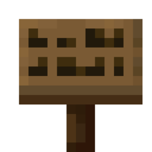 | player_send_action_bar | Send Action Bar Message | Shows an action bar to the selected player. | player |  |  | false | false | communication | basic | messages: text merging: enum |
|  | player_send_advancement | Send an Advancement to a Player | Shows a player a custom advancement popup. | player |  |  | false | false | communication | basic | frame: enum name: text icon: item |
|  | player_send_break_animation | Show Block Break Animation | Shows a block breaking animation for the player without affecting other players. | player |  |  | false | false | world | basic | locations: location stage: number |
|  | player_send_dialogue | Dialogue | Sends multiple chat messages to selected players with a delay after each message. | player |  |  | false | false | communication | basic | messages: text delay: number |
|  | player_send_hover | Send Hover Message | Sends a message to the selected player. When a player 'hovers' over it, a second message appears. | player |  |  | true | false | communication | basic | message: text hover: text |
|  | player_send_message | Send Message | Sends a message to the chat to the specified players. | player |  |  | false | false | communication | basic | messages: text merging: enum |
|  | player_send_minimessage | Send a MiniMessage | Sends a MiniMessage message to a player. | player |  |  | true | false | communication | basic | minimessage: text |
| 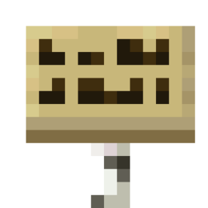 | player_send_title | Send Title | Shows two captions to the screen for the selected player - a title and a subtitle. | player |  |  | false | false | communication | basic | title: text subtitle: text fade_in: number stay: number fade_out: number |
| 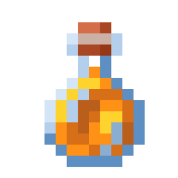 | player_set_absorption_health | Set Bonus Health | Sets a player's bonus health. | player |  |  | false | false | parameters | basic | health: number |
|  | player_set_air_ticks | Set Remaining Air | Sets the player's remaining air. | player |  |  | false | false | parameters | basic | ticks: number |
|  | player_set_allow_flying | Set Player Flying Permission | Sets the flying permission for the player. | player |  |  | false | false | settings | basic | allow_flying: enum |
|  | player_set_armor | Set Armor | Sets the player's armor. | player |  |  | false | false | item_management | basic | helmet: item chestplate: item leggings: item boots: item |
|  | player_set_arrows_in_body | Set Arrows On Player | Displays a set number of arrows on the player. | player |  |  | false | false | appearance | basic | amount: number |
|  | player_set_attack_speed | Set Attack Speed | Sets the player's attack speed. | player |  |  | false | false | parameters | basic | speed: number |
|  | player_set_attribute | Set Attribute | Sets the specified attribute of a player. | player |  |  | false | false | parameters | basic | value: number attribute_type: enum |
|  | player_set_bee_stingers_in_body | Set Bee Stingers On Player | Displays a set number of bee stingers on the player. | player |  |  | false | false | appearance | basic | amount: number |
|  | player_set_block_opened_state | Open/Close Block | Display block opening/closing to the player without changing the block state for other players. | player | Chest Trap Chest Ender Chest Shulker Boxes Barrel |  | false | false | world | basic | location: location is_opened: enum |
|  | player_set_boss_bar | Set Boss Bar | Sets a custom boss bar for a specific player. | player |  |  | false | false | communication | basic | id: text title: text progress: number color: enum style: enum sky_effect: enum |
|  | player_set_chat_completions | Modify Chat Suggestions | Modifies the player's auto-completion suggestions shown when typing in chat. | player |  |  | false | false | communication | basic | completions: text setting_mode: enum |
|  | player_set_collidable | Set Collidable Mode | Sets the player's creature collision mode. | player |  |  | false | false | settings | basic | collidable: enum |
|  | player_set_compass_target | Set Compass Target | Sets the player's compass target in which direction the compass needle will point. | player |  |  | false | false | world | basic | location: location |
|  | player_set_cursor_item | Set Item on Cursor | Sets an item on the player's cursor. | player |  |  | false | false | item_management | basic | item: item |
|  | player_set_death_drops | Set Death Drops | Sets items dropped from a player upon death. | player |  |  | false | false | settings | basic | death_drops: enum |
|  | player_set_death_screen_score | Set Score Count | Sets the score count displayed to the player on the death screen. | player |  | After the value is set, the score count still changes when the player gains experience. | false | false | parameters | basic | score: number |
|  | player_set_default_visible | Set Visibility | Sets the player's visibility. | player |  |  | false | false | settings | basic | default_visible: enum |
|  | player_set_enchantment_seed | Set Enchantment Seed | Sets the player's enchantment seed, which determines the set of enchantments in the enchanting table. | player |  |  | false | false | parameters | basic | seed: number |
|  | player_set_ender_chest_contents | Set Ender Chest Contents | Sets items in the player's Ender Chest inventory. | player |  |  | false | false | item_management | basic | items: item |
|  | player_set_entity_glowing | Set Entity Glowing | Toggles entity glowing effect for a player. | player |  |  | false | false | world | basic | name_or_uuid: text color: enum glow: enum |
|  | player_set_equipment | Set Equipment | Sets an item to one of player's equipment slots (armor and items in hand). | player |  |  | false | false | item_management | basic | item: item slot: enum |
|  | player_set_exhaustion | Set Exhaustion Level | Sets the exhaustion level of the player. | player |  |  | false | false | parameters | basic | exhaustion: number mode: enum |
|  | player_set_experience | Set Experience | Sets a player's level. | player |  |  | false | false | parameters | basic | experience: number mode: enum |
|  | player_set_fall_distance | Set Fall Distance | Sets the distance at which the player falls. | player |  |  | false | false | parameters | basic | distance: number |
|  | player_set_fire_ticks | Set Player on Fire | Sets a player on fire for the selected amount of time. | player |  |  | false | false | parameters | basic | ticks: number |
|  | player_set_flying | Set Flying | Sets the player's flying state. | player |  |  | false | false | movement | basic | is_flying: enum |
|  | player_set_fog_distance | Set Fog Distance | Sets the chunk draw distance for the player. The value "-1" resets to standard. | player |  |  | false | false | world | basic | distance: number |
|  | player_set_food | Set Hunger | Sets a player's hunger level. | player |  |  | false | false | parameters | basic | food: number mode: enum |
|  | player_set_freeze_ticks | Set Freeze Time | Sets the player's freeze time (the number of ticks the player has spent in powder snow). | player |  |  | false | false | parameters | basic | ticks: number ticking_locked: enum |
|  | player_set_gamemode | Set Game Mode | Sets the game mode for the player. | player |  |  | false | false | settings | basic | gamemode: enum flight_mode: enum |
|  | player_set_gliding | Set Elytra Flying | Sets the player's elytra flying state. | player |  |  | false | false | movement | basic | is_gliding: enum |
|  | player_set_health | Set Player Health | Sets a player's health to the selected amount. | player |  |  | false | false | parameters | basic | health: number |
|  | player_set_hotbar_slot | Set Hotbar Slot | Sets the selected slot to a player. | player |  |  | false | false | parameters | basic | slot: number |
|  | player_set_instant_respawn | Set Instant Respawn | Sets an instant respawn for a player. | player |  |  | false | false | settings | basic | instant_respawn: enum |
|  | player_set_inventory_kept | Set Keep Inventory | Sets the player to keep their inventory on death. | player |  |  | false | false | settings | basic | kept: enum |
|  | player_set_inventory_menu_custom_id | Set Open Inventory Custom ID | Sets a custom ID for the player's open inventory menu. | player |  |  | false | false | inventory_menus | basic | custom_id: text |
|  | player_set_inventory_menu_item | Set Item Into Inventory Slot | Sets an item to the specified slot in the player's open inventory menu. | player |  |  | false | false | inventory_menus | basic | item: item slot: number |
|  | player_set_inventory_menu_name | Set Inventory Menu Name | Sets a new name for the player's opened inventory menu. | player |  |  | false | false | inventory_menus | basic | text: text |
|  | player_set_invulnerability_ticks | Set Invulnerability Duration | Sets the invulnerability duration for the player. | player |  |  | false | false | parameters | basic | ticks: number |
|  | player_set_item_cooldown | Set Item Cooldown | Applies a cooldown visual effect to all items of the selected type. | player |  |  | false | false | item_management | basic | item: item cooldown: number sound: sound |
|  | player_set_item_group_cooldown | Set Item Group Cooldown | Applies the cooldown visual effect to all items in the specified group. | player |  |  | false | false | item_management | basic | key: text cooldown: number |
|  | player_set_items | Set Items | Sets a player's inventory accordingly to items from the chest. | player |  |  | false | false | item_management | basic | items: item |
|  | player_set_max_health | Set Player Max Health | Sets a player's maximum health. | player |  |  | false | false | parameters | basic | health: number heal: enum |
|  | player_set_max_invulnerability_ticks | Set Max Invulnerability | Sets the max invulnerability ticks. | player |  |  | false | false | parameters | basic | ticks: number |
|  | player_set_movement_speed | Set Movement Speed | Sets the player's movement speed. | player |  |  | false | false | parameters | basic | distance: number movement_type: enum |
|  | player_set_nametag_visible | Set Nickname Visible | Display or hide the nickname above the head. | player |  |  | false | false | settings | basic | visible: enum |
|  | player_set_player_list_info | Set Player Tab List Text | Sets the text above or below the player list for a player. | player |  |  | false | false | communication | basic | text: text position: enum merging: enum |
|  | player_set_pose | Set Player Pose | Sets a specific player pose. | player |  |  | false | false | appearance | basic | pose: enum locked: enum |
|  | player_set_pvp | Set PVP Enabled | Sets the player's permission to attack and damage other players. | player |  |  | false | false | settings | basic | pvp: enum |
|  | player_set_rain_level | Set Rain Level | Sets player's level of rain | player |  |  | false | false | world | basic | rain_level: number |
|  | player_set_rotation | Set Rotation | Sets the player's rotation. | player |  |  | false | false | movement | basic | yaw: number pitch: number |
|  | player_set_rotation_by_vector | Set Rotation By Vector | Sets player rotation by vector. | player |  |  | false | false | movement | basic | vector: vector |
|  | player_set_saturated_regen_rate | Set Saturated Regeneration Rate | Sets the player's health regeneration rate while saturated. | player |  | The default value is 10. | false | false | parameters | basic | rate: number |
|  | player_set_saturation | Set Saturation | Sets a player's secondary hunger level (saturation). | player |  |  | false | false | parameters | basic | saturation: number mode: enum |
|  | player_set_simulation_distance | Set Simulation Distance | Sets the chunk simulation distance for the player. | player |  |  | false | false | world | basic | distance: number |
|  | player_set_skin | Set Skin | Sets the specified player's skin for the target of the event. | player |  |  | false | false | appearance | basic | name_or_uuid: text server_type: enum |
|  | player_set_slot_item | Set Item In Slot | Sets an item to a slot in a player's inventory. | player |  |  | false | false | item_management | basic | item: item slot: number |
|  | player_set_spawn_point | Set Spawn Location | Sets the player to a new spawn location. | player |  |  | false | false | settings | basic | spawn_point: location |
|  | player_set_starvation_rate | Set Starvation Rate | Sets the player's starvation rate. | player |  | The default value is 80. | false | false | parameters | basic | rate: number |
|  | player_set_thunder_level | Set Thunder Level | Sets player's level of thunder | player |  | Rainy weather is required to set thunder level | false | false | world | basic | thunder_level: number |
|  | player_set_tick_rate | Set Tick Rate | Sets the player's tick rate. | player |  |  | false | false | world | basic | tick_rate: number |
|  | player_set_time | Set Player Time | Set a player's time without changing it for other players. | player |  |  | false | false | world | basic | time: number |
|  | player_set_unsaturated_regen_rate | Set Unsaturated Regeneration Rate | Sets the player's health regeneration rate while unsaturated. | player |  | The default value is 80. | false | false | parameters | basic | rate: number |
|  | player_set_velocity | Set Velocity | Launches the player along the specified vector. | player |  |  | false | false | movement | basic | velocity: vector increment: enum |
|  | player_set_visual_fire | Set Visual Fire | Sets the player to a burning effect. | player |  |  | false | false | appearance | basic | visual_fire: enum |
|  | player_set_waypoint_color | Set Waypoint Icon Color | Sets the color of the icon displayed on the player's location bar. | player |  | For this action to work, the "Location Bar Visibility" game rule must be enabled. | false | false | settings | basic | red: number green: number blue: number |
|  | player_set_waypoint_style | Set Waypoint Icon Style | Sets the icon style displayed on the player's location bar. | player |  |  | false | false | settings | basic | style: text |
|  | player_set_weather | Set Weather | Set player weather without affecting other players. | player |  |  | false | false | world | basic | weather_type: enum |
|  | player_set_world_border | Set World Border | Set the world border for a player without changing it for other players. | player |  |  | false | false | world | basic | center: location size: number warning: number |
|  | player_shift_world_border | Shift World Border | Move the world border for the player without changing it for other players. | player |  |  | false | false | world | basic | old_size: number size: number time: number |
|  | player_show_custom_recipe | Show custom recipe | Displays a new recipe to the player in the recipe book. | player |  |  | false | false | miscellaneous | basic | names: text is_vanilla_recipe: enum |
|  | player_show_debug_marker | Show Debug Marker | Shows the player a debug marker at the location at the specified time. Red and blue colors work for players on version 1.19.4 and above. | player |  | Leave the "Display Name" argument blank to hide the name completely. | false | false | world | basic | location: location name: text duration: number red: number green: number blue: number alpha: number |
|  | player_show_demo_screen | Show Demo Screen | Shows the demo screen to the player. | player |  |  | false | false | communication | basic |  |
|  | player_show_dialog_menu_from_nbt | Show Dialog Menu | Shows a dialog menu to the player from NBT tags. | player |  |  | false | false | communication | basic | dialog_nbt: text |
|  | player_show_inventory_menu | Show Inventory Menu | Shows the player an inventory menu with selected items and title. | player |  |  | false | false | inventory_menus | basic | items: item name: text custom_id: text inventory_type: enum |
|  | player_show_scoreboard | Show Scoreboard | Displays a specific scoreboard to a player. The specified scoreboard must have at least one value to be displayed. | player |  |  | false | false | miscellaneous | basic | id: text |
|  | player_show_win_screen | Show Credits Screen | Shows the player the credits screen. | player |  |  | false | false | communication | basic |  |
|  | player_spectate_target | Spectate Target | Sets the player's spectate target in spectator mode. | player |  |  | false | false | movement | basic | name_or_uuid: text |
|  | player_start_using_item | Start Using Item | Starts using the item in the specified hand. | player |  |  | false | false | item_management | basic | equipment: enum |
|  | player_stop_sound | Stop Sound | Stops all or certain sounds for the player. | player |  |  | false | false | communication | basic | sounds: sound |
|  | player_stop_sounds_by_source | Stop Sounds By Source | Stops all sounds from the specified source. | player |  |  | false | false | communication | basic | source: enum |
|  | player_swing_hand | Play Swing Hand Animation | Plays a swinging hand animation for the player. | player |  |  | false | false | appearance | basic | hand_type: enum |
|  | player_teleport | Teleport | Teleports the player to the selected location. | player |  | Closes an open inventory menu. | false | false | movement | basic | location: location keep_rotation: enum keep_velocity: enum dismount: enum |
|  | player_teleport_sequence | Teleport Sequence | Teleports the player between locations with the specified delay. | player |  |  | false | false | movement | basic | delay: number locations: location |
|  | player_transfer_to_other_server | Transfer to Another Server | Transfers the player to the specified server. | player |  | If the "Server Port" argument is left empty, the default port (25565) will be used. | false | false | miscellaneous | basic | domain: text port: number |
|  | send_currency_transaction | Request Transaction | Sends the player a request to make a transaction in emeralds. | player |  |  | false | false | miscellaneous | basic | amount: number description: text reason: text |
