# Variable actions

| Icon | ID | Name | Description | Category/Subcategory | Arguments | Works with | Additional info | Unused/Deprecated |
| --- | --- | --- | --- | --- | --- | --- | --- | --- |
| 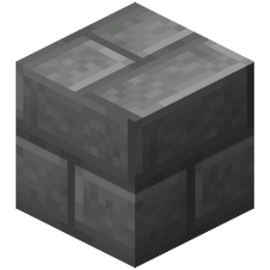 | if_variable_block_equals | creative_plus.action.if_variable_block_equals.name | creative_plus.action.if_variable_block_equals.description | if_variable | value: block compare: block |  |  | false/false |
|  | if_variable_block_is_minecraft_tagged | Block Has Minecraft Tag | Checks whether the block has the specified Minecraft tag (e.g. "mineable/shovel"). | if_variable | block: block namespace: text |  | The Minecraft tag must start with "#minecraft:" | false/false |
|  | if_variable_block_is_solid | Block Is Solid | Checks if the specified block is solid. | if_variable | block: block |  |  | false/false |
|  | if_variable_equals | Equals | Checks if a variable is equal to at least one of the compared values. | if_variable | value: any compare: any compare_type: enum &nbsp;&nbsp;- ANY &nbsp;&nbsp;- ALL |  |  | false/false |
|  | if_variable_exists | Variable Exists | Checks if the selected variable exists. | if_variable | variable: variable compare_type: enum &nbsp;&nbsp;- ANY &nbsp;&nbsp;- ALL |  |  | false/false |
| 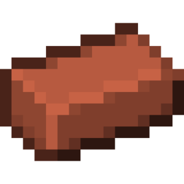 | if_variable_greater | Greater | Checks if a numeric variable is greater than the specified value. | if_variable | value: number compare: number |  |  | false/false |
|  | if_variable_greater_or_equals | Greater or Equals | Checks if a numeric variable is greater than or equal to the specified value. | if_variable | value: number compare: number |  |  | false/false |
|  | if_variable_in_range | In Range | Checks if a variable is in the specified range. | if_variable | value: any min: any max: any |  |  | false/true |
| 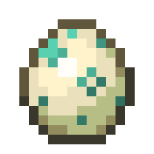 | if_variable_is_type | Variable Type Equals | Checks if a variable's value type is equal to the specified one. | if_variable | value: any variable_type: enum &nbsp;&nbsp;- NUMBER &nbsp;&nbsp;- TEXT &nbsp;&nbsp;- LOCATION &nbsp;&nbsp;- ITEM &nbsp;&nbsp;- POTION &nbsp;&nbsp;- SOUND &nbsp;&nbsp;- PARTICLE &nbsp;&nbsp;- VECTOR &nbsp;&nbsp;- ARRAY &nbsp;&nbsp;- MAP compare_type: enum &nbsp;&nbsp;- ANY &nbsp;&nbsp;- ALL |  |  | false/false |
|  | if_variable_item_equals | Item Equals | Checks if an item variable is equal to at least one of the specified ones. | if_variable | value: item compare: item comparison_mode: enum &nbsp;&nbsp;- EXACTLY &nbsp;&nbsp;- IGNORE_STACK_SIZE &nbsp;&nbsp;- IGNORE_DURABILITY_AND_STACK_SIZE &nbsp;&nbsp;- TYPE_ONLY |  |  | false/false |
|  | if_variable_item_has_enchantment | Item Has Enchantment | Checks if an item have a specific enchantment of a specific level. | if_variable | item: item enchant: text level: number enchantment_type: enum &nbsp;&nbsp;- NORMAL &nbsp;&nbsp;- STORED &nbsp;&nbsp;- BOTH |  |  | false/false |
|  | if_variable_item_has_stored_enchantment | Item Has Stored Enchantment | Checks if the item has the specified stored enchantment at the specified level. | if_variable | item: item enchant: text level: number |  |  | false/true |
|  | if_variable_item_has_tag | Item Has Custom Tag | Checks if an item variable has the specified tag with the selected value. | if_variable | item: item tag: text value: text compare_type: enum &nbsp;&nbsp;- EQUALS &nbsp;&nbsp;- CONTAINS &nbsp;&nbsp;- STARTS_WITH &nbsp;&nbsp;- ENDS_WITH |  |  | false/false |
| 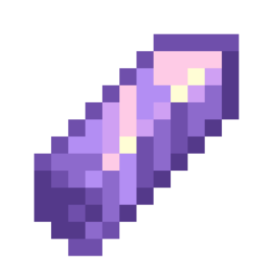 | if_variable_item_is_block | Item Is Block | Checks if the provided item is a block. | if_variable | item: item |  |  | false/false |
|  | if_variable_item_is_minecraft_tagged | Item Has Minecraft Tag | Checks whether the item has the specified Minecraft tag (e.g. "swords"). | if_variable | item: item namespace: text |  | The Minecraft tag must start with "#minecraft:" | false/false |
|  | if_variable_less | Less | Checks if a numeric variable is less than the specified value. | if_variable | value: number compare: number |  |  | false/false |
| 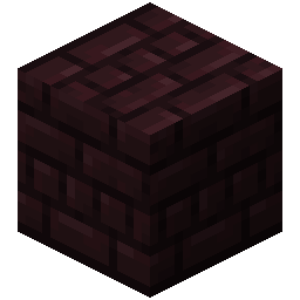 | if_variable_less_or_equals | Less or Equals | Checks if a numeric variable is less than or equal to the specified value. | if_variable | value: number compare: number |  |  | false/false |
|  | if_variable_list_contains_value | List Contains Value | Checks if a list contains a specific value. | if_variable | list: array values: any check_mode: enum &nbsp;&nbsp;- ANY &nbsp;&nbsp;- ALL |  |  | false/false |
|  | if_variable_list_is_empty | Value Is Empty | Checks if the size of a value is zero. | if_variable | list: any compare_type: enum &nbsp;&nbsp;- ANY &nbsp;&nbsp;- ALL | Text Lists Dictionaries Items Non-Existent Variables Empty Values |  | false/false |
|  | if_variable_list_value_equals | List Value Equals | Checks if the value of a list item is equal to at least one value being compared. | if_variable | list: array index: number values: any |  |  | false/false |
|  | if_variable_location_in_range | Location In Range | Checks if the location is in the specified range. | if_variable | value: location min: location max: location border_handling: enum &nbsp;&nbsp;- EXACT &nbsp;&nbsp;- BLOCK &nbsp;&nbsp;- FULL_BLOCK_RANGE |  |  | false/false |
|  | if_variable_location_is_near | Near Location | Checks if a location variable is near the specified location. | if_variable | location: location radius: number check: location shape: enum &nbsp;&nbsp;- SPHERE &nbsp;&nbsp;- CIRCLE &nbsp;&nbsp;- CUBE &nbsp;&nbsp;- SQUARE |  |  | false/false |
|  | if_variable_map_has_key | Dictionary Has Key | Checks if a dictionary has a specific key. | if_variable | map: map key: any check_mode: enum &nbsp;&nbsp;- ANY &nbsp;&nbsp;- ALL |  |  | false/false |
|  | if_variable_map_value_equals | Dictionary Value Equals | Checks if the value of a dictionary element by key is equal to at least one value being compared. | if_variable | map: map key: any values: any |  |  | false/false |
|  | if_variable_multiple_equals | Are equals | Checks if the variables are equal to the compared values.  | if_variable | values: any compares: any compare_type: enum &nbsp;&nbsp;- ANY &nbsp;&nbsp;- ALL |  |  | false/false |
|  | if_variable_not_equals | Not Equals | Checks if a variable is not equal to all of the values being compared. | if_variable | value: any compare: any |  |  | false/true |
|  | if_variable_number_in_range | In Range | Checks whether a numeric variable is within the specified range. | if_variable | value: number min: number max: number including: enum &nbsp;&nbsp;- NOT_INCLUDE &nbsp;&nbsp;- INCLUDE_FIRST &nbsp;&nbsp;- INCLUDE_LAST &nbsp;&nbsp;- INCLUDE_ALL |  |  | false/false |
|  | if_variable_range_intersects_range | Range Intersects Range | Checks whether one region intersects with another. | if_variable | min1: location max1: location min2: location max2: location check_type: enum &nbsp;&nbsp;- OVERLAPS &nbsp;&nbsp;- CONTAINS |  |  | false/false |
|  | if_variable_text_contains | Text Contains | Checks if a text variable contains the specified text. | if_variable | value: text compare: text ignore_case: enum &nbsp;&nbsp;- TRUE &nbsp;&nbsp;- FALSE |  |  | false/false |
| 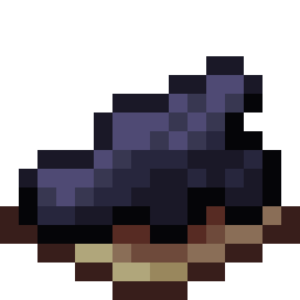 | if_variable_text_ends_with | Text Ends With | Checks if a text variable ends with the specified text. | if_variable | value: text compare: text ignore_case: enum &nbsp;&nbsp;- TRUE &nbsp;&nbsp;- FALSE |  |  | false/false |
|  | if_variable_text_matches | Text Matches | Checks if a text variable matches the specified text or regular expression (RegEx). | if_variable | match: text values: text ignore_case: enum &nbsp;&nbsp;- TRUE &nbsp;&nbsp;- FALSE regular_expressions: enum &nbsp;&nbsp;- TRUE &nbsp;&nbsp;- FALSE |  |  | false/false |
|  | if_variable_text_starts_with | Text Starts With | Checks if a text variable starts with the specified text. | if_variable | value: text compare: text ignore_case: enum &nbsp;&nbsp;- TRUE &nbsp;&nbsp;- FALSE |  |  | false/false |
|  | set_variable_absolute | Absolute Value | Sets the modulus of the selected number to a variable. | set_variable/numerical | variable: variable number: number |  |  | false/false |
|  | set_variable_add | Number Addition (+) | Assigns a sum of numbers to a variable. | set_variable/numerical | variable: variable value: number |  |  | false/false |
| 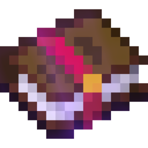 | set_variable_add_item_enchantment | Add Enchantment To an Item | Adds an enchantment to an item and assigns the result to a variable. | set_variable/item | variable: variable item: item enchantment: text level: number enchantment_type: enum &nbsp;&nbsp;- NORMAL &nbsp;&nbsp;- STORED &nbsp;&nbsp;- BOTH |  |  | false/false |
| 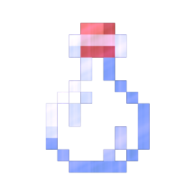 | set_variable_add_item_potion_effects | Set Item Potion Effects | Sets the potion effects of an item and assigns the result to a variable. | set_variable/item | variable: variable item: item potions: potion overwrite: enum &nbsp;&nbsp;- TRUE &nbsp;&nbsp;- FALSE show_icon: enum &nbsp;&nbsp;- TRUE &nbsp;&nbsp;- FALSE particle_mode: enum &nbsp;&nbsp;- REGULAR &nbsp;&nbsp;- AMBIENT &nbsp;&nbsp;- NONE |  |  | false/false |
|  | set_variable_add_item_stored_enchantment | Add Stored Enchantment to Item | Adds a stored enchantment to the item and assigns the result to a variable. | set_variable | variable: variable item: item enchantment: text level: number |  |  | false/true |
| 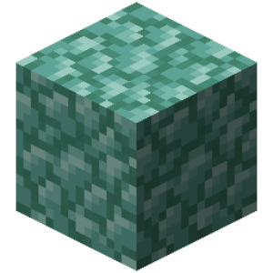 | set_variable_add_vectors | Sum Of Vectors | Sets the sum of vectors value to a variable. | set_variable/vector | variable: variable vectors: vector |  |  | false/false |
| 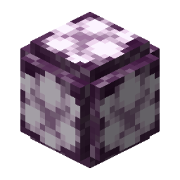 | set_variable_align_location | Round Location | Rounds the location to the center or corner of the block and assigns the result to a variable. | set_variable/location | variable: variable location: location rotation_mode: enum &nbsp;&nbsp;- KEEP &nbsp;&nbsp;- REMOVE coordinates_mode: enum &nbsp;&nbsp;- ALL &nbsp;&nbsp;- X_Z &nbsp;&nbsp;- Y align_mode: enum &nbsp;&nbsp;- BLOCK_CENTER &nbsp;&nbsp;- CORNER |  |  | false/false |
|  | set_variable_align_to_axis_vector | Align Vector | Aligns a vector to the nearest axis and assigns the result to a variable. | set_variable/vector | variable: variable vector: vector normalize: enum &nbsp;&nbsp;- TRUE &nbsp;&nbsp;- FALSE |  |  | false/false |
| 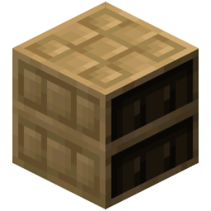 | set_variable_append_component | Append Stylized Texts | Appends different Styled Text together. | set_variable/component | variable: variable components: text merging: enum &nbsp;&nbsp;- SPACES &nbsp;&nbsp;- CONCATENATION &nbsp;&nbsp;- SEPARATE_LINES |  |  | false/false |
|  | set_variable_append_list | Combine Two Lists | Combines two specified lists into one. | set_variable | variable: variable list_1: array list_2: array |  |  | false/true |
|  | set_variable_append_lists | Merge lists | Combines the specified lists into one and assigns the result to a variable. | set_variable/list | variable: variable lists: array |  |  | false/false |
|  | set_variable_append_map | Combine Dictionaries | Concatenates two dictionaries and assigns the result to a variable. | set_variable | variable: variable map: map other_map: map |  |  | false/true |
|  | set_variable_append_maps | Merge dictionaries | Combines the specified maps into one and assigns the result to a variable. | set_variable/map | variable: variable maps: map |  |  | false/false |
|  | set_variable_append_value | Add List Value | Adds the specified values to the end of the list. | set_variable/list | variable: variable values: any |  |  | false/false |
| 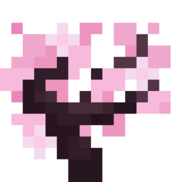 | set_variable_atan2 | Inverse Tangent | Returns the inverse tangent of the two specified numbers. | set_variable/numerical | variable: variable y: number x: number |  |  | false/false |
|  | set_variable_average | Average | Sets the average of numbers to a variable. | set_variable/numerical | variable: variable value: number type: enum &nbsp;&nbsp;- ARITHMETIC &nbsp;&nbsp;- GEOMETRIC &nbsp;&nbsp;- HARMONIC &nbsp;&nbsp;- QUADRATIC |  |  | false/false |
| 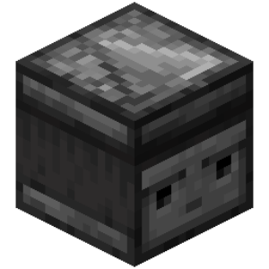 | set_variable_bitwise_operation | Bitwise Operation on Numbers | Sets the result of a bitwise operation on numbers to a variable. | set_variable/numerical | variable: variable operand1: number operand2: number operator: enum &nbsp;&nbsp;- OR &nbsp;&nbsp;- AND &nbsp;&nbsp;- NOT &nbsp;&nbsp;- XOR &nbsp;&nbsp;- LEFT_SHIFT &nbsp;&nbsp;- RIGHT_SHIFT &nbsp;&nbsp;- UNSIGNED_RIGHT_SHIFT &nbsp;&nbsp;- LEFT_ROTATE &nbsp;&nbsp;- RIGHT_ROTATE |  |  | false/false |
|  | set_variable_bytes_to_text | Convert bytes to text | Converts bytes to text and assigns the result to a variable. | set_variable/text | variable: variable bytes: array charset: enum &nbsp;&nbsp;- UTF_16 &nbsp;&nbsp;- UTF_8 &nbsp;&nbsp;- ASCII |  |  | false/false |
|  | set_variable_center_location | Set Center Location | Sets the location to the center between other locations and assigns the result to a variable. | set_variable/location | variable: variable locations: location |  |  | false/false |
|  | set_variable_change_component_parsing | Change Stylized Text Parsing | Change how the Styled Text is parsed. | set_variable/component | variable: variable component: text parsing: enum &nbsp;&nbsp;- PLAIN &nbsp;&nbsp;- LEGACY &nbsp;&nbsp;- MINIMESSAGE &nbsp;&nbsp;- JSON |  |  | false/false |
| 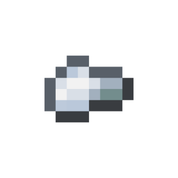 | set_variable_char_to_number | Number By Character | Gets a specific number from a character and assigns the result to a variable. | set_variable/text | variable: variable char: text |  |  | false/false |
| 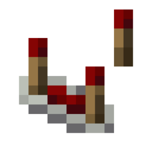 | set_variable_chunk_list | Fragment the list | Splits a list into sublists based on the specified number of elements. | set_variable/list | variable: variable list: array size: number |  |  | false/false |
|  | set_variable_chunk_text | Chunk Text | Splits text into chunks of the specified number of characters into a list of strings and assigns the result to a variable. | set_variable/text | variable: variable text: text size: number |  |  | false/false |
|  | set_variable_clamp | Clamp Number | Checks if a number is between the minimum and maximum values, and if not, sets it to the closest. | set_variable/numerical | variable: variable number: number min: number max: number |  |  | false/false |
|  | set_variable_clamp_location | Clamp Location | Checks whether a location is inside a region, and if not, sets the nearest location within the region. | set_variable/location | variable: variable location: location corner_1: location corner_2: location coordinates_mode: enum &nbsp;&nbsp;- XYZ &nbsp;&nbsp;- XZ &nbsp;&nbsp;- Y |  |  | false/false |
|  | set_variable_clear_color_codes | Clear Text Colors | Clears text from color codes and assigns the result to a variable. | set_variable/text | variable: variable text: text |  |  | false/false |
|  | set_variable_clear_map | Clear Dictionary | Clears the dictionary. | set_variable | map: variable |  |  | false/true |
| 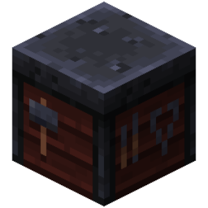 | set_variable_code_bytes | Encode Bytes | Encodes/decodes the input bytes using the selected method and assigns the result to a variable. | set_variable/text | variable: variable input: array codec: enum &nbsp;&nbsp;- BASE64_ENCODE &nbsp;&nbsp;- BASE64_DECODE &nbsp;&nbsp;- ZLIB_COMPRESS &nbsp;&nbsp;- ZLIB_DECOMPRESS |  |  | false/false |
|  | set_variable_compact_component | Compact Stylized Text | Compacts the Styled Text by removing all styles. | set_variable/component | variable: variable component: text |  |  | false/false |
|  | set_variable_component_of_children | Create Styled Text From Children | Creates a new Styled Text from the children Styled Text. | set_variable/component | variable: variable components: text |  |  | true/false |
| 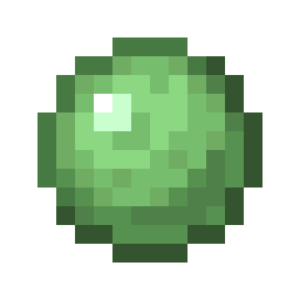 | set_variable_convert_number_to_text | Convert Number To Text | Sets the result of converting a number to text to a variable. | set_variable/text | variable: variable number: number radix: number |  | Only works with integers. Number base must be between 2 and 36 inclusive. | false/false |
|  | set_variable_convert_text_to_number | Convert Text To Number | Sets the result of converting text to number to a variable. Works only with integers. | set_variable/numerical | variable: variable text: text radix: number |  |  | false/false |
| 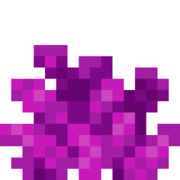 | set_variable_cosine | Cosine | Returns the cosine of a number. | set_variable/numerical | variable: variable number: number variant: enum &nbsp;&nbsp;- COSINE &nbsp;&nbsp;- ARCCOSINE &nbsp;&nbsp;- HYPERBOLIC_COSINE &nbsp;&nbsp;- HYPERBOLIC_ARCCOSINE input: enum &nbsp;&nbsp;- DEGREES &nbsp;&nbsp;- RADIANS |  |  | false/false |
|  | set_variable_cotangent | Cotangent | Returns the cotangent of a number. | set_variable/numerical | variable: variable number: number variant: enum &nbsp;&nbsp;- COTANGENT &nbsp;&nbsp;- ARCCOTANGENT &nbsp;&nbsp;- HYPERBOLIC_COTANGENT &nbsp;&nbsp;- HYPERBOLIC_ARCCOTANGENT input: enum &nbsp;&nbsp;- DEGREES &nbsp;&nbsp;- RADIANS |  |  | false/false |
|  | set_variable_create_head_object_component | Create Styled Text with Head | Assigns a styled text containing the specified head to a variable. | set_variable/component | variable: variable name_or_uuid: text hat: enum &nbsp;&nbsp;- TRUE &nbsp;&nbsp;- FALSE |  |  | false/false |
| 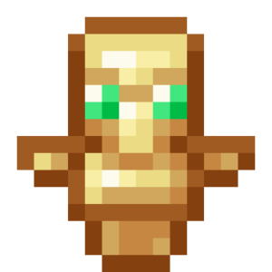 | set_variable_create_keybind_component | Create Stylized Text With Key Binding | Create a keybind Styled Text. | set_variable/component | variable: variable key: text |  |  | false/false |
|  | set_variable_create_list | Create List | Creates a list containing the specified values. | set_variable/list | variable: variable values: any |  | Clears the list if it already exists. | false/false |
|  | set_variable_create_map | Create Dictionary | Creates a dictionary from a list of keys and values and assigns the result to a variable. | set_variable/map | variable: variable keys: array values: array |  | Clears the dictionary if it already exists. | false/false |
|  | set_variable_create_map_from_values | Create Dictionary From Values | Creates a dictionary from keys and values and assigns the result to a variable. | set_variable/map | variable: variable keys: any values: any |  | Clears the dictionary if it already exists. | false/false |
|  | set_variable_create_sprite_object_component | Create Styled Text with Sprite | Assigns a styled text containing the specified sprite to a variable. | set_variable/component | variable: variable sprite: text atlas: text |  | If the "Sprite Atlas" argument is not specified, the "block" atlas will be used for the sprite. | false/false |
|  | set_variable_create_translatable_component | Create Translatable Stylized Text | Creates a translated Styled Text. | set_variable/component | variable: variable key: text fallback: text args: text |  | If no fallback message is set and the specified key has no translation, the final message will equal the specified key. | false/false |
|  | set_variable_decrement | Decrement (-=) | Subtracts the selected number from the variable. | set_variable/numerical | variable: variable number: number |  |  | false/false |
| 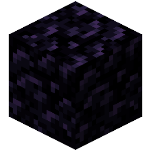 | set_variable_destructure_list | Decompose the list | Decompose the values of a list into separate variables. | set_variable/list | variables: variable list: array |  |  | false/false |
|  | set_variable_divide | Number Divide (÷) | Assigns a quotient to a variable. | set_variable/numerical | variable: variable value: number division_mode: enum &nbsp;&nbsp;- DEFAULT &nbsp;&nbsp;- ROUND_TO_INT &nbsp;&nbsp;- FLOOR &nbsp;&nbsp;- CEIL |  |  | false/false |
|  | set_variable_divide_vector | Vector Divide | Sets the result of dividing two vectors to a variable. | set_variable/vector | variable: variable vector: vector divider: vector |  |  | false/false |
| 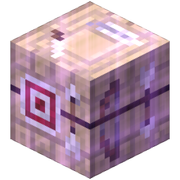 | set_variable_edit_item_custom_model_data | Edit Item Custom Model Data | Edits the Custom Model Data of an item and assigns the result to a variable. | set_variable/item | variable: variable item: item data: any value_type: enum &nbsp;&nbsp;- FLOATS setup_mode: enum &nbsp;&nbsp;- SET |  |  | false/false |
|  | set_variable_face_location | Location Face Another Location | Rotates a location in the direction of another location and assigns the result to a variable. | set_variable/location | variable: variable location: location target: location |  |  | false/false |
|  | set_variable_find_nearest_location | Get Nearest Location | Searches the listed locations for the one nearest to the specified location and assigns the result to a variable. | set_variable/location | variable: variable location: location locations: location distance_type: enum &nbsp;&nbsp;- XYZ &nbsp;&nbsp;- XZ &nbsp;&nbsp;- Y compare_mode: enum &nbsp;&nbsp;- NEAREST &nbsp;&nbsp;- FARTHEST |  |  | false/false |
|  | set_variable_find_nearest_number | Nearest Number | Searches the listed numbers for the one nearest to the specified number and assigns the result to a variable. | set_variable/numerical | variable: variable number: number numbers: number |  |  | false/false |
|  | set_variable_flatten_list | Flatten List | Splits the sublists of the specified list into separate items. | set_variable/list | variable: variable list: array deep: enum &nbsp;&nbsp;- TRUE &nbsp;&nbsp;- FALSE |  |  | false/false |
|  | set_variable_format_timestamp | Create Time Format | Converts a number (milliseconds) to the specified time format and assigns the result to a variable. | set_variable/text | variable: variable time: number pattern: text zone_id: text locale: text format: enum &nbsp;&nbsp;- CUSTOM &nbsp;&nbsp;- DD_MM_YYYY_HH_MM_S &nbsp;&nbsp;- DD_MM_YYYY &nbsp;&nbsp;- YYYY_MM_DD_HH_MM_S &nbsp;&nbsp;- YYYY_MM_DD &nbsp;&nbsp;- EEE_D_MMMM &nbsp;&nbsp;- EEE_MMMM_D &nbsp;&nbsp;- MMMM &nbsp;&nbsp;- EEEE &nbsp;&nbsp;- HH_MM_SS &nbsp;&nbsp;- H_MM_A &nbsp;&nbsp;- H_H_M_M_S_S &nbsp;&nbsp;- S_S |  |  | false/false |
|  | set_variable_gamma_function | Gamma Function | Returns the gamma function of a number and assigns it to a variable. | set_variable/numerical | variable: variable number: number |  | Is a generalization of the factorial. The gamma function can be expressed as (n-1)!, where n is the given number. | false/false |
|  | set_variable_gaussian_distribution | Normally Distributed Random Number | Produces a random number close to the mean μ with a standard deviation σ with a chance given by a normal distribution plot. | set_variable/numerical | variable: variable deviant: number mean: number distribution: enum &nbsp;&nbsp;- NORMAL &nbsp;&nbsp;- FOLDER_NORMAL |  |  | false/false |
|  | set_variable_get_all_block_data | Get All Block Data | Sets all block data at the selected location to a variable. | set_variable/world | variable: variable location: location hide_unspecified: enum &nbsp;&nbsp;- TRUE &nbsp;&nbsp;- FALSE |  |  | false/false |
| 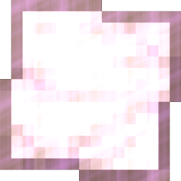 | set_variable_get_all_coordinates | Get All Location Coordinates | Gets the value of all coordinates from a location and assigns them to variables. | set_variable/location | location: location x: variable y: variable z: variable yaw: variable pitch: variable |  |  | false/false |
| 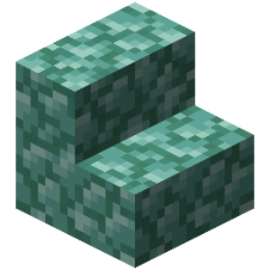 | set_variable_get_angle_between_vectors | Get Angle Between Two Vectors | Sets the angle between two vectors to a variable. | set_variable/vector | variable: variable vector_1: vector vector_2: vector angle_units: enum &nbsp;&nbsp;- DEGREES &nbsp;&nbsp;- RADIANS |  |  | false/false |
|  | set_variable_get_block_data | Get Block Data | Gets the block data and assigns it to a variable. | set_variable/world | variable: variable location: location tag_name: text | Block entities (chests, signs, barrels, etc.) |  | false/false |
|  | set_variable_get_block_growth | Get Block Growth Level | Sets the block growth level at the specified location to a variable. | set_variable/world | variable: variable location: location growth_unit: enum &nbsp;&nbsp;- GROWTH_STAGE &nbsp;&nbsp;- GROWTH_PERCENTAGE |  |  | false/false |
| 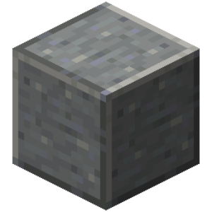 | set_variable_get_block_material | Get Block Type | Sets the block type at the selected location to a variable. | set_variable/world | variable: variable location: location value_type: enum &nbsp;&nbsp;- ID &nbsp;&nbsp;- ID_WITH_DATA &nbsp;&nbsp;- NAME &nbsp;&nbsp;- ITEM |  |  | false/false |
|  | set_variable_get_block_material_property | Get Block Property | Gets the specific block property and assigns the result to a variable. | set_variable/item | variable: variable block: block property: enum &nbsp;&nbsp;- HARDNESS &nbsp;&nbsp;- BLAST_RESISTANCE &nbsp;&nbsp;- SLIPPERINESS |  |  | false/false |
|  | set_variable_get_block_power | Get Redstone Power | Sets the redstone signal strength at the specified location to a variable. | set_variable/world | variable: variable location: location |  |  | false/false |
|  | set_variable_get_block_sound | Get Block Sound | Gets the sound of a specified block and assigns it to a variable. | set_variable/misc | variable: variable block: block source: enum &nbsp;&nbsp;- BREAK &nbsp;&nbsp;- PLACE &nbsp;&nbsp;- HIT &nbsp;&nbsp;- FALL &nbsp;&nbsp;- STEP |  |  | false/false |
| 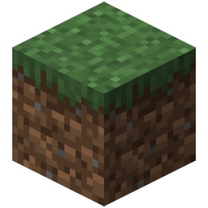 | set_variable_get_blocks_by_tag | Get Blocks by Minecraft Tag | Gets blocks by Minecraft tag (e.g. "mineable/shovel") and assigns the result to a variable. | set_variable/item | variable: variable namespace: text result_type: enum &nbsp;&nbsp;- ID &nbsp;&nbsp;- TRANSLATION_KEY &nbsp;&nbsp;- ITEM |  |  | false/false |
|  | set_variable_get_book_text | Get Book Text | Sets the value of the book text on a specific page to a variable. | set_variable/item | variable: variable book: item page: number |  |  | false/false |
|  | set_variable_get_brushable_block_item | Get Suspicious Block Item | Get an item from a suspicious block (sand, gravel) and assign the result to a variable. | set_variable/world | variable: variable location: location |  |  | false/false |
| 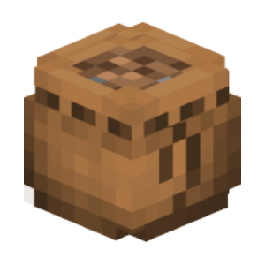 | set_variable_get_bundle_items | Get Bundle Items | Gets the list of items stored in a bundle. | set_variable/item | variable: variable bundle: item |  |  | false/false |
|  | set_variable_get_char_at | Get Character By Index | Get the character from the text at the specified index and assign the result to a variable. | set_variable/text | variable: variable text: text index: number |  |  | false/false |
| 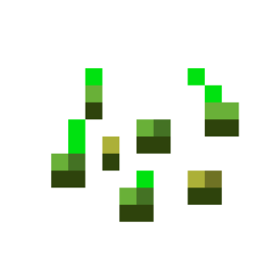 | set_variable_get_color_channels | Get Color Channels | Gets RGB/HSB/HSL color numeric values as a list. | set_variable/misc | variable: variable color: text color_channels: enum &nbsp;&nbsp;- RGB &nbsp;&nbsp;- HSB &nbsp;&nbsp;- HSL |  |  | false/false |
| 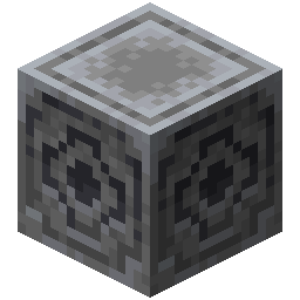 | set_variable_get_compass_lodestone | Get Lodestone Location | Get the location of lodestone from a magnetized compass and assign the result to a variable. | set_variable/item | variable: variable item: item |  |  | false/false |
| 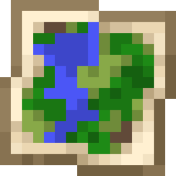 | set_variable_get_component_children | Get Stylized Text Children Components | Gets children components of the Styled Text. | set_variable/component | variable: variable component: text |  |  | false/false |
| 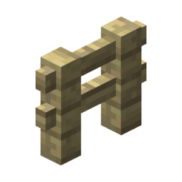 | set_variable_get_component_decorations | Get Stylized Text Decorations | Gets the text decorations (bold, italics, underlined, strikethrough, obfuscated) of a Styled Text. | set_variable/component | variable: variable component: text |  |  | false/false |
|  | set_variable_get_component_hex_color | Get Stylized Text Hex Color | Gets the color in hex of a Styled Text. | set_variable/component | variable: variable component: text |  |  | false/false |
| 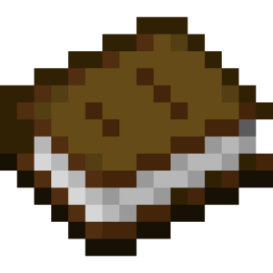 | set_variable_get_component_parsing | Get Type Stylized Text Parsing | Get the method of parsing for a Styled Text. | set_variable/component | variable: variable component: text |  |  | false/false |
|  | set_variable_get_container_contents | Get Container Contents | Sets a list of container contents at the selected location to a variable. | set_variable/world | variable: variable location: location ignore_empty_slots: enum &nbsp;&nbsp;- TRUE &nbsp;&nbsp;- FALSE |  |  | false/false |
|  | set_variable_get_container_lock | Get Container Key | Sets a container key item at the specified location to a variable. | set_variable/world | variable: variable location: location |  |  | false/false |
|  | set_variable_get_container_name | Get Container Name | Sets the variable to the name of the container at the selected location. | set_variable/world | variable: variable location: location |  |  | false/false |
|  | set_variable_get_coordinate | Get Location Coordinate | Gets the value of the selected coordinate from the location and assigns the result to a variable. | set_variable/location | variable: variable location: location type: enum &nbsp;&nbsp;- X &nbsp;&nbsp;- Y &nbsp;&nbsp;- Z &nbsp;&nbsp;- YAW &nbsp;&nbsp;- PITCH |  |  | false/false |
|  | set_variable_get_custom_recipes | creative_plus.action.set_variable_get_custom_recipes.name | creative_plus.action.set_variable_get_custom_recipes.description | set_variable/world | variable: variable is_vanilla_recipes: enum &nbsp;&nbsp;- TRUE &nbsp;&nbsp;- FALSE |  |  | false/false |
| 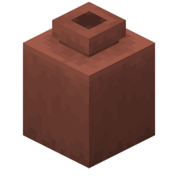 | set_variable_get_decorate_pot_sherd | Get Decorate Pot Sherd | Gets the selected vase side shard material of the selected vase side at the specified location. | set_variable/world | variable: variable location: location side: enum &nbsp;&nbsp;- BACK &nbsp;&nbsp;- FRONT &nbsp;&nbsp;- LEFT &nbsp;&nbsp;- RIGHT |  |  | false/false |
|  | set_variable_get_entity_types_by_tag | Get Entity Types by Minecraft Tag | Gets entity types by Minecraft tag (e.g. "aquatic") and assigns the result to a variable. | set_variable/misc | variable: variable namespace: text result_type: enum &nbsp;&nbsp;- ID &nbsp;&nbsp;- TRANSLATION_KEY |  |  | false/false |
| 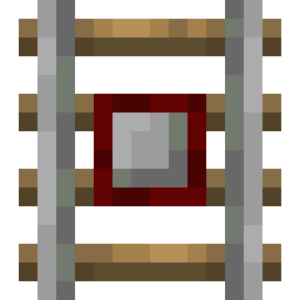 | set_variable_get_index_of_subtext | Get Subtext Index | Gets the subtext index from the text and assigns the result to a variable. | set_variable/text | variable: variable text: text subtext: text start_index: number search_mode: enum &nbsp;&nbsp;- FIRST &nbsp;&nbsp;- LAST |  |  | false/false |
|  | set_variable_get_item_amount | Get Item Amount | Sets the amount of items in a stack to a variable. | set_variable/item | variable: variable item: item |  |  | false/false |
| 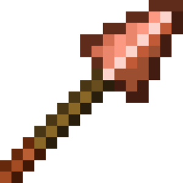 | set_variable_get_item_attack_range | Get Attack Range | Gets the attack range of the specified item and assigns the result to a variable. | set_variable/item | variable: variable item: item property: enum &nbsp;&nbsp;- MIN_RANGE &nbsp;&nbsp;- MAX_RANGE &nbsp;&nbsp;- MIN_CREATIVE_RANGE &nbsp;&nbsp;- MAX_CREATIVE_RANGE &nbsp;&nbsp;- HITBOX_MARGIN &nbsp;&nbsp;- MOB_FACTORY |  |  | false/false |
|  | set_variable_get_item_attribute | Get Item Attribute | Gets the specified attribute from an item as a "UUID - Value" dictionary and assigns the result to a variable. | set_variable/item | variable: variable item: item name: text attribute: enum &nbsp;&nbsp;- GENERIC_MAX_HEALTH &nbsp;&nbsp;- GENERIC_MAX_ABSORPTION &nbsp;&nbsp;- GENERIC_FOLLOW_RANGE &nbsp;&nbsp;- GENERIC_KNOCKBACK_RESISTANCE &nbsp;&nbsp;- GENERIC_MOVEMENT_SPEED &nbsp;&nbsp;- GENERIC_FLYING_SPEED &nbsp;&nbsp;- GENERIC_ATTACK_DAMAGE &nbsp;&nbsp;- GENERIC_ATTACK_KNOCKBACK &nbsp;&nbsp;- GENERIC_ATTACK_SPEED &nbsp;&nbsp;- GENERIC_ARMOR &nbsp;&nbsp;- GENERIC_ARMOR_TOUGHNESS &nbsp;&nbsp;- GENERIC_LUCK &nbsp;&nbsp;- GENERIC_JUMP_STRENGTH &nbsp;&nbsp;- ZOMBIE_SPAWN_REINFORCEMENTS &nbsp;&nbsp;- GENERIC_FALL_DAMAGE_MULTIPLIER &nbsp;&nbsp;- GENERIC_SAFE_FALL_DISTANCE &nbsp;&nbsp;- GENERIC_SCALE &nbsp;&nbsp;- GENERIC_STEP_HEIGHT &nbsp;&nbsp;- GENERIC_GRAVITY &nbsp;&nbsp;- PLAYER_BLOCK_INTERACTION_RANGE &nbsp;&nbsp;- PLAYER_ENTITY_INTERACTION_RANGE &nbsp;&nbsp;- PLAYER_BLOCK_BREAK_SPEED &nbsp;&nbsp;- GENERIC_BURNING_TIME &nbsp;&nbsp;- GENERIC_EXPLOSION_KNOCKBACK_RESISTANCE &nbsp;&nbsp;- GENERIC_MOVEMENT_EFFICIENCY &nbsp;&nbsp;- GENERIC_OXYGEN_BONUS &nbsp;&nbsp;- GENERIC_WATER_MOVEMENT_EFFICIENCY &nbsp;&nbsp;- PLAYER_MINING_EFFICIENCY &nbsp;&nbsp;- PLAYER_SNEAKING_SPEED &nbsp;&nbsp;- PLAYER_SUBMERGED_MINING_SPEED &nbsp;&nbsp;- PLAYER_SWEEPING_DAMAGE_RATIO &nbsp;&nbsp;- TEMP_RANGE &nbsp;&nbsp;- WAYPOINT_TRANSMIT_RANGE &nbsp;&nbsp;- WAYPOINT_RECEIVE_RANGE &nbsp;&nbsp;- CAMERA_DISTANCE &nbsp;&nbsp;- BOUNCINESS &nbsp;&nbsp;- FRICTION_MODIFIER &nbsp;&nbsp;- AIR_DRAG_MODIFIER &nbsp;&nbsp;- NAME_TAG_DISTANCE &nbsp;&nbsp;- BELOW_NAME_DISTANCE slot: enum &nbsp;&nbsp;- ALL &nbsp;&nbsp;- MAIN_HAND &nbsp;&nbsp;- OFF_HAND &nbsp;&nbsp;- HAND &nbsp;&nbsp;- BOOTS &nbsp;&nbsp;- LEGGINGS &nbsp;&nbsp;- CHEST &nbsp;&nbsp;- HEAD &nbsp;&nbsp;- ARMOR &nbsp;&nbsp;- BODY |  |  | false/false |
|  | set_variable_get_item_break_sound | Get Item Break Sound | Gets the sound played when the specified item breaks and assigns the result to a variable. | set_variable/item | variable: variable item: item |  |  | false/false |
| 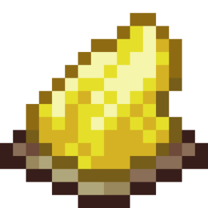 | set_variable_get_item_color | Get Item Color | Sets an item's color value to a variable. | set_variable/item | variable: variable item: item | Leather Armor Potions Tipped Arrows Filled Maps |  | false/false |
| 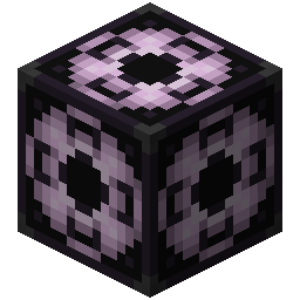 | set_variable_get_item_component | Get Item Component | Gets the value of an item component and assigns the result to a variable. | set_variable/item | variable: variable item: item component: text |  |  | false/false |
|  | set_variable_get_item_contents | Get Item Contents | Gets the contents of the specified item and assigns the result to a variable. | set_variable/item | variable: variable item: item |  |  | false/false |
|  | set_variable_get_item_custom_model_data | Get Item Model Data | Gets the item's model data (CustomModelData) and assigns the result to a variable. | set_variable | variable: variable item: item |  |  | false/true |
|  | set_variable_get_item_custom_tag | Get Custom Item Tag | Sets the item's custom tag value to a variable. | set_variable/item | variable: variable item: item tag_name: text default_value: any |  |  | false/false |
|  | set_variable_get_item_custom_tags | Get Custom Item Tags | Sets a dictionary of custom item tags to a variable. | set_variable/item | variable: variable item: item |  |  | false/false |
| 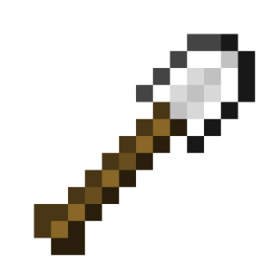 | set_variable_get_item_destroyable_blocks | Get Item Destroyable Blocks | Gets what blocks this item can break. | set_variable/item | variable: variable item: item |  |  | false/false |
|  | set_variable_get_item_durability | Get Item Durability | Sets the durability of the specified item to a variable. | set_variable/item | variable: variable item: item durability_type: enum &nbsp;&nbsp;- DAMAGE &nbsp;&nbsp;- DAMAGE_PERCENTAGE &nbsp;&nbsp;- REMAINING &nbsp;&nbsp;- REMAINING_PERCENTAGE &nbsp;&nbsp;- MAXIMUM |  |  | false/false |
| 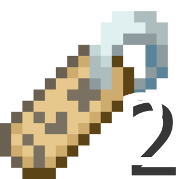 | set_variable_get_item_effective_name | Get Item Display Name | Gets the name of an item as displayed in the inventory and assigns it to a variable. | set_variable/item | variable: variable item: item |  | The returned text is built from several components that affect the displayed name, including rarity and the item's translatable name. | false/false |
|  | set_variable_get_item_enchantment | creative_plus.action.set_variable_get_item_enchantment.name | creative_plus.action.set_variable_get_item_enchantment.description | set_variable/item | variable: variable item: item enchantment: text enchantment_type: enum &nbsp;&nbsp;- NORMAL &nbsp;&nbsp;- STORED &nbsp;&nbsp;- BOTH |  |  | false/false |
|  | set_variable_get_item_enchantments | Get Item Enchantments | Sets a dictionary of enchantments and their item levels to a variable. | set_variable/item | variable: variable item: item enchantment_type: enum &nbsp;&nbsp;- NORMAL &nbsp;&nbsp;- STORED &nbsp;&nbsp;- BOTH |  |  | false/false |
| 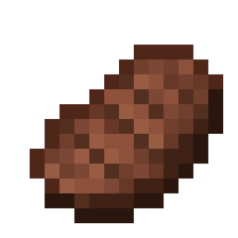 | set_variable_get_item_food_properties | Get Item Food Component Value | Gets the food component value of an item and assigns the result to a variable. | set_variable/item | variable: variable item: item property: enum &nbsp;&nbsp;- NUTRITION &nbsp;&nbsp;- SATURATION |  |  | false/false |
|  | set_variable_get_item_lore | Get Item Description | Sets an item's description text to a variable. | set_variable/item | variable: variable item: item |  |  | false/false |
|  | set_variable_get_item_lore_line | Get Item Description Line | Sets an item's description line to a variable. | set_variable/item | variable: variable item: item line: number |  |  | false/false |
|  | set_variable_get_item_max_stack_size | Get Max Item Amount | Sets the maximum number of items in a stack to a variable. | set_variable/item | variable: variable item: item |  |  | false/false |
| 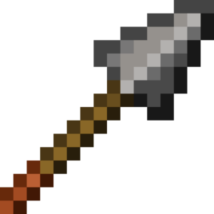 | set_variable_get_item_minimum_attack_charge | Get Minimum Attack Charge | Gets the minimum item charge required to attack and assigns the result to a variable. | set_variable/item | variable: variable item: item |  |  | false/false |
| 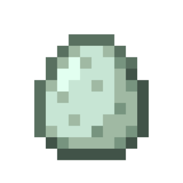 | set_variable_get_item_model_data | Get Item Model | Gets the model of the specified item and assigns the result to a variable. | set_variable/item | variable: variable item: item |  |  | false/false |
|  | set_variable_get_item_name | Get Item Name | Sets an item's display name to a variable. | set_variable/item | variable: variable item: item |  |  | false/false |
|  | set_variable_get_item_nbt_tags | Get NBT Item Tags | Sets the tags of the specified item to an NBT variable. | set_variable/item | variable: variable item: item fetch_mode: enum &nbsp;&nbsp;- ALL &nbsp;&nbsp;- CUSTOM_DATA |  |  | false/false |
| 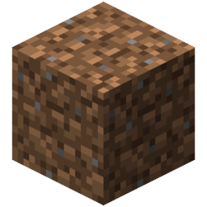 | set_variable_get_item_placeable_blocks | Get Item Placeable Blocks | Gets what blocks this item is placeable against. | set_variable/item | variable: variable item: item |  |  | false/false |
|  | set_variable_get_item_potion_effects | Get Potion Effects From an Item | Get the potion effects from an item and assign the result to a variable. | set_variable/item | variable: variable item: item |  |  | false/false |
| 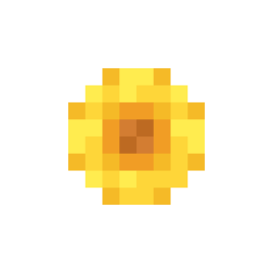 | set_variable_get_item_rarity | Get Item Rarity | Gets the rarity of an item and assigns the result to a variable. | set_variable/item | variable: variable item: item |  |  | false/false |
|  | set_variable_get_item_sprite | Get item sprite | Gets the sprite of the specified item and assigns the result to a variable. | set_variable/item | variable: variable item: item |  |  | false/false |
|  | set_variable_get_item_stored_enchantments | Get Item Stored Enchantments | Gets the list of stored enchantments of the item and assigns the result to a variable. | set_variable | variable: variable item: item |  |  | false/true |
| 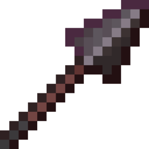 | set_variable_get_item_swing_animation | Get Swing Animation Data | Gets the swing animation data of the specified item and assigns the result to a variable. | set_variable/item | variable: variable item: item property: enum &nbsp;&nbsp;- DURATION &nbsp;&nbsp;- ANIMATION |  |  | false/false |
|  | set_variable_get_item_tooltip_style | Get Item Tooltip Style | Gets the tooltip style of an item and assigns the result to a variable. | set_variable/item | variable: variable item: item |  |  | false/false |
| 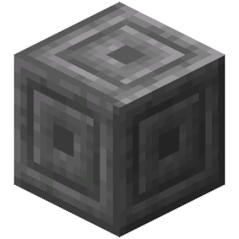 | set_variable_get_item_type | Get Item Type | Sets an item type to a variable, represented as text. | set_variable/item | variable: variable type: item value: enum &nbsp;&nbsp;- ID &nbsp;&nbsp;- NAME &nbsp;&nbsp;- ITEM |  |  | false/false |
| 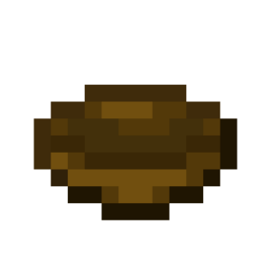 | set_variable_get_item_use_remainder | Get Item Use Remainder | Gets the item that the specified item transforms into after use and assigns the result to a variable. | set_variable/item | variable: variable item: item |  |  | false/false |
| 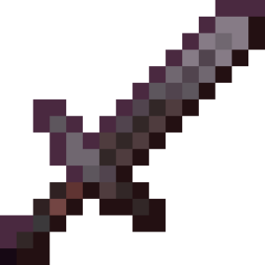 | set_variable_get_item_weapon | Get Item Weapon Component Value | Gets the weapon component value of an item and assigns the result to a variable. | set_variable/item | variable: variable item: item property: enum &nbsp;&nbsp;- ITEM_DAMAGE_PER_ATTACK &nbsp;&nbsp;- DISABLE_BLOCKING |  |  | false/false |
|  | set_variable_get_items_by_tag | Get Items by Minecraft Tag | Gets items by Minecraft tag (e.g. "swords") and assigns the result to a variable. | set_variable/item | variable: variable namespace: text result_type: enum &nbsp;&nbsp;- ID &nbsp;&nbsp;- TRANSLATION_KEY &nbsp;&nbsp;- ITEM |  |  | false/false |
| 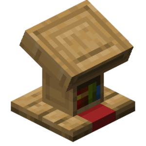 | set_variable_get_lectern_book | Get Lectern Book | Assigns the book from the lectern at the specified location to a variable. | set_variable/world | variable: variable location: location |  |  | false/false |
|  | set_variable_get_lectern_page | Get Lectern Book Page | Sets a variable to the current page number of the book from the lectern at the specified location. | set_variable/world | variable: variable location: location |  |  | false/false |
|  | set_variable_get_light_level | Get Light Level | Sets the value of the light level at the specified location to a variable. | set_variable/world | variable: variable location: location value_type: enum &nbsp;&nbsp;- TOTAL &nbsp;&nbsp;- SKY &nbsp;&nbsp;- BLOCKS |  |  | false/false |
| 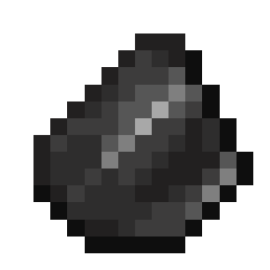 | set_variable_get_list_index_of_value | Get List Value Index | Searchs for a value in a list and gets its index if found. Returns -1 on failure. | set_variable/list | variable: variable list: array value: any search_mode: enum &nbsp;&nbsp;- FIRST &nbsp;&nbsp;- LAST |  |  | false/false |
| 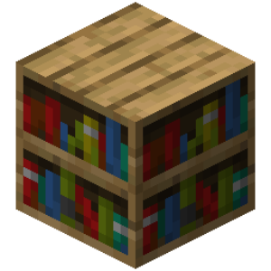 | set_variable_get_list_length | Get List Size | Gets the number of elements contained in the specified list. | set_variable/list | variable: variable list: array |  |  | false/false |
|  | set_variable_get_list_random_value | Get Random List Value | Gets a random value from a list. | set_variable/list | variable: variable list: array |  |  | false/false |
|  | set_variable_get_list_value | Get List Value | Get the value from the list at the specified index. | set_variable/list | variable: variable list: array number: number default_value: any |  |  | false/false |
|  | set_variable_get_list_variables | Get Variable Names | Gets a list of all variable names and assigns the result to the variable. | set_variable/setting | variable: variable names: text scope: enum &nbsp;&nbsp;- GAME &nbsp;&nbsp;- SAVE &nbsp;&nbsp;- LOCAL &nbsp;&nbsp;- LINE match: enum &nbsp;&nbsp;- EQUALS ignore_case: enum &nbsp;&nbsp;- TRUE &nbsp;&nbsp;- FALSE |  |  | false/false |
|  | set_variable_get_location_direction | Get Location Direction | Assigns to a location direction variable. | set_variable/location | variable: variable location: location |  |  | false/false |
|  | set_variable_get_map_entry_by_index | Get a dictionary entry by index | It retrieves a specific key and value from a dictionary by index and assigns the results to variables. | set_variable/map | variable_key: variable variable_value: variable map: map index: number default_key: any default_value: any |  |  | false/false |
|  | set_variable_get_map_key_by_index | Get Dictionary Key By Index | Gets the key by the order it is inserted in. | set_variable | variable: variable map: map index: number default_value: any |  |  | false/true |
|  | set_variable_get_map_keys | Get List Of Dictionary Keys | Sets a list of dictionary keys to a variable. | set_variable/map | variable: variable map: map |  |  | false/false |
|  | set_variable_get_map_keys_by_value | Get Dictionary Keys By Value | Gets the key or list of dictionary keys by value and assigns the result to a variable. | set_variable/map | variable: variable map: map value: any default_value: any find_mode: enum &nbsp;&nbsp;- FIRST &nbsp;&nbsp;- LAST &nbsp;&nbsp;- ALL |  |  | false/false |
|  | set_variable_get_map_random_entry | Get a random entry from the dictionary | Retrieves a random key and value from the dictionary and assigns the results to variables. | set_variable/map | variable_key: variable variable_value: variable map: map |  |  | false/false |
|  | set_variable_get_map_size | Get Dictionary Size | Sets a dictionary size value to a variable. | set_variable/map | variable: variable map: map |  |  | false/false |
|  | set_variable_get_map_value | creative_plus.action.set_variable_get_map_value.name | creative_plus.action.set_variable_get_map_value.description | set_variable | variable: variable map: map key: any default_value: any |  |  | false/true |
|  | set_variable_get_map_value_by_index | Get Dictionary Value By Index | Gets the value by the order it is inserted in. | set_variable | variable: variable map: map index: number default_value: any |  |  | false/true |
|  | set_variable_get_map_value_single | Get Dictionary Value | Gets the specified dictionary value by key and assigns the result to a variable. | set_variable/map | variable: variable map: map key: any default_value: any |  |  | false/false |
|  | set_variable_get_map_values | Get List Of Dictionary Values | Sets a list of dictionary values to a variable. | set_variable/map | variable: variable map: map |  |  | false/false |
|  | set_variable_get_midpoint_between_vectors | Get Midpoint Between Vectors | Sets the midpoint between two vectors to a variable. | set_variable/vector | variable: variable vector_1: vector vector_2: vector |  |  | false/false |
|  | set_variable_get_particle_amount | Get Particle Amount | Sets a particle amount to a variable. | set_variable/particle | variable: variable particle: particle |  |  | false/false |
|  | set_variable_get_particle_color | Get Particle Color | Sets a particle's color value to a variable. | set_variable/particle | variable: variable particle: particle color_type: enum &nbsp;&nbsp;- COLOR &nbsp;&nbsp;- TO_COLOR |  |  | false/false |
|  | set_variable_get_particle_material | Get Particle Material | Sets a particle's material value to a variable. | set_variable/particle | variable: variable particle: particle |  |  | false/false |
|  | set_variable_get_particle_offset | Get Particle Motion | Sets a particle's movement value to a variable. | set_variable/particle | variable: variable particle: particle |  |  | false/false |
|  | set_variable_get_particle_size | Get Particle Size | Sets a particle size value to a variable. | set_variable/particle | variable: variable particle: particle |  |  | false/false |
|  | set_variable_get_particle_spread | Get Particle Spread | Sets a particle's spread value to a variable. | set_variable/particle | variable: variable particle: particle type: enum &nbsp;&nbsp;- VERTICAL &nbsp;&nbsp;- HORIZONTAL |  |  | false/false |
|  | set_variable_get_particle_type | Get Particle Type | Sets a particle type to a variable. | set_variable/particle | variable: variable particle: particle |  |  | false/false |
|  | set_variable_get_player_head | Get Player Head | Gets the player's head as an item and assigns the result to a variable. | set_variable/item | variable: variable name_or_uuid: text receive_type: enum &nbsp;&nbsp;- NAME_OR_UUID &nbsp;&nbsp;- VALUE |  |  | false/false |
|  | set_variable_get_player_head_owner | Get Head Owner | Get the name or UUID of the owner of the item head and assign the result to a variable. | set_variable/item | variable: variable head: item return_value: enum &nbsp;&nbsp;- NAME &nbsp;&nbsp;- UUID &nbsp;&nbsp;- VALUE |  |  | false/false |
|  | set_variable_get_player_head_value | Get Player Head At Location | Gets the skull owner at a location. | set_variable/world | variable: variable location: location return_value: enum &nbsp;&nbsp;- NAME &nbsp;&nbsp;- UUID &nbsp;&nbsp;- VALUE |  |  | false/false |
|  | set_variable_get_potion_effect_amplifier | Get Potion Power | Sets a potion's power to a variable. | set_variable/misc | variable: variable potion: potion |  |  | false/false |
|  | set_variable_get_potion_effect_duration | Get Potion Duration | Sets the potion's duration to a variable. | set_variable/misc | variable: variable potion: potion |  |  | false/false |
|  | set_variable_get_potion_effect_type | Get Potion Effect | Sets a potion type to a variable. | set_variable/misc | variable: variable potion: potion |  |  | false/false |
|  | set_variable_get_sculk_shrieker_warning_level | Get Sculk Shrieker Warning Level | Gets the warning levels of the Sculk Shrieker. | set_variable/world | variable: variable location: location |  |  | false/false |
|  | set_variable_get_sign_text | Get Sign Line Text | Sets the text value of the sign line at the selected location to a variable. | set_variable/world | variable: variable location: location check_side: enum &nbsp;&nbsp;- FRONT &nbsp;&nbsp;- BACK &nbsp;&nbsp;- ALL sign_line: enum &nbsp;&nbsp;- FIRST &nbsp;&nbsp;- SECOND &nbsp;&nbsp;- THIRD &nbsp;&nbsp;- FOURTH &nbsp;&nbsp;- ALL |  |  | false/false |
|  | set_variable_get_sound_pitch | Get Sound Pitch | Sets the pitch of a sound to a variable. | set_variable/misc | variable: variable sound: sound |  |  | false/false |
|  | set_variable_get_sound_source | Get Sound Source | Get the sound source and assign the result to a variable. | set_variable/misc | variable: variable sound: sound |  |  | false/false |
|  | set_variable_get_sound_type | Get Sound Type | Sets a sound type value to a variable. | set_variable/misc | variable: variable sound: sound |  |  | false/false |
|  | set_variable_get_sound_variation | Get Sound Variation | Gets the sound variation and assigns the result to a variable. | set_variable/misc | variable: variable sound: sound |  | Returns empty text if a random seed is used. | false/false |
|  | set_variable_get_sound_volume_action | Get Sound Volume | Sets a sound volume value to a variable. | set_variable/misc | variable: variable sound: sound |  |  | false/false |
|  | set_variable_get_template_code | Get Template Code | Assigns a template code to a variable. | set_variable/misc | variable: variable template: item return_type: enum &nbsp;&nbsp;- TEXT &nbsp;&nbsp;- MAP |  |  | false/false |
|  | set_variable_get_text_regex_groups | Parse by Regular Expression | Parses text by a regular expression and assigns to the variable the matches with the contents of all capture groups or the content of specific groups. | set_variable/text | variable: variable text: text regex: text group: text match_mode: enum &nbsp;&nbsp;- ALL &nbsp;&nbsp;- FIRST get_group_by: enum &nbsp;&nbsp;- INDEX &nbsp;&nbsp;- NAME ignore_case: enum &nbsp;&nbsp;- TRUE &nbsp;&nbsp;- FALSE multiline: enum &nbsp;&nbsp;- TRUE &nbsp;&nbsp;- FALSE literal: enum &nbsp;&nbsp;- TRUE &nbsp;&nbsp;- FALSE unix_lines: enum &nbsp;&nbsp;- TRUE &nbsp;&nbsp;- FALSE comments: enum &nbsp;&nbsp;- TRUE &nbsp;&nbsp;- FALSE dot_matches_all: enum &nbsp;&nbsp;- TRUE &nbsp;&nbsp;- FALSE cannon_eq: enum &nbsp;&nbsp;- TRUE &nbsp;&nbsp;- FALSE |  |  | false/false |
|  | set_variable_get_text_similarity | Get Text Similarity | Gets the similarity coefficient of two texts and assigns the result to a variable. | set_variable/text | variable: variable text_1: text text_2: text value_type: enum &nbsp;&nbsp;- SIMILARITY &nbsp;&nbsp;- LEVENSHTEIN_DISTANCE |  |  | false/false |
|  | set_variable_get_text_width | Get Text Width In Pixels | Gets the size of each character in the text, sums them up, and assigns the result to a variable. | set_variable/text | variable: variable text: text |  | Values may not be relevant if using a resource pack with custom symbols. | false/false |
|  | set_variable_get_tile_block_custom_tag | Get Block Entity Custom Tag | Gets data about the custom tag of a block entity and assigns the result to a variable. | set_variable/block | variable: variable location: location tag_name: text default_value: any | Block Entities (chests, signs, barrels, etc.) |  | false/false |
|  | set_variable_get_tile_block_nbt | Get Block Entity NBT Tags | Gets data about the NBT tags of a block entity and assigns the result to a variable. | set_variable/block | variable: variable location: location path: text value_type: enum &nbsp;&nbsp;- ANY_VALUE &nbsp;&nbsp;- NBT_STRING | creative_plus.action.set_variable_get_tile_block_nbt.work_with.tile_state_block |  | false/false |
|  | set_variable_get_vault_displayed_item | Get Vault Displayed Item | Gets the displayed item of a vault and assigns it to a variable. | set_variable/world | variable: variable location: location | Vaults |  | false/false |
|  | set_variable_get_vault_next_state_update_time | Get Vault Next State Update Time | Gets the next state update time of a vault and assigns it to a variable. | set_variable/world | variable: variable location: location | Vaults |  | false/false |
|  | set_variable_get_vector_all_components | Get All Vector Coordinates | Gets all coordinates of a vector and assigns the result to variables. | set_variable/vector | vector: vector x: variable y: variable z: variable |  |  | false/false |
|  | set_variable_get_vector_between_locations | Create Vector Between Locations | Creates a vector between the start and end locations and assigns the result to a variable. | set_variable/vector | variable: variable start_location: location end_location: location |  |  | false/false |
|  | set_variable_get_vector_component | Get Vector Coordinate | Gets the specified vector coordinate and assigns the result to a variable. | set_variable/vector | variable: variable vector: vector vector_component: enum &nbsp;&nbsp;- X &nbsp;&nbsp;- Y &nbsp;&nbsp;- Z |  |  | false/false |
|  | set_variable_get_vector_from_block_face | Create Vector From Cardinal Direction | Generates a normalized vector based on the specified cardinal direction ("south", "north", "east", "west", "up", " down"). | set_variable/vector | variable: variable block_face: text |  |  | false/false |
|  | set_variable_get_vector_length | Get Vector Length | Sets the length of a vector to a variable. | set_variable/vector | variable: variable vector: vector length_type: enum &nbsp;&nbsp;- LENGTH &nbsp;&nbsp;- LENGTH_SQUARED |  |  | false/false |
|  | set_variable_hadamard_vector_product | Hadamard Vector Product | Assigns the Hadamard product of two vectors to a variable. | set_variable/vector | variable: variable vector_1: vector vector_2: vector |  |  | false/false |
|  | set_variable_hash | Get Text Hash | Sets the text hash value to a variable. | set_variable/text | variable: variable text: text algorithm: enum &nbsp;&nbsp;- MD5 &nbsp;&nbsp;- SHA1 &nbsp;&nbsp;- SHA256 |  |  | false/false |
|  | set_variable_hide_item_components | Hide Item Components | Hides the specified item components and assigns the result to a variable. | set_variable/item | variable: variable item: item components: text mode: enum &nbsp;&nbsp;- SET &nbsp;&nbsp;- ADD &nbsp;&nbsp;- REMOVE |  |  | false/false |
|  | set_variable_increment | Increment (+=) | Adds the selected number to a variable. | set_variable/numerical | variable: variable number: number |  |  | false/false |
|  | set_variable_insert_list_value | Insert Value Into List | Inserts a value into the list at the specified index, shifting all values after it to the right. | set_variable/list | variable: variable list: array number: number value: any |  |  | false/false |
|  | set_variable_join_text | Join List To Text | Combines list items into a single text and assigns the result to a variable. | set_variable/text | variable: variable list: array separator: text prefix: text postfix: text limit: number truncated: text |  |  | false/false |
|  | set_variable_join_to_component | Join List to Component Text | Assigns a formatted text component joined from the list elements to a variable. | set_variable/component | variable: variable list: array separator: text prefix: text suffix: text |  |  | false/false |
|  | set_variable_lerp_number | Lerp Number | Calculates a number between two numbers with a certain factor and assigns the result to a variable. With a factor of 0, the first number will be returned, with 1 - the second, with 0.5 - the average value. | set_variable/numerical | variable: variable start: number stop: number amount: number |  |  | false/false |
|  | set_variable_location_relative | Set Relative Location | Sets the location relative to the side of the block at a certain distance, assigns the result to a variable. | set_variable/location | variable: variable location: location distance: number block_face: enum &nbsp;&nbsp;- NORTH &nbsp;&nbsp;- EAST &nbsp;&nbsp;- SOUTH &nbsp;&nbsp;- WEST &nbsp;&nbsp;- UP &nbsp;&nbsp;- DOWN &nbsp;&nbsp;- NORTH_EAST &nbsp;&nbsp;- NORTH_WEST &nbsp;&nbsp;- SOUTH_EAST &nbsp;&nbsp;- SOUTH_WEST |  |  | false/false |
|  | set_variable_locations_distance | Get Distance Between Locations | Gets the distance between locations and assigns the result to a variable. | set_variable/location | variable: variable location_1: location location_2: location type: enum &nbsp;&nbsp;- THREE_D &nbsp;&nbsp;- TWO_D &nbsp;&nbsp;- ALTITUDE &nbsp;&nbsp;- SQUARED_3D &nbsp;&nbsp;- SQUARED_2D |  |  | false/false |
|  | set_variable_log | Number Logarithm (log) | Sets a variable to the logarithm value with the selected argument and base. | set_variable/numerical | variable: variable number: number base: number |  |  | false/false |
|  | set_variable_map_range | Set New Number Range | Converts a number from one range to another and assigns the result to a variable. | set_variable/numerical | variable: variable number: number from_start: number from_stop: number to_start: number to_stop: number |  |  | false/false |
|  | set_variable_mathematical_expectation | Expected Value | Calculates the expected value, i.e. the weighted average of all possible outcomes of a random variable. Can be expressed as Σ nᵢ * pᵢ, where n is the outcome and p is the probability | set_variable/numerical | variable: variable values: number probabilities: number |  |  | false/false |
|  | set_variable_max | Maximum Value | Sets the largest number of the selected variable to a variable. | set_variable/numerical | variable: variable value: number |  |  | false/false |
|  | set_variable_median | Median Value | Assigns the median (middle) value of the numbers to a variable. | set_variable/numerical | variable: variable value: number |  |  | false/false |
|  | set_variable_min | Minimum Value | Sets the variable to the smallest number selected. | set_variable/numerical | variable: variable value: number |  |  | false/false |
|  | set_variable_multiple | Set Multiple Variable Values (=) | Assigns the specified values to the specified variables. | set_variable/setting | variables: variable values: any |  |  | false/false |
|  | set_variable_multiply | Number Multiply (×) | Sets a multiplication of numbers to a variable. | set_variable/numerical | variable: variable value: number |  |  | false/false |
|  | set_variable_multiply_vector | Multiply Vector By Number | Sets the result of multiplying a vector by a number to a variable. | set_variable/vector | variable: variable vector: vector multiplier: number |  |  | false/false |
|  | set_variable_obtain_item_custom_model_data | Get Item Custom Model Data | Gets the list of Custom Model Data of an item and assigns it to a variable. | set_variable/item | variable: variable item: item value_type: enum &nbsp;&nbsp;- FLOATS |  |  | false/false |
|  | set_variable_parse_json | Parse JSON | Parses JSON text into elements: dictionaries (if the text is in curly braces) and lists (if the text is in square brackets) that can be manipulated to get the desired values. | set_variable/text | variable: variable json: text |  |  | false/false |
|  | set_variable_parse_to_component | Parse To Stylized Text | Turns normal text into stylized text. | set_variable/component | variable: variable text: text parsing: enum &nbsp;&nbsp;- PLAIN &nbsp;&nbsp;- LEGACY &nbsp;&nbsp;- MINIMESSAGE &nbsp;&nbsp;- JSON |  |  | false/false |
|  | set_variable_perlin_noise_3d | Perlin Noise | Sets the perlin noise value at a specific location to a variable. Returns a number, with a value from -1 to 1. | set_variable/numerical | variable: variable location: location seed: number loc_frequency: number octaves: number frequency: number amplitude: number range_mode: enum &nbsp;&nbsp;- ZERO_TO_ONE &nbsp;&nbsp;- FULL_RANGE normalized: enum &nbsp;&nbsp;- TRUE &nbsp;&nbsp;- FALSE |  |  | false/false |
|  | set_variable_pow | Raise To Power (^) | Sets a variable to a power value with the selected base and exponent. | set_variable/numerical | variable: variable base: number power: number |  |  | false/false |
|  | set_variable_purge | Clear Variables | Purges all variables matching the selected names. | set_variable/setting | names: text scope: enum &nbsp;&nbsp;- GAME &nbsp;&nbsp;- SAVE &nbsp;&nbsp;- LOCAL &nbsp;&nbsp;- LINE match: enum &nbsp;&nbsp;- EQUALS &nbsp;&nbsp;- NAME_CONTAINS &nbsp;&nbsp;- PART_CONTAINS &nbsp;&nbsp;- STARTS_WITH &nbsp;&nbsp;- ENDS_WITH ignore_case: enum &nbsp;&nbsp;- TRUE &nbsp;&nbsp;- FALSE |  |  | false/false |
|  | set_variable_put_map_value | Replace the value in the dictionary | Replaces the value in the dictionary for the given key and assigns the result to a variable. | set_variable/map | replaced_value: variable variable: variable map: map key: any value: any |  |  | false/false |
|  | set_variable_random | Set Random Value | Sets a random value to a variable. | set_variable/setting | variable: variable values: any |  |  | false/false |
|  | set_variable_random_location | Create Random Location | Creates a random location in the region between two corners and assigns the result to a variable. | set_variable/location | variable: variable location_1: location location_2: location integer: enum &nbsp;&nbsp;- TRUE &nbsp;&nbsp;- FALSE |  |  | false/false |
|  | set_variable_random_number | Random Number | Sets a variable to a random number within the selected range. | set_variable/numerical | variable: variable min: number max: number integer: enum &nbsp;&nbsp;- TRUE &nbsp;&nbsp;- FALSE |  |  | false/false |
|  | set_variable_randomize_list_order | Randomize List | Sets the order of items randomly. | set_variable/list | variable: variable list: array |  |  | false/false |
|  | set_variable_randomize_map_order | Randomize a dictionary | Randomize a dictionary and assigns the result to a variable. | set_variable/map | variable: variable map: map |  |  | false/false |
|  | set_variable_ray_trace_result | Get Raycast Result | Launches a ray with the given parameters. When the ray collides with the specified objects (entity or block), you can get the location of the ray, the location and side of the block, the UUID of the entity, and the side of the hitbox. Beamwidth only works on entities (increases or decreases creature hitboxes). | set_variable/world | start: location ray_size: number max_distance: number ray_collision_mode: enum &nbsp;&nbsp;- ONLY_BLOCKS &nbsp;&nbsp;- BLOCKS_AND_ENTITIES &nbsp;&nbsp;- ONLY_ENTITIES ignore_passable_blocks: enum &nbsp;&nbsp;- TRUE &nbsp;&nbsp;- FALSE fluid_collision_mode: enum &nbsp;&nbsp;- NEVER &nbsp;&nbsp;- SOURCE_ONLY &nbsp;&nbsp;- ALWAYS variable_for_hit_location: variable variable_for_hit_block_location: variable variable_for_hit_block_face: variable variable_for_hit_entity_uuid: variable entities: array blocks: block |  |  | false/false |
|  | set_variable_reflect_vector_product | Reflect Vector By Second Vector | Reflects a vector relative to another vector and assigns the result to a variable. | set_variable/vector | variable: variable vector_1: vector vector_2: vector bounce: number |  |  | false/false |
|  | set_variable_regex_replace_text | Replace Match With Regular Expression | Replaces text matching the specified regular expression and assigns the result to a variable. The "Replacement" argument can contain $<group name> to refer to the group. Include only the flags you need! | set_variable/text | variable: variable text: text regex: text replacement: text first: enum &nbsp;&nbsp;- ANY &nbsp;&nbsp;- FIRST ignore_case: enum &nbsp;&nbsp;- TRUE &nbsp;&nbsp;- FALSE multiline: enum &nbsp;&nbsp;- TRUE &nbsp;&nbsp;- FALSE literal: enum &nbsp;&nbsp;- TRUE &nbsp;&nbsp;- FALSE unix_lines: enum &nbsp;&nbsp;- TRUE &nbsp;&nbsp;- FALSE comments: enum &nbsp;&nbsp;- TRUE &nbsp;&nbsp;- FALSE dot_matches_all: enum &nbsp;&nbsp;- TRUE &nbsp;&nbsp;- FALSE cannon_eq: enum &nbsp;&nbsp;- TRUE &nbsp;&nbsp;- FALSE |  |  | false/false |
|  | set_variable_remainder | Remainder (%) | Sets the remainder of the division of two numbers to a variable. | set_variable/numerical | variable: variable dividend: number divisor: number remainder_mode: enum &nbsp;&nbsp;- REMAINDER &nbsp;&nbsp;- MODULO |  |  | false/false |
|  | set_variable_remove | Clear variables | Clears the value,​​ contained in the variables. | set_variable/setting | variables: variable |  |  | false/false |
|  | set_variable_remove_compass_lodestone | Remove Lodestone Location | Removes a magnetite location from a magnetized compass and assigns the result to a variable. | set_variable/item | variable: variable item: item |  |  | false/false |
|  | set_variable_remove_enchantment | Remove Item Enchantment | Removes an enchantment from an item and assigns the result to a variable. | set_variable/item | variable: variable item: item enchantment: text enchantment_type: enum &nbsp;&nbsp;- NORMAL &nbsp;&nbsp;- STORED &nbsp;&nbsp;- BOTH |  |  | false/false |
|  | set_variable_remove_item_attribute | Remove Item Attribute | Remove an attribute from the item. | set_variable/item | variable: variable item: item name_or_uuid: text attribute: enum &nbsp;&nbsp;- GENERIC_MAX_HEALTH &nbsp;&nbsp;- GENERIC_MAX_ABSORPTION &nbsp;&nbsp;- GENERIC_FOLLOW_RANGE &nbsp;&nbsp;- GENERIC_KNOCKBACK_RESISTANCE &nbsp;&nbsp;- GENERIC_MOVEMENT_SPEED &nbsp;&nbsp;- GENERIC_FLYING_SPEED &nbsp;&nbsp;- GENERIC_ATTACK_DAMAGE &nbsp;&nbsp;- GENERIC_ATTACK_KNOCKBACK &nbsp;&nbsp;- GENERIC_ATTACK_SPEED &nbsp;&nbsp;- GENERIC_ARMOR &nbsp;&nbsp;- GENERIC_ARMOR_TOUGHNESS &nbsp;&nbsp;- GENERIC_LUCK &nbsp;&nbsp;- GENERIC_JUMP_STRENGTH &nbsp;&nbsp;- ZOMBIE_SPAWN_REINFORCEMENTS &nbsp;&nbsp;- GENERIC_FALL_DAMAGE_MULTIPLIER &nbsp;&nbsp;- GENERIC_SAFE_FALL_DISTANCE &nbsp;&nbsp;- GENERIC_SCALE &nbsp;&nbsp;- GENERIC_STEP_HEIGHT &nbsp;&nbsp;- GENERIC_GRAVITY &nbsp;&nbsp;- PLAYER_BLOCK_INTERACTION_RANGE &nbsp;&nbsp;- PLAYER_ENTITY_INTERACTION_RANGE &nbsp;&nbsp;- PLAYER_BLOCK_BREAK_SPEED &nbsp;&nbsp;- GENERIC_BURNING_TIME &nbsp;&nbsp;- GENERIC_EXPLOSION_KNOCKBACK_RESISTANCE &nbsp;&nbsp;- GENERIC_MOVEMENT_EFFICIENCY &nbsp;&nbsp;- GENERIC_OXYGEN_BONUS &nbsp;&nbsp;- GENERIC_WATER_MOVEMENT_EFFICIENCY &nbsp;&nbsp;- PLAYER_MINING_EFFICIENCY &nbsp;&nbsp;- PLAYER_SNEAKING_SPEED &nbsp;&nbsp;- PLAYER_SUBMERGED_MINING_SPEED &nbsp;&nbsp;- PLAYER_SWEEPING_DAMAGE_RATIO &nbsp;&nbsp;- TEMP_RANGE &nbsp;&nbsp;- WAYPOINT_TRANSMIT_RANGE &nbsp;&nbsp;- WAYPOINT_RECEIVE_RANGE &nbsp;&nbsp;- CAMERA_DISTANCE &nbsp;&nbsp;- BOUNCINESS &nbsp;&nbsp;- FRICTION_MODIFIER &nbsp;&nbsp;- AIR_DRAG_MODIFIER &nbsp;&nbsp;- NAME_TAG_DISTANCE &nbsp;&nbsp;- BELOW_NAME_DISTANCE |  |  | false/false |
|  | set_variable_remove_item_custom_model_data | Remove Item Model Data | Removes item model data (CustomModelData) and assigns the result to a variable. | set_variable | variable: variable item: item |  |  | false/true |
|  | set_variable_remove_item_custom_tag | Remove Custom Item Tag | Removes a custom item tag and assigns the result to a variable. | set_variable/item | variable: variable item: item tag_name: text |  |  | false/false |
|  | set_variable_remove_item_custom_tags | Remove Item Custom Tags | Removes all custom tags of an item and assigns the result to a variable. | set_variable/item | variable: variable item: item |  |  | false/false |
|  | set_variable_remove_item_lore_line | Remove Item Description Line | Removes an item's description line and assigns the result to a variable. | set_variable/item | variable: variable item: item line: number |  |  | false/false |
|  | set_variable_remove_item_potion_effects | Remove Potion Effects From an Item | Removes potion effects from an item and assigns the result to a variable. | set_variable/item | variable: variable item: item effects: potion |  |  | false/false |
|  | set_variable_remove_item_stored_enchantment | Remove Item Stored Enchantment | Removes the specified stored enchantment from the item and assigns the result to a variable. | set_variable | variable: variable item: item enchantment: text |  |  | false/true |
|  | set_variable_remove_list_duplicates | Remove Duplicate Values | Removes all values that appear more than once in the list. | set_variable/list | variable: variable list: array |  |  | false/false |
|  | set_variable_remove_list_value | Remove Value From List | Removes the specified value from the list. | set_variable/list | variable: variable list: array value: any remove_mode: enum &nbsp;&nbsp;- FIRST &nbsp;&nbsp;- LAST &nbsp;&nbsp;- ALL |  |  | false/false |
|  | set_variable_remove_list_value_at_index | Remove Value From List By Index | Removes the value at the specified index from the list. | set_variable/list | removed_value: variable variable: variable list: array index: number |  |  | false/false |
|  | set_variable_remove_map_entry | Remove Dictionary Entry | Removes a dictionary entry and assigns the result to a variable. | set_variable/map | removed_value: variable variable: variable map: map key: any values: any |  |  | false/false |
|  | set_variable_remove_text | Remove Text | Removes all or part of the text and assigns the result to a variable. | set_variable/text | variable: variable text: text remove: text regex: enum &nbsp;&nbsp;- TRUE &nbsp;&nbsp;- FALSE |  |  | false/false |
|  | set_variable_repeat_text | Repeat Text | Sets a variable to text repeated a specified number of times. | set_variable/text | variable: variable text: text repeat: number |  |  | false/false |
|  | set_variable_replace_text | Replace Text | Replaces all or part of the text and assigns the result to a variable. | set_variable/text | variable: variable text: text replace: text replacement: text first: enum &nbsp;&nbsp;- ANY &nbsp;&nbsp;- FIRST ignore_case: enum &nbsp;&nbsp;- TRUE &nbsp;&nbsp;- FALSE |  |  | false/false |
|  | set_variable_reverse_list | Reverse List | Reverses the order of items. | set_variable/list | variable: variable list: array |  |  | false/false |
|  | set_variable_reverse_map | Reverse the dictionary | Reverse the dictionary and assigns the result to a variable | set_variable/map | variable: variable map: map |  |  | false/false |
|  | set_variable_root | Number Root (√) | Sets a variable to a root value with the selected root number and exponent. | set_variable/numerical | variable: variable base: number root: number |  |  | false/false |
|  | set_variable_rotate_vector_around_axis | Rotate Vector Around an Axis | Rotates a vector around an axis by the specified amount and assigns the result to a variable. | set_variable/vector | variable: variable vector: vector angle: number axis: enum &nbsp;&nbsp;- X &nbsp;&nbsp;- Y &nbsp;&nbsp;- Z angle_units: enum &nbsp;&nbsp;- DEGREES &nbsp;&nbsp;- RADIANS |  |  | false/false |
|  | set_variable_rotate_vector_around_vector | Rotate Vector Around Another Vector | Rotates a vector around another vector by the specified amount and assigns the result to a variable. | set_variable/vector | variable: variable rotating_vector: vector axis_vector: vector angle: number angle_units: enum &nbsp;&nbsp;- DEGREES &nbsp;&nbsp;- RADIANS |  |  | false/false |
|  | set_variable_round | Round Number | Sets a number rounded in the chosen way to a variable. | set_variable/numerical | variable: variable number: number precision: number round_type: enum &nbsp;&nbsp;- ROUND &nbsp;&nbsp;- FLOOR &nbsp;&nbsp;- CEIL |  |  | false/false |
|  | set_variable_set_all_coordinates | Set All Location Coordinates | Sets the values of all coordinates to a location. | set_variable/location | variable: variable x: number y: number z: number yaw: number pitch: number |  |  | false/false |
|  | set_variable_set_armor_trim | Set Armor Trim | Sets the armor trim on an armor piece. | set_variable/item | variable: variable armor: item material: item pattern: item |  |  | false/false |
|  | set_variable_set_book_page | Set Book Text On Page | Sets the book text on a specific page and assigns the result to a variable. | set_variable/item | variable: variable book: item text: text page: number mode: enum &nbsp;&nbsp;- MERGE &nbsp;&nbsp;- APPEND |  |  | false/false |
|  | set_variable_set_book_pages | Set Book Text | Sets the book text and assigns the result to a variable. | set_variable/item | variable: variable book: item text: text |  |  | false/false |
|  | set_variable_set_bundle_items | Set Bundle Items | Sets the items in a bundle. | set_variable/item | variable: variable bundle: item items: item setting_mode: enum &nbsp;&nbsp;- ADD &nbsp;&nbsp;- SET &nbsp;&nbsp;- REMOVE |  |  | false/false |
|  | set_variable_set_compass_lodestone | Set Lodestone Location | Sets the compass to the location of the magnetite and assigns the result to a variable. | set_variable/item | variable: variable item: item location: location tracked: enum &nbsp;&nbsp;- TRUE &nbsp;&nbsp;- FALSE |  |  | false/false |
|  | set_variable_set_component_children | Set Styled Text Children Components | Sets the children components of the Styled Text. | set_variable/component | variable: variable component: text children: text |  |  | true/false |
|  | set_variable_set_component_click | Set Stylized Text Click Action | Sets the click event of the Styled Text. | set_variable/component | variable: variable component: text value: text click_action: enum &nbsp;&nbsp;- COPY_TO_CLIPBOARD |  |  | false/false |
|  | set_variable_set_component_decorations | Set Stylized Text Decorations | Sets the text decorations (bold, italics, underlined, strikethrough, obfuscated) of a Styled Text. | set_variable/component | variable: variable component: text bold: enum &nbsp;&nbsp;- FALSE &nbsp;&nbsp;- NOT_SET &nbsp;&nbsp;- TRUE italic: enum &nbsp;&nbsp;- FALSE &nbsp;&nbsp;- NOT_SET &nbsp;&nbsp;- TRUE underlined: enum &nbsp;&nbsp;- FALSE &nbsp;&nbsp;- NOT_SET &nbsp;&nbsp;- TRUE strikethrough: enum &nbsp;&nbsp;- FALSE &nbsp;&nbsp;- NOT_SET &nbsp;&nbsp;- TRUE obfuscated: enum &nbsp;&nbsp;- FALSE &nbsp;&nbsp;- NOT_SET &nbsp;&nbsp;- TRUE |  |  | false/false |
|  | set_variable_set_component_entity_hover | Set Stylized Text Entity Hover | Sets the hover entity of the Styled Text. | set_variable/component | variable: variable component: text name_or_uuid: text |  |  | false/false |
|  | set_variable_set_component_font | Set Stylized Text Font | Sets the font of the Styled Text. | set_variable/component | variable: variable component: text namespace: text value: text |  |  | false/false |
|  | set_variable_set_component_hex_color | Set Stylized Text Hex Color | Sets the color in hex of a Styled Text. | set_variable/component | variable: variable component: text color: text |  |  | false/false |
|  | set_variable_set_component_hover | Set Stylized Text Hover | Sets the hover text of the Styled Text. | set_variable/component | variable: variable component: text hover: text |  |  | false/false |
|  | set_variable_set_component_insertion | Set Stylized Text Hover Text | Sets the insert text of the Styled Text. | set_variable/component | variable: variable component: text insertion: text |  |  | false/false |
|  | set_variable_set_component_item_hover | Set Stylized Text Item Hover | Sets the hover item of the Styled Text. | set_variable/component | variable: variable component: text hover: item |  |  | false/false |
|  | set_variable_set_component_shadow_color | Set Styled Text Shadow Color | Sets the shadow color of the specified styled text and assigns the result to a variable. | set_variable/component | variable: variable component: text color: text |  |  | false/false |
|  | set_variable_set_coordinate | Set Location Coordinate | Sets the value of the selected coordinate to a location and assigns the result to a variable. | set_variable/location | variable: variable location: location coordinate: number type: enum &nbsp;&nbsp;- X &nbsp;&nbsp;- Y &nbsp;&nbsp;- Z &nbsp;&nbsp;- PITCH &nbsp;&nbsp;- YAW |  |  | false/false |
|  | set_variable_set_item_amount | Set Item Amount | Sets the number of items in a stack. | set_variable/item | variable: variable item: item amount: number |  |  | false/false |
|  | set_variable_set_item_attack_range | Set Attack Range | Sets the attack range of the specified item and assigns the result to a variable. | set_variable/item | variable: variable item: item min_reach: number min_max: number min_creative_reach: number max_creative_reach: number hitbox_margin: number mob_factor: number |  |  | false/false |
|  | set_variable_set_item_attribute | Add Attribute To Item | Adds a specific attribute to an item and assigns the result to a variable. | set_variable/item | variable: variable item: item amount: number name: text attribute: enum &nbsp;&nbsp;- GENERIC_MAX_HEALTH &nbsp;&nbsp;- GENERIC_MAX_ABSORPTION &nbsp;&nbsp;- GENERIC_FOLLOW_RANGE &nbsp;&nbsp;- GENERIC_KNOCKBACK_RESISTANCE &nbsp;&nbsp;- GENERIC_MOVEMENT_SPEED &nbsp;&nbsp;- GENERIC_FLYING_SPEED &nbsp;&nbsp;- GENERIC_ATTACK_DAMAGE &nbsp;&nbsp;- GENERIC_ATTACK_KNOCKBACK &nbsp;&nbsp;- GENERIC_ATTACK_SPEED &nbsp;&nbsp;- GENERIC_ARMOR &nbsp;&nbsp;- GENERIC_ARMOR_TOUGHNESS &nbsp;&nbsp;- GENERIC_LUCK &nbsp;&nbsp;- GENERIC_JUMP_STRENGTH &nbsp;&nbsp;- ZOMBIE_SPAWN_REINFORCEMENTS &nbsp;&nbsp;- GENERIC_FALL_DAMAGE_MULTIPLIER &nbsp;&nbsp;- GENERIC_SAFE_FALL_DISTANCE &nbsp;&nbsp;- GENERIC_SCALE &nbsp;&nbsp;- GENERIC_STEP_HEIGHT &nbsp;&nbsp;- GENERIC_GRAVITY &nbsp;&nbsp;- PLAYER_BLOCK_INTERACTION_RANGE &nbsp;&nbsp;- PLAYER_ENTITY_INTERACTION_RANGE &nbsp;&nbsp;- PLAYER_BLOCK_BREAK_SPEED &nbsp;&nbsp;- GENERIC_BURNING_TIME &nbsp;&nbsp;- GENERIC_EXPLOSION_KNOCKBACK_RESISTANCE &nbsp;&nbsp;- GENERIC_MOVEMENT_EFFICIENCY &nbsp;&nbsp;- GENERIC_OXYGEN_BONUS &nbsp;&nbsp;- GENERIC_WATER_MOVEMENT_EFFICIENCY &nbsp;&nbsp;- PLAYER_MINING_EFFICIENCY &nbsp;&nbsp;- PLAYER_SNEAKING_SPEED &nbsp;&nbsp;- PLAYER_SUBMERGED_MINING_SPEED &nbsp;&nbsp;- PLAYER_SWEEPING_DAMAGE_RATIO &nbsp;&nbsp;- TEMP_RANGE &nbsp;&nbsp;- WAYPOINT_TRANSMIT_RANGE &nbsp;&nbsp;- WAYPOINT_RECEIVE_RANGE &nbsp;&nbsp;- CAMERA_DISTANCE &nbsp;&nbsp;- BOUNCINESS &nbsp;&nbsp;- FRICTION_MODIFIER &nbsp;&nbsp;- AIR_DRAG_MODIFIER &nbsp;&nbsp;- NAME_TAG_DISTANCE &nbsp;&nbsp;- BELOW_NAME_DISTANCE slot: enum &nbsp;&nbsp;- ALL &nbsp;&nbsp;- MAIN_HAND &nbsp;&nbsp;- OFF_HAND &nbsp;&nbsp;- HAND &nbsp;&nbsp;- BOOTS &nbsp;&nbsp;- LEGGINGS &nbsp;&nbsp;- CHEST &nbsp;&nbsp;- HEAD &nbsp;&nbsp;- ARMOR &nbsp;&nbsp;- BODY operation: enum &nbsp;&nbsp;- MULTIPLY_SCALAR_1 &nbsp;&nbsp;- ADD_NUMBER &nbsp;&nbsp;- ADD_SCALAR |  |  | false/false |
|  | set_variable_set_item_break_sound | Set Item Break Sound | Sets the sound played when the specified item breaks and assigns the result to a variable. | set_variable/item | variable: variable item: item break_sound: sound |  |  | false/false |
|  | set_variable_set_item_color | Set Item Color | Sets the specified color to an item and assigns the result to a variable. | set_variable/item | variable: variable item: item color: text | Leather Armor Potions Tipped Arrows Filled Maps Firework Stars |  | false/false |
|  | set_variable_set_item_component | Set Item Component | Sets a component to an item with the specified value and assigns the resulting item to a variable. | set_variable/item | variable: variable item: item component: text value: text |  |  | false/false |
|  | set_variable_set_item_contents | Set Item Contents | Sets the contents of the specified item and assigns the result to a variable. | set_variable/item | variable: variable item: item items: item setting_mode: enum &nbsp;&nbsp;- ADD &nbsp;&nbsp;- SET &nbsp;&nbsp;- REMOVE |  |  | false/false |
|  | set_variable_set_item_custom_model_data | Set Item Model Data | Sets the item's model data (CustomModelData) and assigns the result to a variable. | set_variable | variable: variable item: item model: number |  |  | false/true |
|  | set_variable_set_item_custom_tag | Set Custom Item Tag | Sets a custom tag for an item and assigns the result to a variable. | set_variable/item | variable: variable item: item tag_name: text tag_value: text |  |  | false/false |
|  | set_variable_set_item_destroyable_blocks | Set Item Breakeble Blocks | Sets an item with the blocks it can break and assigns the result to a variable. | set_variable/item | variable: variable item: item destroyable: item |  |  | false/false |
|  | set_variable_set_item_durability | Set Item Durability | Sets an item's durability and assigns the result to a variable. | set_variable/item | variable: variable item: item durability: number durability_type: enum &nbsp;&nbsp;- DAMAGE &nbsp;&nbsp;- DAMAGE_PERCENTAGE &nbsp;&nbsp;- REMAINING &nbsp;&nbsp;- REMAINING_PERCENTAGE &nbsp;&nbsp;- MAX_DAMAGE |  |  | false/false |
|  | set_variable_set_item_enchantments | Set Item Enchantments | Sets an enchantment on an item and assigns the result to a variable. | set_variable/item | variable: variable item: item enchantments: map enchantment_type: enum &nbsp;&nbsp;- NORMAL &nbsp;&nbsp;- STORED &nbsp;&nbsp;- BOTH |  |  | false/false |
|  | set_variable_set_item_food_properties | Set Item Food Component Data | Sets the food component data for an item and assigns the result to a variable. | set_variable/item | variable: variable item: item nutrition: number saturation: number can_always_eat: enum &nbsp;&nbsp;- TRUE &nbsp;&nbsp;- FALSE |  |  | false/false |
|  | set_variable_set_item_glider | Set Item Glider | Sets the glider property for an item and assigns the result to a variable. | set_variable/item | variable: variable item: item glider: enum &nbsp;&nbsp;- TRUE &nbsp;&nbsp;- FALSE |  | Equipping an item with the glider property allows the player to glide along the ground and fly as if wearing elytra. | false/false |
|  | set_variable_set_item_glint_override | Override Item Glint | Overrides the glint of an item and assigns the result to a variable. | set_variable/item | variable: variable item: item glowing: enum &nbsp;&nbsp;- TRUE &nbsp;&nbsp;- FALSE &nbsp;&nbsp;- NOT_SET |  |  | false/false |
|  | set_variable_set_item_hidden_tooltip | Hide Item Tooltip | Hides the tooltip of an item and assigns the result to a variable. | set_variable/item | variable: variable item: item tooltip_hidden: enum &nbsp;&nbsp;- TRUE &nbsp;&nbsp;- FALSE |  |  | false/false |
|  | set_variable_set_item_lore | Set Item Description | Sets the item's description. | set_variable/item | variable: variable lore: text item: item |  | Clears the description if no new one is specified. | false/false |
|  | set_variable_set_item_lore_line | Set Item Description Line | Sets the item's description line. | set_variable/item | variable: variable item: item text: text line: number mode: enum &nbsp;&nbsp;- MERGE &nbsp;&nbsp;- APPEND |  |  | false/false |
|  | set_variable_set_item_max_stack_size | Set Max Item Amount | Sets the max stack size for the specified item and assigns the resulting item to a variable. | set_variable/item | variable: variable item: item size: number |  | The number of items in a stack can only be between 1 and 99. A value of 0 will set the max stack size to the default value. | false/false |
|  | set_variable_set_item_minimum_attack_charge | Set Minimum Attack Charge | Sets the minimum item charge required to attack and assigns the result to a variable. | set_variable/item | variable: variable item: item minimum_attack_charge: number |  |  | false/false |
|  | set_variable_set_item_model_data | Set Item Model | Sets the model of the specified item and assigns the result to a variable. | set_variable/item | variable: variable item: item model: text |  |  | false/false |
|  | set_variable_set_item_name | Set Item Name | Sets the item's display name. | set_variable/item | variable: variable item: item text: text |  |  | false/false |
|  | set_variable_set_item_piercing_weapon | Set Piercing | Sets piercing on the item and assigns the result to a variable. | set_variable/item | variable: variable item: item deals_knockback: enum &nbsp;&nbsp;- TRUE &nbsp;&nbsp;- FALSE dismounts: enum &nbsp;&nbsp;- TRUE &nbsp;&nbsp;- FALSE sound: sound hit_sound: sound |  |  | false/false |
|  | set_variable_set_item_placeable_blocks | Set Item Placeable Blocks | Sets an item to placeable blocks and assigns the result to a variable. | set_variable/item | variable: variable item: item placeable: item |  |  | false/false |
|  | set_variable_set_item_rarity | Set Item Rarity | Sets the rarity of an item and assigns the result to a variable. | set_variable/item | variable: variable item: item rarity: enum &nbsp;&nbsp;- NONE &nbsp;&nbsp;- COMMON &nbsp;&nbsp;- UNCOMMON &nbsp;&nbsp;- RARE &nbsp;&nbsp;- EPIC |  |  | false/false |
|  | set_variable_set_item_swing_animation | Set Swing Animation Data | Sets the swing animation data of the specified item and assigns the result to a variable. | set_variable/item | variable: variable item: item duration: number animation: enum &nbsp;&nbsp;- NONE &nbsp;&nbsp;- WHACK &nbsp;&nbsp;- STAB |  |  | false/false |
|  | set_variable_set_item_tooltip_style | Set Item Tooltip Style | Sets the tooltip style of an item and assigns the result to a variable. | set_variable/item | variable: variable item: item style: text |  |  | false/false |
|  | set_variable_set_item_type | Set Item Type | Changes the type of item without changing the other data of the item. | set_variable/item | variable: variable item: item type: text |  |  | false/false |
|  | set_variable_set_item_unbreakable | Set Item Unbreakable | Sets an item's unbreakable and assigns the result to a variable. | set_variable/item | variable: variable item: item unbreakable: enum &nbsp;&nbsp;- TRUE &nbsp;&nbsp;- FALSE |  |  | false/false |
|  | set_variable_set_item_use_effects | Set Use Effects | Sets effects that appear when the item is used and assigns the result to a variable. | set_variable/item | variable: variable item: item can_sprint: enum &nbsp;&nbsp;- TRUE &nbsp;&nbsp;- FALSE interact_vibrations: enum &nbsp;&nbsp;- TRUE &nbsp;&nbsp;- FALSE speed_multiplier: number |  |  | false/false |
|  | set_variable_set_item_use_remainder | Set Item Use Remainder | Sets the item that the specified item transforms into after use and assigns the result to a variable. | set_variable/item | variable: variable item: item remainder: item |  |  | false/false |
|  | set_variable_set_item_visibility_flags | Set Item Visibility Flags | Sets certain item visibility flags and assigns the result to a variable. | set_variable/item | variable: variable item: item hide_dye: enum &nbsp;&nbsp;- ON &nbsp;&nbsp;- NO_CHANGE &nbsp;&nbsp;- OFF hide_enchantments: enum &nbsp;&nbsp;- ON &nbsp;&nbsp;- NO_CHANGE &nbsp;&nbsp;- OFF hide_attributes: enum &nbsp;&nbsp;- ON &nbsp;&nbsp;- NO_CHANGE &nbsp;&nbsp;- OFF hide_unbreakable: enum &nbsp;&nbsp;- ON &nbsp;&nbsp;- NO_CHANGE &nbsp;&nbsp;- OFF hide_place_on: enum &nbsp;&nbsp;- ON &nbsp;&nbsp;- NO_CHANGE &nbsp;&nbsp;- OFF hide_destroys: enum &nbsp;&nbsp;- ON &nbsp;&nbsp;- NO_CHANGE &nbsp;&nbsp;- OFF hide_potion_effects: enum &nbsp;&nbsp;- ON &nbsp;&nbsp;- NO_CHANGE &nbsp;&nbsp;- OFF hide_armor_trim: enum &nbsp;&nbsp;- ON &nbsp;&nbsp;- NO_CHANGE &nbsp;&nbsp;- OFF |  |  | false/false |
|  | set_variable_set_item_weapon | Set Item Weapon Component Data | Sets the weapon component data for an item and assigns the result to a variable. | set_variable/item | variable: variable item: item item_damage_per_attack: number disable_blocking: number |  |  | false/false |
|  | set_variable_set_list_value | Set List Value | Sets the list value at the specified index. | set_variable/list | variable: variable list: array number: number value: any |  |  | false/false |
|  | set_variable_set_location_direction | Set Location Direction | Sets the location direction and assigns the result to a variable. | set_variable/location | variable: variable location: location vector: vector |  |  | false/false |
|  | set_variable_set_map_value | Set Dictionary Value | Sets a specific dictionary value by key and assigns the result to a variable. | set_variable/map | variable: variable map: map key: any value: any |  |  | false/false |
|  | set_variable_set_particle_amount | Set Particle Amount | Sets the amount of particles and assigns the result to a variable. | set_variable/particle | variable: variable particle: particle amount: number |  |  | false/false |
|  | set_variable_set_particle_color | Set Particle Color | Sets the particle color and assigns the result to a variable. | set_variable/particle | variable: variable particle: particle hex_color: text color_type: enum &nbsp;&nbsp;- COLOR &nbsp;&nbsp;- TO_COLOR |  |  | false/false |
|  | set_variable_set_particle_material | Set Particle Material | Sets the particle material and assigns the result to a variable. | set_variable/particle | variable: variable particle: particle material: item |  |  | false/false |
|  | set_variable_set_particle_offset | Set Particle Motion | Sets the movement of a particle and assigns the result to a variable. | set_variable/particle | variable: variable particle: particle offset: vector |  |  | false/false |
|  | set_variable_set_particle_size | Set Particle Size | Sets the particle size and assigns the result to a variable. | set_variable/particle | variable: variable particle: particle size: number |  |  | false/false |
|  | set_variable_set_particle_spread | Set Particle Spread | Sets a particle's spread value to a variable. | set_variable/particle | variable: variable particle: particle horizontal: number vertical: number |  |  | false/false |
|  | set_variable_set_particle_type | Set Particle Type | Sets the particle type and assigns the result to a variable. | set_variable/particle | variable: variable particle: particle type: text |  |  | false/false |
|  | set_variable_set_potion_effect_amplifier | Set Potion Power | Sets the power of a potion and assigns the result to a variable. | set_variable/misc | variable: variable potion: potion amplifier: number |  |  | false/false |
|  | set_variable_set_potion_effect_duration | Set Potion Duration | Sets the duration of a potion and assigns the result to a variable. | set_variable/misc | variable: variable potion: potion duration: number |  |  | false/false |
|  | set_variable_set_potion_effect_type | Set Potion Effect | Sets the effect of a potion and assigns the result to a variable. | set_variable/misc | variable: variable potion: potion effect_type: text |  |  | false/false |
|  | set_variable_set_sound_pitch | Set Sound Pitch | Sets the pitch of a sound and assigns the result to a variable. | set_variable/misc | variable: variable sound: sound pitch: number |  |  | false/false |
|  | set_variable_set_sound_source | Set Sound Source | Sets the sound source and assigns the result to a variable. | set_variable/misc | variable: variable sound: sound source: enum &nbsp;&nbsp;- AMBIENT &nbsp;&nbsp;- BLOCK &nbsp;&nbsp;- HOSTILE &nbsp;&nbsp;- MASTER &nbsp;&nbsp;- MUSIC &nbsp;&nbsp;- NEUTRAL &nbsp;&nbsp;- PLAYER &nbsp;&nbsp;- RECORD &nbsp;&nbsp;- VOICE &nbsp;&nbsp;- WEATHER |  |  | false/false |
|  | set_variable_set_sound_type | Set Sound Type | Sets the sound type and assigns the result to a variable. | set_variable/misc | variable: variable sound: sound namespace: text value: text |  |  | false/false |
|  | set_variable_set_sound_variation | Set Sound Variation | Sets a sound variation and assigns the result to a variable. | set_variable/misc | variable: variable sound: sound variation: text |  | You can set both text variation and numeric seed. Random seed if failed to set. | false/false |
|  | set_variable_set_sound_volume_action | Set Sound Volume | Sets the sound volume and assigns the result to a variable. | set_variable/misc | variable: variable sound: sound volume: number |  |  | false/false |
|  | set_variable_set_template_code | Set Template Code | Sets a code to a template and assigns the result to a variable. | set_variable/misc | variable: variable template: item code: any |  |  | false/false |
|  | set_variable_set_texture_to_map | Set Map Image | Sets the map image at the given link. When the server is restarted, images may disappear, so it is recommended to re-install it on the same maps when starting the world. | set_variable/item | variable: variable map: item url: text |  |  | false/false |
|  | set_variable_set_vector_component | Set Vector Coordinate | Sets a specific vector coordinate and assigns the result to a variable. | set_variable/vector | variable: variable vector: vector value: number vector_component: enum &nbsp;&nbsp;- X &nbsp;&nbsp;- Y &nbsp;&nbsp;- Z |  |  | false/false |
|  | set_variable_set_vector_length | Set Vector Length | Sets the length of a vector and assigns the result to a variable. | set_variable/vector | variable: variable vector: vector length: number |  |  | false/false |
|  | set_variable_shift_all_coordinates | Shift All Location Coordinates | Shifts all location coordinates by certain values. | set_variable/location | variable: variable location: location x: number y: number z: number yaw: number pitch: number |  |  | false/false |
|  | set_variable_shift_coordinate | Shift Location Coordinate | Shifts a location's coordinate by a certain amount. | set_variable/location | variable: variable location: location distance: number type: enum &nbsp;&nbsp;- X &nbsp;&nbsp;- Y &nbsp;&nbsp;- Z &nbsp;&nbsp;- PITCH &nbsp;&nbsp;- YAW |  |  | false/false |
|  | set_variable_shift_location_in_direction | Shift Location In Direction | Shifts the location in a certain direction by a certain amount. | set_variable/location | variable: variable location: location shift: number direction: enum &nbsp;&nbsp;- FORWARD &nbsp;&nbsp;- UPWARD &nbsp;&nbsp;- SIDEWAYS |  |  | false/false |
|  | set_variable_shift_location_on_vector | Shift Location By Vector | Shifts the specified location along a vector and assigns the result to a variable. | set_variable/location | variable: variable location: location vector: vector length: number |  |  | false/false |
|  | set_variable_shift_location_towards_location | Shift Location Towards Location | Shifts a location towards a given location by a certain distance and assigns it to a variable. | set_variable/location | variable: variable location_from: location location_to: location distance: number |  |  | false/false |
|  | set_variable_simplex_noise_3d | Simplex Noise | Sets the value of the Simplex noise at a specific location to a variable. Returns a number, with a value from -1 to 1. | set_variable/numerical | variable: variable location: location seed: number loc_frequency: number octaves: number frequency: number amplitude: number range_mode: enum &nbsp;&nbsp;- ZERO_TO_ONE &nbsp;&nbsp;- FULL_RANGE normalized: enum &nbsp;&nbsp;- TRUE &nbsp;&nbsp;- FALSE |  |  | false/false |
|  | set_variable_sine | Sine | Returns the sine of a number. | set_variable/numerical | variable: variable number: number variant: enum &nbsp;&nbsp;- SINE &nbsp;&nbsp;- ARCSINE &nbsp;&nbsp;- HYPERBOLIC_SINE &nbsp;&nbsp;- HYPERBOLIC_ARCSINE input: enum &nbsp;&nbsp;- DEGREES &nbsp;&nbsp;- RADIANS |  |  | false/false |
|  | set_variable_sort_any_list | Sort List | Sorts the items in a list. | set_variable/list | variable: variable list: array sort_mode: enum &nbsp;&nbsp;- ASCENDING &nbsp;&nbsp;- DESCENDING | Numbers Text Lists |  | false/false |
|  | set_variable_sort_any_map | Sort Dictionary | Sorts a dictionary based on the given parameters and assigns the result to a variable. | set_variable/map | variable: variable map: map sort_order: enum &nbsp;&nbsp;- ASCENDING &nbsp;&nbsp;- DESCENDING sort_type: enum &nbsp;&nbsp;- KEYS &nbsp;&nbsp;- VALUES |  |  | false/false |
|  | set_variable_split_text | Split Text Into List | Splits text into list items at the given character and assigns the result to a variable. | set_variable/text | variable: variable text: text delimiter: text |  |  | false/false |
|  | set_variable_split_text_by_length | Word Wrap | Splits text by words into a list of strings and assigns the result to a variable. | set_variable/text | variable: variable text: text max_length: number |  |  | false/false |
|  | set_variable_strip_text | Remove Spaces | Removes spaces from text and assigns the result to a variable. | set_variable/text | variable: variable text: text strip_type: enum &nbsp;&nbsp;- ALL &nbsp;&nbsp;- START &nbsp;&nbsp;- END &nbsp;&nbsp;- INDENT |  |  | false/false |
|  | set_variable_subtract | Number Subtraction (-) | Assigns a difference of numbers to a variable. | set_variable/numerical | variable: variable value: number |  |  | false/false |
|  | set_variable_subtract_vectors | Vector Difference | Sets a vector difference value to a variable. | set_variable/vector | variable: variable vectors: vector |  |  | false/false |
|  | set_variable_tangent | Tangent | Returns the tangent of a number. | set_variable/numerical | variable: variable number: number variant: enum &nbsp;&nbsp;- TANGENT &nbsp;&nbsp;- ARCTANGENT &nbsp;&nbsp;- HYPERBOLIC_TANGENT &nbsp;&nbsp;- HYPERBOLIC_ARCTANGENT input: enum &nbsp;&nbsp;- DEGREES &nbsp;&nbsp;- RADIANS |  |  | false/false |
|  | set_variable_text | Set Text | Concatenates and assigns one or more text values to a variable. | set_variable/text | variable: variable text: text merging: enum &nbsp;&nbsp;- SPACES &nbsp;&nbsp;- CONCATENATION &nbsp;&nbsp;- SEPARATE_LINES |  |  | false/false |
|  | set_variable_text_case | Set Text Case | Sets the text case and assigns the result to a variable. | set_variable/text | variable: variable text: text case_type: enum &nbsp;&nbsp;- UPPER &nbsp;&nbsp;- LOWER &nbsp;&nbsp;- PROPER &nbsp;&nbsp;- INVERT &nbsp;&nbsp;- RANDOM |  |  | false/false |
|  | set_variable_text_length | Get Text Length | Sets the number of characters in text to a variable. | set_variable/text | variable: variable text: text |  |  | false/false |
|  | set_variable_text_to_bytes | Convert text to bytes | Converts the text to bytes and assigns the result to a variable. | set_variable/text | variable: variable text: text charset: enum &nbsp;&nbsp;- UTF_16 &nbsp;&nbsp;- UTF_8 &nbsp;&nbsp;- ASCII |  |  | false/false |
|  | set_variable_text_to_chars | Convert Text to Characters | Converts text to characters of the selected type and assigns the result to a variable. | set_variable/text | variable: variable text: text chars_type: enum &nbsp;&nbsp;- CHARS &nbsp;&nbsp;- CODES &nbsp;&nbsp;- CODEPOINTS_CHARS &nbsp;&nbsp;- CODEPOINTS |  |  | false/false |
|  | set_variable_to_char | Character By Number | Get a specific character from a number and assign the result to a variable. | set_variable/text | variable: variable number: number |  |  | false/false |
|  | set_variable_to_hsb | Create HSB Color | Creates a HEX color based on hue, saturation and lightness. | set_variable/misc | variable: variable hue: number saturation: number brightness: number |  |  | false/false |
|  | set_variable_to_hsl | Create HSL Color | Creates a HEX color based on Hue, Saturation and Lightness. | set_variable/misc | variable: variable hue: number saturation: number lightness: number |  |  | false/false |
|  | set_variable_to_json | Convert To JSON | Converts dictionaries and lists to JSON text. | set_variable/text | variable: variable value: any pretty_print: enum &nbsp;&nbsp;- TRUE &nbsp;&nbsp;- FALSE |  |  | false/false |
|  | set_variable_to_rgb | Create RGB Color | Creates a HEX color based on the red, green and blue channels. | set_variable/misc | variable: variable red: number green: number blue: number |  |  | false/false |
|  | set_variable_trim_list | Trim List | Returns a list containing the elements of the specified list that start and end at the specified indexes. | set_variable/list | variable: variable list: array start: number end: number |  |  | false/false |
|  | set_variable_trim_text | Trim Text | Trims text and assigns the result to a variable. | set_variable/text | variable: variable text: text start: number end: number |  |  | false/false |
|  | set_variable_unset_item_components | Remove Item Components | Removes the specified components from an item and assigns the result to a variable. | set_variable/item | variable: variable item: item components: text |  |  | false/false |
|  | set_variable_value | Set Value (=) | Assigns a value to a variable. | set_variable/setting | variable: variable value: any |  |  | false/false |
|  | set_variable_vector | Create Vector | Creates a vector from the specified coordinates and assigns the result to a variable. | set_variable/vector | variable: variable x: number y: number z: number |  |  | false/false |
|  | set_variable_vector_cross_product | Vector Product Of Two Vectors | Sets the cross product of two vectors to a variable. | set_variable/vector | variable: variable vector_1: vector vector_2: vector |  |  | false/false |
|  | set_variable_vector_dot_product | Dot Product Of Two Vectors | Sets the dot product of two vectors to a variable. | set_variable/vector | variable: variable vector_1: vector vector_2: vector |  |  | false/false |
|  | set_variable_vector_to_direction_name | Get Direction By Vector | Sets to variable which direction the vector is pointing. | set_variable/vector | variable: variable vector: vector |  |  | false/false |
|  | set_variable_voronoi_noise_3d | Voronoi Noise | Sets the value of the Voronoi noise at a specific location to a variable. Returns a number, with a value between 0 and 1. | set_variable/numerical | variable: variable location: location seed: number frequency: number displacement: number range_mode: enum &nbsp;&nbsp;- ZERO_TO_ONE &nbsp;&nbsp;- FULL_RANGE enable_distance: enum &nbsp;&nbsp;- TRUE &nbsp;&nbsp;- FALSE |  |  | false/false |
|  | set_variable_warp | Wrap Number | Checks if a number is between two borders, and if not, wraps it around that border. | set_variable/numerical | variable: variable number: number min: number max: number |  |  | false/false |
