# World actions

| Icon | ID | Name | Description | Category | Works with | Additional info | Unused | Deprecated | Subcategory | Type | Arguments |
| --- | --- | --- | --- | --- | --- | --- | --- | --- | --- | --- | --- |
|  | game_add_custom_cooking_recipe | Add cooking recipe | Adds a custom smelting recipe for furnace or blast furnace to the game. | game |  |  | false | false | recipe | basic | name: text replace_vanilla: enum input: item input_only_type: enum result: item experience: number cooking_time: number recipe_type: enum category: enum |
|  | game_add_custom_crafting_recipe | Add crafting recipe | Adds a custom crafting recipe to the world. | game |  |  | false | false | recipe | basic | name: text replace_vanilla: enum items: item input_only_types: enum result: item recipe_type: enum category: enum |
|  | game_add_custom_smithing_transform_recipe | Add smithing upgrade recipe | Adds a custom gear upgrade recipe to the smithing table. | game |  |  | false | false | recipe | basic | name: text replace_vanilla: enum template: item template_only_type: enum base: item base_only_type: enum addition: item addition_only_type: enum result: item copy_data_components: enum |
|  | game_add_custom_smithing_trim_recipe | Add smithing trim recipe | Adds a custom armor trim recipe to the smithing table. | game |  |  | false | false | recipe | basic | name: text replace_vanilla: enum template: item template_only_type: enum base: item base_only_type: enum addition: item addition_only_type: enum trim: item copy_data_components: enum |
|  | game_add_custom_stonecutting_recipe | Add stonecutter recipe | Adds a custom block sawing recipe to the stonecutter. | game |  |  | false | false | recipe | basic | name: text replace_vanilla: enum input: item input_only_type: enum result: item |
| 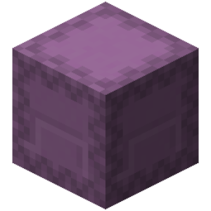 | game_add_custom_transmute_recipe | Add transmutation recipe | Adds a custom item transmutation recipe to the world. | game |  |  | false | false | recipe | basic | name: text replace_vanilla: enum input: item input_only_type: enum material: item material_only_type: enum result: item category: enum |
|  | game_block_growth | Set Block Growth Stage | Sets the growth stage for the block at the selected location. | game |  |  | false | false | block | basic | location: location growth_stage: number growth_type: enum |
|  | game_bloom_skulk_catalyst | Bloom Skulk Catalyst | Spreads sculk from a sculk catalyst to a location. | game | Sculk Catalyst |  | false | false | block | basic | location: location bloom_location: location charge: number |
|  | game_bone_meal_block | Bonemeal Block | Bonemeals a block at the selected location. | game |  |  | false | false | block | basic | location: location count: number |
|  | game_break_block | Break Block | Breaks blocks at the specified locations as if it were done by a Survival player with the right tool. | game |  |  | false | false | block | basic | locations: location tool: item drop_exp: enum |
| 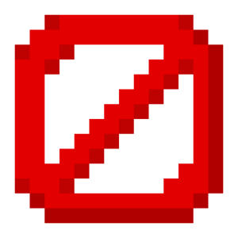 | game_cancel_event | Cancel Event | Cancels the start event that triggered this code. | game |  |  | false | false | event | basic |  |
| 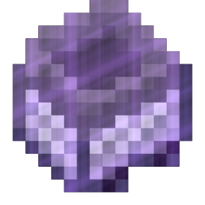 | game_chunk_get_custom_tag | Get a custom chunk tag | Retrieves a custom chunk tag and assigns the result to a variable. | game |  |  | false | false | block | basic | variable: variable location: location tag_name: text default_value: any |
| 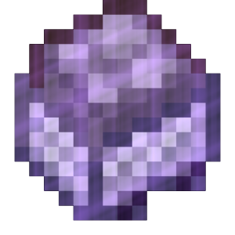 | game_chunk_get_custom_tags | Get custom chunk tags | Retrieves custom chunk tags and assigns the result to a variable. | game |  |  | false | false | block | basic | variable: variable location: location |
| 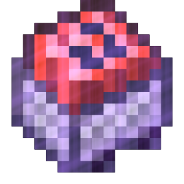 | game_chunk_remove_custom_tag | Remove Custom Chunk Tag | Removes the specified custom chunk tags. | game |  |  | false | false | block | basic | location: location tag_names: text |
|  | game_chunk_remove_custom_tags | Remove Custom Chunk Tags | Removes all custom chunk tags. | game |  |  | false | false | block | basic | location: location |
|  | game_chunk_set_custom_tag | Set Custom Chunk Tag | Sets the specified custom chunk tags. | game |  |  | false | false | block | basic | location: location tag_names: text tag_values: text |
|  | game_clear_container | Clear Container | Removes all items from a container at the selected location. | game | Containers |  | false | false | block | basic | location: location |
|  | game_clear_container_items | Clear Container Items | Clears the specified items from a container. | game | Containers |  | false | false | block | basic | location: location items: item |
|  | game_clear_custom_recipes | Clear custom recipes | Clears all custom recipes. | game |  |  | false | false | recipe | basic |  |
|  | game_clear_exploded_blocks | Clear Exploded Blocks | Returns exploded blocks to their original position. | game | Entity Explode Event Block Explode Event |  | false | false | event | basic | location: location |
|  | game_clear_region | Clear Region | Removes all blocks in a region. | game |  |  | false | false | block | basic | pos_1: location pos_2: location |
|  | game_clear_scoreboard_scores | Clear Scoreboard Values | Clears all values of the specified scoreboard. | game |  |  | false | false | scoreboard | basic | id: text |
| 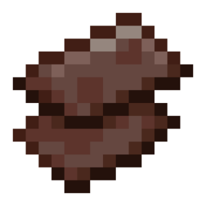 | game_clone_region | Clone Region Blocks | Clones a region to the selected location. | game |  |  | false | false | block | basic | pos_1: location pos_2: location target_pos: location paste_pos: location ignore_air: enum copy_entity: enum |
|  | game_create_explosion | Create Explosion | Creates an explosion at the specified location. | game |  |  | false | false | entity | basic | location: location power: number name_or_uuid: text fire: enum break_blocks: enum |
| 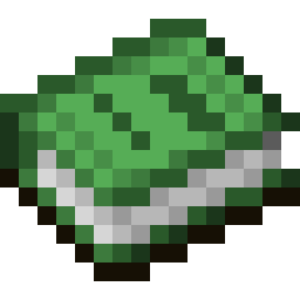 | game_create_scoreboard | Create Scoreboard | Creates a scoreboard with a specific ID. To display a scoreboard to a player, use the "Show scoreboard" action. | game |  |  | false | false | scoreboard | basic | id: text display_name: text |
|  | game_fill_container | Fill Container | Fills a container at the selected location with the specified items. | game | Containers |  | false | false | block | basic | location: location items: item |
| 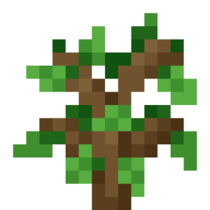 | game_generate_tree | Generate Tree | Generates a tree at the selected location. | game |  |  | false | false | block | basic | location: location tree_type: enum |
| 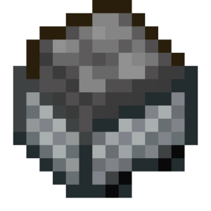 | game_get_tile_block_custom_tags | creative_plus.action.game_get_tile_block_custom_tags.name | creative_plus.action.game_get_tile_block_custom_tags.description | game | creative_plus.action.game_get_tile_block_custom_tags.work_with.tile_state_block |  | false | false | block | basic | variable: variable location: location |
|  | game_hide_event_message | Hide Event Message | Removes the message from the event that triggered this code. | game | Player Join Event Player Quit Event Player Death Event |  | false | false | event | basic | hide: enum |
|  | game_launch_firework | Spawn Firework | Launches firework at the specified location. | game |  |  | false | false | entity | basic | firework: item location: location movement: enum instant: enum |
|  | game_launch_projectile | Launch Projectile | Launches a projectile at the specified location. | game |  |  | false | false | entity | basic | projectile: item location: location speed: number inaccuracy: number custom_name: text trail: particle |
|  | game_random_tick_block | Random Tick Block | Updates a block (random tick) at the selected location. | game |  |  | false | false | block | basic | location: location times: number |
|  | game_remove_container_items | Remove Items From Container | Removes the specified items from a container at the selected location. | game | Containers |  | false | false | block | basic | location: location items: item |
|  | game_remove_custom_recipe | Remove custom recipe | Removes custom recipe from world. | game |  |  | false | false | recipe | basic | names: text remove_vanilla: enum |
|  | game_remove_scoreboard | Remove Scoreboard | Removes the specified scoreboard. | game |  |  | false | false | scoreboard | basic | id: text |
| 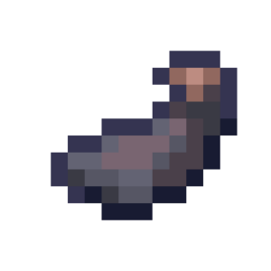 | game_remove_scoreboard_score_by_name | Remove Scoreboard Value By Text | Removes the value of the specified scoreboard by display text. | game |  |  | false | false | scoreboard | basic | id: text text: text |
| 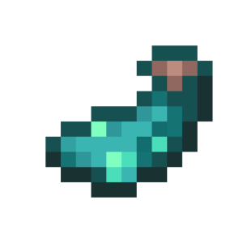 | game_remove_scoreboard_score_by_score | Remove Scoreboard Value By Score | Removes the value of the specified scoreboard by score. | game |  |  | false | false | scoreboard | basic | id: text score: number |
| 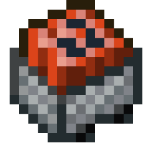 | game_remove_tile_block_custom_tag | Remove Block Entity Custom Tag | Removes the specified custom tag from the block entity at the location. | game | Block Entities (chests, signs, barrels, etc.) |  | false | false | block | basic | location: location tag_name: text |
|  | game_remove_tile_block_custom_tags | Remove custom entity block tags | Removes all custom tags of the entity block. | game | With block entities (chests, signs, barrels, etc.) |  | false | false | block | basic | location: location |
|  | game_replace_blocks_in_region | Replace Blocks in Region | Replaces blocks with others in the selected region. | game |  |  | false | false | block | basic | old_block: block pos_1: location pos_2: location new_block: block |
|  | game_replace_container_items | Replace Items in Container | Replaces the specified items in a container at the selected location with a specific item. | game | Containers |  | false | false | block | basic | items: item location: location replace: item count: number |
|  | game_send_web_request | Send Web Request | Sends a web request with the selected method and body to the selected URL. | game |  |  | false | false | web | basic | url: text content_body: text headers: map request_type: enum content_type: enum |
| 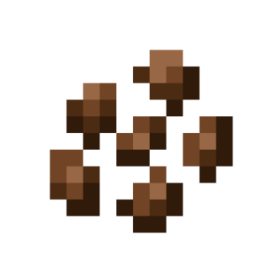 | game_set_age | Set Block Age | Sets the age of the block at the selected location. | game | Ageable blocks |  | false | false | block | basic | location: location tick: number |
|  | game_set_block | Set Block | Sets the selected block type on selected locations. | game |  |  | false | false | block | basic | block: block locations: location update_blocks: enum |
|  | game_set_block_analogue_power | Set Redstone Signal Strength | Sets the selected location to a specific signal strength. | game | Powerable blocks |  | false | false | block | basic | location: location power_level: number |
|  | game_set_block_data | Set Block Data | Sets the parameters of a block at a specific location. | game |  |  | false | true |  | basic | location: location block_data: text |
| 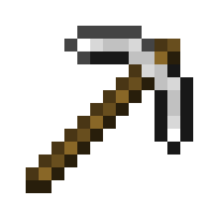 | game_set_block_drops_enabled | Set Block Drops | Sets a rule in the world to drop blocks when they are broken. | game |  |  | false | false | settings | basic | enable: enum |
|  | game_set_block_nbt | Set Block Entity NBT Tags | Sets the specified NBT tag on the block entity at the location. | game | Block Entities | Only NBT tags supported by the target block entity can be set. | false | false | block | basic | location: location tag_names: text tag_values: text |
| 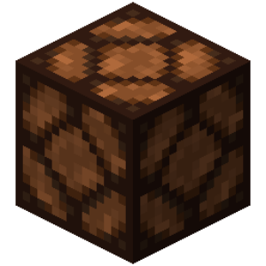 | game_set_block_powered | Activate Block | Activates a block at the selected location. | game | Powerable blocks |  | false | false | block | basic | location: location powered: enum |
|  | game_set_block_single_data | Set Block Single Data | Sets the given parameter to a block at the location to a given value. | game |  |  | false | false | block | basic | location: location data: text value: text |
|  | game_set_brushable_block_item | Set Item in Suspicious Block | Sets an item into a suspicious block (sand, gravel) at the selected location. | game | Suspicious Sand Suspicious Gravel |  | false | false | block | basic | location: location item: item |
|  | game_set_campfire_item | Set Campfire Item | Sets an item to a campfire at the selected location. | game | Campfires |  | false | false | block | basic | location: location item: item cooking_time: number slot: enum |
|  | game_set_container | Set Items In Container | Sets the specified items into a container at the selected location. | game | Containers |  | false | false | block | basic | location: location items: item |
| 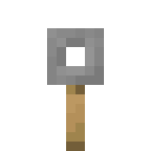 | game_set_container_lock | Set Container Key | Sets a specific key to a container at the selected location. | game |  | Any item with a specific name can serve as a container key. | false | false | block | basic | location: location container_key: text |
|  | game_set_container_name | Set Container Name | Sets the name of the container at the selected location. | game | Containers |  | false | false | block | basic | location: location name: text |
|  | game_set_copper_golem_statue_pose | Set Copper Golem Statue Pose | Sets the specified pose for the copper golem statue at the specified location. | game | Copper Golem Statues |  | false | false | block | basic | location: location pose: enum |
| 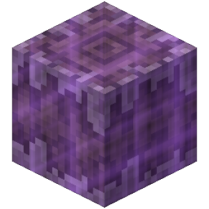 | game_set_creaking_heart_natural | Set Creaking Heart Natural | Sets whether the Creaking Heart at the specified location is natural. | game | Creaking Hearts | Whether the Creaking Heart is natural determines if experience drops when it is destroyed. | false | false | block | basic | location: location natural: enum |
| 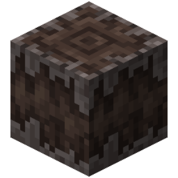 | game_set_creaking_heart_state | Set Creaking Heart State | Sets the state of the Creaking Heart at the specified location. | game | Creaking Hearts |  | false | false | block | basic | location: location heart_state: enum |
|  | game_set_decorate_pot_sherd | Set Decorate Pot Sherd | Sets the specified shard to the selected side of the vase at the specified location. | game | Decorated Pots |  | false | false | block | basic | location: location item: item side: enum |
| 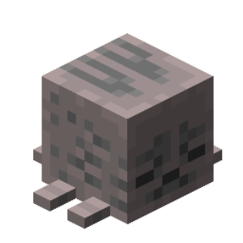 | game_set_dried_ghast_hydration | Set Dried Ghast Hydration | Sets the hydration of the Dried Ghast at the specified location. | game | Dried Ghasts |  | false | false | block | basic | location: location hydration: number |
|  | game_set_event_anvil_damage_state | Set Anvil Damage State | Sets the damage state of the anvil. | game | Event "Player Damages Anvil" |  | false | false | event | basic | damage_state: enum |
|  | game_set_event_anvil_repair_cost | Set Anvil Action Cost | Sets the cost of the action being performed at the anvil. | game | Player Gets Result Event |  | false | false | event | basic | repair_cost: number repair_cost_type: enum bypass_cost: enum |
|  | game_set_event_combust_duration | Set Event Burn Duration | Sets the burn duration associated with this event. | game | Event "Player catches fire" Event "Entity catches fire" |  | false | false | event | basic | duration: number |
|  | game_set_event_damage | Set Event Damage | Sets the damage associated with this event. | game | Damage Events Event "Player Damages Item" |  | false | false | event | basic | damage: number |
|  | game_set_event_death_screen_message | Set Death Screen Message | Sets the death screen message displayed on the death screen, associated with this event. | game | Event "Player dies" | If the provided value is empty, the default message is set. The set message is limited to 256 characters. | false | false | event | basic | message: text |
|  | game_set_event_enchantment_offers | Set Event Enchantment Offers | Sets the enchantment offers for the event. | game | Player Enchant Item Event |  | false | false | event | basic | enchantments: text levels: number costs: number |
|  | game_set_event_exhaustion | Set Event Exhaustion | Sets the exhaustion level. | game | Player Exhaustion |  | false | false | event | basic | exhaustion: number |
| 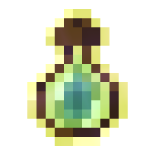 | game_set_event_experience | Set Event Experience | Sets the experience value associated with this event. | game | Fishing Event Experience Gain Event Kill Events |  | false | false | event | basic | experience: number |
|  | game_set_event_gamemode | Set Event Game Mode | Sets the game mode associated with the event. | game | Event "Player requests game mode change menu" |  | false | false | event | basic | gamemode: enum |
|  | game_set_event_heal | Set Event Heal | Sets the heal value associated with this event. | game | Player Heal Event Entity Heal Event |  | false | false | event | basic | heal: number |
| 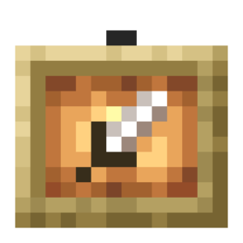 | game_set_event_item | Set Event Item | Sets the item associated with this event. | game |  |  | false | false | event | basic | item: item |
|  | game_set_event_item_cooldown | Set Event Item Cooldown | Sets the item cooldown associated with this event. | game | Event "Player uses item with cooldown" Event "Player receives cooldown for item group" |  | false | false | event | basic | cooldown: number |
| 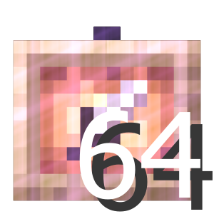 | game_set_event_items | Set Event Items | Sets the items related to the event. | game |  |  | false | false | event | basic | items: item |
|  | game_set_event_knockback_vector | Set Event Knockback Vector | Sets the knockback vector associated with this event. | game | Event "Player is knocked back" Event "Entity is knocked back" |  | false | false | event | basic | knockback: vector |
| 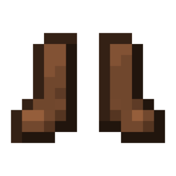 | game_set_event_move_allowed | Allow Movement | Allows movement if it fails. | game | Player Failed to Move Event |  | false | false | event | basic | allowed: enum |
|  | game_set_event_projectile | Set Event Projectile | Replaces the projectile associated with this event. | game |  |  | false | false | event | basic | projectile: item name: text |
|  | game_set_event_should_drop_leash | Set Event Leash Drop | Sets whether the leash associated with the event will be dropped. | game | Unleash Events |  | false | false | event | basic | should_drop_leash: enum |
| 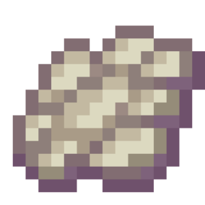 | game_set_event_should_play_effect | Set Event Particle Effect | Sets whether the particles associated with the event will be spawned. | game | Event "Block Failed to Dispense Item" |  | false | false | event | basic | should_play_effect: enum |
| 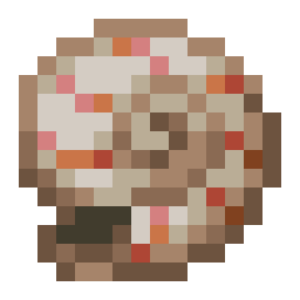 | game_set_event_sound | Set Event Sound | Sets the sound to play associated with this event, replacing the original one. | game |  |  | false | false | event | basic | sound: sound |
|  | game_set_event_source_slot | Set Event Source Slot | Sets the source slot of the event. | game | Player Pick Item |  | false | false | event | basic | source_slot: number |
|  | game_set_event_target_slot | Set Event Target Slot | Sets the destination slot of the event. | game | Player Pick Item |  | false | false | event | basic | target: number |
|  | game_set_event_uery_info | Add Tags To Received Info | Adds additional tags to the received debug info that will be copied to the clipboard if the event is not cancelled. | game | Player Receives Block Information Event Player Receives Entity Info Event | Additional information only changes. | false | false | event | basic | information: text |
|  | game_set_event_velocity | Set Event Velocity Vector | Sets the velocity vector associated with this event. | game | Event "Player changed velocity vector" |  | false | false | event | basic | velocity: vector |
|  | game_set_furnace_cook_time | Set Furnace Cooking Time | Sets the cooking time for the oven at the selected location. | game | Furnaces Blast Furnaces Smokers |  | false | false | block | basic | location: location time: number |
| 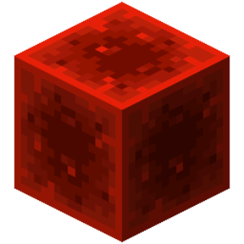 | game_set_hardcore | creative_plus.action.game_set_hardcore.name | creative_plus.action.game_set_hardcore.description | game |  |  | false | true |  | basic | hardcore: enum |
|  | game_set_item_in_container_slot | Set Item In Container Slot | Sets an item in the specified container slot at the selected location. | game | Containers |  | false | false | block | basic | location: location item: item slot: number |
|  | game_set_lectern_book | Set Book In Lectern | Sets a book in the lectern at the selected location. | game | Lecterns |  | false | false | block | basic | location: location item: item page: number |
|  | game_set_player_head | Set Player Head | Sets the player's head at the selected location. | game | Player Heads |  | false | false | block | basic | location: location name_or_uuid: text receive_type: enum |
| 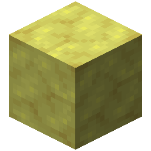 | game_set_potent_sulfur_state | Set Potent Sulfur State | Sets the state of the potent sulfur. | game | Potent Sulfur |  | false | false | block | basic | location: location state: enum |
| 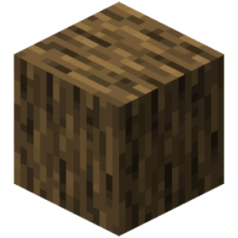 | game_set_region | Set Blocks In Region | Sets the selected block type to the entire selected region. | game |  |  | false | false | block | basic | block: block pos_1: location pos_2: location |
|  | game_set_scoreboard_line | Set Scoreboard Line | Sets a line in the scoreboard | game |  |  | false | false | scoreboard | basic | id: text line: text display: text score: number format_content: text format: enum |
|  | game_set_scoreboard_line_display | Set Scoreboard Line Display | Sets a scoreboard line to a text. | game |  |  | false | false | scoreboard | basic | id: text line: text display: text |
|  | game_set_scoreboard_line_format | Set Scoreboard Line Format | Sets the text formatting of a specific scoreboard line. | game |  |  | false | false | scoreboard | basic | id: text line: text format_content: text format: enum |
| 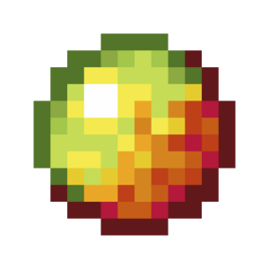 | game_set_scoreboard_number_format | Set Scoreboard Number Format | Sets the format for the values of the scoreboard. | game |  |  | false | false | scoreboard | basic | id: text format_content: text format: enum |
|  | game_set_scoreboard_score | Set Scoreboard Value | Sets the value of the specified scoreboard with the displayed text and score. | game |  |  | false | false | scoreboard | basic | id: text text: text score: number |
|  | game_set_scoreboard_title | Change Scoreboard Title | Changes the title of the specified scoreboard. | game |  |  | false | false | scoreboard | basic | id: text title: text |
|  | game_set_sculk_shrieker_can_summon | Set Sculk Shrieker Can Summon | Sets the Sculk Shriker's ability to summon Wardens. | game | Sculk Shrieker |  | false | false | block | basic | location: location can_summon: enum |
| 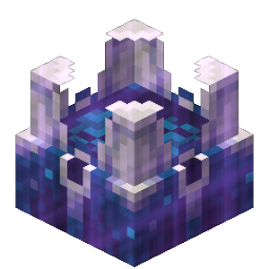 | game_set_sculk_shrieker_shrieking | Set Sculk Shrieker Shrieking | Sets the shrieking status of a Sculk Shrieker. | game | Sculk Shrieker |  | false | false | block | basic | location: location shrieking: enum |
| 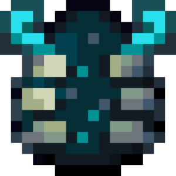 | game_set_sculk_shrieker_warning_level | Set Sculk Shrieker Warning Level | Sets the warning levels of a Sculk Shrieker. | game | Sculk Shrieker |  | false | false | block | basic | location: location warning_level: number |
|  | game_set_sign_text | Set Sign Text | Sets the sign text at the selected location. | game | Signs |  | false | false | block | basic | location: location text: text line: number side: enum |
| 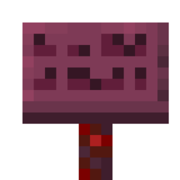 | game_set_sign_text_color | Set Sign Text Color | Sets the color of sign text at the selected location. | game | Signs |  | false | false | block | basic | location: location side: enum sign_text_color: enum glowing: enum |
| 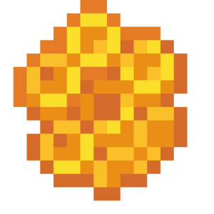 | game_set_sign_waxed | Set Sign Waxed | Sets the waxedness of the sign at the selected location. | game | Signs |  | false | false | block | basic | location: location waxed: enum |
| 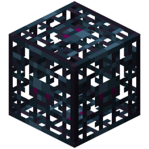 | game_set_spawner_entity | Set Spawner Entity | Sets the entity that spawns near a Spawner. | game | Spawner |  | false | false | block | basic | location: location entity: item |
|  | game_set_tile_block_custom_tag | Set Block Entity Custom Tag | Sets the specified custom tag on the block entity at the location. | game | Block Entities (chests, signs, barrels, etc.) |  | false | false | block | basic | location: location tag_name: text tag_value: text |
| 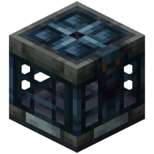 | game_set_vault_displayed_item | Set Vault Displayed Item | Sets the displayed item of the vault at the specified location. | game | Vaults | Calling the action again overwrites the displayed item. | false | false | block | basic | location: location item: item |
| 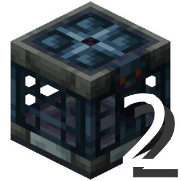 | game_set_vault_next_state_update_time | Set Vault Next State Update Time | Sets the time until the next state transition for the vault at the specified location. | game | Vaults | You must set the exact time when the vault will transition to the next state. By default, selects the maximum possible value. | false | false | block | basic | location: location time: number |
| 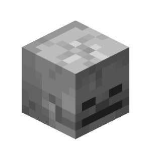 | game_set_world_difficulty | Set World Difficulty | Sets a specific world difficulty. | game |  |  | false | false | settings | basic | difficulty: enum |
|  | game_set_world_gamerule | Set World Gamerule | Sets a specific game rule in the world. | game |  | Leave the value argument empty to reset the gamerule to its default state. | false | false | settings | basic | gamerule: enum value: text |
|  | game_set_world_simulation_distance | Set World Simulation Distance | Sets the chunk simulation distance for the world. | game |  |  | false | false | settings | basic | distance: number |
|  | game_set_world_time | Set World Time | Sets the world time in ticks. | game |  |  | false | false | settings | basic | time: number |
|  | game_set_world_weather | Set World Weather | Sets the world's weather for a certain amount of time. | game |  | By default, if no duration is specified, the weather will not change. | false | false | settings | basic | weather_type: enum weather_duration: number |
| 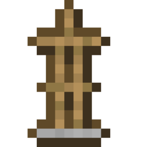 | game_spawn_armor_stand | Spawn Armor Stand | Spawns an armor stand at the specified location. | game |  |  | false | false | entity | basic | helmet: item chestplate: item leggings: item boots: item right_hand: item left_hand: item gravity: enum marker: enum small: enum show_arms: enum base_plate: enum invisible: enum location: location custom_name: text |
|  | game_spawn_block_display | Spawn Block Display | Spawns a block renderer at the specified location | game |  |  | false | false | entity | basic | spawn_location: location custom_name: text block: block |
| 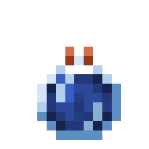 | game_spawn_effect_cloud | Spawn Effect Cloud | Spawns a cloud of misty potion that infuses the effects of the entities in it. | game |  |  | false | false | entity | basic | location: location effects: potion radius: number duration: number particle: particle custom_name: text |
|  | game_spawn_end_crystal | Spawn End Crystal | Spawns an End Crystal at the specified location. | game |  |  | false | false | entity | basic | location: location custom_name: text show_bottom: enum |
| 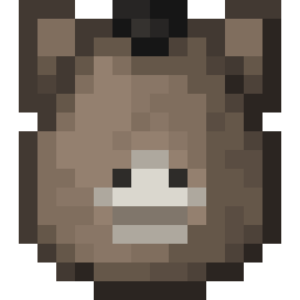 | game_spawn_evoker_fangs | Spawn Evoker Fangs | Spawns the Evoker fangs at the specified location. | game |  |  | false | false | entity | basic | location: location custom_name: text |
|  | game_spawn_experience_orb | Spawn Experience Orb | Spawns an Experience Orb at the specified location with the selected options. | game |  |  | false | false | entity | basic | location: location experience_amount: number custom_name: text |
|  | game_spawn_eye_of_ender | Spawn Eye of Ender | Spawns an Eye of End at the target location that will move towards the target. | game |  |  | false | false | entity | basic | location: location destination: location lifespan: number custom_name: text end_of_lifespan: enum |
|  | game_spawn_falling_block | Spawn Falling Block | Spawns a falling block at the specified location. | game |  |  | false | false | entity | basic | block: block location: location name: text should_expire: enum |
|  | game_spawn_interaction_entity | Spawn Interaction Entity | Spawns an interaction entity at the specified location | game |  |  | false | false | entity | basic | location: location custom_name: text width: number height: number responsive: enum |
|  | game_spawn_item | Spawn Item | Spawns an item at the specified location with the selected options. | game |  |  | false | false | entity | basic | item: item location: location custom_name: text apply_motion: enum can_mob_pickup: enum can_player_pickup: enum |
|  | game_spawn_item_display | Spawn Item Display | Spawns an item visualizer at the specified location | game |  |  | false | false | entity | basic | spawn_location: location custom_name: text displayed_item: item |
| 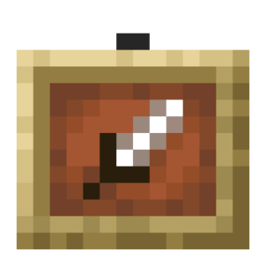 | game_spawn_item_frame | Spawn Item Frame | Spawns an item frame at the specified location. | game |  |  | false | false | entity | basic | spawn_location: location item: item rotation: enum block_face: enum glowing: enum visible: enum fixed: enum |
|  | game_spawn_lightning_bolt | Spawn Lightning | Spawns lightning at the specified location. | game |  |  | false | false | entity | basic | location: location |
| 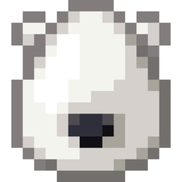 | game_spawn_mob | Spawn Entity | Spawns a mob at the specified location with the selected options. | game |  |  | false | false | entity | basic | mob: item location: location health: number custom_name: text potion_effects: potion main_hand: item helmet: item chestplate: item leggings: item boots: item off_hand: item natural_equipment: enum |
|  | game_spawn_painting | Spawn Painting | Spawns a painting at the specified location. | game |  |  | false | false | entity | basic | spawn_location: location art: text block_face: enum |
|  | game_spawn_primed_tnt | Spawn Ignited TNT | Spawns ignited dynamite at the specified location. | game |  |  | false | false | entity | basic | location: location tnt_power: number fuse_duration: number custom_name: text block: block |
|  | game_spawn_shulker_bullet | Spawn Shulker Bullet | Spawns a Shulker Bullet at the specified location. | game |  |  | false | false | entity | basic | location: location custom_name: text |
| 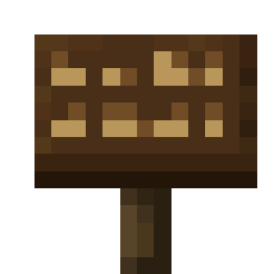 | game_spawn_text_display | Spawn Text Display | Spawns a text renderer at the specified location | game |  |  | false | false | entity | basic | spawn_location: location custom_name: text merging_mode: enum displayed_text: text |
|  | game_spawn_vehicle | Spawn Vehicle | Spawns a vehicle at the specified location with the selected options. | game |  |  | false | false | entity | basic | vehicle: item location: location custom_name: text |
|  | game_uncancel_event | Uncancel Event | Returns the cancellation of the event that triggered this code. | game |  |  | false | false | event | basic |  |
| 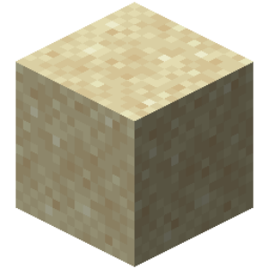 | game_update_block | Update Adjacent Block | Updates adjacent blocks at the specified location if the block is not air. The block on the location itself is not updated, but it can be updated from adjacent blocks. | game |  |  | false | false | block | basic | location: location |
| 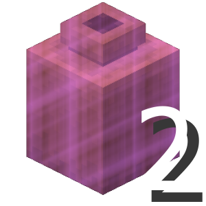 | game_wobble_decorated_pot | Set Decorated Pot Wobble | Sets the specified wobble type for the decorated pot at the specified location. | game | Decorated Pots |  | false | false | block | basic | location: location style: enum |
|  | if_game_block_equals | Block Equals | Checks if a block at a specific location is a specific block type. | if_game |  |  | false | false |  | container | location: location blocks: block |
| 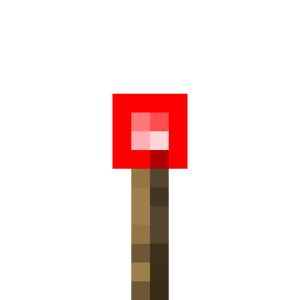 | if_game_block_powered | Block Powered by Redstone | Checks if a block at a specific location is powered by redstone. | if_game |  |  | false | false |  | container | locations: location power_mode: enum |
| 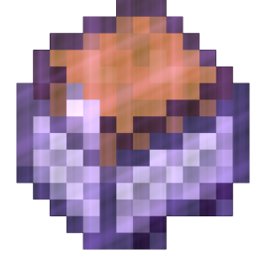 | if_game_chunk_has_custom_tag | The chunk has a custom tag | Checks whether the chunk has the specified custom tag. | if_game |  |  | false | false |  | container | location: location tag: text tag_value: text compare_type: enum |
|  | if_game_chunk_is_loaded | Chunk Is Loaded | Checks if the location has a chunk loaded | if_game |  |  | false | false |  | container | location: location |
|  | if_game_container_has | Container Has an Item | Checks if a container at a specific location has certain items in its inventory. | if_game |  |  | false | false |  | container | location: location items: item check_mode: enum comparison_mode: enum |
|  | if_game_container_has_room_for_item | Container Has Room For Items | Checks if a container at a specific location has room for items in its inventory. | if_game |  |  | false | false |  | container | location: location items: item check_mode: enum |
| 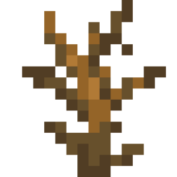 | if_game_damage_cause_equals | Event Damage Source Equals | Checks if the event's damage source is equal to the selected one. | if_game |  |  | false | false |  | container | cause: enum |
|  | if_game_event_attack_is_critical | Attack Was Critical | Checks if an attack in an event was a critical attack. | if_game |  |  | false | false |  | container |  |
|  | if_game_event_block_equals | Event Block Equals | Checks if the current event's block is equal to certain blocks. | if_game |  |  | false | false |  | container | blocks: block locations: location |
| 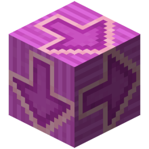 | if_game_event_has_input | Movement Key Equals | Checks whether the movement key from the event equals the selected key. | if_game | Event "Player changes movement keys pressed" |  | false | false |  | container | input_type: enum |
| 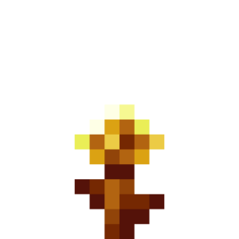 | if_game_event_is_age_locked | Growth has stopped | Checks whether propagation has been stopped for the event | if_game | Halting growth like a golden dandelion |  | false | false |  | container |  |
|  | if_game_event_is_canceled | Event Cancelled | Checks if the event has been cancelled. | if_game |  |  | false | false |  | container |  |
|  | if_game_event_item_equals | Event Item Equals | Checks if the current event item is equal to certain items. | if_game |  |  | false | false |  | container | items: item comparison_mode: enum |
|  | if_game_has_entity | Entity in World | Checks whether a specific entity exists in the world. | if_game |  |  | false | false |  | container | names_or_uuids: text check_mode: enum |
|  | if_game_has_player | Player Online | Checks if a certain player is in the game. | if_game |  |  | false | false |  | container | names_or_uuids: text check_mode: enum |
|  | if_game_heal_cause_equals | Healing Source Equals | Checks if the heal source is equal to the selected one. | if_game |  |  | false | false |  | container | heal_cause: enum |
|  | if_game_ignite_cause_equals | Ignite Cause Equals | Checks if the fire source is equal to the selected one. | if_game |  |  | false | false |  | container | cause: enum |
|  | if_game_instrument_equals | Sound Instrument Equals | Checks if the instrument in the event is equal to the selected one. | if_game |  |  | false | false |  | container | instrument: enum |
|  | if_game_location_in_block | If Location in Block | Checks if the specified location is in a block. | if_game |  |  | false | false |  | container | location: location |
|  | if_game_sign_contains | Sign Contains Text | Checks if a sign at a given location contains the specified text. | if_game |  |  | false | false |  | container | location: location texts: text check_side: enum check_mode: enum lines: enum |
|  | if_game_tile_block_has_custom_tag | Block Entity Has Custom Tag | Checks if the block entity has the specified custom tag. | if_game |  |  | false | false |  | container | location: location tag: text tag_value: text compare_type: enum |
