# Events

| Icon | ID | Name | Description | Category | Cancellable | Works with | Additional info | Unused | Deprecated |
| --- | --- | --- | --- | --- | --- | --- | --- | --- | --- |
| 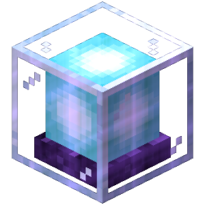 | beacon_activate | Beacon Activated | Executes code when a beacon is activated. | world | false |  |  | false | false |
|  | beacon_deactivate | Beacon Deactivated | Executes code when a beacon is deactivated. | world | false |  |  | false | false |
| 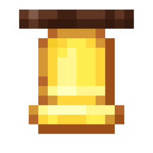 | bell_ring | Bell rings | Runs code when a bell rings in the world. | world | true |  |  | false | false |
|  | block_break_block | Block Breaks Block | Executes code when a block (liquid or piston) breaks another block. | world | false |  |  | false | false |
|  | block_burn | Block burns | Runs code when a block burns. | world | true |  |  | false | false |
|  | block_damage | Player starts breaking a block | Runs code when a player starts breaking a block. | player | true |  |  | false | false |
|  | block_damage_abort | Player stops breaking a block | Runs code when a player stops breaking a block. | player | false |  |  | false | false |
|  | block_dispense_loot | Block Dispenses Loot | Executes code when a block dispenses loot. | world | true | Vaults |  | false | false |
| 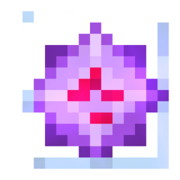 | block_explode | Block explodes | Runs code when a block explodes. | world | true |  |  | false | false |
|  | block_fade | Block fades | Runs code when a block fades, such as when ice or snow melts, fire goes out, or coral dries out. | world | true | Snow Ice Fire Corals Turtle eggs Grass |  | false | false |
| 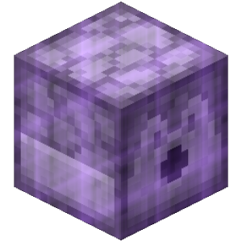 | block_failed_dispense | Block Failed to Dispense Item | Executes code when a block fails to dispense an item. | world | false |  |  | false | false |
|  | block_fall | Block starts falling | Runs code when a block affected by gravity becomes a falling block. | entity | true |  |  | false | false |
| 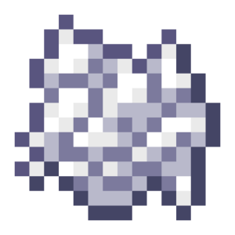 | block_fertilize | Block gets bonemealed | Executes code when a block is bonemealed. | world | true |  |  | false | false |
| 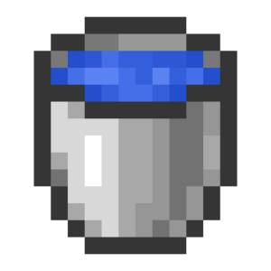 | block_flow | Block moves | Runs code when a block is moved. | world | true | Liquids Dragon egg |  | false | false |
|  | block_form | Block generates | Runs code when a block is generated after block interactions. | world | true | Snow Ice Generating cobblestone etc. Concrete hardening |  | false | false |
| 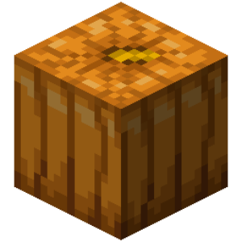 | block_form_by_entity | Block generated By an entity | Runs code when a block is generated after blocks and entities interact. | entity | true | Snow Golems Frost Walker Enchantment |  | false | false |
|  | block_grow | Block grows | Runs code when a block grows. | world | true | Seeds Pumpkins and watermelons Turtle eggs |  | false | false |
| 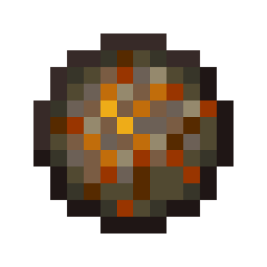 | block_ignite | Block ignites | Runs code when a block is ignited. | world | true |  |  | false | false |
|  | block_piston_extend | Piston extends | Runs code when a piston extends a block. | world | true |  |  | false | false |
| 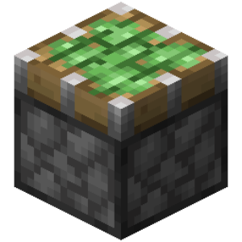 | block_piston_retract | Piston retracts | Runs code when a piston retracts a block. | world | true |  |  | false | false |
| 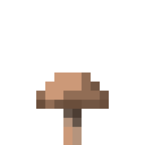 | block_spread | Block spreads | Executes code when a block spreads. | world | true | Mushrooms Fire creative_plus.trigger.block_spread.work_with.grass_block |  | false | false |
|  | brew_complete | Brewing is completed | Executes code when potions in a block are brewed. | world | true |  |  | false | false |
|  | chunk_load | Chunk loaded | Executes code, when the chunk loads. | world | false |  | The "Event block location" value for this event corresponds to the bottom-most block of the chunk. | false | false |
| 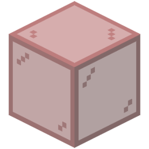 | chunk_unload | Chunk unloaded | Executes code, when the chunk unloads. | world | false |  | The "Event block location" value for this event corresponds to the bottom-most block of the chunk. | false | false |
| 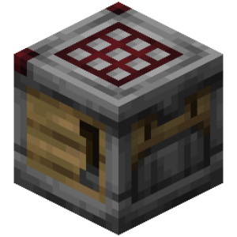 | crafter_craft | Crafter Crafts Item | Executes code when a crafter crafts an item. | world | true | Crafters |  | false | false |
|  | dispenser_dispense_item | Block dispenses an item | Executes code when a block dispenses an item. | world | true |  |  | false | false |
| 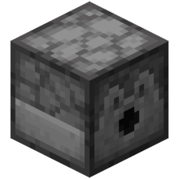 | dispenser_equip_armor | Dispenser puts armor on an entity | Runs code when a dispenser equips an entity with armor. | world | true |  |  | false | false |
|  | dispenser_shear_sheep | Dispenser shears a sheep | Executes code when a dispenser cuts wool from a sheep. | entity | true |  |  | false | false |
|  | elder_guardian_appears_at_player | Guardian Appears at Player | Triggers when an Elder Guardian curses a player. | player | true |  |  | false | false |
| 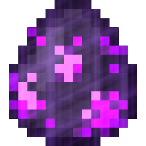 | enderman_attack_player | Enderman gets angry | Runs code when an enderman gets mad at a player. | entity | true |  |  | false | false |
|  | enderman_escape | Enderman escapes | Runs code when an enderman teleports to escape something. | entity | true |  |  | false | false |
|  | entity_bell_ring | Entity rings a bell | Runs code when an entity rings a bell. | entity | true |  |  | false | false |
|  | entity_block_break_progress_update | Block Break Progress Update | Executes code when an entity updates the block break progress. | entity | false | Zombies |  | false | false |
| 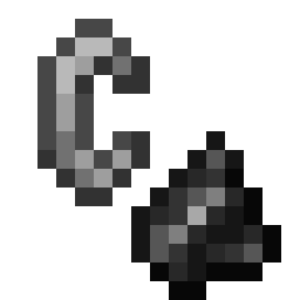 | entity_combust | Entity catches fire | Executes code when an entity catches fire. | entity | true |  |  | false | false |
|  | entity_damage_entity | Mob damages another mob | Runs code when a mob deals damage to another mob. | entity | true |  |  | false | false |
| 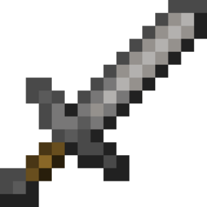 | entity_damage_player | Entity damages a player | Executes code when the entity damages a player. | player | true |  |  | false | false |
|  | entity_death | Entity dies | Executes code when an entity dies. | entity | true |  |  | false | false |
| 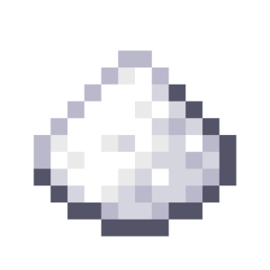 | entity_drop_item | Entity drops an item | Executes code when an entity drops an item. | entity | true |  |  | false | false |
| 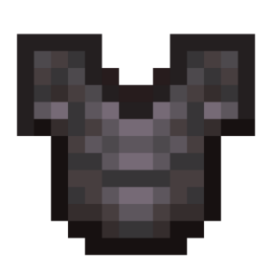 | entity_equipment_changed | Entity changes equipment | Executes code when an entity's equipment changes. | entity | false |  | The event fires after the attributes or enchantments of any equipment piece change. | false | false |
|  | entity_explode | Entity explodes | Runs code when an entity explodes. | entity | true |  |  | false | false |
|  | entity_explosion | Entity starts exploding | Runs code when an entity starts to explode. | entity | true |  |  | false | false |
| 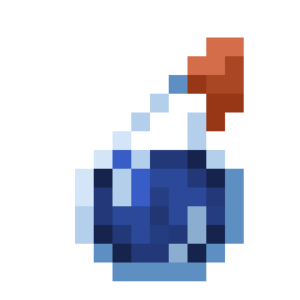 | entity_heal | Entity restores health | Runs code when an entity regenerates health in any way. | entity | true |  |  | false | false |
|  | entity_interact | Entity interacts with the world | Runs code when an entity interacts with the world. | entity | true |  |  | false | false |
|  | entity_kill_entity | Mob kills another mob | Runs code when a mob kills another mob. | entity | true |  |  | false | false |
|  | entity_knockback | Entity Take Knockback | Executes code when an entity is knocked back. | entity | true |  |  | false | false |
| 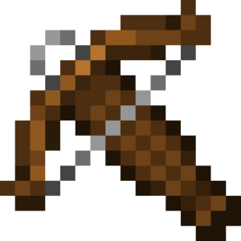 | entity_load_crossbow | Entity Load Crossbow | Triggers when an entity loads a Crossbow. | entity | true |  |  | false | false |
|  | entity_pickup_item | Entity pickups an item | Executes code when an entity picks up an item. | entity | true |  |  | false | false |
|  | entity_removed_from_world | Entity removed | Executes code when an entity is removed from the world. | entity | false |  |  | false | false |
|  | entity_resurrect | Entity gets ressurected | Runs code when an entity is resurrected by a Totem of Undying. | entity | true |  | By default, this event is cancelled if the entity is not holding a Totem of Undying. | false | false |
|  | entity_shot_bow | Entity Shot Bow | Triggers when an entity shoots a bow. | entity | true |  |  | false | false |
| 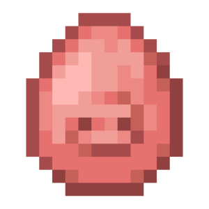 | entity_spawn | Entity spawns | Executes code when a new entity spawns in the world. | entity | true |  |  | false | false |
|  | entity_spell_cast | Entity casts a spell | Executes code when an entity performs a spell. | entity | true | Evokers Illusioners |  | false | false |
| 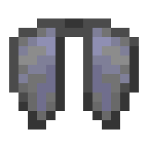 | entity_start_gliding | Entity starts gliding with elytra | Executes code when an entity starts gliding with elytra. | entity | true |  |  | false | false |
|  | entity_stop_gliding | Entity stops gliding with elytra | Executes code when an entity stops gliding with elytra. | entity | true |  |  | false | false |
|  | entity_take_damage | Entity takes damage | Runs code when an entity takes damage. | entity | true |  |  | false | false |
|  | entity_teleport | Entity Teleports | Executes code when an entity teleports or is teleported. | entity | true |  |  | false | false |
|  | entity_transform | Entity Transform | Triggers when an entity transforms into another entity. | entity | true |  |  | false | false |
|  | entity_unleash_event | Entity Unleashed | Executes code when an entity is detached from a leash. | entity | true |  |  | false | false |
|  | experience_orb_merge | Experience Orbs Merge | Executes code when an experience orb merges with another experience orb. | entity | true |  |  | false | false |
|  | falling_block_land | Falling Block Lands | Runs code when a falling block turns into a regular block. | entity | true |  |  | false | false |
|  | firework_explode | Firework explodes | Runs code when a firework explodes. | entity | true |  |  | false | false |
|  | fishing_hook_state_change | Fishing hook changes state | Executes code when a fishing hook changes its state. | entity | false | Fishing hook |  | false | false |
| 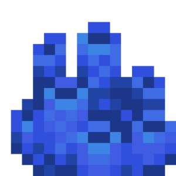 | fluid_level_change | Fluid Level Change | Runs code when the water level in a block changes. | world | true |  |  | false | false |
| 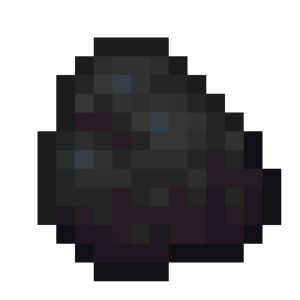 | furnace_burn | Furnace Uses Fuel | Triggers when a furnace burns another object as fuel. | world | true | Furnaces Blast Furnaces Smokers |  | false | false |
| 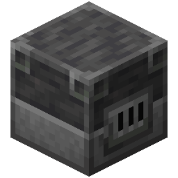 | furnace_smelt | Furnace End Smelt | Triggers when a furnace finishes smelting an item. | world | true | Furnaces Blast Furnaces Smokers |  | false | false |
|  | furnace_start_smelt | Furnace Start Smelt | Triggers when a furnace starts smelting items. | world | false | Furnaces Blast Furnaces Smokers |  | false | false |
|  | goat_ram_entity | Goat Ram Entity | Triggers when a goat rams into an entity. | entity | true |  |  | false | false |
|  | hanging_break | Hanging entity breaks | Runs code when a hanging entity breaks. | entity | true | Item frames Paintings Leashes |  | false | false |
| 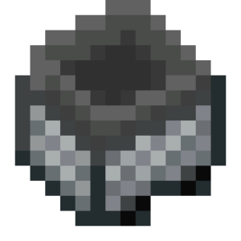 | hopper_pickup_item | Hopper Pickups Item | Runs code when the hopper picks up an item. | entity | true |  | Use the Victim target to select an item as an entity. | false | false |
|  | item_despawn | Item disappears | Runs code when an item disappears from the world 5 minutes after it was created. | entity | true |  |  | false | false |
|  | item_merge | Items Merge | Executes code when nearby items combine into a single stack. | entity | true |  |  | false | false |
|  | item_moved_into_container | Item Moved Into Container | Runs code when an item is moved into a container. | world | true |  |  | false | false |
| 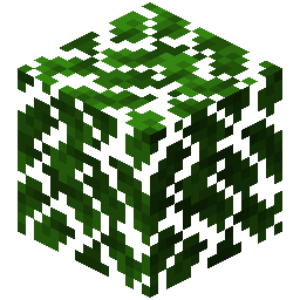 | leaves_decay | Leaves decay | Runs code when leaves decay by time. | world | true |  |  | false | false |
| 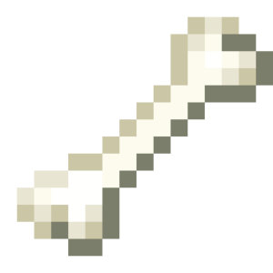 | mob_kill_player | Mob kills a player | Executes code when a mob kills a player. | player | true |  |  | false | false |
| 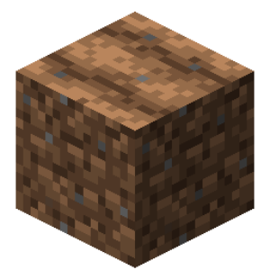 | moisture_change | Farmland Changes Moisture | Executes code when a farmland block becomes wet or dries out. | world | true |  |  | false | false |
|  | note_play | Note block playing | Runs code when a note block in the world plays a sound. | world | true |  |  | false | false |
| 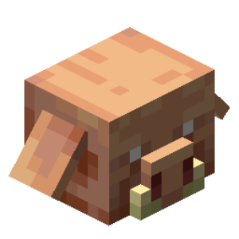 | piglin_barter | Piglin Barter | Triggers when a Piglin barters. | entity | true |  |  | false | false |
|  | player_anticheat_flag | Anticheat Flags a Player | Runs the code when the anticheat flags a player for cheating. Only fires in recommended worlds. | player | false | World Anticheat Settings |  | false | false |
| 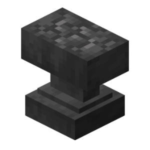 | player_anvil_damaged | Player Damages Anvil | Executes code when a player damages an anvil. | player | true | Anvils |  | false | false |
|  | player_anvil_rename_input | Player Renames Item | Executes code when a player renames an item using an anvil. | player | false | Anvils | Event is fired before the item is renamed | false | false |
|  | player_arm_swing | Player swings hand | Executes code when a player waves their right or left hand. | player | true |  |  | false | false |
| 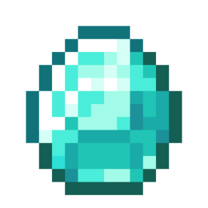 | player_ask_gamemode_change | Player requests game mode change menu | Executes code when a player requests the game mode change menu. | player | true | Key combination F3 + F4 Key combination F3 + N | By default, this event is cancelled if the player does not have permission to change game mode. | false | false |
| 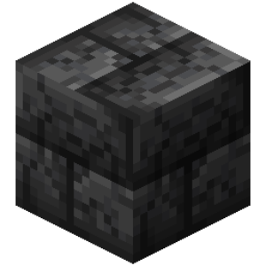 | player_block_break_progress_update | Block Break Progress Update | Executes code when a player updates the block break progress. | player | false |  |  | false | false |
|  | player_block_dispense_loot | Player Causes Block to Dispense Loot | Executes code when a player causes a block to dispense loot. | player | true | Vaults |  | false | false |
| 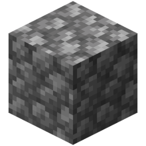 | player_break_block | Player breaks a block | Executes code when a player breaks a block. | player | true |  | By default, this event is cancelled if a player in creative mode breaks a block while holding a sword or trident. | false | false |
| 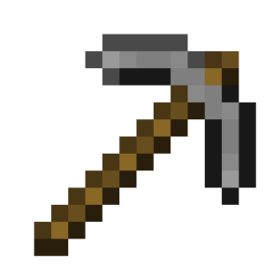 | player_break_item | Player breaks an item | Executes code when a player breaks an item. | player | false |  |  | false | false |
|  | player_change_slot | Player changes hotbar slot | Executes code when a player changes a hotbar slot. | player | true |  |  | false | false |
|  | player_chat | Player sends a message | Executes code when a player writes a message in chat. | player | true |  |  | false | false |
|  | player_click_inventory | Player clicks in an inventory | Executes code when a player clicks in an inventory menu. | player | true |  | By default, this event is cancelled if the player is in spectator mode. | false | false |
|  | player_click_own_inventory | Player clicks in their inventory | Executes code when a player clicks in their own inventory. | player | true |  | By default, this event is cancelled if the player is in spectator mode. | false | false |
|  | player_close_advancements_menu | Close Advancements | Triggers when the player closes the advancements tab. | player | false |  |  | true | false |
|  | player_close_inventory | Player closes an inventory | Executes code when a player closes inventory. | player | false |  |  | false | false |
|  | player_combust | Player catches fire | Executes code when a player catches fire. | player | true |  |  | false | false |
|  | player_consume_item | Player consumes an item | Runs code when a player eats or drinks an item. | player | true | Food Potions Milk |  | false | false |
| 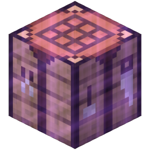 | player_craft_item | Player crafts an item | Executes code when a player crafts an item. | player | true |  |  | false | false |
|  | player_currency_transaction | Player Makes a Transaction | Executes code when a player makes a transaction in emeralds. | player | false |  |  | false | false |
|  | player_custom_click | Player triggers custom click | Executes code when a player triggers a custom click in a dialog menu or chat. | player | false |  |  | false | false |
|  | player_damage_entity | Player damages an entity | Executes code when a player damages an entity. | player | true |  |  | false | false |
| 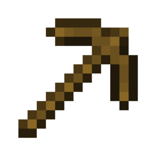 | player_damage_item | Player Damages Item | Executes code when an item in the player's inventory takes damage. | player | true |  |  | false | false |
|  | player_damage_player | Player damages another player | Executes code when a player hurts another player. | player | true |  |  | false | false |
|  | player_death | Player dies | Executes code when a player dies. | player | true |  |  | false | false |
| 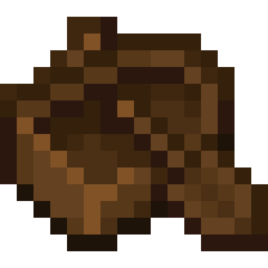 | player_dismount | Player dismounts | Executes code when a player dismounts from a boat, a horse, or another entity. | player | true |  |  | false | false |
|  | player_drag_inventory | Player drags item in an inventory | Executes code when a player drags an item in an inventory. | player | true |  | By default, this event is cancelled if the player is in spectator mode. | false | false |
|  | player_drop_item | Player drops an item | Executes code when a player drops an item. | player | true |  |  | false | false |
|  | player_edit_book | Player edit a book | Executes code when a player edits text or signs the book. | player | true |  |  | false | false |
|  | player_enchant_item | Player enchants an item | Executes code when a player enchants an item. | player | true | Enchanting tables |  | false | false |
|  | player_equipment_changed | Player changes equipment | Executes code when a player's equipment changes. | player | false |  | The event fires after the attributes or enchantments of any equipment piece change. | false | false |
|  | player_exhaustion | Player Exhaustion | Triggers when the player gains exhaustion. | player | true |  |  | false | false |
|  | player_fail_move | Player failed to move | Runs code when a player fails to move. | player | false |  |  | false | false |
| 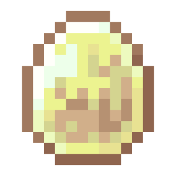 | player_feed_sulfur_cube_item | The player feeds a sulfur slime an item | Executes code when the player feeds a sulfur slime an item. | player | true |  |  | false | false |
|  | player_fish | Player fishes | Runs code when a player fishes something. | player | true |  |  | false | false |
| 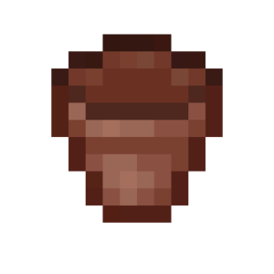 | player_flowerpot_manipulate | Player Interacts with Flower Pot | Executes code when a player interacts with a flower pot. | player | true | Flower Pots |  | false | false |
|  | player_food_level_change | Player's hunger level changes | Executes code when the player's hunger level changes. | player | true |  |  | false | false |
| 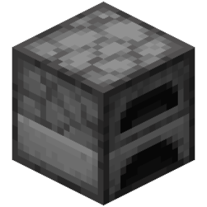 | player_furnace_extract | Player Extract Furnace | Triggers when the player extracts items from a Furnace | player | false | Furnaces Blast Furnaces Smokers |  | false | false |
| 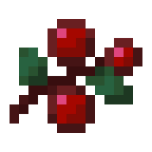 | player_harvest_block | Player Harvests Block | Executes code when a player harvests a crop without breaking the block. | player | true |  |  | false | false |
|  | player_heal | Player restores health | Executes code when a player regenerates health in any way. | player | true |  |  | false | false |
|  | player_horse_jump | Player jumps while riding | Executes code when a player performs a jump on horse, donkey or mule. | player | true |  |  | false | false |
|  | player_imbue_potion_cloud | Player gets an effect from a lingering potion | Executes code when a player gets an effect from a lingering potion. | player | true |  |  | false | false |
|  | player_input_event | Player changes movement keys pressed | Executes code when a player changes the movement keys pressed. | player | false |  | The event fires when the player's pressed movement key list (default: WASD - movement, Shift - sneak, Space - jump, Ctrl - sprint) changes. The event contains all keys currently pressed by the player. | false | false |
| 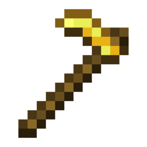 | player_interact | Player interacts with world | Runs code when a player interacts with the world. | player | true |  | Works with left click, right click, pressure plate interactions, trip wires, etc. | false | false |
|  | player_inventory_slot_change | creative_plus.trigger.player_inventory_slot_change.name | creative_plus.trigger.player_inventory_slot_change.description | player | false |  |  | false | false |
|  | player_item_cooldown | Player uses item with cooldown | Executes code when a player uses an item that has a cooldown between uses. | player | true |  |  | false | false |
|  | player_item_group_cooldown | Player receives cooldown for item group | Executes code when a player receives a cooldown for an item group. | player | true |  |  | false | false |
|  | player_item_mend | Player Mends Item | Executes code when a player repairs an item using the "Mending" enchantment. | player | true |  |  | false | false |
|  | player_join | Player joined | Executes code when a player enters the world. | player | false |  |  | false | false |
| 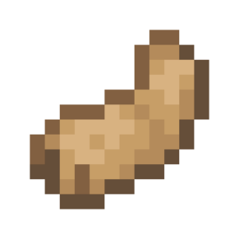 | player_jump | Player jumps | Executes code when a player jumps. | player | true |  |  | false | false |
| 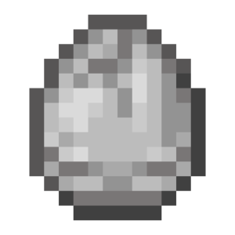 | player_kill_mob | Player kills a mob | Executes code when a player kills a mob. | player | true |  |  | false | false |
|  | player_kill_player | Player kills another player | Executes code when a player kills another player. | player | true |  |  | false | false |
|  | player_knockback | Player Take Knockback | Executes code when a player is knocked back. | player | true |  |  | false | false |
|  | player_launch_projectile | Player launches a projectile | Executes code when a player launches a projectile. | player | true | Eggs Snowballs Potions |  | false | false |
|  | player_leash_entity | Player leashes an entity | Executes code when a player puts a leash on an entity. | player | true |  |  | false | false |
|  | player_left_click | Player left clicks | Executes code when a player left-clicks. | player | true |  |  | false | false |
|  | player_load_crossbow | Player Load Crossbow | Triggers when the player loads a Crossbow. | player | true | Crossbow |  | false | false |
|  | player_location_change | Player Changes Location | Executes code when a player changes their location (including staying on the same block). | player | true |  |  | false | false |
|  | player_move | Player moves | Executes code when a player moves. | player | true |  |  | false | false |
|  | player_open_advancements_tab | Open Advancements | Triggers when the player opens the advancements tab. | player | false |  | The menu can be closed with the "Close Inventory" action. | false | false |
|  | player_open_inventory | Player opens inventory | Executes code when a player opens their inventory menu. | player | true |  |  | false | false |
| 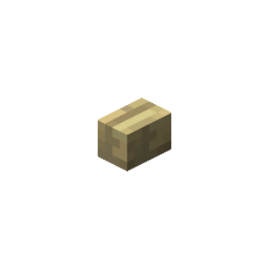 | player_pick_block | Player uses pick block on a block | Executes code when a player uses pick block on a block. | player | true |  | The event fires when a player uses the pick block function on a block (middle-clicking a block to obtain the corresponding item). | false | false |
| 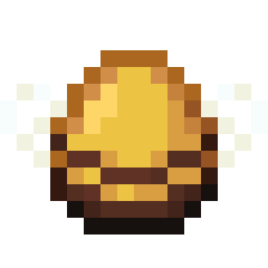 | player_pick_entity | Player uses pick block on an entity | Executes code when a player uses pick block on an entity. | player | true |  | The event fires when a player uses the pick block function on an entity (clicking on an entity to obtain the corresponding item). | false | false |
|  | player_pick_item | Player Pick Item | Executes when the player middle-clicks an item in an inventory. | player | true |  |  | false | false |
|  | player_pickup_experience | Player collects an experience orb | Executes code when a player picks up an experience orb. | player | true |  |  | false | false |
|  | player_pickup_item | Player picks up an item | Executes code when a player picks up an item. | player | true |  |  | false | false |
|  | player_pickup_projectile | Player picks up a projectile | Executes code when a player picks up a projectile. | player | true |  |  | false | false |
|  | player_place_block | Player places a block | Executes code when a player places a block. | player | true |  |  | false | false |
| 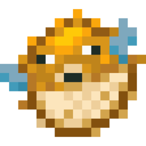 | player_pre_attack_entity | Player is about to damage an entity | Executes code when a player is about to damage an entity. Cancelling the event also cancels the attack sounds. | player | true |  |  | false | false |
|  | player_prepare_item_craft | Player Lays Out Craft | Executes code when a player lays out a crafting recipe for some item. | player | false | Crafting Tables Inventory Crafting Grid |  | false | false |
|  | player_prepare_item_enchant | Player Enchants Item | Executes code when a player gets a result at an enchanting table and is given the option to select an enchantment. | player | true | Enchanting Tables |  | false | false |
|  | player_prepare_result | Player receives a result | Executes code when a player receives a result in an inventory. | player | false | Anvils Grindstones Smithing tables |  | false | false |
|  | player_projectile_hit | Player's projectile hits | Executes code when a projectile launched by a player hits a block, a creature, or another player. | player | true |  |  | false | false |
|  | player_query_block_info | Player gets info about a block | Executes code when a player receives debug information about a block (F3 + I). | player | true |  | The event will not fire if the player is sneaking. | false | false |
|  | player_query_entity_info | Player gets info about an entity | Runs code when a player receives debug information about an entity (F3 + I). | player | true |  | The event will not fire if the player is sneaking. | false | false |
| 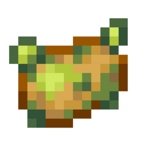 | player_quit | Player left | Executes code when a player exits the world. | player | false |  |  | false | false |
| 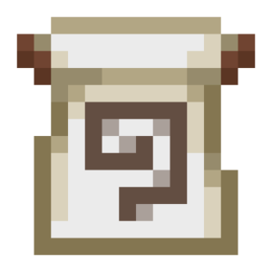 | player_rejoin | Player rejoined | Executes code when a player re-enters the world using /play. | player | true |  |  | false | false |
|  | player_request_stats | Player Requested Statistics | Executes code when a player opens the "Statistics" menu. | player | false |  | The "Statistics" menu can be closed using the "Close Menu" action. | false | false |
|  | player_respawn | Player respawns | Runs code when a player is respawned. | player | false |  | It is recommended to use the Wait block before other code to work correctly. | false | false |
|  | player_resurrect | Player gets ressurected | Runs code when a player is resurrected by the Totem of Undying. | player | true |  | By default, this event is cancelled if the player is not holding a Totem of Undying. | false | false |
|  | player_right_click | Player right clicks | Executes code when a player right-clicks. | player | true |  |  | false | false |
|  | player_right_click_entity | Player right-clicks an entity | Executes code when a player right-clicks on an entity. | player | true |  |  | false | false |
|  | player_right_click_player | Player right-clicks a player | Executes code when a player right-clicks another player. | player | true |  |  | false | false |
|  | player_riptide | Player uses riptide | Executes code when a player uses a trident with the riptide enchantment. | player | true |  |  | false | false |
|  | player_rotate | Player Rotates | Executes code when the player rotates (changes their yaw or pitch). | player | true |  |  | false | false |
|  | player_shear_block | Player Shears Block | Executes code when a player shears a block with shears. | player | true |  |  | false | false |
|  | player_shot_bow | Player shoots | Executes code when a player shoots a bow or crossbow. | player | true | Bow Crossbow |  | false | false |
|  | player_sign_change | Player changes a sign | Executes code when a player makes changes to a sign. | player | true |  |  | false | false |
|  | player_skin_change | Player Skin Changed | Executes code when a player's skin changes. | player | true | Player changing skin manually (via /skin) The "Set Skin" action | By default, this event is cancelled. | false | false |
|  | player_sneak | Player starts sneaking | Executes code when a player starts sneaking. | player | true |  |  | false | false |
|  | player_start_flight | Player starts flying | Executes code when a player starts flying. | player | true |  |  | false | false |
|  | player_start_gliding | Player starts gliding with elytra | Executes code when a player starts gliding with elytra. | player | true |  |  | false | false |
|  | player_start_spectating_entity | Player Start Spectating Entity | Executes code, when a players in spectator mode starts spectating an entity. | player | true |  |  | false | false |
|  | player_start_sprint | Player starts sprinting | Executes code when a player starts running. | player | true |  |  | false | false |
|  | player_stop_flight | Player stops flying | Executes code when a player stops flying. | player | true |  |  | false | false |
|  | player_stop_gliding | Player stops gliding with elytra | Executes code when a player stops gliding with elytra. | player | true |  |  | false | false |
|  | player_stop_spectating_entity | Player Stop Spectating Entity | Executes code, when a players in spectator mode stops spectating an entity. | player | true |  |  | false | false |
|  | player_stop_sprint | Player stops sprinting | Executes code when a player stops running. | player | true |  |  | false | false |
|  | player_stop_using_item | Player stops using item | Runs code when a player stops using an item. | player | false |  |  | false | false |
|  | player_structure_grow | Player grows a tree | Runs code when a player grows a tree or mushroom. | player | true |  |  | false | false |
|  | player_swap_hands | Player swaps hands | Executes code when a player swaps hands. | player | true |  |  | false | false |
|  | player_take_damage | Player takes damage | Runs code when a player takes damage. | player | true |  |  | false | false |
|  | player_tame_entity | Player tames an entity | Executes code when a player tames an entity. | player | true |  |  | false | false |
|  | player_teleport | Player teleports | Executes code when a player teleports. | player | true |  |  | false | false |
|  | player_toggle_entity_age_lock | The player stops the entity growth | Executes code when a player blocks a entity growth using a golden dandelion. | player | true |  |  | false | false |
|  | player_unleash_entity | Player Unleashes Entity | Executes code when a player detaches an entity from a leash. | player | true |  |  | false | false |
|  | player_unsneak | Player stops sneaking | Executes code when a player stops sneaking. | player | true |  |  | false | false |
|  | player_vault_change_state | Player changes vault state | Executes code when a player changes the vault state. | player | true | Vaults |  | false | false |
|  | player_vehicle_jump | Player jump while riding a vehicle | Executes code when a player presses jump button while sitting in a boat or a minecart. | player | false |  | Can be used to check if the jump button was pressed. | false | false |
|  | player_vehicle_move | Player Move on Vehicle | Executes code, when a player presses movement keys, while sitting in transport. | player | false |  |  | true | false |
|  | player_velocity | Player Change Velocity Vector | Executes code when a player's velocity vector is updated. | player | true |  |  | false | false |
|  | portal_create | Portal created | Runs code when a portal is created in the world. | world | true |  |  | false | false |
|  | projectile_damage_entity | Projectile damages an entity | Executes code when a projectile damages an entity. | entity | true |  |  | false | false |
|  | projectile_damage_player | Player takes damage from a projectile | Executes code when a projectile hits a player. | player | true |  |  | false | false |
|  | projectile_hit | Projectile hits a block | Runs code when a projectile hits a block. | entity | true |  |  | false | false |
|  | projectile_kill_entity | Projectile kills an entity | Executes code when a projectile kills an entity. | entity | true |  |  | false | false |
|  | projectile_launch | Projectile Launch | Triggers when a projectile is launched. | entity | true |  |  | false | false |
|  | projective_collide | Projectile collides | Runs code when a projectile collides with a block or entity. | entity | true |  |  | false | false |
|  | redstone_level_change | Redstone power changes | Runs code when power of a redstone dust changes. | world | false |  |  | false | false |
|  | sculk_bloom | Sculk Bloom | Triggers when a sculk blooms. | world | true |  |  | false | false |
|  | sheep_regrow_wool | Sheep regrows wool | Runs code when a sheep grows wool. | entity | true |  |  | false | false |
|  | sponge_absorb | Sponge Absorbs Water | Executes code when a sponge absorbs water. | world | true |  |  | false | false |
|  | structure_grow | Tree grows | Runs code when a tree or a mushroom grows. | world | true |  |  | false | false |
|  | time_skip | Time skips | Runs code if a time skip occurs. | world | true | Sleep Setting time in code |  | false | false |
|  | tnt_prime | TNT ingites | Runs code when a block of TNT is ignited. | world | true |  |  | false | false |
|  | vault_change_state | Vault changes state | Executes code when a vault changes its state. | world | true | Vaults |  | false | false |
|  | vault_display_item | Vault Displays Item | Executes code when a vault block displays an item. | world | true | Vaults |  | false | false |
|  | vehicle_take_damage | Vehicle damage | Runs code when a vehicle takes damage. | entity | true |  |  | false | false |
|  | witch_throw_potion | Witch throws a potion | Runs code when the witch throws a potion. | entity | true | Witches |  | false | false |
|  | world_reload | World reload | Executes code when the world unfreezes after a critical error occurs. | world | false |  |  | false | false |
|  | world_start | World starts | Runs code when the world starts in game mode. | world | false |  |  | false | false |
|  | world_stop | World stops | Runs code when game mode stops in the world. | world | false |  |  | false | false |
|  | world_web_exception | Web Request Error | Triggers when a request responds with an error. | world | false |  |  | false | false |
|  | world_web_response | Server responds | Runs code when the server responds to the web request. | world | false |  |  | false | false |
