# Game values

| Icon | ID | Name | Description | Category | Return type | Works with | Additional info | Status |
| --- | --- | --- | --- | --- | --- | --- | --- | --- |
| 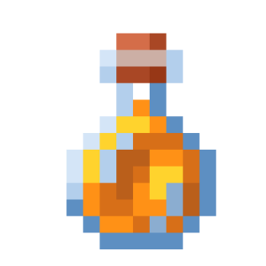 | absorption_health | Additional Health | Gets the target's absorption (gold) health. | Statistics | number |  |  |  |
| 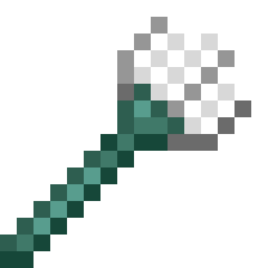 | active_item_used_time | Item usage time | Gets the current usage time of the item held in the hand. | Statistics | number |  |  |  |
| 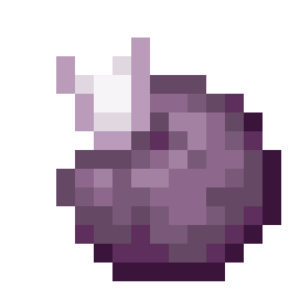 | age | Target Age | Gets the target's age in ticks. | Statistics | number |  |  |  |
| 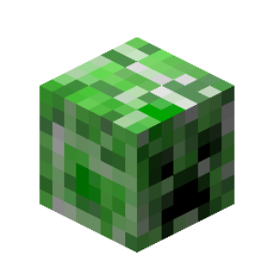 | all_entities_names | All Entity Names | Gets the names of all entities in the world. | World | array<text> |  |  |  |
|  | all_entities_uuids | All Entity UUIDs | Gets the UUIDs of all entities in the world. | World | array<text> |  |  |  |
| 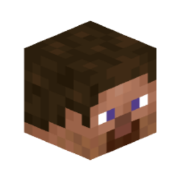 | all_players_names | All Player Names | Gets the names of all players in the world. | World | array<text> |  |  |  |
|  | all_players_uuids | All Player UUIDs | Gets the UUIDs of all players in the world. | World | array<text> |  |  |  |
| 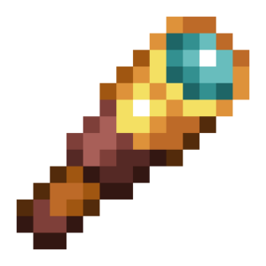 | anticheat_check | Anticheat Check | Gets the name of the anticheat check that flagged the player. | Event | text | Anticheat Flags a Player Event |  |  |
| 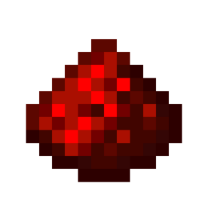 | anticheat_violations | Anticheat Violations | Gets the number of anticheat check violations the player has. | Event | number | Anticheat Flags a Player Event |  |  |
| 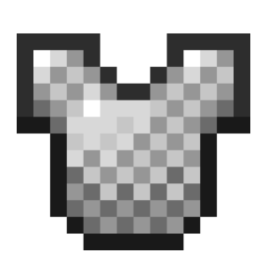 | armor_items | Armor Items | Gets items in the target's armor slots. | Item | array<item> |  |  |  |
| 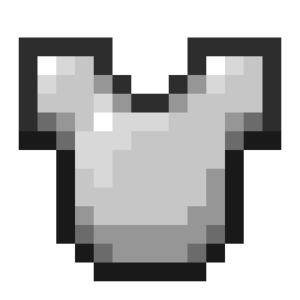 | armor_points | Defense Points | Gets the target's armor, which can be modified by items. | Statistics | number |  |  |  |
| 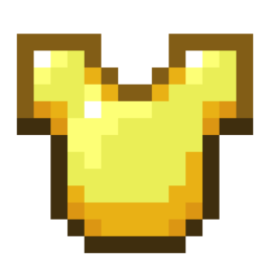 | armor_toughness | Armor Hardness | Gets the target's armor hardness, which can be modified with items. | Statistics | number |  |  |  |
| 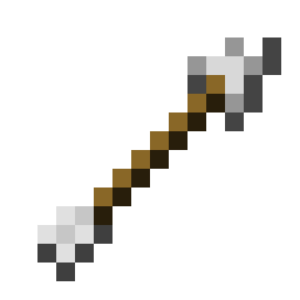 | arrows_in_body | Number of Arrows In Body | Gets the number of arrows in the target's body. | Statistics | number |  |  |  |
| 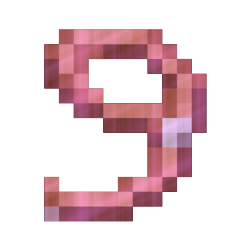 | attached_leads | Attached Leads | Gets the UUID of the entities that are attached to the target with a lead. | Info | array<text> |  |  |  |
| 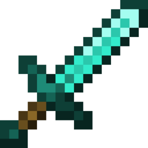 | attack_cooldown_strength | Attack Cooldown Strength | Gets the attack cooldown strength multiplier (How much of your base attack damage is nullified by your attack cooldown) | Statistics | number |  |  |  |
| 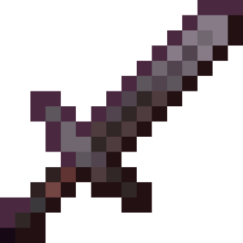 | attack_cooldown_ticks | Attack Cooldown in Ticks | Gets the current attack cooldown of the target, measured in ticks. | Statistics | number |  |  |  |
| 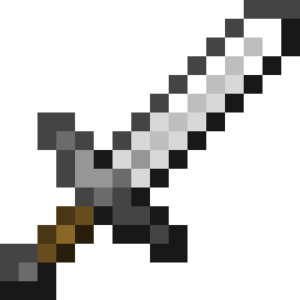 | attack_damage | Attack Damage | Gives the target's attack damage, modifiable by items. | Statistics | number |  |  |  |
| 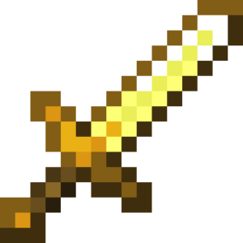 | attack_speed | Attack Speed | Gets the target's attack speed, which can be modified by items. | Statistics | number |  |  |  |
| 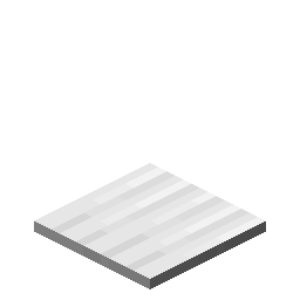 | block_beneath | Block Location Under Target | Gets the location of the block supporting the target. | Location | location |  |  |  |
| 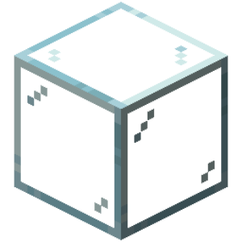 | blocks_beneath | Block Locations Under Target | Gets the location of all blocks supporting the target. | Location | array<location> |  |  |  |
| 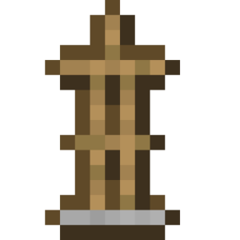 | body_yaw | Body rotation | Gets rotation of target's body. | Location | number |  |  |  |
| 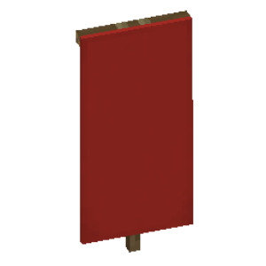 | cape_location | Cape Location | Gets the location of a player's cape. | Location | location | Player |  |  |
| 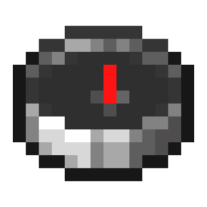 | cardinal_direction | Cardinal Direction | Gets the cardinal direction (north, west, south, east) of the target. | Location | text |  |  |  |
| 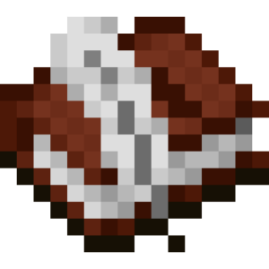 | chat_visibility | Chat Visibility | Gets the player's chat visibility status, defined in their game settings. | Info | text | Player |  |  |
| 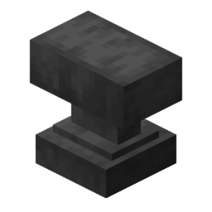 | client_brand_name | Player Client Name | Gets the name of the player's client. | Info | text | Players |  |  |
|  | client_view_distance | Player Render Distance | Gets the render distance of the player, as set in the game's settings. | Statistics | number | Player |  |  |
| 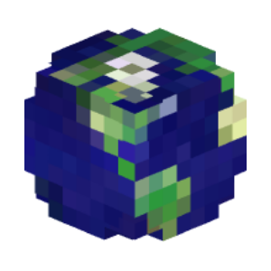 | clientside_locale | Player Client Locale | Gets the player's client locale. | Info | text | Players |  |  |
| 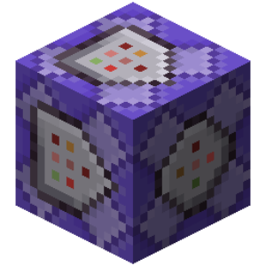 | cpu_usage | CPU Usage Percentage | Gets the percentage of the world's CPU utilization on the server. | World | number |  |  |  |
| 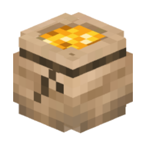 | currency_transaction_amount | Emerald Transaction Amount | Gets the number of emeralds spent in the transaction. | Event | text | Player Makes a Transaction Event |  |  |
| 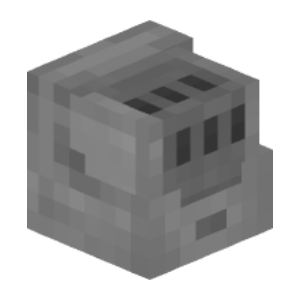 | currency_transaction_reason | Transaction Request Reason | Gets the reason for the emerald transaction request. | Event | text | Player Makes a Transaction Event |  |  |
| 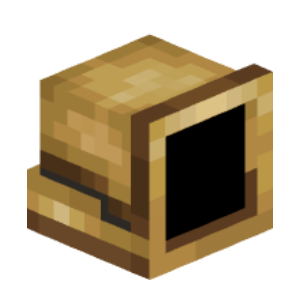 | currency_transaction_result | Transaction Result | Gets the result of the completed transaction. | Event | text | Player Makes a Transaction Event |  |  |
| 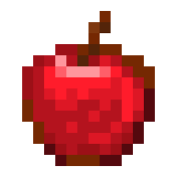 | current_health | Current Health | Gets the target's remaining health. | Statistics | number |  |  |  |
| 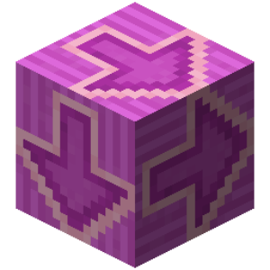 | current_input_list | Current Pressed Movement Keys | Gets the currently pressed movement keys. | Info | array<text> | Players |  |  |
| 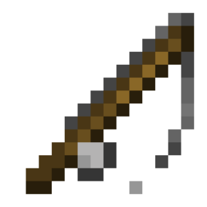 | cursor_item | Cursor Item | Gets the item at the target cursor (used when moving inventory items). | Item | item |  |  |  |
| 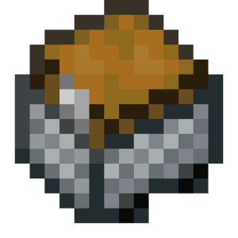 | custom_inventory_items | List of items in open inventory | Returns a list containing the items that are in the currently open inventory menu. | Item | array<item> |  |  |  |
| 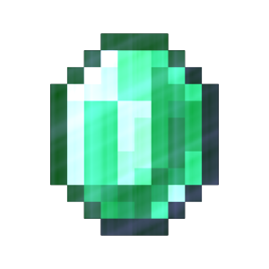 | death_screen_score | Score Count | Gets the score displayed on the death screen. | Statistics | number | Players |  |  |
| 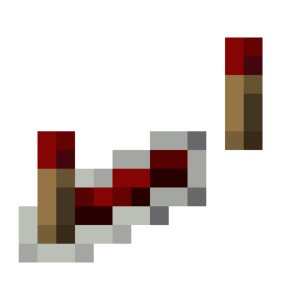 | delay_reload_count | Current world freeze time | Gets the current time for which the world is frozen. | World | number |  |  |  |
| 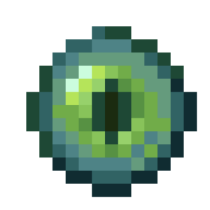 | direction_of_view | View Vector | Get the direction vector of the target's view. | Location | vector |  |  |  |
| 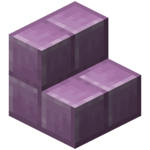 | display_entity_left_rotation | Display Entity Left Rotation | Gets a display entity's rotation to the left as a vector. | Info | vector | Display Entities |  |  |
| 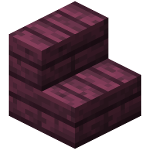 | display_entity_right_rotation | Display Entity Right Rotation | Gets a display entity's rotation to the right as a vector. | Info | vector | Display Entities |  |  |
| 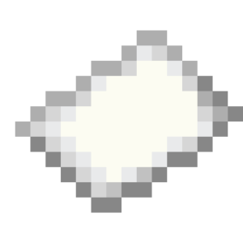 | display_entity_scale | Display Entity Scale | Gets the scale of a display entity as a vector. | Info | vector | Display Entities |  |  |
|  | display_entity_translation | Display Entity Offset | Gets the offset of a display entity as a vector. | Info | vector | Display Entities |  |  |
| 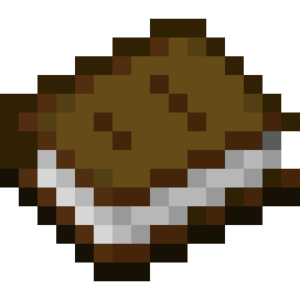 | display_name | Display Name | Gets the target's display name. | Info | text |  |  |  |
| 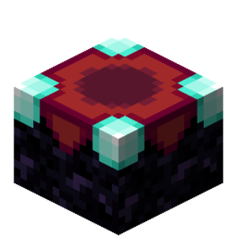 | enchantment_seed | Current Enchantment Seed | Gets the player's current enchantment seed. | Statistics | number |  |  |  |
| 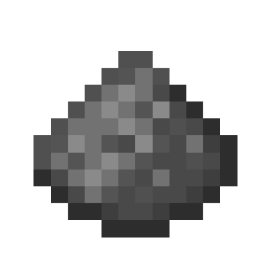 | entity_fuse_ticks | Entity Fuse Time | Gets the entity's time before it explodes. | Statistics | number | Creepers TNT Fireworks |  |  |
| 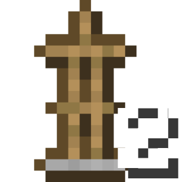 | entity_height | Hitbox Height | Gets the height of the target's hitbox. | Statistics | number |  |  |  |
| 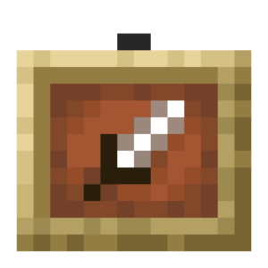 | entity_item | Entity Item | Gets the object form of the target. | Item | item |  |  |  |
| 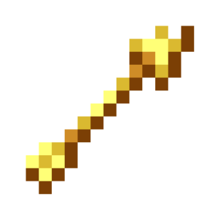 | entity_pathfinder_point_index | Path point index | Gets the current path point index the mob is moving along. | Statistics | number |  |  |  |
|  | entity_pathfinder_points | Current path | Gets a list of all points that make up the current path of the mob. | Info | array<location> |  |  |  |
| 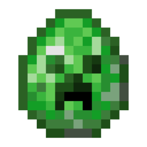 | entity_pick_item_stack | Entity Pick Item | Gets the item obtained by middle-clicking (MMB) on the entity. | Item | item |  |  |  |
| 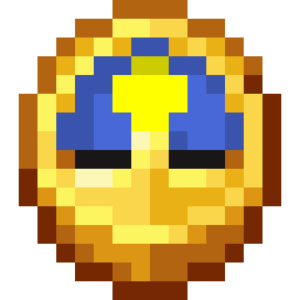 | entity_ticks_lived | Target Lifetime | Gets the number of ticks the entity has been alive. | Statistics | number |  |  |  |
| 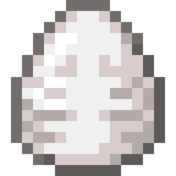 | entity_type | Entity Type | Gets the entity type of the target. | Info | text |  |  |  |
|  | entity_width_x | Hitbox X Size | Gets the size of the target's hitbox in the x-axis. | Statistics | number |  |  |  |
| 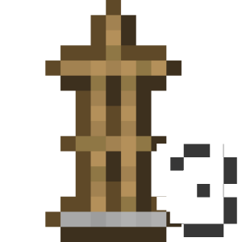 | entity_width_z | Hitbox Z Size | Gets the size of the target's hitbox in the z-axis. | Statistics | number |  |  |  |
|  | event_added_items | Distributed Items | Produces a dictionary of slotted items with LMB/RMB or duplication with mouse wheel. | Event | map<number, item> | Drag Items Event |  |  |
| 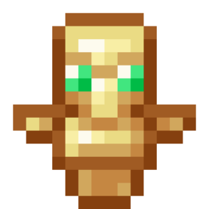 | event_advancement_tab_name | Event Advancement Tab Name | The name of the current opened advancements tab. | Event | text | "Player Open Advancement Tab" event |  | deprecated |
| 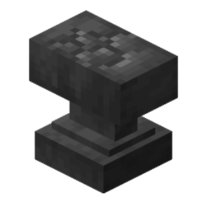 | event_anvil_damage_state | New Anvil Damage State | Gets the new damage state of the anvil. | Event | text | Event "Player Damages Anvil" |  |  |
|  | event_anvil_rename_input | Anvil Rename Input | Gets the new name of the item in an anvil. | Event | text | "Player Anvil Rename Input" event. |  |  |
|  | event_block | Event Block | Gets the ID of the block associated with the event. | Event | text |  |  |  |
|  | event_block_break_progress | Block Break Progress | Gets the block break progress associated with the event. | Event | number | Player Block Break Progress Update Entity Block Break Progress Update |  |  |
|  | event_block_face | Event Block Face | Gets as directions the side of the block that was hit by the event. | Event | text | Interaction Events Block Place or Break Events Projectile Hit Event Piston Events |  |  |
|  | event_block_location | Event Block Location | Gets the location of the block in the event. | Event | location |  |  |  |
|  | event_blocks_involved | Involved Event Blocks | Gets a list of the locations of all enabled blocks in the event. | Event | array<location> | Explosion Events Piston Events |  |  |
|  | event_chat_message | Chat Message | Receives the message sent by the target in the event. | Event | text | Player Event Message |  |  |
|  | event_close_inventory_cause | Inventory close reason | Gets the reason for closing the target's open inventory in an event. | Event | text | Inventory close event |  |  |
|  | event_combust_duration | Entity Combust Duration | Gets the duration an entity burns from the event. | Event | number | Event "Player catches fire" Event "Entity catches fire" |  |  |
|  | event_combust_reason | Entity Combust Reason | Gets the reason an entity caught fire from the event. | Event | text | Event "Player catches fire" Event "Entity catches fire" |  |  |
|  | event_custom_click_dialog_view_data | Dialog Menu Data | Gets the data entered by the player in the dialog menu. | Event | any | Event "Player triggers custom click" |  |  |
|  | event_custom_click_key | Custom Click ID | Gets the identifier of the custom click in the dialog menu or chat. | Event | text | Event "Player triggers custom click" |  |  |
|  | event_damage | Damage Dealt | Gets the amount of damage dealt in an event. | Event | number |  |  |  |
|  | event_damage_cause | Cause of Damage Received | Gets the cause or type of damage taken in an event. | Event | text |  |  |  |
|  | event_death_screen_message | Death Screen Message | Gets the message displayed on the death screen. | Event | text | Event "Player dies" |  |  |
|  | event_dialog_button_id | creative_plus.game_value.event_dialog_button_id.name | creative_plus.game_value.event_dialog_button_id.description | Event | text | creative_plus.game_value.event_dialog_button_id.work_with.player_custom_click |  |  |
|  | event_dialog_id | creative_plus.game_value.event_dialog_id.name | creative_plus.game_value.event_dialog_id.description | Event | text | creative_plus.game_value.event_dialog_id.work_with.player_custom_click |  |  |
|  | event_drag_type | Inventory Drag Type | Gets the drag type of items over the target's open inventory in the event. | Event | text | Drag Item Event |  |  |
|  | event_enchantment_bonus | Bookshelf Count | Gets the number of bookshelves associated with the event. | Event | number | Player Enchant Item Event |  |  |
|  | event_enchantment_hint | Suggested Enchantment | Gets the name of the suggested enchantment in the enchanting table. | Event | text | Event "Player enchants an item" |  |  |
|  | event_enchantment_level_hint | Required Enchantment Experience Level | Gets the required experience level for the selected enchantment. | Event | number | Event "Player enchants an item" |  |  |
|  | event_enchantment_offers | Event Enchantment Offers | Gets the list of enchantments offered to the player associated with the event. | Event | array<text> | Player Enchant Item Event |  |  |
|  | event_enchantments_to_add | Applied Enchantments | Gets a map of enchantments applied to the item. | Event | map<text, number> | Event "Player enchants an item" |  |  |
|  | event_entity_unleash_reason | Entity Unleash Reason | Gets the reason why the entity was unleashed. | Event | text | Unleash Events |  |  |
|  | event_equipment_slot | Event Slot Type | Gets the type of the equipped slot of the target in the event. | Event | text |  |  |  |
|  | event_exhaustion_amount | Exhaustion Amount | Gets the amount of exhaustion received. | Event | number | Player Exhaustion |  |  |
|  | event_exhaustion_reason | Exhaustion Reason | Gets the reason for the exhaustion | Event | text | Player Exhaustion |  |  |
|  | event_experience | Amount of Event Experience | Gets the number of experience points in an event. | Event | number |  |  |  |
|  | event_fail_move_reason | Reason for failed move | Gets the reason for a failed move | Event | text | Player Failed to Move Event |  |  |
|  | event_final_damage | Final Damage | Gets the final damage dealt in the event. | Event | number |  |  |  |
|  | event_fish_state | Fishing Event Reason | Gets the reason for the fishing event. | Event | text | Fishing Event |  |  |
|  | event_food_level | Event Hunger Replenished | Get the number of hunger points replenished. | Event | number | Hunger Level Change Event |  |  |
|  | event_from_location | Previous Location | Previous location of the player | Event | location |  |  |  |
|  | event_gamemode | Event Game Mode | Gets the game mode associated with the event. | Event | text | Event "Player requests game mode change menu" |  |  |
|  | event_hanging_break_cause | Reason for Hanging Entity Removal | Gets the reason for removing a hanging entity (painting, frame). | Event | text | Hanging Entity Break Event |  |  |
|  | event_heal_amount | Health Restored Amount | Gets the amount of health restored in an event. | Event | number | Player heals with an event Entity event restores health |  |  |
|  | event_heal_cause | Healing Cause | Gets the reason for the event's health recovery. | Event | text | Player heals with an event Entity event restores health |  |  |
|  | event_hotbar_slot | Event Hotbar Slot | Gets the current hotbar slot number in the event. | Event | number |  |  |  |
|  | event_input_list | List of Pressed Movement Keys | Gets the list of pressed movement keys from the event. | Event | array<text> | Event "Player changes movement keys pressed" Event "Player moves in a vehicle" Event "Player jumps in a vehicle" |  |  |
|  | event_interaction | Event Interaction Type | Gets the interaction type of the target in the event. | Event | text | Right Click Event Left Click Event Interaction Event |  |  |
|  | event_inventory_action | Inventory Action on Click | Gets the current action in the inventory menu when it is clicked. | Event | text |  |  |  |
|  | event_inventory_click_type | Inventory Click Type | Gets the click type of the target's open inventory in the event. | Event | text |  |  |  |
|  | event_item | Event Item | Receives an item in an event. | Event | item |  |  |  |
|  | event_item_cooldown | Event Item Cooldown | Gets the item cooldown from the event. | Event | number | Event "Player uses item with cooldown" Event "Player receives cooldown for item group" |  |  |
|  | event_item_cooldown_group | Cooldown Item Group | Gets the item group affected by the cooldown from the event. | Event | text | Event "Player uses item with cooldown" Event "Player receives cooldown for item group" |  |  |
|  | event_item_damage | Item Damage Dealt | Gets the amount of damage dealt to the item. | Event | number | Event "Player Damages Item" |  |  |
|  | event_items | Event Items | Gets all the items in the event. | Event | array<item> |  |  |  |
|  | event_knockback_cause | Knockback Cause | Gets the cause of the knockback of the event. | Event | text | "Player Knockback" event "Entity Knockback" event |  |  |
|  | event_knockback_event_type | Knockback Type | Gets the type of knockback of the event. | Event | text | "Player Knockback" event "Entity Knockback" event |  |  |
|  | event_knockback_vector | Knockback Vector | Gets the vector of the motion of the knockback of the event. | Event | vector | "Player Knockback" event "Entity Knockback" event |  |  |
|  | event_message | Event Message | Receives the system message sent in an event. | Event | text |  |  |  |
|  | event_new_equipments | Equipment | Gets the equipment from the event. | Event | map<text, item> | Event "Player changes equipment" Event "Entity changes equipment" |  |  |
|  | event_new_fishing_hook_state | New Fishing Hook State | Gets the new fishing hook state. | Event | text | Event "Fishing hook changes state" |  |  |
|  | event_new_location | New Player Location | Gets the player's new location. | Event | location |  |  |  |
|  | event_new_potion_effect | New potion effect | Gets new potion effect of the event. | Event | potion | Event "Player gets an effect from a lingering potion" |  |  |
|  | event_new_vault_state | New Vault State | Gets the new vault state. | Event | text | Event "Vault changes state" Event "Player changes vault state" |  |  |
|  | event_old_equipments | Previous Event Equipment | Gets the previous equipment from the event. | Event | map<text, item> | Event "Player changes equipment" Event "Entity changes equipment" |  |  |
|  | event_old_item | creative_plus.game_value.event_old_item.name | creative_plus.game_value.event_old_item.description | Event | item | creative_plus.game_value.event_old_item.work_with.player_inventory_slot_change_event |  |  |
|  | event_old_vault_state | Previous Vault State | Gets the previous vault state. | Event | text | Event "Vault changes state" Event "Player changes vault state" |  |  |
|  | event_power | Complete Power Percentage | Gets the percentage of execution power (bow draw, horse jump) of the event. | Event | number | Player Event Shoots Horse Jump Event |  |  |
|  | event_projectile_item | Event Projectile Item | Gets an event projectile item. | Event | item | Player Event Shoots |  |  |
|  | event_query_info | Debug Info | Gets the debug information of the target block or entity. | Event | text | Player Receives Block Information Event Player Receives Entity Info Event |  |  |
|  | event_replaced_block | Event replaced block | Gets the ID of the replaced block. | Event | text | Place Block Event |  |  |
|  | event_sign_lines | Sign Lines | Gets the lines on a Sign as a list. | Event | array<text> | "Player Change Sign" event |  |  |
|  | event_sign_side | Sign Side | Gets the side the text is on. | Event | text | "Player Change Sign" event |  |  |
|  | event_slot | Event Slot | Produces the slot number in the event. | Event | number |  |  |  |
|  | event_slot_type | Clicked Slot Type | Gets the current slot type of the inventory menu when clicked. | Event | text |  |  |  |
|  | event_slots_involved | Involved Slots | Gets a list of all enabled slots in the target's open inventory in the event. | Event | array<number> | Drag Item Event |  |  |
|  | event_teleport_cause | Teleport Cause | Gets the reason for teleporting in an event. | Event | text | Player Teleport Event Enderman Escape Event |  |  |
|  | event_ticks_held_for | Item Use Ticks | Gets the number of ticks to use an item. | Event | number | Player Event "Stops using an item" |  |  |
|  | event_time_skip_amount | Number of Skip Time ticks | Gets the number of time skip ticks in the world. | Event | number | Time Skip Event |  |  |
|  | event_time_skip_reason | Skip Time Reason | Gets the reason for skipping time in the world. | Event | text | Time Skip Event |  |  |
|  | event_transform_reason | Entity transform reason | Gets the reason for the entity transformation. | Event | text | Entity Transform Event |  |  |
|  | event_transformed_entities | Event transformed entities | Get transformed entities of the event. | Event | array<text> | Entity Transform Event |  |  |
|  | event_tree_type | Tree Type | Gets the type of tree in the event. | Event | text | Grow Tree Player Event Tree Grows World Event |  |  |
|  | event_velocity | Velocity Vector | Gets the velocity vector of the event. | Event | vector | "Player Change Velocity Vector" event. |  |  |
|  | experience_level | Experience Level | Get the target's experience levels. | Statistics | number |  |  |  |
|  | experience_progress | Experience Progress | Gets the percentage progress of the target's current experience level. | Statistics | number |  |  |  |
|  | eye_location | Eye Location | Gets the location of the target at eye height. | Location | location |  |  |  |
|  | fall_distance | Fall Distance | Gets the target's fall distance in blocks. | Statistics | number |  |  |  |
|  | fire_ticks | Burning Time | Get the target's remaining fire ticks. | Statistics | number |  |  |  |
|  | flying_speed | Flying Speed | Gets the target's current flying speed (attribute). | Statistics | number |  |  |  |
|  | food_exhaustion | Food Exhaustion | Gets the target's food exhaustion level, which increases based on the player's actions. | Statistics | number |  |  |  |
|  | food_level | Hunger Level | Gets the target's remaining food. | Statistics | number |  |  |  |
|  | food_saturation | Saturation Level | Gets the target's food saturation based on the types of food eaten. | Statistics | number |  |  |  |
|  | freeze_ticks | Freeze Time | Get the target's current freeze time. | Statistics | number |  |  |  |
|  | gamemode | Game Mode | Gets the player's current game mode. | Info | text | Players |  |  |
|  | held_slot | Choose Slot in Hot Bar | Gets the target's selected hotbar slot. | Statistics | number |  |  |  |
|  | hitbox_midpoint_location | Hitbox Center | Gets the location of the center of the target's hitbox. | Location | location |  |  |  |
|  | hotbar_items | Hotbar Items | Gets the items in the target's hotbar. | Item | array<item> |  |  |  |
|  | idle_duration | Idle Duration | Gets the current idle duration of the player. | Statistics | number |  |  |  |
|  | inventory_items | Inventory Items | Gets the items in the target's inventory (including the hot bar). | Item | array<item> |  |  |  |
|  | invulnerability_ticks | Invulnerability Time | Gets the target's remaining invulnerability ticks. | Statistics | number |  |  |  |
|  | item_usage_progress | Item Usage Progress | Gets the target's percentage progress on using an item in hand, such as food. | Statistics | number |  |  |  |
|  | last_damage_cause | Last Damage Cause | Gets the target's last damage cause. | Info | text |  |  |  |
|  | last_death_location | Last Death Location | Gets the location of the player's last death. | Location | location |  |  |  |
|  | lead_holder | Lead Holder | Gets the UUID of the entity that leads the target on the lead. | Info | text |  |  |  |
|  | location | Location | Gets the target's location. | Location | location |  |  |  |
|  | main_hand | Main Hand | Get the player's main hand. | Info | text | Player |  |  |
|  | main_hand_item | Main Hand Item | Gets the item in the target's main hand. | Item | item |  |  |  |
|  | max_health | Max Health | Gets the target's maximum health. | Statistics | number |  |  |  |
|  | max_invulnerability_ticks | Total Invulnerability Ticks | Gets the max amount of time the target can have invulnerability ticks for. | Statistics | number |  |  |  |
|  | merchant_recipe_count | Merchant Recipe Count | Gets the number of Merchant Recipe counts. | Statistics | number |  |  |  |
|  | name | Name | Gets the target's name. | Info | text |  |  |  |
|  | off_hand_item | Offhand Item | Gets the item in the target's secondary hand. | Item | item |  |  |  |
|  | open_inventory_custom_id | Open Inventory Custom ID | Gets the custom ID of the target's open inventory. | Info | text | Players |  |  |
|  | open_inventory_size | Opened Inventory Size | Gets the size of the currently opened inventory. | Statistics | number | Players |  |  |
|  | open_inventory_title | Open Inventory Title | Gets the title of the target's open inventory. | Info | text | Players |  |  |
|  | open_inventory_type | Open Inventory Type | Get the target's open inventory type. | Info | text | Players |  |  |
|  | origin | First Spawn Location | Gets the location of the target's first appearance. | Location | location |  |  |  |
|  | owner_uuid | UUID of world owner | Gets the UUID of the owner of the world. | World | text |  |  |  |
|  | particle_cpu_usage | Particle CPU Usage | Gets the percent of CPU usage caused by particles. | World | number |  |  |  |
|  | particle_visibility | Particle Visibility | Gets the player's particle visibility setting value. | Info | text | Players |  |  |
|  | passengers | Passengers | Gets the UUID of the entities that are traveling to the target. | Info | array<text> |  |  |  |
|  | ping | Player Ping | Gets the latency between player and server in milliseconds. | Statistics | number |  |  |  |
|  | pitch | Vertical Pitch | Gets the vertical (up/down) pitch of the target. | Location | number |  |  |  |
|  | player_count | Number of players in the world | Gets the number of players in the world. | World | number |  |  |  |
|  | player_ender_pearls | Ender Pearl List | Gets the list of the player's in-flight ender pearls. | Info | array<text> | Players |  |  |
|  | player_enderchest_items | Ender Chest Items | Gets the items in the target's Ender Chest. | Item | array<item> | Players |  |  |
|  | pose | Entity Pose | Gets the entity's pose. | Info | text |  |  |  |
|  | potion_effects | Potion Effects | Get the target's potion effects in effect. | Info | array<potion> |  |  |  |
|  | projectile_owner_uuid | Projectile Owner UUID | Gets the owner of the target projectile. | Info | text | Any Projectile |  |  |
|  | projectile_power | Projectile Motion Vector | Gets the motion vector of a projectile | Statistics | vector | Fireballs Dragon Charges Wither Skulls |  |  |
|  | protocol_version | Client Protocol Version | Get the protocol version of the player's client. | Statistics | number |  |  |  |
|  | remaining_air | Remaining Air | Gets the target's remaining air ticks. | Statistics | number |  |  |  |
|  | response_headers | Web Request Response Headers | Gets the headers of the response to the sent web request. | Event | map<text, any> | Event "Server responds" |  |  |
|  | saddle_item | Saddle Item | Gets the saddle or carpet equipped on the target. | Item | item | Pigs Horses Lamas |  |  |
|  | saturated_regen_rate | Saturated Regeneration Rate | Gets the player's health regeneration rate while saturated. | Statistics | number |  |  |  |
|  | selection_size | Number of Selected Targets | Gets the number of targets in the selection. | World | number |  |  |  |
|  | selection_target_names | Names of selected targets | Gets the name of each target in the selection. | World | array<text> |  |  |  |
|  | selection_target_uuids | UUID of selected targets | Gets the UUID of each target in the selection. | World | array<text> |  |  |  |
|  | server_current_tick | Server Current Time | Gets the server's current time in ticks. | World | number |  |  |  |
|  | server_tps | Server TPS | Gets the number of Ticks Per Second (TPS) that the server can handle. | World | number |  |  |  |
|  | spawn_location | World Spawn Location | Gets the location of the world's spawn point. | Location | location |  |  |  |
|  | spawn_reason | Spawn Reason | Gets the reason for the target to spawn. | Info | text |  |  |  |
|  | start_reload_tick | World freeze start time | Gets the world freeze start time in ticks. | World | number |  |  |  |
|  | starvation_rate | Starvation Rate | Gets the starvation rate of the target. | Statistics | number |  |  |  |
|  | steer_forward | Forward Vehicle Movement | Gets the value of a vehicle moving forward or backward. | Statistics | number |  |  |  |
|  | steer_sideways | Sideways Vehicle Movement | Gets the value of the vehicle moving left or right. | Statistics | number |  |  |  |
|  | target_block_face | Target Block Face | Gets as the direction of the side of the block that the target is facing. | Location | text |  |  |  |
|  | target_block_location | Target Block Location | Gets the location of the block the target is looking at. | Location | location |  |  |  |
|  | target_fluid_location | Target Fluid Location | Gets the location of the fluid the target is looking at. | Location | location |  |  |  |
|  | targeted_entity | Attack Target | Gets the current target for the mob to attack. | Info | text |  |  |  |
|  | timestamp | UNIX time | Gets the current time as a single number in milliseconds. | World | number |  |  |  |
|  | unsaturated_regen_rate | Unsaturated Regeneration Rate | Gets the player's health regeneration rate while unsaturated. | Statistics | number |  |  |  |
|  | url | Web Request Link | Gets the web request link. | Event | text | The "Server Response" event |  |  |
|  | url_response | Web Request Response | Receives the response to a sent web request. | Event | text | The "Server Response" event |  |  |
|  | url_response_code | Web Request Response Code | Gets the response code for a sent web request. | Event | number | Server Response Event |  |  |
|  | user_locale | Player Client Language | Gets the current language of the player's client. | Info | text | Players |  |  |
|  | uuid | UUID | Gets the universally unique identifier (UUID) of the target. | Info | text |  |  |  |
|  | vehicle | Vehicle | Gets the UUID of the entity the target is riding. | Info | text |  |  |  |
|  | velocity | Velocity Vector | Gets the target's velocity vector (not walking, but external forces). | Info | vector |  |  |  |
|  | walking_speed | Walking Speed | Gets the target's current walking speed (attribute). | Statistics | number |  |  |  |
|  | world_clear_weather_duration | World Clear Weather Duration | Gets the current clear weather duration in the world. | World | number |  |  |  |
|  | world_game_time | World Existence Time | Gets the existence time of the world in ticks. | World | number |  |  |  |
|  | world_id | World ID | Gets the world ID. | World | text |  |  |  |
|  | world_moon_phase | Current Moon Phase | Gets the current moon phase in the world. | World | text |  |  |  |
|  | world_size | World Size | Gets the current world size. | World | number |  |  |  |
|  | world_thunder_duration | World Rain Duration | Gets the current rain duration in the world. | World | number |  |  |  |
|  | world_time | Current World Time | Gets the current world time in ticks. | World | number |  |  |  |
|  | world_weather | Current world weather | Gets the current world weather type. | World | text |  |  |  |
|  | world_weather_duration | World Current Weather Duration | Gets the current weather duration in the world. | World | number |  |  |  |
|  | x_coordinate | X Coordinate | Gets the X coordinate of the target's location. | Location | number |  |  |  |
|  | y_coordinate | Y Coordinate | Gets the Y coordinate of the target's location. | Location | number |  |  |  |
|  | yaw | Horizontal Rotate | Gets the horizontal (left/right) rotation (yaw) of the target. | Location | number |  |  |  |
|  | z_coordinate | Z Coordinate | Gets the Z coordinate of the target's location. | Location | number |  |  |  |
