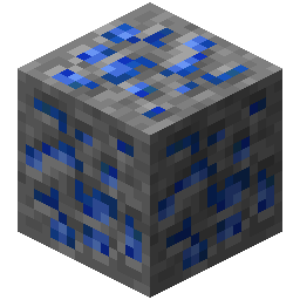
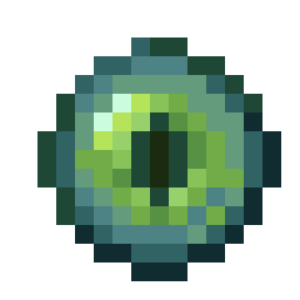
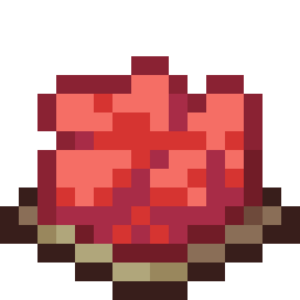
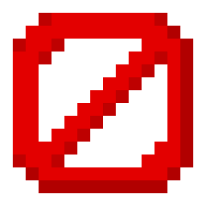
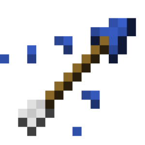
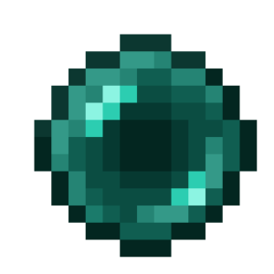
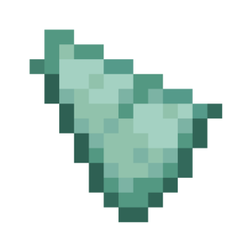
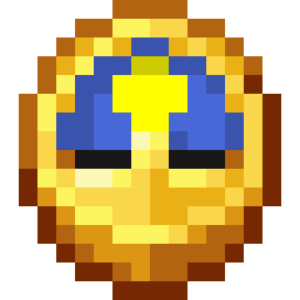
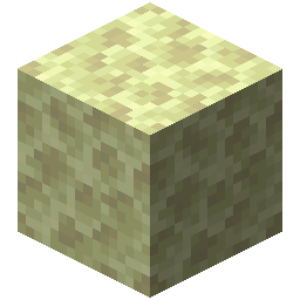
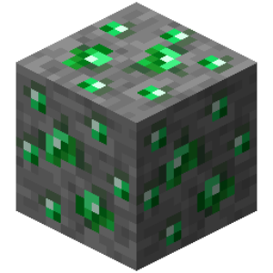

# Code actions

| Icon | ID | Name | Description | Category/Subcategory | Arguments | Works with | Additional info | Status |
| --- | --- | --- | --- | --- | --- | --- | --- | --- |
|  | call_function | Вызвать функцию | Вызывает строку кода функции. | call_function | function_name: text args: map |  |  |  |
|  | control_break_label | Выйти из блока с меткой | Прерывает код, помеченный указанным именем. | control | label: text | Действием "Пометить код" |  |  |
|  | control_call_exception | Вызвать ошибку | Вызывает определённую ошибку с указанным ID и сообщением. | control | id: text message: text type: enum &nbsp;&nbsp;- WARNING &nbsp;&nbsp;- ERROR &nbsp;&nbsp;- FATAL |  | Рекомендуется использовать это в действии "Уловить ошибку". |  |
|  | control_end_thread | Остановить последовательность | Останавливает текущую последовательность блоков кода. Любой код после этого блока не будет выполнен. | control |  |  | Если действие было использовано в функциях, то остановит родительскую строку, в которой вызвали функцию. |  |
|  | control_return_function | Вернуться до вызова | Останавливает текущую последовательность блоков кода в функции и возвращает к блоку вызова этой самой функции. | control |  |  | Возвращает до блока вызова текущей функции в родительской строке. |  |
|  | control_skip_iteration | Пропустить повторение | Пропускает одну итерацию в текущем повторении. | control |  |  |  |  |
|  | control_stop_repeat | Остановить повторение | Полностью останавливает текущее повторение. | control |  |  |  |  |
|  | control_wait | Ждать | Приостанавливает текущую последовательность блоков кода на определённое время. | control | duration: number time_unit: enum &nbsp;&nbsp;- TICKS &nbsp;&nbsp;- SECONDS &nbsp;&nbsp;- MINUTES |  | Минимальная задержка - 1 тик; в режиме Тики можно установить только целые числа. |  |
|  | else | Иначе | ... | else |  |  |  |  |
|  | start_process | Запустить процесс | Запускает строку кода процесса. | start_process | process_name: text target_mode: enum &nbsp;&nbsp;- CURRENT_TARGET &nbsp;&nbsp;- CURRENT_SELECTION &nbsp;&nbsp;- NO_TARGET &nbsp;&nbsp;- FOR_EACH_IN_SELECTION local_variables_mode: enum &nbsp;&nbsp;- DONT_COPY &nbsp;&nbsp;- COPY &nbsp;&nbsp;- SHARE args: map |  |  |  |
