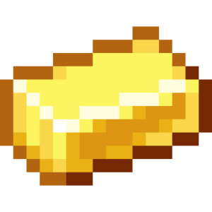
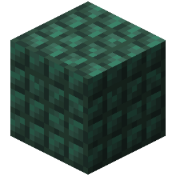
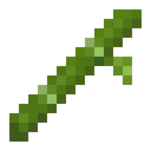
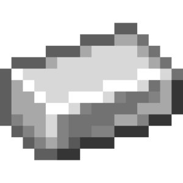

# Repeat actions

| Icon | ID | Name | Description | Category/Subcategory | Arguments | Works with | Additional info | Unused/Deprecated |
| --- | --- | --- | --- | --- | --- | --- | --- | --- |
|  | repeat_adjacently | Проход по смежным блокам | Присваивает текущее местоположение в указанную переменную среди соседних блоков относительно заданного местоположения. | repeat | variable: variable origin: location change_rotation: enum &nbsp;&nbsp;- TRUE &nbsp;&nbsp;- FALSE include_self: enum &nbsp;&nbsp;- TRUE &nbsp;&nbsp;- FALSE pattern: enum &nbsp;&nbsp;- CARDINAL &nbsp;&nbsp;- SQUARE &nbsp;&nbsp;- ADJACENT &nbsp;&nbsp;- CUBE |  |  | false/false |
|  | repeat_for_each_in_list | Проход по списку | Обращается к каждому элементу из указанного списка и выдаёт его индекс и значение в указанные переменные. | repeat | index_variable: variable value_variable: variable list: array |  |  | false/false |
|  | repeat_for_each_map_entry | Проход по словарю | Обращается к каждому элементу из указанного словаря и выдаёт его индекс и значение в указанные переменные. | repeat | key_variable: variable value_variable: variable map: map |  |  | false/false |
|  | repeat_forever | Повторять вечно | Постоянно повторяет код внутри поршней. | repeat |  |  |  | false/false |
|  | repeat_multi_times | Цикл со счётчиком | Выполняет код заданное количество раз. | repeat | variable: variable amount: number |  |  | false/false |
|  | repeat_on_circle | Проход по окружности | Последовательно выдаёт местоположение каждого блока окружности с указанными параметрами. | repeat | variable: variable center: location radius: number circle_points: number perpendicular_to_plane: vector start_angle: number angle_unit: enum &nbsp;&nbsp;- DEGREES &nbsp;&nbsp;- RADIANS |  |  | false/false |
|  | repeat_on_grid | Проход по региону | Выдаёт местоположение каждого блока из заданного региона в указанную переменную. | repeat | variable: variable start: location end: location |  |  | false/false |
|  | repeat_on_path | Проход по пути | Проходит от одного местоположения к другому с определённым шагом, присваивая текущее местоположение в указанную переменную. | repeat | variable: variable step: number locations: location rotation: enum &nbsp;&nbsp;- TRUE &nbsp;&nbsp;- FALSE |  |  | false/false |
|  | repeat_on_range | Цикл в диапазоне | Присваивает текущее число в указанную переменную из заданного диапазона с определённым шагом. | repeat | variable: variable start: number end: number interval: number |  |  | false/false |
|  | repeat_on_sphere | Проход по сфере | Последовательно выдаёт местоположение каждой точки на сфере с указанными параметрами. | repeat | variable: variable center: location radius: number points: number rotate_location: enum &nbsp;&nbsp;- NO_CHANGES &nbsp;&nbsp;- INWARDS &nbsp;&nbsp;- OUTWARDS |  |  | false/false |
|  | repeat_while | Цикл с условием | Выполняет код до тех пор, пока выбранное условие является истиной. | repeat |  |  |  | false/false |
