# Game values

| Icon | ID | Name | Description | Category | Return type | Works with | Additional info | Status |
| --- | --- | --- | --- | --- | --- | --- | --- | --- |
| 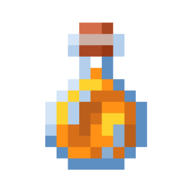 | absorption_health | Дополнительное здоровье | Получает количество единиц поглощательного (золотого) здоровья цели. | Статистика | number |  |  |  |
| 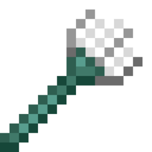 | active_item_used_time | Время использования предмета | Получает текущее время использования предмета в руке. | Статистика | number |  |  |  |
| 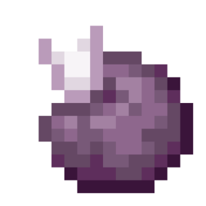 | age | Возраст цели | Получает возраст цели в тиках. | Статистика | number |  |  |  |
| 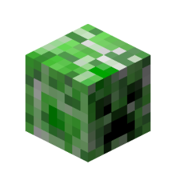 | all_entities_names | Имена всех сущностей | Получает имена всех сущностей, находящихся в мире. | Мир | array<text> |  |  |  |
|  | all_entities_uuids | UUID всех сущностей | Получает UUID всех сущностей, находящихся в мире. | Мир | array<text> |  |  |  |
| 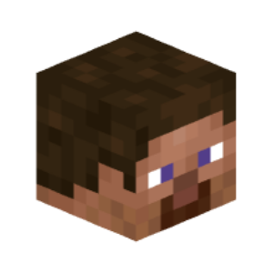 | all_players_names | Имена всех игроков | Получает имена всех игроков, находящихся в мире. | Мир | array<text> |  |  |  |
|  | all_players_uuids | UUID всех игроков | Получает UUID всех игроков, находящихся в мире. | Мир | array<text> |  |  |  |
| 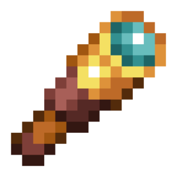 | anticheat_check | Проверка античита | Получает название проверки античита, на которой засекли игрока. | Событие | text | Событием "Античит засёк игрока" |  |  |
| 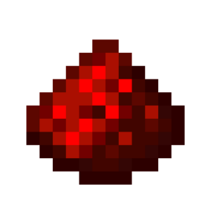 | anticheat_violations | Срабатываний античита | Получает количество срабатываний проверки античита у игрока. | Событие | number | Событием "Античит засёк игрока" |  |  |
| 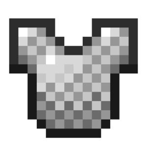 | armor_items | Предметы брони | Получает предметы в слотах брони цели. | Предмет | array<item> |  |  |  |
| 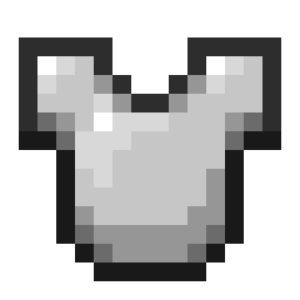 | armor_points | Очки защиты | Получает количество единиц брони цели, которое можно изменить предметами. | Статистика | number |  |  |  |
| 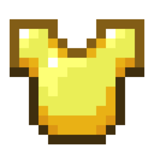 | armor_toughness | Твёрдость брони | Получает количество единиц твёрдости брони цели, которое можно изменить предметами. | Статистика | number |  |  |  |
| 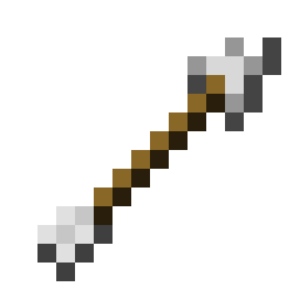 | arrows_in_body | Количество стрел в теле | Получает количество стрел в теле цели. | Статистика | number |  |  |  |
| 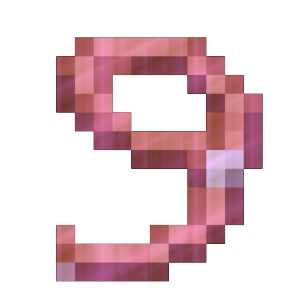 | attached_leads | Привязанные сущности | Получает UUID сущностей, которые привязаны поводком к цели. | Информация | array<text> |  |  |  |
| 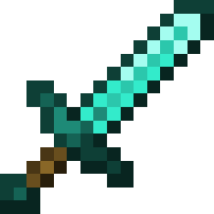 | attack_cooldown_strength | Кулдаун атаки | Получает текущий кулдаун атаки цели. | Статистика | number |  |  |  |
| 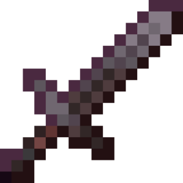 | attack_cooldown_ticks | Кулдаун атаки в тиках | Получает текущий кулдаун атаки цели в тиках. | Статистика | number |  |  |  |
| 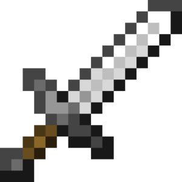 | attack_damage | Урон от атаки | Получает количество единиц урона от атак цели, которое можно изменить предметами. | Статистика | number |  |  |  |
| 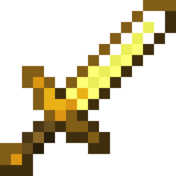 | attack_speed | Скорость атаки | Получает скорость атаки цели, которую можно изменить предметами. | Статистика | number |  |  |  |
| 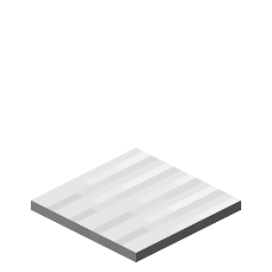 | block_beneath | Местоположение блока под целью | Получает местоположение блока под целью. | Местоположение | location |  |  |  |
| 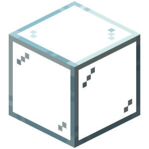 | blocks_beneath | Блоки под целью | Получает местоположения всех блоков, находящихся под целью. | Местоположение | array<location> |  |  |  |
| 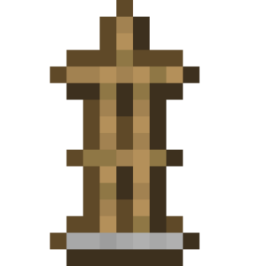 | body_yaw | Поворот тела | Получает поворот тела цели. | Местоположение | number |  |  |  |
| 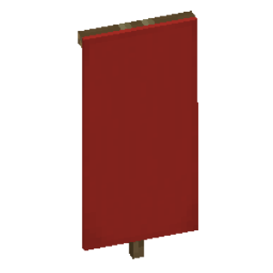 | cape_location | Местоположение плаща | Получает местоположение плаща игрока. | Местоположение | location | Игроками |  |  |
| 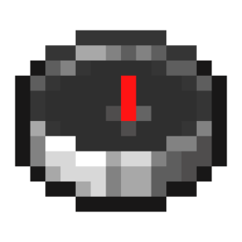 | cardinal_direction | Кардинальное направление | Получает кардинальное направление (север, запад, юг, восток) цели. | Местоположение | text |  |  |  |
| 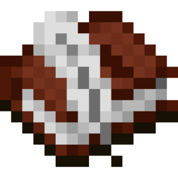 | chat_visibility | Видимость чата | Получает статус видимости чата игрока. | Информация | text | Игроками |  |  |
| 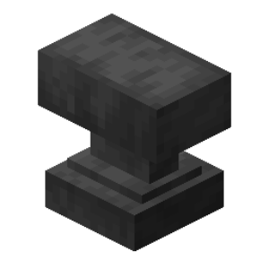 | client_brand_name | Название клиента игрока | Получает название клиента игрока. | Информация | text | Игроками |  |  |
|  | client_view_distance | Дальность прорисовки игрока | Получает дальность прорисовки игрока, установленную в настройках игры. | Статистика | number | Игроками |  |  |
| 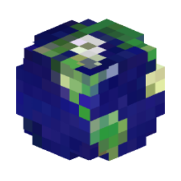 | clientside_locale | Язык клиента игрока | Получает язык клиента игрока. | Информация | text | Игроками |  |  |
| 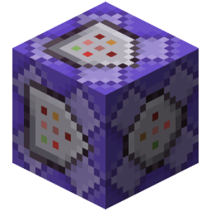 | cpu_usage | Процент использования процессора | Получает процент нагрузки миром процессора сервера. | Мир | number |  |  |  |
| 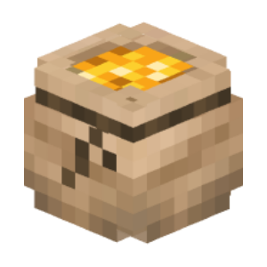 | currency_transaction_amount | Количество изумрудов в транзакции | Получает количество потраченных изумрудов в транзакции. | Событие | text | Событием "Игрок совершает транзакцию" |  |  |
| 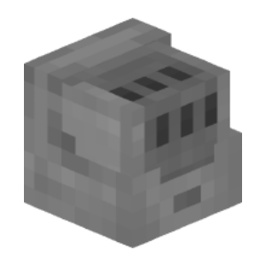 | currency_transaction_reason | Причина запроса транзакции | Получает причину запроса транзакции в изумрудах. | Событие | text | Событием "Игрок совершает транзакцию" |  |  |
| 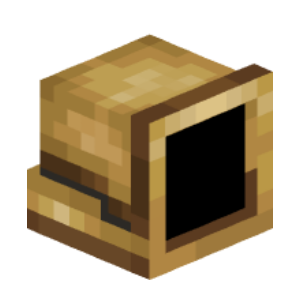 | currency_transaction_result | Результат транзакции | Получает результат совершённой транзакции. | Событие | text | Событием "Игрок совершает транзакцию" |  |  |
| 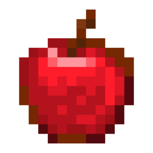 | current_health | Текущее здоровье | Получает оставшееся количество единиц здоровья цели. | Статистика | number |  |  |  |
| 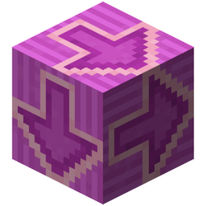 | current_input_list | Текущие нажатые клавиши передвижения | Получает нажатые в данный момент клавиши передвижения. | Информация | array<text> | Игроками |  |  |
| 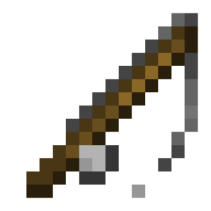 | cursor_item | Предмет на курсоре | Получает предмет на курсоре цели (используется при переносе предметов в инвентаре). | Предмет | item |  |  |  |
| 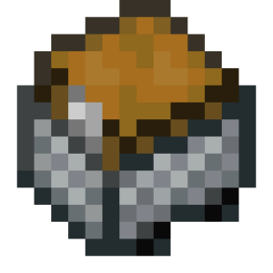 | custom_inventory_items | Список предметов в открытом инвентаре | Возвращает список, содержащий предметы, которые находятся в текущем открытом инвентарном меню. | Предмет | array<item> |  |  |  |
| 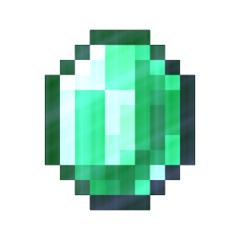 | death_screen_score | Количество очков | Получает количество очков, отображаемых на экране смерти. | Статистика | number | Игроками |  |  |
| 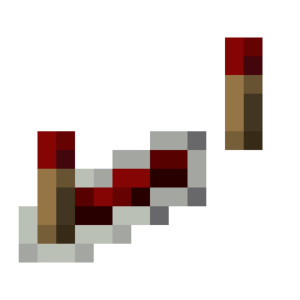 | delay_reload_count | Длительность заморозки мира | Получает текущее время, на которое мир заморожен. | Мир | number |  |  |  |
| 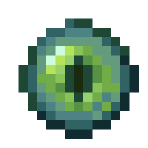 | direction_of_view | Направление взгляда | Получает вектор направления взгляда цели. | Местоположение | vector |  |  |  |
| 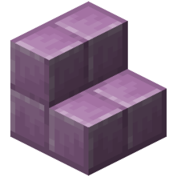 | display_entity_left_rotation | Левый поворот визуализатора | Получает левый поворот визуализатора в виде вектора. | Информация | vector | Визуализаторами |  |  |
| 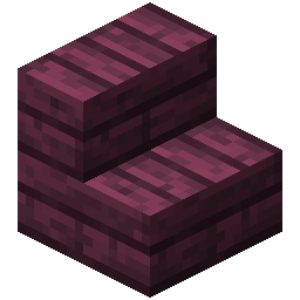 | display_entity_right_rotation | Правый поворот визуализатора | Получает правый поворот визуализатора в виде вектора. | Информация | vector | Визуализаторами |  |  |
| 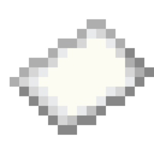 | display_entity_scale | Масштаб визуализатора | Получает масштаб визуализатора в виде вектора. | Информация | vector | Визуализаторами |  |  |
|  | display_entity_translation | Смещение визуализатора | Получает смещение визуализатора в виде вектора. | Информация | vector | Визуализаторами |  |  |
| 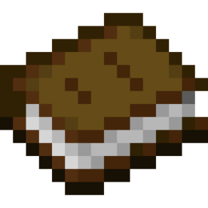 | display_name | Отображаемое имя | Получает отображаемое имя цели. | Информация | text |  |  |  |
| 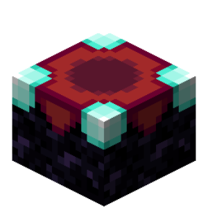 | enchantment_seed | Текущий сид зачарований | Получает текущий сид зачарований игрока. | Статистика | number |  |  |  |
| 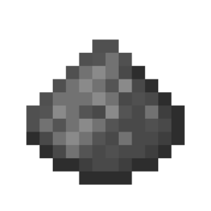 | entity_fuse_ticks | Время до взрыва | Получает время до взрыва сущности. | Статистика | number | Крипером Динамитом Фейерверками |  |  |
| 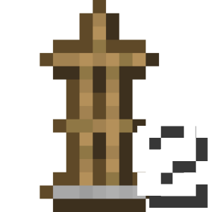 | entity_height | Высота хитбокса | Получает размер хитбокса цели по оси Y. | Статистика | number |  |  |  |
| 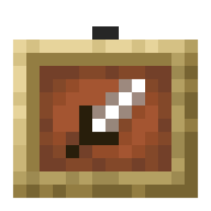 | entity_item | Предмет сущности | Получает предметную форму цели. | Предмет | item |  |  |  |
| 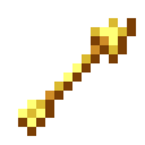 | entity_pathfinder_point_index | Индекс точки на пути | Получает текущий индекс точки пути моба, по которому он идет. | Статистика | number |  |  |  |
|  | entity_pathfinder_points | Текущий маршрут | Получает список всех точек, которые составляют текущий путь моба. | Информация | array<location> |  |  |  |
| 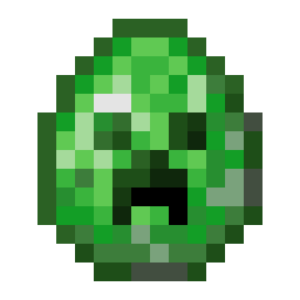 | entity_pick_item_stack | Получаемый предмет сущности | Получает предмет, получаемый при нажатии колесиком (СКМ) по сущности. | Предмет | item |  |  |  |
| 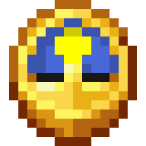 | entity_ticks_lived | Время жизни цели | Получает количество тиков существования цели. | Статистика | number |  |  |  |
| 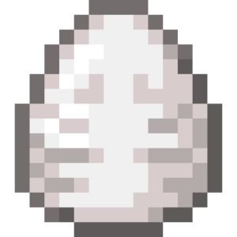 | entity_type | Тип сущности | Получает тип сущности цели. | Информация | text |  |  |  |
|  | entity_width_x | Ширина хитбокса | Получает размер хитбокса цели по оси X. | Статистика | number |  |  |  |
| 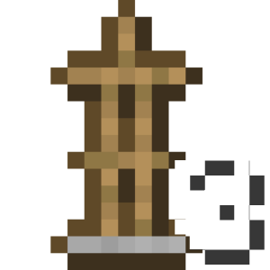 | entity_width_z | Длина хитбокса | Получает размер хитбокса цели по оси Z. | Статистика | number |  |  |  |
|  | event_added_items | Распределённые предметы | Выдаёт словарь распределённых по слотам предметов с помощью ЛКМ/ПКМ или дублирования с помощью колёсика мыши. | Событие | map<number, item> | Событием "Игрок перетягивает предмет в инвентаре" |  |  |
| 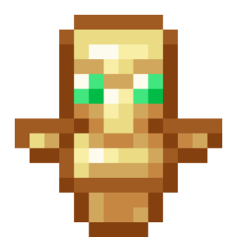 | event_advancement_tab_name | Имя вкладки достижений | Получает имя текущей вкладки достижений события. | Событие | text | Событием "Игрок сменил вкладку в меню достижений" |  | deprecated |
| 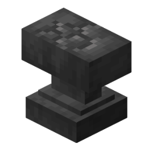 | event_anvil_damage_state | Новое состояние поломки наковальни | Получает новое состояние поломки наковальни. | Событие | text | Событием "Игрок повреждает наковальню" |  |  |
|  | event_anvil_rename_input | Новое имя предмета | Получает новое имя предмета в наковальне. | Событие | text | Событием "Игрок переименовывает предмет" |  |  |
|  | event_block | Блок события | Получает ID блока, связанного с событием. | Событие | text |  |  |  |
|  | event_block_break_progress | Прогресс поломки блока | Получает прогресс поломки блока, связанного с событием. | Событие | number | Обновлением поломки блока игроком Обновлением поломки блока сущностью |  |  |
|  | event_block_face | Сторона блока события | Получает как направления сторону блока, задетую в событии. | Событие | text | Событиями взаимодействия Событиями установки или поломки блоков Событием "Попадание снаряда игрока" Событиями поршней |  |  |
|  | event_block_location | Местоположение блока события | Получает местоположение блока в событии. | Событие | location |  |  |  |
|  | event_blocks_involved | Задействованные блоки события | Получает список местоположений всех задействованных блоков в событии. | Событие | array<location> | Событиями взрывов Событиями поршней |  |  |
|  | event_chat_message | Сообщение чата | Получает сообщение, отправленное целью в событии. | Событие | text | Событием "Игрок пишет сообщение в чат" |  |  |
|  | event_close_inventory_cause | Причина закрытия инвентаря | Получает причину закрытия открытого инвентаря цели в событии. | Событие | text | Событием "Игрок закрывает инвентарь" |  |  |
|  | event_combust_duration | Длительность сгорания сущности | Получает длительность сгорания сущности из события. | Событие | number | Событием "Игрок загорелся" Событием "Сущность загорелась" |  |  |
|  | event_combust_reason | Причина сгорания сущности | Получает причину сгорания сущности из события. | Событие | text | Событием "Игрок загорелся" Событием "Сущность загорелась" |  |  |
|  | event_custom_click_dialog_view_data | Данные диалогового окна | Получает данные, введённые игроком в диалоговое окно. | Событие | any | Событием "Игрок вызывает кастомный клик" |  |  |
|  | event_custom_click_key | ID кастомного клика | Получает идентификатор кастомного клика в диалоговом окне или чате. | Событие | text | Событием "Игрок вызывает кастомный клик" |  |  |
|  | event_damage | Нанесённый урон | Получает количество единиц нанесённого урона в событии. | Событие | number |  |  |  |
|  | event_damage_cause | Причина полученного урона | Получает причину или тип полученного урона в событии. | Событие | text |  |  |  |
|  | event_death_screen_message | Сообщение при смерти | Получает сообщение, отображаемое на экране смерти. | Событие | text | Событием "Игрок умирает" |  |  |
|  | event_dialog_button_id | ID кнопки диалогового окна | Получает ID кнопки диалогового окна, которую нажал игрок. | Событие | text | Событием "Игрок вызывает кастомный клик" |  |  |
|  | event_dialog_id | ID диалогового окна | Получает ID диалогового окна, в котором игрок нажал кнопку. | Событие | text | Событием "Игрок вызывает кастомный клик" |  |  |
|  | event_drag_type | Тип перетягивания по инвентарю | Получает тип перетягивания предметов по открытому инвентарю цели в событии. | Событие | text | Событием "Игрок перетягивает предмет в инвентаре" |  |  |
|  | event_enchantment_bonus | Количество книжных полок | Получает количество книжных полок, связанных с событием. | Событие | number | Событием "Игрок выбирает зачарование" |  |  |
|  | event_enchantment_hint | Предложенное зачарование | Получает название предложенного зачарования в столе зачарований. | Событие | text | Событием "Игрок зачаровывает предмет" |  |  |
|  | event_enchantment_level_hint | Требуемый уровень опыта зачарования | Получает требуемый уровень опыта для выбранного зачарования. | Событие | number | Событием "Игрок зачаровывает предмет" |  |  |
|  | event_enchantment_offers | Предлагаемые зачарования события | Получает список предлагаемых игроку зачарований, связанных с событием. | Событие | array<text> | Событием "Игрок выбирает зачарование" |  |  |
|  | event_enchantments_to_add | Полученные зачарования | Получает словарь полученных зачарований предмета. | Событие | map<text, number> | Событием "Игрок зачаровывает предмет" |  |  |
|  | event_entity_unleash_reason | Причина отвязывания сущности | Получает причину по которой сущность была отвязана. | Событие | text | Событиями отвязывания |  |  |
|  | event_equipment_slot | Тип задействованного слота | Получает тип задействованного слота цели в событии. | Событие | text |  |  |  |
|  | event_exhaustion_amount | Истощение события | Получает количество полученного истощения. | Событие | number | Событием "Игрок истощается" |  |  |
|  | event_exhaustion_reason | Причина истощения | Получает причину истощения. | Событие | text | Событием "Игрок истощается" |  |  |
|  | event_experience | Количество опыта события | Получает количество единиц опыта в событии. | Событие | number |  |  |  |
|  | event_fail_move_reason | Причина неудачного перемещения | Получает причину неудачного перемещения. | Событие | text | Событием "Игроку не удалось передвинуться" |  |  |
|  | event_final_damage | Конечный урон | Получает конечное количество единиц нанесённого урона в событии. | Событие | number |  |  |  |
|  | event_fish_state | Причина события рыбалки | Получает причину события рыбалки. | Событие | text | Событием "Игрок рыбачит" |  |  |
|  | event_food_level | Восполненный голод события | Получает количество единиц восполненного голода. | Событие | number | Событием "Изменение уровня голода игрока" |  |  |
|  | event_from_location | Старое местоположение игрока | Получает старое местоположение игрока. | Событие | location |  |  |  |
|  | event_gamemode | Режим игры события | Получает режим игры, связанный с событием. | Событие | text | Событием "Игрок запросил меню смены режима игры" |  |  |
|  | event_hanging_break_cause | Причина удаления висящей сущности | Получает причину удаления висящей сущности (картины, рамки). | Событие | text | Событием "Ломание висящего существа" |  |  |
|  | event_heal_amount | Количество восстановленного здоровья | Получает количество единиц восстановленного здоровья в событии. | Событие | number | Событием "Игрок восстанавливает здоровье" Событием "Сущность восстанавливает здоровье" |  |  |
|  | event_heal_cause | Причина исцеления | Получает причину восстановления здоровья в событии. | Событие | text | Событием "Игрок восстанавливает здоровье" Событием "Сущность восстанавливает здоровье" |  |  |
|  | event_hotbar_slot | Слот хот-бара в событии | Получает текущий номер слота хот-бара в событии. | Событие | number |  |  |  |
|  | event_input_list | Список нажатых клавиш передвижения | Получает список нажатых клавиш передвижения события. | Событие | array<text> | Событием "Игрок меняет нажатые клавиши передвижения" Событием "Игрок передвигается на транспорте" Событием "Игрок прыгает на транспорте" |  |  |
|  | event_interaction | Тип взаимодействия события | Получает тип взаимодействия цели в событии. | Событие | text | Событием "Игрок кликает правой кнопкой" Событием "Игрок кликает левой кнопкой" Событием "Игрок взаимодействует с миром" |  |  |
|  | event_inventory_action | Действие в инвентаре при клике | Получает текущее действие в инвентарном меню при клике по нему. | Событие | text |  |  |  |
|  | event_inventory_click_type | Тип клика по инвентарю | Получает тип клика по открытому инвентарю цели в событии. | Событие | text |  |  |  |
|  | event_item | Предмет события | Получает предмет в событии. | Событие | item |  |  |  |
|  | event_item_cooldown | Задержка предмета события | Получает задержку предметы события. | Событие | number | Событием "Игрок использует предмет с задержкой" Событием "Игрок получает задержку для группы предметов" |  |  |
|  | event_item_cooldown_group | Группа предмета с задержкой | Получает группу предмета, на который распостраняется задержка из события. | Событие | text | Событием "Игрок использует предмет с задержкой" Событием "Игрок получает задержку для группы предметов" |  |  |
|  | event_item_damage | Нанесённый урон предмету | Получает количество единиц нанесённого урона предмету. | Событие | number | Событием "Игрок повреждает предмет" |  |  |
|  | event_items | Предметы события | Получает все предметы в событии. | Событие | array<item> |  |  |  |
|  | event_knockback_cause | Причина отталкивания | Получает причину отталкивания в событии. | Событие | text | Событием "Игрок отталкивается" Событием "Сущность отталкивается" |  |  |
|  | event_knockback_event_type | Тип отталкивания | Получает тип отталкивания в событии. | Событие | text | Событием "Игрок отталкивается" Событием "Сущность отталкивается" |  |  |
|  | event_knockback_vector | Вектор отталкивания | Получает вектор отталкивания в событии. | Событие | vector | Событием "Игрок отталкивается" Событием "Сущность отталкивается" |  |  |
|  | event_message | Сообщение события | Получает системное сообщение, отправленное в событии. | Событие | text |  |  |  |
|  | event_new_equipments | Экипировка | Получает экипировку из события. | Событие | map<text, item> | Событием "Игрок меняет экипировку" Событием "Сущность меняет экипировку" |  |  |
|  | event_new_fishing_hook_state | Новое состояние поплавка | Получает новое состояние поплавка. | Событие | text | Событием "Поплавок удочки изменяет состояние" |  |  |
|  | event_new_location | Новое местоположение игрока | Получает новое местоположение игрока. | Событие | location |  |  |  |
|  | event_new_potion_effect | Новый эффект | Получает новый эффект события. | Событие | potion | Событием "Игрок получает эффект от взрывного зелья" |  |  |
|  | event_new_vault_state | Новое состояние сокровищницы | Получает новое состояние сокровищницы. | Событие | text | Событием "Сокровищница меняет состояние" Событием "Игрок меняет состояние сокровищницы" |  |  |
|  | event_old_equipments | Прошлая экипировка события | Получает прошлую экипировку события. | Событие | map<text, item> | Событием "Игрок меняет экипировку" Событием "Сущность меняет экипировку" |  |  |
|  | event_old_item | Старый предмет события | Получает старый предмет в событии. | Событие | item | Событием "Слот инвентаря игрока обновляется" |  |  |
|  | event_old_vault_state | Прошлое состояние сокровищницы | Получает прошлое состояние сокровищницы. | Событие | text | Событием "Сокровищница меняет состояние" Событием "Игрок меняет состояние сокровищницы" |  |  |
|  | event_power | Процент силы выполнения | Получает процент силы выполнения (натяжения лука, прыжка на коне) события. | Событие | number | Событием "Игрок стреляет" Событием "Игрок прыгает на лошади" |  |  |
|  | event_projectile_item | Предмет снаряда события | Получает предмет снаряда события. | Событие | item | Событием "Игрок стреляет" |  |  |
|  | event_query_info | Отладочная информация | Получает отладочную информацию целевого блока или сущности. | Событие | text | Событием "Игрок получает информацию о блоке" Событием "Игрок получает информацию о сущности" |  |  |
|  | event_replaced_block | Заменённый блок | Получает ID заменённого блока события. | Событие | text | Событием "Игрок ставит блок" |  |  |
|  | event_sign_lines | Строки таблички | Получает строки таблички в виде списка. | Событие | array<text> | Событием "Игрок изменяет табличку" |  |  |
|  | event_sign_side | Сторона таблички | Получает сторону таблички в виде текста. | Событие | text | Событием "Игрок изменяет табличку" |  |  |
|  | event_slot | Слот события | Выдаёт номер слота в событии. | Событие | number |  |  |  |
|  | event_slot_type | Тип слота при клике | Получает текущий тип слота инвентарного меню при клике по нему. | Событие | text |  |  |  |
|  | event_slots_involved | Задействованные слоты | Получает список всех задействованных слотов открытого инвентаря цели в событии. | Событие | array<number> | Событием "Игрок перетягивает предмет в инвентаре" |  |  |
|  | event_teleport_cause | Причина телепортации | Получает причину телепортации в событии. | Событие | text | Событием "Игрок телепортировался" Событием "Эндермен убегает" |  |  |
|  | event_ticks_held_for | Количество тиков использования предмета | Получает количество тиков использования предмета. | Событие | number | Событием "Игрок перестаёт использовать предмет" |  |  |
|  | event_time_skip_amount | Количество тиков пропуска времени | Получает количество тиков пропуска времени в мире. | Событие | number | Событием "Пропуск времени" |  |  |
|  | event_time_skip_reason | Причина пропуска времени | Получает причину пропуска времени в мире. | Событие | text | Событием "Пропуск времени" |  |  |
|  | event_transform_reason | Причина замены сущности | Получает причину замены сущности события. | Событие | text | Событием "Сущность заменяется другой сущностью" |  |  |
|  | event_transformed_entities | Заменённые сущности события | Получает заменённых сущностей события. | Событие | array<text> | Событием "Сущность заменяется другой сущностью" |  |  |
|  | event_tree_type | Тип дерева | Получает тип дерева в событии. | Событие | text | Событием "Игрок выращивает дерево" Событием "Дерево вырастает" |  |  |
|  | event_velocity | Вектор скорости | Получает вектор скорости в событии. | Событие | vector | Событием "Игрок изменил вектор скорости" |  |  |
|  | experience_level | Уровень опыта | Получает количество уровней опыта цели. | Статистика | number |  |  |  |
|  | experience_progress | Прогресс опыта | Получает процентный прогресс текущего уровня опыта цели. | Статистика | number |  |  |  |
|  | eye_location | Местоположение глаз | Получает местоположение цели на высоте глаз. | Местоположение | location |  |  |  |
|  | fall_distance | Дистанция падения | Получает дистанцию падения цели в блоках. | Статистика | number |  |  |  |
|  | fire_ticks | Время горения | Получает оставшееся количество тиков горения цели. | Статистика | number |  |  |  |
|  | flying_speed | Скорость полёта | Получает текущую скорость полёта цели (атрибут). | Статистика | number |  |  |  |
|  | food_exhaustion | Уровень истощения | Получает уровень истощения цели, который увеличивается от выполненных действий игрока. | Статистика | number |  |  |  |
|  | food_level | Уровень голода | Получает оставшееся количество единиц еды цели. | Статистика | number |  |  |  |
|  | food_saturation | Уровень насыщения | Получает количество единиц насыщения едой цели, которое зависит от видов съеденной еды. | Статистика | number |  |  |  |
|  | freeze_ticks | Время заморозки | Получает текущее время заморозки цели. | Статистика | number |  |  |  |
|  | gamemode | Режим игры | Получает текущий режим игры игрока. | Информация | text | Игроками |  |  |
|  | held_slot | Выбранный слот в хот-баре | Получает выбранный слот хот-бара цели. | Статистика | number |  |  |  |
|  | hitbox_midpoint_location | Центр хитбокса | Получает местоположение центра хитбокса цели. | Местоположение | location |  |  |  |
|  | hotbar_items | Предметы в хот-баре | Получает предметы в хот-баре цели. | Предмет | array<item> |  |  |  |
|  | idle_duration | Длительность простоя | Получает текущую длительность простоя игрока. | Статистика | number |  |  |  |
|  | inventory_items | Предметы в инвентаре | Получает предметы в инвентаре цели (включая хот-бар). | Предмет | array<item> |  |  |  |
|  | invulnerability_ticks | Время бессмертия | Получает оставшееся количество тиков неуязвимости цели. | Статистика | number |  |  |  |
|  | item_usage_progress | Прогресс использования предмета | Получает процентный прогресс использования целью предмета в руке, например еды. | Статистика | number |  |  |  |
|  | last_damage_cause | Последняя причина урона | Получает последнюю причину урона цели. | Информация | text |  |  |  |
|  | last_death_location | Местоположение последней смерти | Получает местоположение последней смерти игрока. | Местоположение | location |  |  |  |
|  | lead_holder | Поводырь | Получает UUID сущности, которая ведёт цель на поводке. | Информация | text |  |  |  |
|  | location | Местоположение | Получает местоположение цели. | Местоположение | location |  |  |  |
|  | main_hand | Ведущая рука | Получает ведущую руку игрока. | Информация | text | Игроком |  |  |
|  | main_hand_item | Предмет в ведущей руке | Получает предмет в ведущей руке цели. | Предмет | item |  |  |  |
|  | max_health | Максимальное здоровье | Получает максимальное количество единиц здоровья цели. | Статистика | number |  |  |  |
|  | max_invulnerability_ticks | Общее время бессмертия | Получает количество тиков на которое выдана неуязвимость для цели. | Статистика | number |  |  |  |
|  | merchant_recipe_count | Количество торгов Жителя | Получает количество торгов Жителя. | Статистика | number |  |  |  |
|  | name | Имя | Получает имя цели. | Информация | text |  |  |  |
|  | off_hand_item | Предмет во второй руке | Получает предмет во второстепенной руке цели. | Предмет | item |  |  |  |
|  | open_inventory_custom_id | Кастомный ID открытого инвентаря | Получает кастомный ID открытого инвентаря цели. | Информация | text | Игроками |  |  |
|  | open_inventory_size | Размер открытого инвентаря | Получает размер текущего открытого инвентаря. | Статистика | number | Игроками |  |  |
|  | open_inventory_title | Заголовок открытого инвентаря | Получает заголовок открытого инвентаря цели. | Информация | text | Игроками |  |  |
|  | open_inventory_type | Тип открытого инвентаря | Получает тип открытого инвентаря цели. | Информация | text | Игроками |  |  |
|  | origin | Местоположение первого появления | Получает местоположение первого появления цели. | Местоположение | location |  |  |  |
|  | owner_uuid | UUID владельца мира | Получает UUID владельца мира. | Мир | text |  |  |  |
|  | particle_cpu_usage | Процент использования процессора частицами | Получает процент нагрузки процессора сервера созданием частиц. | Мир | number |  |  |  |
|  | particle_visibility | Видимость частиц | Получает значение настроек видимости частиц игрока. | Информация | text | Игроками |  |  |
|  | passengers | Пассажиры | Получает UUID сущностей, которые едут на цели. | Информация | array<text> |  |  |  |
|  | ping | Пинг игрока | Получает задержку между игроком и сервером в миллисекундах. | Статистика | number |  |  |  |
|  | pitch | Вертикальный поворот | Получает вертикальный (вверх/вниз) поворот (pitch) цели. | Местоположение | number |  |  |  |
|  | player_count | Количество игроков в мире | Получает количество игроков, находящихся в мире. | Мир | number |  |  |  |
|  | player_ender_pearls | Список эндер-жемчугов | Получает список не приземлившихся эндер-жемчугов игрока. | Информация | array<text> | Игроками |  |  |
|  | player_enderchest_items | Предметы в эндер-сундуке | Получает предметы в эндер-сундуке цели. | Предмет | array<item> | Игроками |  |  |
|  | pose | Поза сущности | Получает позу сущности. | Информация | text |  |  |  |
|  | potion_effects | Эффекты зелий | Получает действующие эффекты зелий цели. | Информация | array<potion> |  |  |  |
|  | projectile_owner_uuid | UUID владельца снаряда | Получает UUID владельца снаряда. | Информация | text | Любыми снарядами |  |  |
|  | projectile_power | Вектор движения снаряда | Получает вектор движения снаряда. | Статистика | vector | Огненными шарами Зарядами дракона Головами Иссушителя |  |  |
|  | protocol_version | Версия протокола клиента | Получает версию протокола клиента игрока. | Статистика | number |  |  |  |
|  | remaining_air | Оставшийся воздух | Получает оставшееся количество тиков воздуха цели. | Статистика | number |  |  |  |
|  | response_headers | Заголовки ответа на веб-запрос | Получает заголовки ответа на отправленный веб-запрос. | Событие | map<text, any> | Событием "Ответ от сервера" |  |  |
|  | saddle_item | Предмет на седле | Получает седло или ковёр, надетые на цель. | Предмет | item | Свиньями Лошадьми Ламами |  |  |
|  | saturated_regen_rate | Скорость регенерации от насыщения | Получает скорость регенерации игрока с насыщением. | Статистика | number |  |  |  |
|  | selection_size | Количество выбранных целей | Получает количество целей в выборке. | Мир | number |  |  |  |
|  | selection_target_names | Имена выбранных целей | Получает имя каждой цели в выборке. | Мир | array<text> |  |  |  |
|  | selection_target_uuids | UUID выбранных целей | Получает UUID каждой цели в выборке. | Мир | array<text> |  |  |  |
|  | server_current_tick | Текущее время сервера | Получает текущее время сервера в тиках. | Мир | number |  |  |  |
|  | server_tps | TPS сервера | Получает количество Тиков За Секунду (TPS), которое может обработать сервер. | Мир | number |  |  |  |
|  | spawn_location | Местоположение спавна мира | Получает местоположение точки спавна мира. | Местоположение | location |  |  |  |
|  | spawn_reason | Причина спавна | Получает причину спавна цели. | Информация | text |  |  |  |
|  | start_reload_tick | Время начала заморозки мира | Получает время начала заморозки мира в тиках. | Мир | number |  |  |  |
|  | starvation_rate | Скорость голодания | Получает скорость голодания цели. | Статистика | number |  |  |  |
|  | steer_forward | Прямолинейное движение транспорта | Получает значение движения транспорта вперёд или назад. | Статистика | number |  |  |  |
|  | steer_sideways | Движение транспорта в стороны | Получает значение движения транспорта влево или вправо. | Статистика | number |  |  |  |
|  | target_block_face | Сторона целевого блока | Получает направление стороны блока, на которую смотрит цель. | Местоположение | text |  |  |  |
|  | target_block_location | Местоположение целевого блока | Получает местоположение блока, на который смотрит цель. | Местоположение | location |  |  |  |
|  | target_fluid_location | Местоположение целевой жидкости | Получает местоположение жидкости, на которую смотрит цель. | Местоположение | location |  |  |  |
|  | targeted_entity | Цель для атаки | Получает текущую цель для атаки мобом. | Информация | text |  |  |  |
|  | timestamp | UNIX-время | Получает текущее время как одно число в миллисекундах. | Мир | number |  |  |  |
|  | unsaturated_regen_rate | Скорость регенерации без насыщения | Получает скорость регенерации игрока без насыщения. | Статистика | number |  |  |  |
|  | url | Ссылка веб-запроса | Получает ссылку веб-запроса. | Событие | text | Событием "Ответ от сервера" |  |  |
|  | url_response | Ответ на веб-запрос | Получает ответ на отправленный веб-запрос. | Событие | text | Событием "Ответ от сервера" |  |  |
|  | url_response_code | Код ответа на веб-запрос | Получает код ответа на отправленный веб-запрос. | Событие | number | Событием "Ответ от сервера" |  |  |
|  | user_locale | Серверный язык игрока | Получает текущий серверный язык игрока. | Информация | text | Игроками |  |  |
|  | uuid | UUID | Получает универсальный уникальный идентификатор (UUID) цели. | Информация | text |  |  |  |
|  | vehicle | Транспорт | Получает UUID сущности, которую оседлала цель. | Информация | text |  |  |  |
|  | velocity | Вектор скорости | Получает вектор скорости движения цели (не ходьбы, а внешних сил). | Информация | vector |  |  |  |
|  | walking_speed | Скорость ходьбы | Получает текущую скорость ходьбы цели (атрибут). | Статистика | number |  |  |  |
|  | world_clear_weather_duration | Длительность ясной погоды в мире | Получает текущую длительность ясной погоды в мире. | Мир | number |  |  |  |
|  | world_game_time | Время существования мира | Получает время существования мира в тиках. | Мир | number |  |  |  |
|  | world_id | ID мира | Получает идентификатор мира. | Мир | text |  |  |  |
|  | world_moon_phase | Текущая фаза луны | Получает текущую фазу луны в мире. | Мир | text |  |  |  |
|  | world_size | Размер мира | Получает текущий размер мира в чанках. | Мир | number |  |  |  |
|  | world_thunder_duration | Длительность дождя в мире | Получает текущую длительность дождя в мире. | Мир | number |  |  |  |
|  | world_time | Текущее время мира | Получает текущее время мира в тиках. | Мир | number |  |  |  |
|  | world_weather | Текущая погода мира | Получает тип текущей погоды мира. | Мир | text |  |  |  |
|  | world_weather_duration | Длительность текущей погоды мира | Получает длительность текущей погоды мира. | Мир | number |  |  |  |
|  | x_coordinate | Координата X | Получает координату X местоположения цели. | Местоположение | number |  |  |  |
|  | y_coordinate | Координата Y | Получает координату Y местоположения цели. | Местоположение | number |  |  |  |
|  | yaw | Горизонтальный поворот | Получает горизонтальный (влево/вправо) поворот (yaw) цели. | Местоположение | number |  |  |  |
|  | z_coordinate | Координата Z | Получает координату Z местоположения цели. | Местоположение | number |  |  |  |
