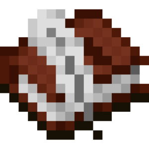
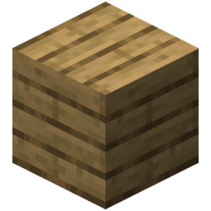
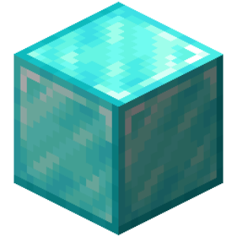
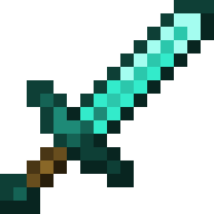
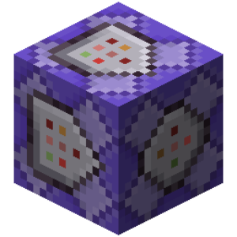
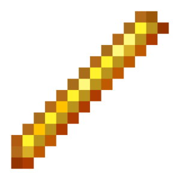
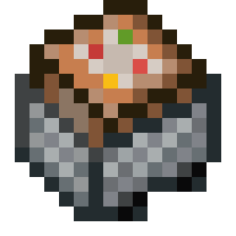
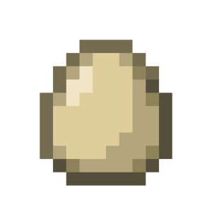
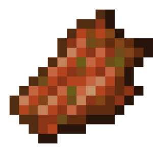

# Select actions

| Icon | ID | Name | Description | Category | Works with | Additional info | Unused | Deprecated | Subcategory | Type | Arguments |
| --- | --- | --- | --- | --- | --- | --- | --- | --- | --- | --- | --- |
|  | select_add_all_entities | Додати всіх сутностей | Додає до вибірки всіх сутностей зі світу. | select |  |  | false | false | add | basic |  |
|  | select_add_all_mobs | Додати всіх мобів | Додає до вибірки всіх мобів зі світу. | select |  |  | false | false | add | basic |  |
|  | select_add_all_players | Додати всіх гравців | Додає до вибірки всіх гравців зі світу. | select |  |  | false | false | add | basic |  |
|  | select_add_entity_by_conditional | Додати сутність за умовою | Додає сутностей, якщо виконується зазначена умова. | select |  |  | false | false | add | basic_with_conditional |  |
|  | select_add_entity_by_name | Додати сутність за іменем/UUID | Додає до вибірки сутність із зазначеним іменем/UUID. | select |  |  | false | false | add | basic | name_or_uuid: text |
|  | select_add_event_target | Додати ціль події | Додає до вибірки ціль, яка запустила подію. | select |  |  | false | false | add | basic | selection_type: enum |
|  | select_add_last_entity | Додати останню сутність, що з'явилася | Додає до вибірки останню сутність, що з'явилася у світі. | select |  |  | false | false | add | basic |  |
|  | select_add_last_mob | Додати останнього моба, що з'явився | Додає до вибірки останнього моба, що з'явився у світі. | select |  |  | false | false | add | basic |  |
|  | select_add_mob_by_name | Додати моба за іменем/UUID | Додає до вибірки моба із зазначеним іменем/UUID. | select |  |  | false | false | add | basic | name_or_uuid: text |
|  | select_add_player_by_conditional | Додати гравця за умовою | Додає гравців, якщо виконується зазначена умова. | select |  |  | false | false | add | basic_with_conditional |  |
|  | select_add_player_by_name | Додати гравця за іменем/UUID | Додає до вибірки гравця із зазначеним іменем/UUID. | select |  |  | false | false | add | basic | name_or_uuid: text |
|  | select_add_random_entity | Додати випадкову сутність | Додає до вибірки випадкову сутність зі світу. | select |  |  | false | false | add | basic |  |
|  | select_add_random_mob | Додати випадкового моба | Додає до вибірки випадкового моба зі світу. | select |  |  | false | false | add | basic |  |
|  | select_add_random_player | Додати випадкового гравця | Додає до вибірки випадкового гравця зі світу. | select |  |  | false | false | add | basic |  |
|  | select_all_entities | Выбрать всех сущностей | Выбирает всех сущностей в мире. | select |  |  | false | false | creation | basic |  |
|  | select_all_mobs | Выбрать всех мобов | Выбирает всех мобов в мире. | select |  |  | false | false | creation | basic |  |
|  | select_all_players | Выбрать всех игроков | Выбирает всех игроков в мире. | select |  |  | false | false | creation | basic |  |
|  | select_entity_by_conditional | Выбрать сущность по условию | Выбирает сущностей, если выполняется указанное условие. | select |  |  | false | false | creation | basic_with_conditional |  |
|  | select_entity_by_name | Выбрать сущность по имени | Выбирает сущность или сущностей по имени или UUID. | select |  |  | false | false | creation | basic | name_or_uuid: text |
|  | select_event_target | Выбрать цель события | Выбирает цель, которая запустила событие. | select |  |  | false | false | creation | basic | selection_type: enum |
|  | select_filter_by_conditional | Відфільтрувати вибірку за умовою | Залишає у вибірці ті цілі, які відповідають обраній умові. | select |  |  | false | false | filter | basic_with_conditional |  |
|  | select_filter_by_distance | Відфільтрувати вибірку за відстанню | Залишає у вибірці ті цілі, які знаходяться на відстані до місцезнаходження. | select |  |  | false | false | filter | basic | location: location selection_size: number ignore_y_axis: enum compare_mode: enum |
|  | select_filter_by_raycast | Фільтр рейкастом | Залишає у вибірці лише ті цілі, в які потрапив запущений промінь. Ширина променя працює лише на сутностей (збільшує або зменшує хітбокси істот). | select |  |  | false | false | filter | basic | variable: variable origin: location max_distance: number ray_size: number selection_size: number consider_blocks: enum ignore_passable_blocks: enum fluid_collision_mode: enum |
|  | select_filter_randomly | Выбрать случайную сущность с выборки | Выбирает случайную сущность с выборки. | select |  |  | false | false | filter | basic | size: number |
|  | select_invert | Інвертувати вибірку | Створює нову вибірку, до якої входять усі істоти, крім обраних. | select |  |  | false | false | creation | basic |  |
|  | select_last_entity | Выбрать последнюю появившуюся сущность | Выбирает последнюю появившуюся сущность в мире. | select |  |  | false | false | creation | basic |  |
|  | select_last_mob | Выбрать последнего появившегося моба | Выбирает последнего появившегося моба в мире. | select |  |  | false | false | creation | basic |  |
|  | select_mob_by_name | Выбрать моба по имени | Выбирает моба или мобов по имени или UUID. | select |  |  | false | false | creation | basic | name_or_uuid: text |
|  | select_player_by_conditional | Выбрать игрока по условию | Выбирает игроков, если выполняется указанное условие. | select |  |  | false | false | creation | basic_with_conditional |  |
|  | select_player_by_name | Выбрать игрока по имени | Выбирает игрока или игроков по имени или UUID. | select |  |  | false | false | creation | basic | name_or_uuid: text |
|  | select_random_entity | Выбрать случайную сущность | Выбирает случайную сущность в мире. | select |  |  | false | false | creation | basic |  |
|  | select_random_mob | Выбрать случайного моба | Выбирает случайного моба в мире. | select |  |  | false | false | creation | basic |  |
|  | select_random_player | Выбрать случайного игрока | Выбирает случайного игрока в мире. | select |  |  | false | false | creation | basic |  |
|  | select_reset | Сбросить выборку | Сбрасывает всю выборку. | select |  |  | false | false | creation | basic |  |
