# World actions

| Icon | ID | Name | Description | Category/Subcategory | Arguments | Works with | Additional info | Status |
| --- | --- | --- | --- | --- | --- | --- | --- | --- |
| 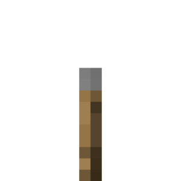 | game_add_boolean_option_dialog_input | Додати перемикач | Додає в діалогове вікно галочку, яку гравець може ввімкнути або вимкнути. | game/dialog | dialog_id: text input_id: text label: text initial_value: enum &nbsp;&nbsp;- TRUE &nbsp;&nbsp;- FALSE |  |  |  |
|  | game_add_custom_cooking_recipe | Додати рецепт виплавки | Додає власний рецепт для печі або коптильні в гру | game/recipe | name: text input: item result: item experience: number cooking_time: number replace_vanilla: enum &nbsp;&nbsp;- TRUE &nbsp;&nbsp;- FALSE input_match: enum &nbsp;&nbsp;- EXACT &nbsp;&nbsp;- IGNORE_NAME_DURABILITY &nbsp;&nbsp;- IGNORE_NAME_DURABILITY_ENCHANTMENTS &nbsp;&nbsp;- CUSTOM_TAGS_CONTAINS &nbsp;&nbsp;- MINECRAFT_TAG &nbsp;&nbsp;- ITEM_TYPE recipe_type: enum &nbsp;&nbsp;- FURNACE &nbsp;&nbsp;- BLASTING &nbsp;&nbsp;- SMOKING &nbsp;&nbsp;- CAMPFIRE category: enum &nbsp;&nbsp;- FOOD &nbsp;&nbsp;- BLOCKS &nbsp;&nbsp;- MISC |  |  |  |
|  | game_add_custom_crafting_recipe | Додати рецепт крафту | Додає власний рецепт крафту у світ. | game/recipe | name: text items: item result: item replace_vanilla: enum &nbsp;&nbsp;- TRUE &nbsp;&nbsp;- FALSE recipe_match_slot_1: enum &nbsp;&nbsp;- EXACT &nbsp;&nbsp;- IGNORE_NAME_DURABILITY &nbsp;&nbsp;- IGNORE_NAME_DURABILITY_ENCHANTMENTS &nbsp;&nbsp;- CUSTOM_TAGS_CONTAINS &nbsp;&nbsp;- MINECRAFT_TAG &nbsp;&nbsp;- ITEM_TYPE recipe_match_slot_2: enum &nbsp;&nbsp;- EXACT &nbsp;&nbsp;- IGNORE_NAME_DURABILITY &nbsp;&nbsp;- IGNORE_NAME_DURABILITY_ENCHANTMENTS &nbsp;&nbsp;- CUSTOM_TAGS_CONTAINS &nbsp;&nbsp;- MINECRAFT_TAG &nbsp;&nbsp;- ITEM_TYPE recipe_match_slot_3: enum &nbsp;&nbsp;- EXACT &nbsp;&nbsp;- IGNORE_NAME_DURABILITY &nbsp;&nbsp;- IGNORE_NAME_DURABILITY_ENCHANTMENTS &nbsp;&nbsp;- CUSTOM_TAGS_CONTAINS &nbsp;&nbsp;- MINECRAFT_TAG &nbsp;&nbsp;- ITEM_TYPE recipe_match_slot_4: enum &nbsp;&nbsp;- EXACT &nbsp;&nbsp;- IGNORE_NAME_DURABILITY &nbsp;&nbsp;- IGNORE_NAME_DURABILITY_ENCHANTMENTS &nbsp;&nbsp;- CUSTOM_TAGS_CONTAINS &nbsp;&nbsp;- MINECRAFT_TAG &nbsp;&nbsp;- ITEM_TYPE recipe_match_slot_5: enum &nbsp;&nbsp;- EXACT &nbsp;&nbsp;- IGNORE_NAME_DURABILITY &nbsp;&nbsp;- IGNORE_NAME_DURABILITY_ENCHANTMENTS &nbsp;&nbsp;- CUSTOM_TAGS_CONTAINS &nbsp;&nbsp;- MINECRAFT_TAG &nbsp;&nbsp;- ITEM_TYPE recipe_match_slot_6: enum &nbsp;&nbsp;- EXACT &nbsp;&nbsp;- IGNORE_NAME_DURABILITY &nbsp;&nbsp;- IGNORE_NAME_DURABILITY_ENCHANTMENTS &nbsp;&nbsp;- CUSTOM_TAGS_CONTAINS &nbsp;&nbsp;- MINECRAFT_TAG &nbsp;&nbsp;- ITEM_TYPE recipe_match_slot_7: enum &nbsp;&nbsp;- EXACT &nbsp;&nbsp;- IGNORE_NAME_DURABILITY &nbsp;&nbsp;- IGNORE_NAME_DURABILITY_ENCHANTMENTS &nbsp;&nbsp;- CUSTOM_TAGS_CONTAINS &nbsp;&nbsp;- MINECRAFT_TAG &nbsp;&nbsp;- ITEM_TYPE recipe_match_slot_8: enum &nbsp;&nbsp;- EXACT &nbsp;&nbsp;- IGNORE_NAME_DURABILITY &nbsp;&nbsp;- IGNORE_NAME_DURABILITY_ENCHANTMENTS &nbsp;&nbsp;- CUSTOM_TAGS_CONTAINS &nbsp;&nbsp;- MINECRAFT_TAG &nbsp;&nbsp;- ITEM_TYPE recipe_match_slot_9: enum &nbsp;&nbsp;- EXACT &nbsp;&nbsp;- IGNORE_NAME_DURABILITY &nbsp;&nbsp;- IGNORE_NAME_DURABILITY_ENCHANTMENTS &nbsp;&nbsp;- CUSTOM_TAGS_CONTAINS &nbsp;&nbsp;- MINECRAFT_TAG &nbsp;&nbsp;- ITEM_TYPE recipe_type: enum &nbsp;&nbsp;- SHAPED &nbsp;&nbsp;- SHAPELESS category: enum &nbsp;&nbsp;- BUILDING &nbsp;&nbsp;- REDSTONE &nbsp;&nbsp;- EQUIPMENT &nbsp;&nbsp;- MISC |  |  |  |
| 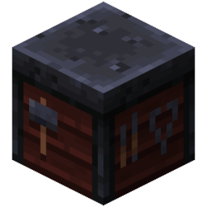 | game_add_custom_smithing_transform_recipe | Додати ковальський рецепт поліпшення | Додає власний рецепт поліпшення спорядження в ковальському столі | game/recipe | name: text template: item base: item addition: item result: item replace_vanilla: enum &nbsp;&nbsp;- TRUE &nbsp;&nbsp;- FALSE template_match: enum &nbsp;&nbsp;- EXACT &nbsp;&nbsp;- IGNORE_NAME_DURABILITY &nbsp;&nbsp;- IGNORE_NAME_DURABILITY_ENCHANTMENTS &nbsp;&nbsp;- CUSTOM_TAGS_CONTAINS &nbsp;&nbsp;- MINECRAFT_TAG &nbsp;&nbsp;- ITEM_TYPE base_match: enum &nbsp;&nbsp;- EXACT &nbsp;&nbsp;- IGNORE_NAME_DURABILITY &nbsp;&nbsp;- IGNORE_NAME_DURABILITY_ENCHANTMENTS &nbsp;&nbsp;- CUSTOM_TAGS_CONTAINS &nbsp;&nbsp;- MINECRAFT_TAG &nbsp;&nbsp;- ITEM_TYPE recipe_match: enum &nbsp;&nbsp;- EXACT &nbsp;&nbsp;- IGNORE_NAME_DURABILITY &nbsp;&nbsp;- IGNORE_NAME_DURABILITY_ENCHANTMENTS &nbsp;&nbsp;- CUSTOM_TAGS_CONTAINS &nbsp;&nbsp;- MINECRAFT_TAG &nbsp;&nbsp;- ITEM_TYPE copy_data_components: enum &nbsp;&nbsp;- TRUE &nbsp;&nbsp;- FALSE |  |  |  |
|  | game_add_custom_smithing_trim_recipe | Додати ковальський рецепт оздоблення | Додає власний рецепт прикрашання/оздоблення броні в ковальському столі | game/recipe | name: text template: item base: item addition: item trim: item replace_vanilla: enum &nbsp;&nbsp;- TRUE &nbsp;&nbsp;- FALSE template_match: enum &nbsp;&nbsp;- EXACT &nbsp;&nbsp;- IGNORE_NAME_DURABILITY &nbsp;&nbsp;- IGNORE_NAME_DURABILITY_ENCHANTMENTS &nbsp;&nbsp;- CUSTOM_TAGS_CONTAINS &nbsp;&nbsp;- MINECRAFT_TAG &nbsp;&nbsp;- ITEM_TYPE base_match: enum &nbsp;&nbsp;- EXACT &nbsp;&nbsp;- IGNORE_NAME_DURABILITY &nbsp;&nbsp;- IGNORE_NAME_DURABILITY_ENCHANTMENTS &nbsp;&nbsp;- CUSTOM_TAGS_CONTAINS &nbsp;&nbsp;- MINECRAFT_TAG &nbsp;&nbsp;- ITEM_TYPE addition_match: enum &nbsp;&nbsp;- EXACT &nbsp;&nbsp;- IGNORE_NAME_DURABILITY &nbsp;&nbsp;- IGNORE_NAME_DURABILITY_ENCHANTMENTS &nbsp;&nbsp;- CUSTOM_TAGS_CONTAINS &nbsp;&nbsp;- MINECRAFT_TAG &nbsp;&nbsp;- ITEM_TYPE copy_data_components: enum &nbsp;&nbsp;- TRUE &nbsp;&nbsp;- FALSE |  |  |  |
| 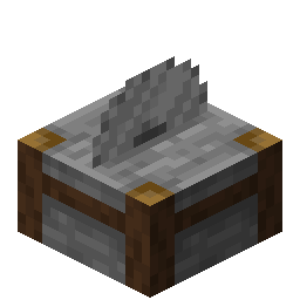 | game_add_custom_stonecutting_recipe | Додати рецепт камнеріза | Додає власний рецепт розпилу блоків у камнерізі | game/recipe | name: text input: item result: item replace_vanilla: enum &nbsp;&nbsp;- TRUE &nbsp;&nbsp;- FALSE input_match: enum &nbsp;&nbsp;- EXACT &nbsp;&nbsp;- IGNORE_NAME_DURABILITY &nbsp;&nbsp;- IGNORE_NAME_DURABILITY_ENCHANTMENTS &nbsp;&nbsp;- CUSTOM_TAGS_CONTAINS &nbsp;&nbsp;- MINECRAFT_TAG &nbsp;&nbsp;- ITEM_TYPE |  |  |  |
| 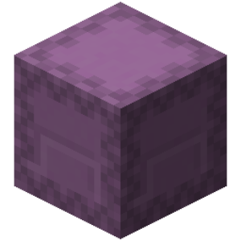 | game_add_custom_transmute_recipe | Додати рецепт трансмутації | Додає власний рецепт трансмутації предмета у світ. | game/recipe | name: text input: item material: item result: item replace_vanilla: enum &nbsp;&nbsp;- TRUE &nbsp;&nbsp;- FALSE input_match: enum &nbsp;&nbsp;- EXACT &nbsp;&nbsp;- IGNORE_NAME_DURABILITY &nbsp;&nbsp;- IGNORE_NAME_DURABILITY_ENCHANTMENTS &nbsp;&nbsp;- CUSTOM_TAGS_CONTAINS &nbsp;&nbsp;- MINECRAFT_TAG &nbsp;&nbsp;- ITEM_TYPE material_match: enum &nbsp;&nbsp;- EXACT &nbsp;&nbsp;- IGNORE_NAME_DURABILITY &nbsp;&nbsp;- IGNORE_NAME_DURABILITY_ENCHANTMENTS &nbsp;&nbsp;- CUSTOM_TAGS_CONTAINS &nbsp;&nbsp;- MINECRAFT_TAG &nbsp;&nbsp;- ITEM_TYPE category: enum &nbsp;&nbsp;- BUILDING &nbsp;&nbsp;- REDSTONE &nbsp;&nbsp;- EQUIPMENT &nbsp;&nbsp;- MISC |  |  |  |
| 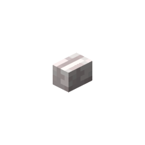 | game_add_dialog_button | Додати кнопку в діалогове вікно | Додає кнопку в діалогове вікно. У вікні з кнопкою виходу перша додана кнопка стає кнопкою виходу. У вікні підтвердження замінює кнопки «Так» і «Ні», у сповіщенні — єдину кнопку. | game/dialog | dialog_id: text label: text tooltip: text value: text button_width: number button_type: enum &nbsp;&nbsp;- ID &nbsp;&nbsp;- SUGGEST_TEXT &nbsp;&nbsp;- OPEN_URL &nbsp;&nbsp;- COPY_TO_CLIPBOARD &nbsp;&nbsp;- OPEN_DIALOG |  |  |  |
| 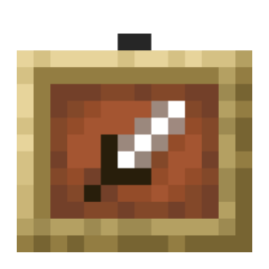 | game_add_item_dialog_body | Додати предмет у діалогове вікно | Додає предмет із підписом у тіло діалогового вікна. | game/dialog | dialog_id: text item: item item_width: number item_height: number label: text label_width: number show_decorations: enum &nbsp;&nbsp;- TRUE &nbsp;&nbsp;- FALSE show_tooltip: enum &nbsp;&nbsp;- TRUE &nbsp;&nbsp;- FALSE |  |  |  |
| 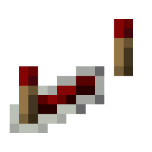 | game_add_number_range_dialog_input | Додати повзунок числа | Додає в діалогове вікно повзунок для вибору числа з діапазону. | game/dialog | dialog_id: text input_id: text label: text min_value: number max_value: number initial_value: number step: number element_width: number display_format: text |  |  |  |
| 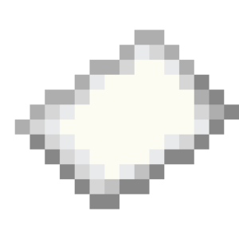 | game_add_single_option_dialog_input | Додати вибір варіанта | Додає в діалогове вікно кнопку, яка перемикає варіанти зі списку. | game/dialog | dialog_id: text input_id: text label: text element_width: number default_option: text option_ids: text option_labels: text show_label: enum &nbsp;&nbsp;- TRUE &nbsp;&nbsp;- FALSE |  |  |  |
| 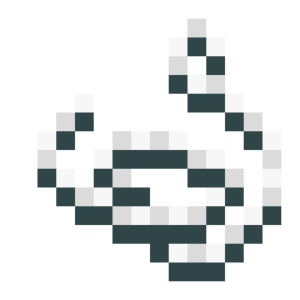 | game_add_text_box_dialog_input | Додати поле введення тексту | Додає в діалогове вікно поле, у яке гравець може ввести текст. | game/dialog | dialog_id: text input_id: text label: text initial_content: text element_width: number max_chars: number max_lines: number element_height: number show_label: enum &nbsp;&nbsp;- TRUE &nbsp;&nbsp;- FALSE |  |  |  |
| 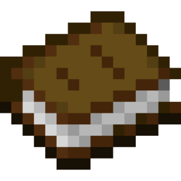 | game_add_text_dialog_body | Додати текст у діалогове вікно | Додає блок тексту в тіло діалогового вікна. | game/dialog | dialog_id: text text: text element_width: number |  |  |  |
| 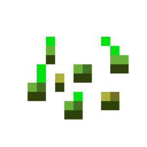 | game_block_growth | Установить стадию роста блока | Устанавливает стадию роста для блока на выбранном местоположении. | game/block | location: location growth_stage: number growth_type: enum &nbsp;&nbsp;- STAGE_NUMBER &nbsp;&nbsp;- PERCENTAGE |  |  |  |
| 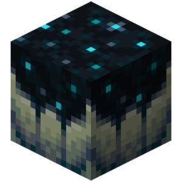 | game_bloom_skulk_catalyst | Продовжити скалк-зараження до місцезнаходження | Продовжує скалк-зараження до місцезнаходження. | game/block | location: location bloom_location: location charge: number | Скалк-каталізаторами |  |  |
| 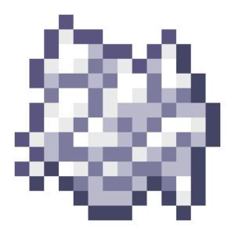 | game_bone_meal_block | Удобрить блок | Удобряет блок на выбранном местоположении. | game/block | location: location count: number |  |  |  |
| 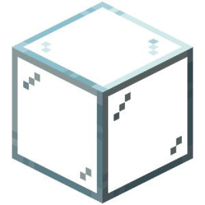 | game_break_block | Сломать блок | Разрушает блоки на указанных местоположениях, как если бы это сделал игрок в режиме выживания нужным инструментом. | game/block | locations: location tool: item drop_exp: enum &nbsp;&nbsp;- TRUE &nbsp;&nbsp;- FALSE |  |  |  |
|  | game_cancel_event | Отмена события | Отменяет начальное событие, который вызвал этот код. | game/event |  |  |  |  |
| 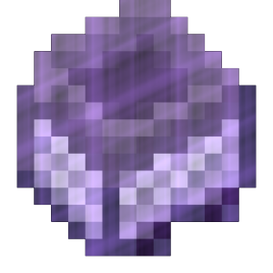 | game_chunk_get_custom_tag | Отримати кастомний тег чанку | Отримує кастомний тег чанку та присвоює результат змінній. | game/block | variable: variable location: location tag_name: text default_value: any |  |  |  |
| 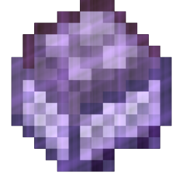 | game_chunk_get_custom_tags | Отримати кастомні теги чанку | Отримує кастомні теги чанку та присвоює результат змінній. | game/block | variable: variable location: location |  |  |  |
| 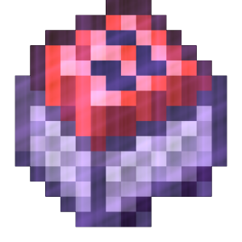 | game_chunk_remove_custom_tag | Видалити кастомний тег чанку | Видаляє вказані кастомні теги чанку. | game/block | location: location tag_names: text |  |  |  |
| 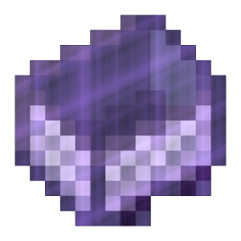 | game_chunk_remove_custom_tags | Видалити кастомні теги чанку | Видаляє всі кастомні теги чанку. | game/block | location: location |  |  |  |
|  | game_chunk_set_custom_tag | Встановити кастомний тег чанку | Встановлює вказані кастомні теги чанку. | game/block | location: location tag_names: text tag_values: text |  |  |  |
|  | game_clear_container | Очистить контейнер | Удаляет все предметы из контейнера на выбранном местоположении. | game/block | location: location | Будь-якими контейнерами |  |  |
| 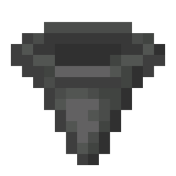 | game_clear_container_items | Очистить предметы в контейнере | Очищает указанные предметы из контейнера. | game/block | location: location items: item | Будь-якими контейнерами |  |  |
|  | game_clear_custom_recipes | Очистити кастомні рецепти | Очищає всі кастомні рецепти. | game/recipe |  |  |  |  |
|  | game_clear_exploded_blocks | Очистить взорванные блоки | Возвращает взорванные блоки в исходное положение. | game/event | location: location | Подією "Істота вибухає" Подією "Блок вибухає" |  |  |
| 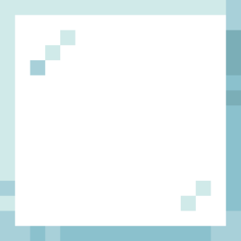 | game_clear_region | Очистить регион | Удаляет все блоки в регионе. | game/block | pos_1: location pos_2: location |  |  |  |
| 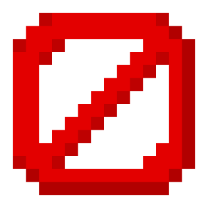 | game_clear_scoreboard_scores | Очистити значення скорборду | Очищає всі значення вказаного скорборду. | game/scoreboard | id: text |  |  |  |
| 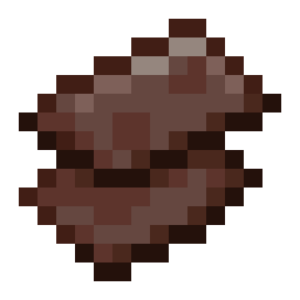 | game_clone_region | Клонировать блоки региона | Клонирует регион на выбраное местоположение. | game/block | pos_1: location pos_2: location target_pos: location paste_pos: location ignore_air: enum &nbsp;&nbsp;- TRUE &nbsp;&nbsp;- FALSE copy_entity: enum &nbsp;&nbsp;- TRUE &nbsp;&nbsp;- FALSE |  |  |  |
| 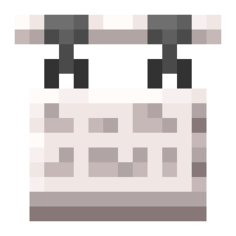 | game_create_dialog | Створити діалогове вікно | Створює діалогове вікно з указаним ID. Якщо вікно з таким ID вже є, воно створюється заново. | game/dialog | dialog_id: text title: text close_with_escape: enum &nbsp;&nbsp;- TRUE &nbsp;&nbsp;- FALSE after_action: enum &nbsp;&nbsp;- CLOSE &nbsp;&nbsp;- NONE &nbsp;&nbsp;- WAIT_FOR_RESPONSE type: enum &nbsp;&nbsp;- MULTI_ACTION &nbsp;&nbsp;- MULTI_ACTION_WITH_EXIT &nbsp;&nbsp;- CONFIRMATION &nbsp;&nbsp;- NOTICE |  |  |  |
|  | game_create_explosion | Создать взрыв | Создаёт взрыв в указанном местоположении. | game/entity | location: location power: number name_or_uuid: text fire: enum &nbsp;&nbsp;- TRUE &nbsp;&nbsp;- FALSE break_blocks: enum &nbsp;&nbsp;- TRUE &nbsp;&nbsp;- FALSE |  |  |  |
|  | game_create_scoreboard | Створити скорборд | Створює скорборд з певним ID. Щоб відобразити скорборд гравцю, використовуйте дію "Показати скорборд". | game/scoreboard | id: text display_name: text |  |  |  |
| 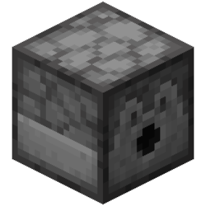 | game_fill_container | Заполнить контейнер | Заполняет контейнер на выбранном местоположении указанными предметами. | game/block | location: location items: item | Будь-якими контейнерами |  |  |
| 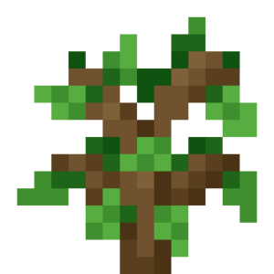 | game_generate_tree | Создать дерево | Создаёт дерево на выбранном местоположении. | game/block | location: location tree_type: enum &nbsp;&nbsp;- TREE &nbsp;&nbsp;- BIG_TREE &nbsp;&nbsp;- REDWOOD &nbsp;&nbsp;- TALL_REDWOOD &nbsp;&nbsp;- BIRCH &nbsp;&nbsp;- JUNGLE &nbsp;&nbsp;- SMALL_JUNGLE &nbsp;&nbsp;- COCOA_TREE &nbsp;&nbsp;- JUNGLE_BUSH &nbsp;&nbsp;- RED_MUSHROOM &nbsp;&nbsp;- BROWN_MUSHROOM &nbsp;&nbsp;- SWAMP &nbsp;&nbsp;- ACACIA &nbsp;&nbsp;- DARK_OAK &nbsp;&nbsp;- MEGA_REDWOOD &nbsp;&nbsp;- MEGA_PINE &nbsp;&nbsp;- TALL_BIRCH &nbsp;&nbsp;- CHORUS_PLANT &nbsp;&nbsp;- CRIMSON_FUNGUS &nbsp;&nbsp;- WARPED_FUNGUS &nbsp;&nbsp;- AZALEA &nbsp;&nbsp;- MANGROVE &nbsp;&nbsp;- TALL_MANGROVE &nbsp;&nbsp;- CHERRY &nbsp;&nbsp;- PALE_OAK &nbsp;&nbsp;- PALE_OAK_CREAKING |  |  |  |
| 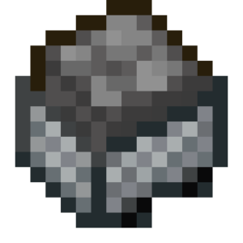 | game_get_tile_block_custom_tags | Отримати кастомні теги блоку-сутності | Отримує кастомні теги блоку-сутності та присвоює результат змінній. | game/block | variable: variable location: location | Блоками-сутностями (скрині, таблички, бочки тощо) |  |  |
|  | game_hide_event_message | Убрать сообщение события | Убирает отправку сообщения события, который вызвал этот код. | game/event | hide: enum &nbsp;&nbsp;- TRUE &nbsp;&nbsp;- FALSE | Подією "Гравець зайшов у світ" Подією "Гравець вийшов зі світу" Подією "Гравець помирає" |  |  |
| 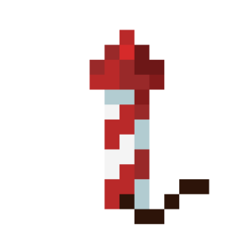 | game_launch_firework | Создать фейерверк | Запускает фейерверк в указанном местоположении. | game/entity | firework: item location: location movement: enum &nbsp;&nbsp;- UPWARDS &nbsp;&nbsp;- DIRECTIONAL instant: enum &nbsp;&nbsp;- TRUE &nbsp;&nbsp;- FALSE |  |  |  |
| 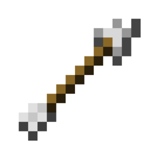 | game_launch_projectile | Запустить снаряд | Запускает снаряд в указанном местоположении. | game/entity | projectile: item location: location speed: number inaccuracy: number custom_name: text trail: particle |  |  |  |
| 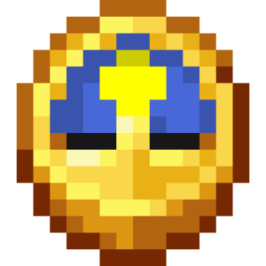 | game_random_tick_block | Викликати випадковий тік | Викликає випадковий тік на вибраному місцезнаходженні. | game/block | location: location times: number |  |  |  |
| 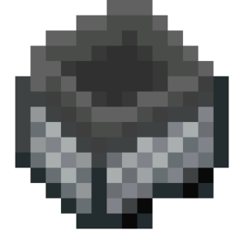 | game_remove_container_items | Удалить предметы из контейнера | Удаляет из контейнера на выбранном местоположении указанные предметы. | game/block | location: location items: item | Будь-якими контейнерами |  |  |
| 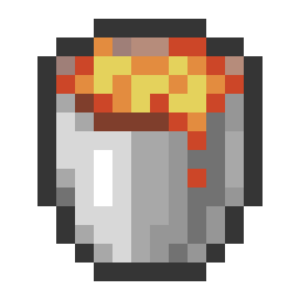 | game_remove_custom_recipe | Видалити кастомний рецепт | Видаляє кастомний рецепт зі світу. | game/recipe | names: text remove_vanilla: enum &nbsp;&nbsp;- TRUE &nbsp;&nbsp;- FALSE |  |  |  |
| 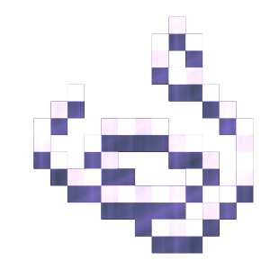 | game_remove_dialog_input_by_id | Видалити поле діалогового вікна | Видаляє з діалогового вікна поле введення з указаним ID. | game/dialog | dialog_id: text input_id: text |  |  |  |
|  | game_remove_scoreboard | Видалити скорборд | Видаляє вказаний скорборд. | game/scoreboard | id: text |  |  |  |
| 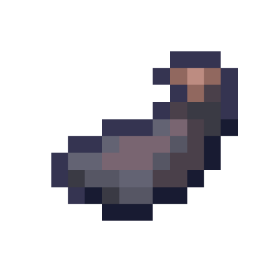 | game_remove_scoreboard_score_by_name | Видалити значення скорборду за текстом | Видаляє значення вказаного рядка у скорборді. | game/scoreboard | id: text text: text |  |  |  |
| 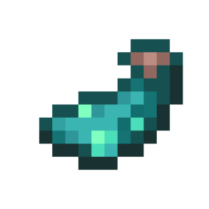 | game_remove_scoreboard_score_by_score | Видалити значення скорборду за рахунком | Видаляє значення вказаного скорборду за рахунком. | game/scoreboard | id: text score: number |  |  |  |
| 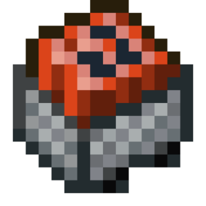 | game_remove_tile_block_custom_tag | Видалити кастомний тег блока-сутності | Видаляє вказаний кастомний тег блока-сутності на місцеположенні. | game/block | location: location tag_name: text | Блоками-сутностями (сундуки, таблички, бочки тощо) |  |  |
| 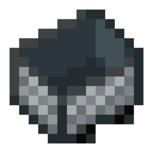 | game_remove_tile_block_custom_tags | Видалити кастомні теги сутності блока | Видаляє всі кастомні теги сутності блока (тайл-блока). | game/block | location: location | Із сутностями блоків (скрині, таблички, бочки тощо) |  |  |
| 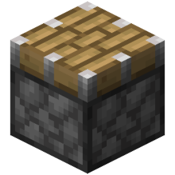 | game_replace_blocks_in_region | Заменить блоки в регионе | Заменяет одни блоки на другие в выбранном регионе. | game/block | old_block: block pos_1: location pos_2: location new_block: block |  |  |  |
| 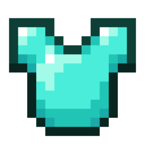 | game_replace_container_items | Заменить предметы в контейнере | Заменяет указанные предметы в контейнере на выбранном местоположении на определённый предмет. | game/block | items: item location: location replace: item count: number | Будь-якими контейнерами |  |  |
| 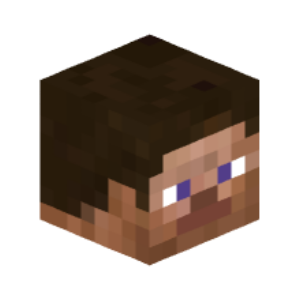 | game_send_web_request | Отправить веб-запрос | Отправляет веб-запрос с выбранным методом и телом на выбранный URL. | game/web | url: text content_body: text headers: map request_type: enum &nbsp;&nbsp;- GET &nbsp;&nbsp;- HEAD &nbsp;&nbsp;- POST &nbsp;&nbsp;- PUT &nbsp;&nbsp;- PATCH &nbsp;&nbsp;- DELETE content_type: enum &nbsp;&nbsp;- TEXT_PLAIN &nbsp;&nbsp;- APPLICATION_JSON |  |  |  |
| 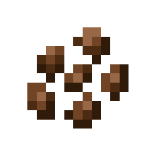 | game_set_age | Установить возраст | Устанавливает возраст блока на выбранном местоположении. | game/block | location: location tick: number | Будь-якими блоками, які можуть мати вік |  |  |
| 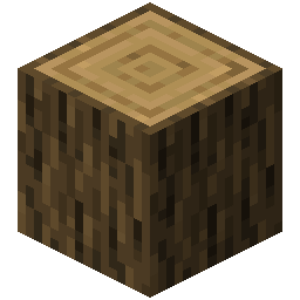 | game_set_block | Установить блок | Устанавливает выбранный тип блока на выбранных местоположениях. | game/block | block: block locations: location update_blocks: enum &nbsp;&nbsp;- TRUE &nbsp;&nbsp;- FALSE |  |  |  |
| 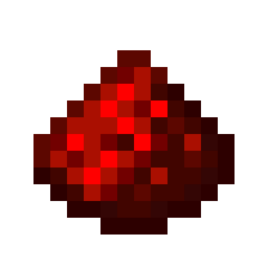 | game_set_block_analogue_power | Встановити силу редстоун-сигналу | Встановлює на вибраному місцезнаходженні певну силу сигналу. | game/block | location: location power_level: number | Активованими блоками |  |  |
| 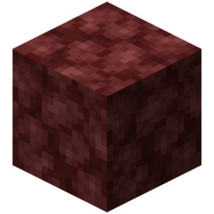 | game_set_block_data | Встановити параметри блоку | ... | game | location: location block_data: text |  |  | deprecated |
| 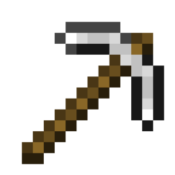 | game_set_block_drops_enabled | Установить выпадение блоков | Устанавливает правило в мире на выпадение блоков при их разрушении. | game/settings | enable: enum &nbsp;&nbsp;- TRUE &nbsp;&nbsp;- FALSE |  |  |  |
| 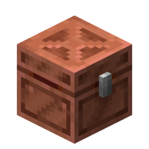 | game_set_block_nbt | Встановити NBT-теги блока-сутності | Встановлює вказаний NBT-тег блоку-сутності на місцеположенні. | game/block | location: location tag_names: text tag_values: text | Блоками-сутностями | Встановити можна лише NBT-теги, підтримувані цільовим блоком-сутністю. |  |
| 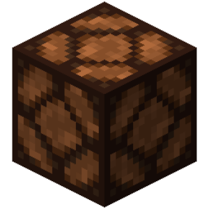 | game_set_block_powered | Активувати блок | Активує блок на вибраному місцезнаходженні. | game/block | location: location powered: enum &nbsp;&nbsp;- TRUE &nbsp;&nbsp;- FALSE | Активованими блоками |  |  |
| 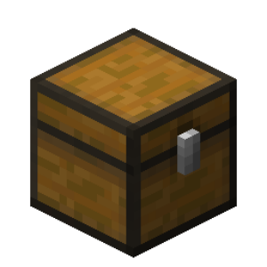 | game_set_block_single_data | Встановити параметр блоку | Встановлює вказаний параметр блоку на місцезнаходженні на задане значення. | game/block | location: location data: text value: text |  |  |  |
|  | game_set_brushable_block_item | Встановити предмет у підозрілий блок | Встановлює предмет у підозрілий блок (пісок, гравій) на вибраному місцезнаходженні. | game/block | location: location item: item | Підозрілим піском Підозрілим гравієм |  |  |
| 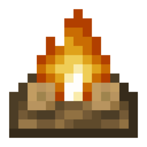 | game_set_campfire_item | Установить предмет в костёр | Устанавливает предмет в костёр на выбранном местоположении. | game/block | location: location item: item cooking_time: number slot: enum &nbsp;&nbsp;- FIRST &nbsp;&nbsp;- SECOND &nbsp;&nbsp;- THIRD &nbsp;&nbsp;- FOURTH | Багаттями |  |  |
| 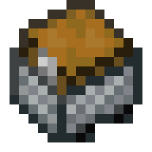 | game_set_container | Установить предметы в контейнере | Устанавливает указанные предметы в контейнер на выбранном местоположении. | game/block | location: location items: item | Будь-якими контейнерами |  |  |
| 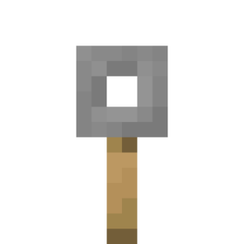 | game_set_container_lock | Установить ключ контейнера | Устанавливает определённый ключ контейнеру на выбранном местоположении. | game/block | location: location container_key: text |  | В качестве ключа контейнера служит любой предмет с определённым именем |  |
|  | game_set_container_name | Установить имя контейнеру | Устанавливает имя контейнеру на выбранном местоположении. | game/block | location: location name: text | Будь-якими контейнерами |  |  |
|  | game_set_copper_golem_statue_pose | Встановити позу статуї мідного голема | Встановлює вказану позу для статуї мідного голема на вказаному місцеположенні. | game/block | location: location pose: enum &nbsp;&nbsp;- STANDING &nbsp;&nbsp;- SITTING &nbsp;&nbsp;- RUNNING &nbsp;&nbsp;- STAR | Статуями мідного голема |  |  |
|  | game_set_creaking_heart_natural | Встановити натуральність скрипцевини | Встановлює натуральність скрипцевини, що знаходиться у вказаному місцерозташуванні. | game/block | location: location natural: enum &nbsp;&nbsp;- TRUE &nbsp;&nbsp;- FALSE | Скрипцевинами | Натуральність скрипцевини визначає, чи випаде досвід при її руйнуванні. |  |
|  | game_set_creaking_heart_state | Встановити стан скрипцевині | Встановлює стан скрипцевині, що знаходиться у вказаному місцерозташуванні. | game/block | location: location heart_state: enum &nbsp;&nbsp;- UPROOTED &nbsp;&nbsp;- DORMANT &nbsp;&nbsp;- AWAKE | Скрипцевинами |  |  |
|  | game_set_decorate_pot_sherd | Встановити прикрасу вази | Встановлює вказаний черепок вибраній стороні вази на вказаному місцезнаходженні. | game/block | location: location item: item side: enum &nbsp;&nbsp;- BACK &nbsp;&nbsp;- LEFT &nbsp;&nbsp;- RIGHT &nbsp;&nbsp;- FRONT | Вазами |  |  |
|  | game_set_dialog_button_columns | Встановити кількість стовпців кнопок | Задає, у скільки стовпців розташовані кнопки. Працює лише з вікнами з кількома кнопками. | game/dialog | dialog_id: text columns: number |  |  |  |
|  | game_set_dialog_title | Встановити заголовок діалогового вікна | Змінює заголовок діалогового вікна. | game/dialog | dialog_id: text title: text |  |  |  |
|  | game_set_dialog_type | Встановити тип діалогового вікна | Змінює тип діалогового вікна. Уже додані кнопки за можливості зберігаються. | game/dialog | dialog_id: text type: enum &nbsp;&nbsp;- MULTI_ACTION &nbsp;&nbsp;- MULTI_ACTION_WITH_EXIT &nbsp;&nbsp;- CONFIRMATION &nbsp;&nbsp;- NOTICE |  |  |  |
|  | game_set_dried_ghast_hydration | Встановити вологість Висушеному гасту | Встановлює вологість Висушеному гасту, що знаходиться у вказаному місцерозташуванні. | game/block | location: location hydration: number | Висушеними гастами |  |  |
|  | game_set_event_anvil_damage_state | Встановити стан поломки ковадла | Встановлює стан поломки ковадла. | game/event | damage_state: enum &nbsp;&nbsp;- FULL &nbsp;&nbsp;- CHIPPED &nbsp;&nbsp;- DAMAGED &nbsp;&nbsp;- BROKEN | Подією "Гравець пошкоджує ковадло" |  |  |
|  | game_set_event_anvil_repair_cost | Встановити вартість дії ковадла | Встановлює вартість дії, що здійснюється в ковадлі. | game/event | repair_cost: number repair_cost_type: enum &nbsp;&nbsp;- REPAIR_COST &nbsp;&nbsp;- REPAIR_ITEM_COUNT_COST &nbsp;&nbsp;- MAXIMUM_REPAIR_COST bypass_cost: enum &nbsp;&nbsp;- TRUE &nbsp;&nbsp;- FALSE | Подією "Гравець отримує результат" |  |  |
|  | game_set_event_combust_duration | Встановити час горіння події | Встановлює час горіння, пов'язаний з цією подією. | game/event | duration: number | Подією "Гравець загорівся" Подією "Істота загорілась" |  |  |
|  | game_set_event_damage | Установить урон события | Устанавливает урон связанный с этим событием. | game/event | damage: number | Подіями урону Подією "Гравець пошкоджує предмет" |  |  |
|  | game_set_event_death_screen_message | Встановити повідомлення при смерті | Встановлює повідомлення при смерті, що відображається на екрані смерті, пов'язане з цією подією. | game/event | message: text | Подією "Гравець помирає" | Якщо передане значення порожнє, встановлюється повідомлення за замовчуванням. Встановлюване повідомлення обмежене 256 символами. |  |
|  | game_set_event_enchantment_offers | Встановити пропоновані зачарування події | Встановлює пропоновані зачарування події. | game/event | enchantments: text levels: number costs: number | Подією "Гравець вибирає зачарування" |  |  |
|  | game_set_event_exhaustion | Встановити виснаження події | Встановлює значення виснаження, пов'язане з цією подією. | game/event | exhaustion: number | Подією "Гравець виснажується" |  |  |
|  | game_set_event_experience | Установить опыт события | Устанавливает значение опыта связанное с этим событием. | game/event | experience: number | Подією "Гравець рибалить" Подією "Гравець підняв сферу досвіду" Подіями вбивства |  |  |
|  | game_set_event_gamemode | Встановити режим гри події | Встановлює режим гри, пов'язаний з подією. | game/event | gamemode: enum &nbsp;&nbsp;- SURVIVAL &nbsp;&nbsp;- CREATIVE &nbsp;&nbsp;- ADVENTURE &nbsp;&nbsp;- SPECTATOR | Подією "Гравець запросив меню зміни режиму гри" |  |  |
|  | game_set_event_heal | Установить лечение события | Устанавливает значение лечения связанное с этим событием. | game/event | heal: number | Подією "Гравець відновлює здоров'я" Подією "Істота зцілюється" |  |  |
|  | game_set_event_item | Встановити предмет події | Встановлює предмет, пов'язаний з цією подією. | game/event | item: item |  |  |  |
|  | game_set_event_item_cooldown | Встановити затримку предмета події | Встановлює затримку предмета, пов'язану з цією подією. | game/event | cooldown: number | Подією "Гравець використовує предмет із затримкою" Подією "Гравець отримує затримку для групи предметів" |  |  |
|  | game_set_event_items | Встановити предмети події | Встановлює предмети, пов'язані з цією подією. | game/event | items: item |  |  |  |
|  | game_set_event_knockback_vector | Встановити вектор відштовхування події | Встановлює вектор відштовхування, пов'язаний із цією подією. | game/event | knockback: vector | Подією "Гравець відштовхується" Подією "Істота відштовхується" |  |  |
|  | game_set_event_move_allowed | Дозволити переміщення | Дозволяє переміщення, якщо воно не вдалося. | game/event | allowed: enum &nbsp;&nbsp;- TRUE &nbsp;&nbsp;- FALSE | Подією "Гравцю не вдалося переміститися" |  |  |
|  | game_set_event_projectile | Установить снаряд события | Заменяет снаряд, который связан с этим событием. | game/event | projectile: item name: text |  |  |  |
|  | game_set_event_should_drop_leash | Встановити випадання повідка | Встановлює випадання повідка, пов'язаного з подією. | game/event | should_drop_leash: enum &nbsp;&nbsp;- TRUE &nbsp;&nbsp;- FALSE | Подіями відв'язування |  |  |
|  | game_set_event_should_play_effect | Встановити створення частинок події | Встановлює, чи будуть створені частинки, пов'язані з подією. | game/event | should_play_effect: enum &nbsp;&nbsp;- TRUE &nbsp;&nbsp;- FALSE | Подією "Блок не зміг викинути предмет" |  |  |
|  | game_set_event_sound | Установить звук события | Устанавливает звук для проигрывания связанный с этим событием, заменяя изначальный. | game/event | sound: sound |  |  |  |
|  | game_set_event_source_slot | Встановити початковий слот події | Встановлює початковий слот, пов'язаний з цією подією. | game/event | source_slot: number | Подією "Гравець знаходить предмет в інвентарі" |  |  |
|  | game_set_event_target_slot | Встановити кінцевий слот події | Встановлює кінцевий слот, пов'язаний з цією подією. | game/event | target: number | Подією "Гравець знаходить предмет в інвентарі" |  |  |
|  | game_set_event_uery_info | Встановити теги в отриману інформацію | Встановлює додаткові теги в отриману налагоджувальну інформацію, яка скопіюється в буфер обміну, якщо подію не скасовано. | game/event | information: text | Подією "Гравець отримує інформацію про блок" Подією "Гравець отримує інформацію про істоту" | Зміни стосуються лише додаткової інформації. |  |
|  | game_set_event_velocity | Встановити вектор швидкості події | Встановлює вектор швидкості, пов'язаний із цією подією. | game/event | velocity: vector | Подією "Гравець змінив вектор швидкості" |  |  |
|  | game_set_furnace_cook_time | Установить время готовки печи | Устанавливает время готовки печи на выбранном местоположении. | game/block | location: location time: number | Печами Доменними печами Коптильнями |  |  |
|  | game_set_hardcore | creative_plus.action.game_set_hardcore.name | creative_plus.action.game_set_hardcore.description | game | hardcore: enum &nbsp;&nbsp;- TRUE &nbsp;&nbsp;- FALSE |  |  | deprecated |
|  | game_set_item_in_container_slot | Установить предмет в слот контейнера | Устанавливает предмет в указанный слот контейнера на выбранном местоположении. | game/block | location: location item: item slot: number | Будь-якими контейнерами |  |  |
|  | game_set_lectern_book | Установить книгу в кафедру | Устанавливает книгу в кафедру на выбранном местоположении. | game/block | location: location item: item page: number | Кафедрами |  |  |
|  | game_set_player_head | Установить голову игрока | Устанавливает голову игрока на выбранном местоположении. | game/block | location: location name_or_uuid: text receive_type: enum &nbsp;&nbsp;- NAME_OR_UUID &nbsp;&nbsp;- VALUE | Головами гравців |  |  |
|  | game_set_potent_sulfur_state | Встановити стан активної сірки | Встановлює стан активної сірки. | game/block | location: location state: enum &nbsp;&nbsp;- DRY &nbsp;&nbsp;- WET &nbsp;&nbsp;- DORMANT &nbsp;&nbsp;- ERUPTING &nbsp;&nbsp;- CONTINUOUS | Активною сіркою |  |  |
|  | game_set_region | Установить блоки в регионе | Устанавливает выбранный тип блока на весь выбранный регион. | game/block | block: block pos_1: location pos_2: location |  |  |  |
|  | game_set_scoreboard_line | Встановити рядок у скорборді | Встановлює рядок у скорборді. | game/scoreboard | id: text line: text display: text score: number format_content: text format: enum &nbsp;&nbsp;- BLANK &nbsp;&nbsp;- FIXED &nbsp;&nbsp;- STYLED &nbsp;&nbsp;- RESET |  |  |  |
|  | game_set_scoreboard_line_display | Встановити відображуваний текст рядка скорборду | Встановлює вказаному рядку скорборду відображуваний текст. | game/scoreboard | id: text line: text display: text |  |  |  |
|  | game_set_scoreboard_line_format | Встановити формат тексту рядка скорборду | Встановлює форматування тексту вказаного рядка скорборду. | game/scoreboard | id: text line: text format_content: text format: enum &nbsp;&nbsp;- BLANK &nbsp;&nbsp;- FIXED &nbsp;&nbsp;- STYLED &nbsp;&nbsp;- RESET |  |  |  |
|  | game_set_scoreboard_number_format | Встановити форматування значень скорборду | Встановлює форматування значень для скорборду. | game/scoreboard | id: text format_content: text format: enum &nbsp;&nbsp;- BLANK &nbsp;&nbsp;- FIXED &nbsp;&nbsp;- STYLED &nbsp;&nbsp;- RESET |  |  |  |
|  | game_set_scoreboard_score | Встановити значення скорборду | Встановлює значення вказаному рядку у скорборді. | game/scoreboard | id: text text: text score: number |  |  |  |
|  | game_set_scoreboard_title | Змінити заголовок скорборду | Змінює заголовок вказаного скорборду. | game/scoreboard | id: text title: text |  |  |  |
|  | game_set_sculk_shrieker_can_summon | Встановити скалк-крикуну можливість виклику | Встановлює вказаному скалк-крикуну можливість виклику Вардена. | game/block | location: location can_summon: enum &nbsp;&nbsp;- TRUE &nbsp;&nbsp;- FALSE | Скалк-крикунами |  |  |
|  | game_set_sculk_shrieker_shrieking | Встановити стан скалк-крикуну | Встановлює вказаному скалк-крикуну стан. | game/block | location: location shrieking: enum &nbsp;&nbsp;- TRUE &nbsp;&nbsp;- FALSE | Скалк-крикунами |  |  |
|  | game_set_sculk_shrieker_warning_level | Встановити скалк-крикуну рівень небезпеки | Встановлює вказаному скалк-крикуну рівень небезпеки. | game/block | location: location warning_level: number | Скалк-крикунами |  |  |
|  | game_set_sign_text | Установить текст таблички | Устанавливает текст таблички на выбранном местоположении. | game/block | location: location text: text line: number side: enum &nbsp;&nbsp;- FRONT &nbsp;&nbsp;- BACK &nbsp;&nbsp;- ALL | Табличками |  |  |
|  | game_set_sign_text_color | Установить цвет текста таблички | Устанавливает цвет текста таблички на выбранном местоположении. | game/block | location: location side: enum &nbsp;&nbsp;- FRONT &nbsp;&nbsp;- BACK &nbsp;&nbsp;- ALL sign_text_color: enum &nbsp;&nbsp;- WHITE &nbsp;&nbsp;- ORANGE &nbsp;&nbsp;- MAGENTA &nbsp;&nbsp;- LIGHT_BLUE &nbsp;&nbsp;- YELLOW &nbsp;&nbsp;- LIME &nbsp;&nbsp;- PINK &nbsp;&nbsp;- GRAY &nbsp;&nbsp;- LIGHT_GRAY &nbsp;&nbsp;- CYAN &nbsp;&nbsp;- PURPLE &nbsp;&nbsp;- BLUE &nbsp;&nbsp;- BROWN &nbsp;&nbsp;- GREEN &nbsp;&nbsp;- RED &nbsp;&nbsp;- BLACK glowing: enum &nbsp;&nbsp;- TRUE &nbsp;&nbsp;- FALSE | Табличками |  |  |
|  | game_set_sign_waxed | Встановити вощеність таблички | Встановлює вощеність таблички на вибраному місцезнаходженні. | game/block | location: location waxed: enum &nbsp;&nbsp;- TRUE &nbsp;&nbsp;- FALSE | Табличками |  |  |
|  | game_set_spawner_entity | Встановити сутність у спавнері | Встановлює спавнеру на вибраному місцезнаходженні сутність всередині. | game/block | location: location entity: item | Спавнерами |  |  |
|  | game_set_tile_block_custom_tag | Встановити кастомний тег блоку-сутності | Встановлює вказаний кастомний тег блоку-сутності на місцеположенні. | game/block | location: location tag_name: text tag_value: text | Блоками-сутностями (сундуки, таблички, бочки тощо) |  |  |
|  | game_set_vault_displayed_item | Встановити відображуваний предмет скарбниці | Встановлює відображуваний предмет скарбниці, що знаходиться у вказаному місцерозташуванні. | game/block | location: location item: item | Скарбницями | Повторний виклик дії перезаписує відображуваний предмет. |  |
|  | game_set_vault_next_state_update_time | Встановити час до наступного стану скарбниці | Встановлює час до переходу у наступний стан скарбниці, що знаходиться у вказаному місцерозташуванні. | game/block | location: location time: number | Скарбницями | Необхідно встановити точний час, коли скарбниця перейде у наступний стан. За замовчуванням вибирає максимально можливе значення. |  |
|  | game_set_world_difficulty | Встановити складність світу | Встановлює певну складність у світі. | game/settings | difficulty: enum &nbsp;&nbsp;- PEACEFUL &nbsp;&nbsp;- EASY &nbsp;&nbsp;- NORMAL &nbsp;&nbsp;- HARD |  |  |  |
|  | game_set_world_gamerule | Встановити ігрове правило світу | Встановлює певне ігрове правило (gamerule) світу. | game/settings | gamerule: enum &nbsp;&nbsp;- DISABLE_RAIDS &nbsp;&nbsp;- DO_DAYLIGHT_CYCLE &nbsp;&nbsp;- DO_ENTITY_DROPS &nbsp;&nbsp;- DO_FIRE_TICK &nbsp;&nbsp;- DO_IMMEDIATE_RESPAWN &nbsp;&nbsp;- DO_INSOMNIA &nbsp;&nbsp;- DO_MOB_LOOT &nbsp;&nbsp;- DO_MOB_SPAWNING &nbsp;&nbsp;- DO_PATROL_SPAWNING &nbsp;&nbsp;- DO_TILE_DROPS &nbsp;&nbsp;- DO_TRADER_SPAWNING &nbsp;&nbsp;- DO_WEATHER_CYCLE &nbsp;&nbsp;- DROWNING_DAMAGE &nbsp;&nbsp;- FALL_DAMAGE &nbsp;&nbsp;- FIRE_DAMAGE &nbsp;&nbsp;- FORGIVE_DEAD_PLAYERS &nbsp;&nbsp;- KEEP_INVENTORY &nbsp;&nbsp;- MOB_GRIEFING &nbsp;&nbsp;- PROJECTILES_CAN_BREAK_BLOCKS &nbsp;&nbsp;- SHOW_DEATH_MESSAGES &nbsp;&nbsp;- NATURAL_REGENERATION &nbsp;&nbsp;- UNIVERSAL_ANGER &nbsp;&nbsp;- PLAYERS_SLEEPING_PERCENTAGE &nbsp;&nbsp;- REDUCED_DEBUG_INFO &nbsp;&nbsp;- FREEZE_DAMAGE &nbsp;&nbsp;- RANDOM_TICK_SPEED &nbsp;&nbsp;- MAX_ENTITY_CRAMMING &nbsp;&nbsp;- SPAWN_RADIUS &nbsp;&nbsp;- LAVA_SOURCE_CONVERSION &nbsp;&nbsp;- WATER_SOURCE_CONVERSION &nbsp;&nbsp;- TNT_EXPLOSION_DROP_DECAY &nbsp;&nbsp;- BLOCK_EXPLOSION_DROP_DECAY &nbsp;&nbsp;- MOB_EXPLOSION_DROP_DECAY &nbsp;&nbsp;- DO_LIMITED_CRAFTING &nbsp;&nbsp;- PLAYERS_NETHER_PORTAL_DEFAULT_DELAY &nbsp;&nbsp;- PLAYERS_NETHER_PORTAL_CREATIVE_DELAY &nbsp;&nbsp;- SNOW_ACCUMULATION_HEIGHT &nbsp;&nbsp;- DO_WARDEN_SPAWNING &nbsp;&nbsp;- ENDER_PEARLS_VANISH_ON_DEATH &nbsp;&nbsp;- DO_VINES_SPREAD &nbsp;&nbsp;- TNT_EXPLODER &nbsp;&nbsp;- LOCATOR_BAR &nbsp;&nbsp;- SPAWN_MONSTERS &nbsp;&nbsp;- PVP &nbsp;&nbsp;- SPAWNER_BLOCKS_WORK value: text |  | Залиште аргумент "Значення" порожнім, щоб скинути його до стану за замовчуванням. |  |
|  | game_set_world_simulation_distance | Встановити дистанцію симуляції світу | Встановлює дистанцію симуляції чанків для світу. | game/settings | distance: number |  |  |  |
|  | game_set_world_time | Установить время мира | Устанавливает время мира в тиках. | game/settings | time: number |  |  |  |
|  | game_set_world_weather | Встановити погоду світу | Встановлює погоду світу на певний час. | game/settings | weather_type: enum &nbsp;&nbsp;- CLEAR &nbsp;&nbsp;- RAINING &nbsp;&nbsp;- THUNDER weather_duration: number |  | За замовчуванням, якщо не вказати тривалість, погода не змінюватиметься. |  |
|  | game_spawn_armor_stand | Создать стойку для брони | Создаёт стойку для брони в указанном местоположении. | game/entity | helmet: item chestplate: item leggings: item boots: item right_hand: item left_hand: item gravity: enum &nbsp;&nbsp;- TRUE &nbsp;&nbsp;- FALSE marker: enum &nbsp;&nbsp;- TRUE &nbsp;&nbsp;- FALSE small: enum &nbsp;&nbsp;- TRUE &nbsp;&nbsp;- FALSE show_arms: enum &nbsp;&nbsp;- TRUE &nbsp;&nbsp;- FALSE base_plate: enum &nbsp;&nbsp;- TRUE &nbsp;&nbsp;- FALSE invisible: enum &nbsp;&nbsp;- TRUE &nbsp;&nbsp;- FALSE location: location custom_name: text |  |  |  |
|  | game_spawn_block_display | Створити візуалізатор блоку | Створює візуалізатор блоку у вказаному місцезнаходженні. | game/entity | spawn_location: location custom_name: text block: block |  |  |  |
|  | game_spawn_effect_cloud | Создать облако туманного зелья | Создаёт облако туманного зелья, которое пропитывает эффектами сущностей в нём. | game/entity | location: location effects: potion radius: number duration: number particle: particle custom_name: text |  |  |  |
|  | game_spawn_end_crystal | Создать кристалл Энда | Создаёт кристалл Энда в указанном местоположении. | game/entity | location: location custom_name: text show_bottom: enum &nbsp;&nbsp;- TRUE &nbsp;&nbsp;- FALSE |  |  |  |
|  | game_spawn_evoker_fangs | Создать челюсти заклинателя | Создаёт челюсти заклинателя в указанном местоположении. | game/entity | location: location custom_name: text |  |  |  |
|  | game_spawn_experience_orb | Создать сферу опыта | Создаёт сферу опыта в указанном местоположении с выбранными параметрами. | game/entity | location: location experience_amount: number custom_name: text |  |  |  |
|  | game_spawn_eye_of_ender | Создать око Энда | Создаёт в указанном местоположении око Энда, которое будет двигаться в сторону цели. | game/entity | location: location destination: location lifespan: number custom_name: text end_of_lifespan: enum &nbsp;&nbsp;- DROP &nbsp;&nbsp;- SHATTER &nbsp;&nbsp;- RANDOM |  |  |  |
|  | game_spawn_falling_block | Создать падающий блок | Создаёт падающий блок в указанном местоположении. | game/entity | block: block location: location name: text should_expire: enum &nbsp;&nbsp;- TRUE &nbsp;&nbsp;- FALSE |  |  |  |
|  | game_spawn_interaction_entity | Створити сутність взаємодії | Створює сутність взаємодії у вказаному місцезнаходженні. | game/entity | location: location custom_name: text width: number height: number responsive: enum &nbsp;&nbsp;- TRUE &nbsp;&nbsp;- FALSE |  |  |  |
|  | game_spawn_item | Создать предмет | Создаёт предмет в указанном местоположении с выбранными параметрами. | game/entity | item: item location: location custom_name: text apply_motion: enum &nbsp;&nbsp;- TRUE &nbsp;&nbsp;- FALSE can_mob_pickup: enum &nbsp;&nbsp;- TRUE &nbsp;&nbsp;- FALSE can_player_pickup: enum &nbsp;&nbsp;- TRUE &nbsp;&nbsp;- FALSE |  |  |  |
|  | game_spawn_item_display | Створити візуалізатор предмета | Створює візуалізатор предмета у вказаному місцезнаходженні. | game/entity | spawn_location: location custom_name: text displayed_item: item |  |  |  |
|  | game_spawn_item_frame | Створити рамку | Створює рамку у вказаному місцерозташуванні. | game/entity | spawn_location: location item: item rotation: enum &nbsp;&nbsp;- NONE &nbsp;&nbsp;- CLOCKWISE_45 &nbsp;&nbsp;- CLOCKWISE &nbsp;&nbsp;- CLOCKWISE_135 &nbsp;&nbsp;- FLIPPED &nbsp;&nbsp;- FLIPPED_45 &nbsp;&nbsp;- COUNTER_CLOCKWISE &nbsp;&nbsp;- COUNTER_CLOCKWISE_45 block_face: enum &nbsp;&nbsp;- NORTH &nbsp;&nbsp;- EAST &nbsp;&nbsp;- SOUTH &nbsp;&nbsp;- WEST &nbsp;&nbsp;- UP &nbsp;&nbsp;- DOWN glowing: enum &nbsp;&nbsp;- TRUE &nbsp;&nbsp;- FALSE visible: enum &nbsp;&nbsp;- TRUE &nbsp;&nbsp;- FALSE fixed: enum &nbsp;&nbsp;- TRUE &nbsp;&nbsp;- FALSE |  |  |  |
|  | game_spawn_lightning_bolt | Создать молнию | Создаёт молнию в указанном местоположении. | game/entity | location: location |  |  |  |
|  | game_spawn_mob | Создать моба | Создаёт моба в указанном местоположении с выбранными параметрами. | game/entity | mob: item location: location health: number custom_name: text potion_effects: potion main_hand: item helmet: item chestplate: item leggings: item boots: item off_hand: item natural_equipment: enum &nbsp;&nbsp;- TRUE &nbsp;&nbsp;- FALSE |  |  |  |
|  | game_spawn_painting | Створити картину | Створює картину у вказаному місцерозташуванні. | game/entity | spawn_location: location art: text block_face: enum &nbsp;&nbsp;- NORTH &nbsp;&nbsp;- EAST &nbsp;&nbsp;- SOUTH &nbsp;&nbsp;- WEST |  |  |  |
|  | game_spawn_primed_tnt | Создать подожженный динамит | Создаёт подожжённый динамит в указанном местоположении. | game/entity | location: location tnt_power: number fuse_duration: number custom_name: text block: block |  |  |  |
|  | game_spawn_shulker_bullet | Створити снаряд Шалкера | Створює снаряд Шалкера у вказаному місцезнаходженні. | game/entity | location: location custom_name: text |  |  |  |
|  | game_spawn_text_display | Створити візуалізатор тексту | Створює візуалізатор тексту у вказаному місцезнаходженні. | game/entity | spawn_location: location custom_name: text merging_mode: enum &nbsp;&nbsp;- SPACES &nbsp;&nbsp;- CONCATENATION &nbsp;&nbsp;- SEPARATE_LINES displayed_text: text |  |  |  |
|  | game_spawn_vehicle | Создать транспорт | Создаёт транспорт в указанном местоположении с выбранными параметрами. | game/entity | vehicle: item location: location custom_name: text |  |  |  |
|  | game_uncancel_event | Возврат события | Возвращает отмену события, который вызвал этот код. | game/event |  |  |  |  |
|  | game_update_block | Оновити суміжні блоки | Оновлює сусідні блоки на вказаному місцезнаходженні, якщо блок на місцезнаходженні не є повітрям. Сам блок на місцезнаходженні не оновлюється, але може оновитися від сусідніх. | game/block | location: location |  |  |  |
|  | game_wobble_decorated_pot | Встановити гойдання вази | Встановлює вказаний тип гойдання вази на вказаному місцеположенні. | game/block | location: location style: enum &nbsp;&nbsp;- POSITIVE &nbsp;&nbsp;- NEGATIVE | Вазами |  |  |
|  | if_game_block_equals | Блок равен | Проверяет, является ли блок в определённом местоположении определённым типом блока. | if_game | location: location blocks: block |  |  |  |
|  | if_game_block_powered | Блок запитан редстоуном | Проверяет, запитан ли блок в определённом местоположении редстоуном. | if_game | locations: location power_mode: enum &nbsp;&nbsp;- DIRECT &nbsp;&nbsp;- INDIRECT |  |  |  |
|  | if_game_chunk_has_custom_tag | Чанк має кастомний тег | Перевіряє, чи має чанк вказаний кастомний тег. | if_game | location: location tag: text tag_value: text compare_type: enum &nbsp;&nbsp;- EQUALS &nbsp;&nbsp;- CONTAINS &nbsp;&nbsp;- STARTS_WITH &nbsp;&nbsp;- ENDS_WITH |  |  |  |
|  | if_game_chunk_is_loaded | Чанк завантажено | Перевіряє, чи завантажено чанк у місцезнаходженні. | if_game | location: location |  |  |  |
|  | if_game_container_has | Контейнер имеет предмет | Проверяет, имеет ли контейнер в определённом местоположении определённые предметы в его инвентаре. | if_game | location: location items: item check_mode: enum &nbsp;&nbsp;- ANY &nbsp;&nbsp;- ALL comparison_mode: enum &nbsp;&nbsp;- EXACTLY &nbsp;&nbsp;- IGNORE_STACK_SIZE &nbsp;&nbsp;- IGNORE_DURABILITY_AND_STACK_SIZE &nbsp;&nbsp;- TYPE_ONLY |  |  |  |
|  | if_game_container_has_room_for_item | Контейнер имеет место для предметов | Проверяет, имеет ли контейнер в определённом местоположении место для предметов в его инвентаре. | if_game | location: location items: item check_mode: enum &nbsp;&nbsp;- ANY &nbsp;&nbsp;- ALL |  |  |  |
|  | if_game_damage_cause_equals | Источник урона события равен | Проверяет, равен ли источник урона события выбранному. | if_game | cause: enum &nbsp;&nbsp;- KILL &nbsp;&nbsp;- WORLD_BORDER &nbsp;&nbsp;- CONTACT &nbsp;&nbsp;- ENTITY_ATTACK &nbsp;&nbsp;- ENTITY_SWEEP_ATTACK &nbsp;&nbsp;- PROJECTILE &nbsp;&nbsp;- SUFFOCATION &nbsp;&nbsp;- FALL &nbsp;&nbsp;- FIRE &nbsp;&nbsp;- FIRE_TICK &nbsp;&nbsp;- MELTING &nbsp;&nbsp;- LAVA &nbsp;&nbsp;- DROWNING &nbsp;&nbsp;- BLOCK_EXPLOSION &nbsp;&nbsp;- ENTITY_EXPLOSION &nbsp;&nbsp;- VOID &nbsp;&nbsp;- LIGHTNING &nbsp;&nbsp;- SUICIDE &nbsp;&nbsp;- STARVATION &nbsp;&nbsp;- POISON &nbsp;&nbsp;- MAGIC &nbsp;&nbsp;- WITHER &nbsp;&nbsp;- FALLING_BLOCK &nbsp;&nbsp;- THORNS &nbsp;&nbsp;- DRAGON_BREATH &nbsp;&nbsp;- FLY_INTO_WALL &nbsp;&nbsp;- HOT_FLOOR &nbsp;&nbsp;- CAMPFIRE &nbsp;&nbsp;- CRAMMING &nbsp;&nbsp;- DRYOUT &nbsp;&nbsp;- FREEZE &nbsp;&nbsp;- SONIC_BOOM &nbsp;&nbsp;- CUSTOM |  |  |  |
|  | if_game_dialog_input_is_true | Перемикач діалогу ввімкнено | Перевіряє, чи ввімкнув гравець перемикач з указаним ID. Працює в події "Гравець викликає кастомний клік". | if_game | input_id: text |  |  |  |
|  | if_game_event_attack_is_critical | Атака була критичною | Перевіряє, чи була атака у події критичною. | if_game |  |  |  |  |
|  | if_game_event_block_equals | Блок события равен | Проверяет, равен ли блок текущего события определенному блоку. | if_game | blocks: block locations: location |  |  |  |
|  | if_game_event_has_input | Клавіша пересування дорівнює | Перевіряє, чи є клавіша пересування з події вибраною клавішею. | if_game | input_type: enum &nbsp;&nbsp;- FORWARD &nbsp;&nbsp;- BACKWARDS &nbsp;&nbsp;- LEFT &nbsp;&nbsp;- RIGHT &nbsp;&nbsp;- JUMP &nbsp;&nbsp;- SNEAK &nbsp;&nbsp;- SPRINT | Подією "Гравець змінює натиснуті клавіші пересування" |  |  |
|  | if_game_event_is_age_locked | Ріст зупинено | Перевіряє, чи було зупинено поширення/ріст для цієї події. | if_game |  | Зупинення росту як у золотій кульбабі |  |  |
|  | if_game_event_is_canceled | Событие отменено | Проверяет, отменено ли событие. | if_game |  |  |  |  |
|  | if_game_event_item_equals | Предмет события равен | Проверяет, равен ли предмет текущего события определенному предмету. | if_game | items: item comparison_mode: enum &nbsp;&nbsp;- EXACTLY &nbsp;&nbsp;- IGNORE_STACK_SIZE &nbsp;&nbsp;- IGNORE_DURABILITY_AND_STACK_SIZE &nbsp;&nbsp;- TYPE_ONLY |  |  |  |
|  | if_game_has_custom_recipe | Рецепт існує | Перевіряє, чи існує кастомний рецепт у світі. | if_game | names: text is_vanilla_recipe: enum &nbsp;&nbsp;- TRUE &nbsp;&nbsp;- FALSE compare_type: enum &nbsp;&nbsp;- ANY &nbsp;&nbsp;- ALL |  |  |  |
|  | if_game_has_entity | Сутність у світі | Перевіряє, чи існує певна сутність у світі. | if_game | names_or_uuids: text check_mode: enum &nbsp;&nbsp;- ANY &nbsp;&nbsp;- ALL |  |  |  |
|  | if_game_has_player | Гравець в мережі | Перевіряє, чи перебуває певний гравець у грі. | if_game | names_or_uuids: text check_mode: enum &nbsp;&nbsp;- ANY &nbsp;&nbsp;- ALL |  |  |  |
|  | if_game_heal_cause_equals | Источник исцеления равен | Проверяет, равен ли источник исцеления выбранному. | if_game | heal_cause: enum &nbsp;&nbsp;- REGEN &nbsp;&nbsp;- SATIATED &nbsp;&nbsp;- EATING &nbsp;&nbsp;- ENDER_CRYSTAL &nbsp;&nbsp;- MAGIC &nbsp;&nbsp;- MAGIC_REGEN &nbsp;&nbsp;- WITHER_SPAWN &nbsp;&nbsp;- WITHER &nbsp;&nbsp;- CUSTOM |  |  |  |
|  | if_game_ignite_cause_equals | Источник огня равен | Проверяет, равен ли источник огня выбранному. | if_game | cause: enum &nbsp;&nbsp;- LAVA &nbsp;&nbsp;- FLINT_AND_STEEL &nbsp;&nbsp;- SPREAD &nbsp;&nbsp;- LIGHTNING &nbsp;&nbsp;- FIREBALL &nbsp;&nbsp;- ENDER_CRYSTAL &nbsp;&nbsp;- EXPLOSION &nbsp;&nbsp;- ARROW |  |  |  |
|  | if_game_instrument_equals | Инструмент равен | Проверяет, равен ли инструмент в событии выбранному. | if_game | instrument: enum &nbsp;&nbsp;- PIANO &nbsp;&nbsp;- BASS_DRUM &nbsp;&nbsp;- SNARE_DRUM &nbsp;&nbsp;- STICKS &nbsp;&nbsp;- BASS_GUITAR &nbsp;&nbsp;- FLUTE &nbsp;&nbsp;- BELL &nbsp;&nbsp;- GUITAR &nbsp;&nbsp;- CHIME &nbsp;&nbsp;- XYLOPHONE &nbsp;&nbsp;- IRON_XYLOPHONE &nbsp;&nbsp;- COW_BELL &nbsp;&nbsp;- DIDGERIDOO &nbsp;&nbsp;- BIT &nbsp;&nbsp;- BANJO &nbsp;&nbsp;- PLING &nbsp;&nbsp;- TRUMPET &nbsp;&nbsp;- TRUMPET_EXPOSED &nbsp;&nbsp;- TRUMPET_OXIDIZED &nbsp;&nbsp;- TRUMPET_WEATHERED &nbsp;&nbsp;- ZOMBIE &nbsp;&nbsp;- SKELETON &nbsp;&nbsp;- CREEPER &nbsp;&nbsp;- DRAGON &nbsp;&nbsp;- WITHER_SKELETON &nbsp;&nbsp;- PIGLIN &nbsp;&nbsp;- CUSTOM_HEAD |  |  |  |
|  | if_game_location_in_block | Якщо місцеположення всередині блоку | Перевіряє, чи знаходиться вказане місцеположення всередині блоку. | if_game | location: location |  |  |  |
|  | if_game_sign_contains | Табличка содержит текст | Проверяет, содержит ли табличка в определённом местоположении определённый текст. | if_game | location: location texts: text check_side: enum &nbsp;&nbsp;- ANY &nbsp;&nbsp;- FRONT &nbsp;&nbsp;- BACK check_mode: enum &nbsp;&nbsp;- CONTAINS &nbsp;&nbsp;- EQUALS lines: enum &nbsp;&nbsp;- FIRST &nbsp;&nbsp;- SECOND &nbsp;&nbsp;- THIRD &nbsp;&nbsp;- FOURTH &nbsp;&nbsp;- ALL |  |  |  |
|  | if_game_tile_block_has_custom_tag | Блок-сутність має кастомний тег | Перевіряє, чи має блок-сутність вказаний кастомний тег. | if_game | location: location tag: text tag_value: text compare_type: enum &nbsp;&nbsp;- EQUALS &nbsp;&nbsp;- CONTAINS &nbsp;&nbsp;- STARTS_WITH &nbsp;&nbsp;- ENDS_WITH |  |  |  |
