# Game values

| Icon | ID | Name | Description | Category | Return type | Works with | Additional info | Status |
| --- | --- | --- | --- | --- | --- | --- | --- | --- |
| 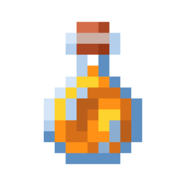 | absorption_health | Дополнительное здоровье | Получает количество единиц поглощательного (золотого) здоровья цели. | Статистика | number |  |  |  |
| 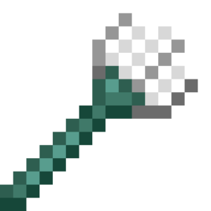 | active_item_used_time | Час використання предмета | Отримує час використання предмета в руці. | Статистика | number |  |  |  |
| 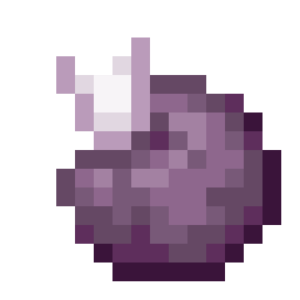 | age | Вік цілі | Отримує вік цілі у тіках. | Статистика | number |  |  |  |
| 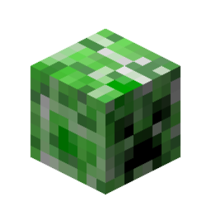 | all_entities_names | Імена всіх сутностей | Отримує імена всіх сутностей, що перебувають у світі. | Мир | array<text> |  |  |  |
|  | all_entities_uuids | UUID всіх сутностей | Отримує UUID всіх сутностей, що перебувають у світі. | Мир | array<text> |  |  |  |
|  | all_players_names | Імена всіх гравців | Отримує імена всіх гравців, що перебувають у світі. | Мир | array<text> |  |  |  |
|  | all_players_uuids | UUID всіх гравців | Отримує UUID всіх гравців, що перебувають у світі. | Мир | array<text> |  |  |  |
| 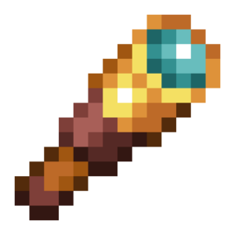 | anticheat_check | Перевірка античита | Отримує назву перевірки античита, на якій засікли гравця. | Событие | text | Подією "Античит засік гравця" |  |  |
| 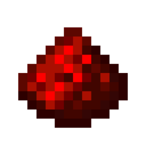 | anticheat_violations | Спрацювань античита | Отримує кількість спрацювань перевірки античита у гравця. | Событие | number | Подією "Античит засік гравця" |  |  |
| 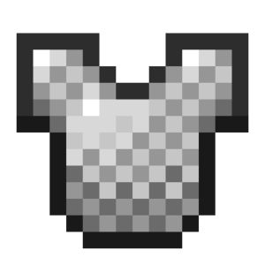 | armor_items | Предметы брони | Получает предметы в слотах брони цели. | Предмет | array<item> |  |  |  |
|  | armor_points | Очки защиты | Получает количество единиц брони цели, которое можно изменить предметами. | Статистика | number |  |  |  |
| 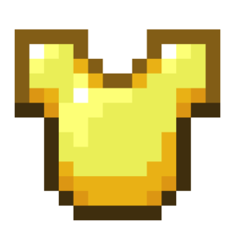 | armor_toughness | Твёрдость брони | Получает количество единиц твёрдости брони цели, которое можно изменить предметами. | Статистика | number |  |  |  |
|  | arrows_in_body | Кількість стріл у тілі | Отримує кількість стріл у тілі цілі. | Статистика | number |  |  |  |
|  | attached_leads | Привязанные сущности | Получает UUID сущностей, которые привязаны поводком к цели. | Информация | array<text> |  |  |  |
| 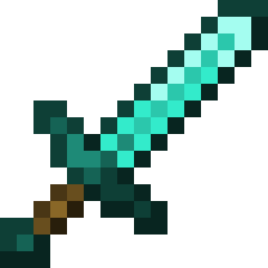 | attack_cooldown_strength | Кулдаун атаки | Отримує поточний кулдаун атаки цілі. | Статистика | number |  |  |  |
|  | attack_cooldown_ticks | Кулдаун атаки у тіках | Отримує поточний кулдаун атаки цілі у тіках. | Статистика | number |  |  |  |
| 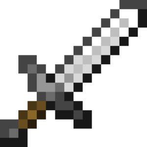 | attack_damage | Урон от атаки | Получает количество единиц урона от атак цели, которое можно изменить предметами. | Статистика | number |  |  |  |
| 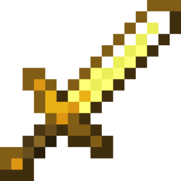 | attack_speed | Скорость атаки | Получает скорость атаки цели, которую можно изменить предметами. | Статистика | number |  |  |  |
| 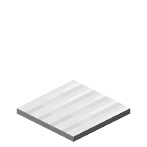 | block_beneath | Місцезнаходження блоку під ціллю | Отримує місцезнаходження блоку під ціллю. | Местоположение | location |  |  |  |
| 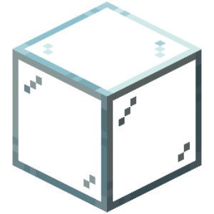 | blocks_beneath | Блоки під ціллю | Отримує місцезнаходження всіх блоків, що знаходяться під ціллю. | Местоположение | array<location> |  |  |  |
| 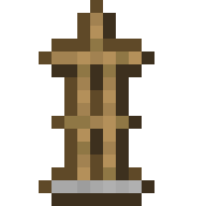 | body_yaw | Поворот тіла | Отримує поворот тіла цілі. | Местоположение | number |  |  |  |
| 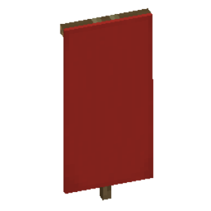 | cape_location | Місцезнаходження плаща | Отримує місцезнаходження плаща гравця. | Местоположение | location | Гравцями |  |  |
|  | cardinal_direction | Кардинальное направление | Получает кардинальное направление (север, запад, юг, восток) цели. | Местоположение | text |  |  |  |
| 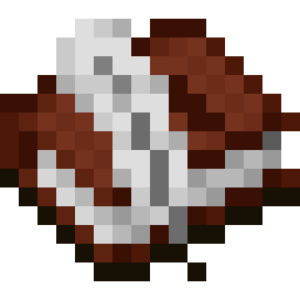 | chat_visibility | Видимість чату | Отримує статус видимості чату гравця. | Информация | text | Гравцями |  |  |
| 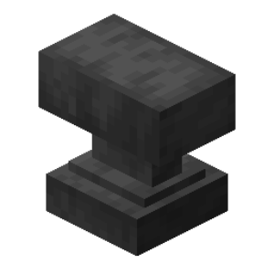 | client_brand_name | Название клиента игрока | Получает название клиента игрока. | Информация | text | Гравцями |  |  |
|  | client_view_distance | Дальність прорисовки гравця | Отримує дальність прорисовки гравця, встановлену в налаштуваннях гри. | Статистика | number | Гравцями |  |  |
| 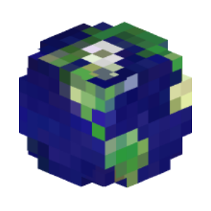 | clientside_locale | Мова клієнта гравця | Отримує мову клієнта гравця. | Информация | text | Гравцями |  |  |
| 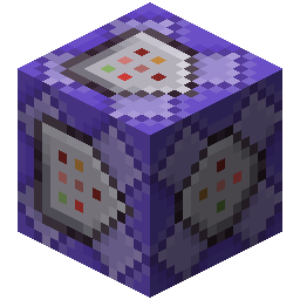 | cpu_usage | Процент использования процессора | Получает процент загрузки миром процессора сервера. | Мир | number |  |  |  |
| 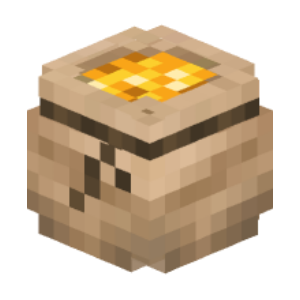 | currency_transaction_amount | Кількість смарагдів у транзакції | Отримує кількість витрачених смарагдів у транзакції. | Событие | text | Подією "Гравець здійснює транзакцію" |  |  |
| 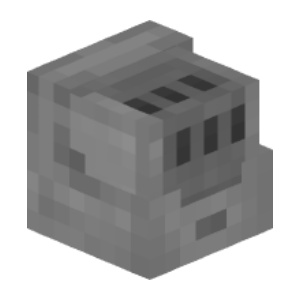 | currency_transaction_reason | Причина запиту транзакції | Отримує причину запиту транзакції в смарагдах. | Событие | text | Подією "Гравець здійснює транзакцію" |  |  |
| 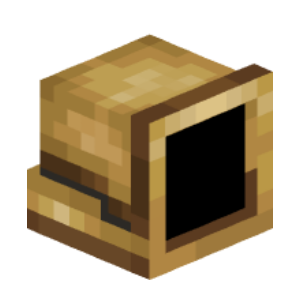 | currency_transaction_result | Результат транзакції | Отримує результат здійсненої транзакції. | Событие | text | Подією "Гравець здійснює транзакцію" |  |  |
| 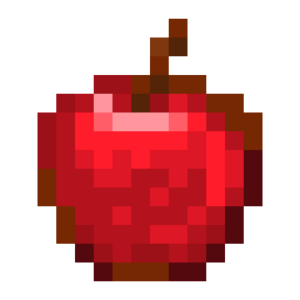 | current_health | Текущее здоровье | Получает оставшееся количество единиц здоровья цели. | Статистика | number |  |  |  |
| 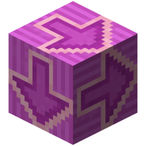 | current_input_list | Поточні натиснуті клавіші пересування | Отримує натиснуті на даний момент клавіші пересування. | Информация | array<text> | Гравцями |  |  |
|  | cursor_item | Предмет на курсоре | Получает предмет на курсоре цели (используется при переносе предметов в инвентаре). | Предмет | item |  |  |  |
|  | custom_inventory_items | Список предметов в открытом инвентаре | Возвращает список, содержащий предметы, которые находятся в текущем открытом инвентарном меню. | Предмет | array<item> |  |  |  |
| 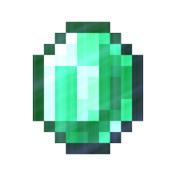 | death_screen_score | Кількість очок | Отримує кількість очок, що відображаються на екрані смерті. | Статистика | number | Гравцями |  |  |
|  | delay_reload_count | creative_plus.game_value.delay_reload_count.name | creative_plus.game_value.delay_reload_count.description | Мир | number |  |  |  |
| 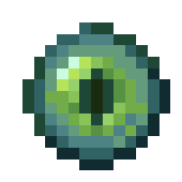 | direction_of_view | Направление взгляда | Получает вектор направления взгляда цели. | Местоположение | vector |  |  |  |
| 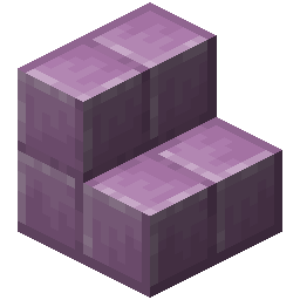 | display_entity_left_rotation | Лівий поворот візуалізатора | Отримує лівий поворот візуалізатора у вигляді вектора. | Информация | vector | Візуалізаторами |  |  |
| 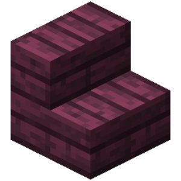 | display_entity_right_rotation | Правий поворот візуалізатора | Отримує правий поворот візуалізатора у вигляді вектора. | Информация | vector | Візуалізаторами |  |  |
|  | display_entity_scale | Масштаб візуалізатора | Отримує масштаб візуалізатора у вигляді вектора. | Информация | vector | Візуалізаторами |  |  |
| 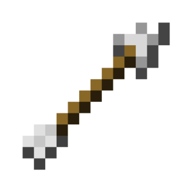 | display_entity_translation | Зміщення візуалізатора | Отримує зміщення візуалізатора у вигляді вектора. | Информация | vector | Візуалізаторами |  |  |
| 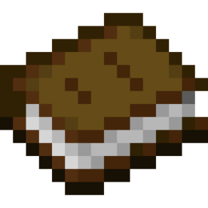 | display_name | Відображуване ім'я | Отримує відображуване ім'я цілі. | Информация | text |  |  |  |
| 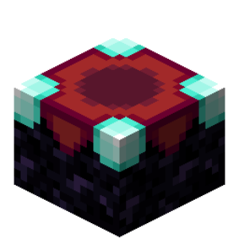 | enchantment_seed | Поточний сід зачарувань | Отримує поточний сід зачарувань гравця. | Статистика | number |  |  |  |
| 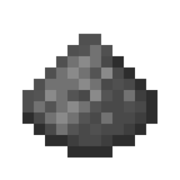 | entity_fuse_ticks | Час до вибуху | Отримує час до вибуху сутності. | Статистика | number | Крипером Динамітом Феєрверками |  |  |
| 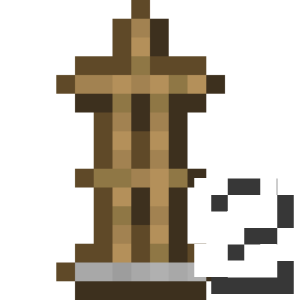 | entity_height | Висота хітбоксу | Отримує розмір хітбоксу цілі по осі Y. | Статистика | number |  |  |  |
| 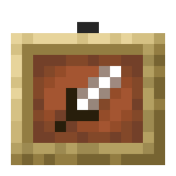 | entity_item | Предмет сущности | Получает предметную форму цели. | Предмет | item |  |  |  |
| 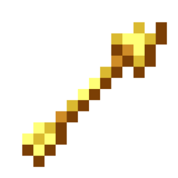 | entity_pathfinder_point_index | Індекс точки на шляху | Отримує поточний індекс точки шляху, по якому рухається моб. | Статистика | number |  |  |  |
|  | entity_pathfinder_points | Поточний шлях | Отримує список усіх точок, які складають поточний шлях мобу. | Информация | array<location> |  |  |  |
| 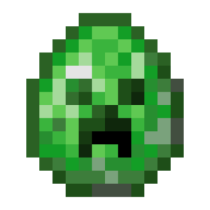 | entity_pick_item_stack | Отримуваний предмет істоти | Отримує предмет, що видається при натисканні коліщатком (СКМ) по істоті. | Предмет | item |  |  |  |
|  | entity_ticks_lived | Час життя цілі | Отримує кількість тіків існування цілі. | Статистика | number |  |  |  |
| 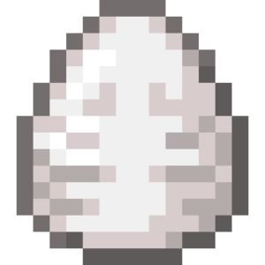 | entity_type | Тип сущности | Получает тип сущности цели. | Информация | text |  |  |  |
|  | entity_width_x | Ширина хітбоксу | Отримує розмір хітбоксу цілі по осі X. | Статистика | number |  |  |  |
| 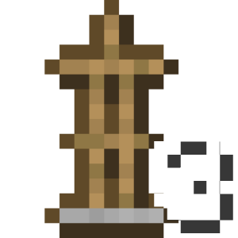 | entity_width_z | Довжина хітбоксу | Отримує розмір хітбоксу цілі по осі Z. | Статистика | number |  |  |  |
| 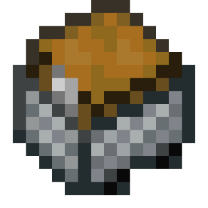 | event_added_items | Розподілені предмети | Видає словник розподілених по слотах предметів за допомогою ЛКМ/ПКМ або дублювання за допомогою колісця миші. | Событие | map<number, item> | Подією "Гравець перетягує предмет в інвентарі" |  |  |
| 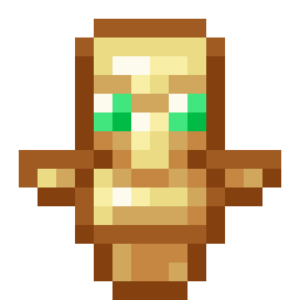 | event_advancement_tab_name | Ім'я вкладки досягнень | Отримує ім'я поточної вкладки досягнень події. | Событие | text | Подією "Гравець змінив вкладку в меню досягнень" |  | deprecated |
| 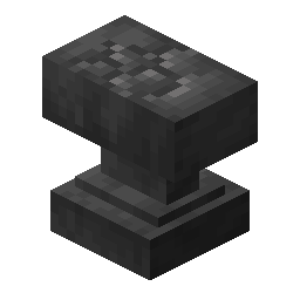 | event_anvil_damage_state | Новий стан поломки ковадла | Отримує новий стан поломки ковадла. | Событие | text | Подією "Гравець пошкоджує ковадло" |  |  |
|  | event_anvil_rename_input | Нова назва предмета | Отримує нову назву предмета на ковадлі. | Событие | text | Подією "Гравець перейменовує предмет" |  |  |
|  | event_block | Блок події | Отримує ID блоку, пов'язаного з подією. | Событие | text |  |  |  |
| 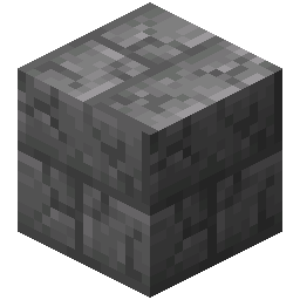 | event_block_break_progress | Прогрес поломки блока | Отримує прогрес поломки блока, пов'язаного з подією. | Событие | number | Оновленням поломки блока гравцем Оновленням поломки блока істотою |  |  |
| 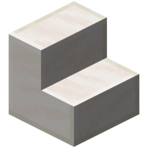 | event_block_face | Сторона блока события | Получает как направления сторону блока, задетую в событии. | Событие | text | Подіями взаємодії Подіями встановлення або зламу блоків Подією "Влучення снаряда гравця" Подіями поршнів |  |  |
| 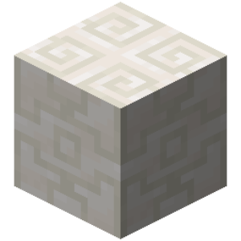 | event_block_location | Местоположение блока события | Получает местоположение блока в событии. | Событие | location |  |  |  |
| 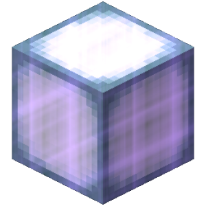 | event_blocks_involved | Задействованные блоки события | Получает список местоположений всех задействованных блоков в событии. | Событие | array<location> | Подіями вибухів Подіями поршнів |  |  |
|  | event_chat_message | Сообщение чата | Получает сообщение, отправленное целью в событии. | Событие | text | Подією "Гравець пише повідомлення до чату" |  |  |
| 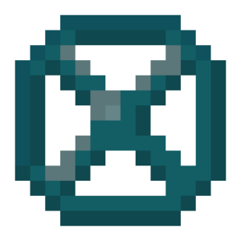 | event_close_inventory_cause | Причина закрытия инвентаря | Получает причину закрытия открытого инвентаря цели в событии. | Событие | text | Подією "Гравець закриває інвентар" |  |  |
| 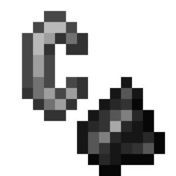 | event_combust_duration | Тривалість горіння істоти | Отримує тривалість горіння істоти з події. | Событие | number | Подією "Гравець загорівся" Подією "Істота загорілась" |  |  |
| 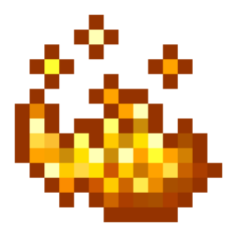 | event_combust_reason | Причина займання істоти | Отримує причину займання істоти з події. | Событие | text | Подією "Гравець загорівся" Подією "Істота загорілася" |  |  |
| 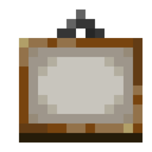 | event_custom_click_dialog_view_data | Дані діалогового вікна | Отримує дані, введені гравцем у діалогове вікно. | Событие | any | Подією "Гравець викликає кастомний клік" |  |  |
| 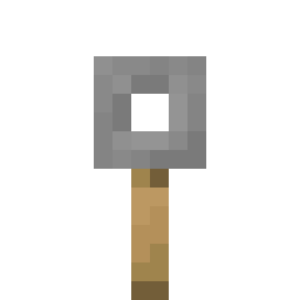 | event_custom_click_key | ID кастомного кліку | Отримує ідентифікатор кастомного кліку у діалоговому вікні або чаті. | Событие | text | Подією "Гравець викликає кастомний клік" |  |  |
|  | event_damage | Нанесённый урон | Получает количество единиц нанесённого урона в событии. | Событие | number |  |  |  |
|  | event_damage_cause | Причина полученного урона | Получает причину или тип полученного урона в событии. | Событие | text |  |  |  |
|  | event_death_screen_message | Повідомлення при смерті | Отримує повідомлення, що відображається на екрані смерті. | Событие | text | Подією "Гравець помирає" |  |  |
|  | event_dialog_button_id | ID кнопки діалогового вікна | Отримує ID кнопки діалогового вікна, яку натиснув гравець. | Событие | text | Подією "Гравець викликає кастомний клік" |  |  |
|  | event_dialog_id | ID діалогового вікна | Отримує ID діалогового вікна, у якому гравець натиснув кнопку. | Событие | text | Подією "Гравець викликає кастомний клік" |  |  |
|  | event_drag_type | Тип перетягивания по инвентарю | Получает тип перетягивания предметов по открытому инвентарю цели в событии. | Событие | text | Подією "Гравець перетягує предмет в інвентарі" |  |  |
|  | event_enchantment_bonus | Кількість книжкових полиць | Отримує кількість книжкових полиць, пов'язаних з подією. | Событие | number | Подією "Гравець вибирає зачарування" |  |  |
|  | event_enchantment_hint | Запропоноване зачарування | Отримує назву запропонованого зачарування в столі зачарувань. | Событие | text | Подією "Гравець зачаровує предмет" |  |  |
|  | event_enchantment_level_hint | Необхідний рівень досвіду зачарування | Отримує необхідний рівень досвіду для вибраного зачарування. | Событие | number | Подією "Гравець зачаровує предмет" |  |  |
|  | event_enchantment_offers | Пропоновані зачарування події | Отримує список пропонованих гравцю зачарувань, пов'язаних з подією. | Событие | array<text> | Подією "Гравець вибирає зачарування" |  |  |
|  | event_enchantments_to_add | Отримані зачарування | Отримує словник отриманих зачарувань предмета. | Событие | map<text, number> | Подією "Гравець зачаровує предмет" |  |  |
|  | event_entity_unleash_reason | Причина відв'язування істоти | Отримує причину, через яку істота була відв'язана. | Событие | text | Подіями відв'язування |  |  |
|  | event_equipment_slot | Тип задействованного слота | Получает тип задействованного слота цели в событии. | Событие | text |  |  |  |
|  | event_exhaustion_amount | Виснаження події | Отримує кількість отриманого виснаження. | Событие | number | Подією "Гравець виснажується" |  |  |
|  | event_exhaustion_reason | Причина виснаження | Отримує причину виснаження. | Событие | text | Подією "Гравець виснажується" |  |  |
|  | event_experience | Количество опыта события | Получает количество единиц опыта в событии. | Событие | number |  |  |  |
|  | event_fail_move_reason | Причина невдалого переміщення | Отримує причину невдалого переміщення. | Событие | text | Подією "Гравцю не вдалося пересунутися" |  |  |
|  | event_final_damage | Кінцевий урон | Отримує кінцеву кількість одиниць завданого урону в події. | Событие | number |  |  |  |
|  | event_fish_state | Причина события рыбалки | Получает причину события рыбалки. | Событие | text | Подією "Гравець рибалить" |  |  |
|  | event_food_level | Восполненный голод события | Получает количество единиц восполненного голода. | Событие | number | Подією "Зміна рівня голоду гравця" |  |  |
|  | event_from_location | Старе місцеположення гравця | Отримує старе місцеположення гравця. | Событие | location |  |  |  |
|  | event_gamemode | Режим гри події | Отримує режим гри, пов'язаний з подією. | Событие | text | Подією "Гравець запросив меню зміни режиму гри" |  |  |
|  | event_hanging_break_cause | Причина удаление висящей сущности | Получает причину удаления висящей сущности (картины, рамки). | Событие | text | Подією "Злам висячої сутності" |  |  |
|  | event_heal_amount | Количество восстановленного здоровья | Получает количество единиц восстановленного здоровья в событии. | Событие | number | Подією "Гравець відновлює здоров'я" Подією "Сутність відновлює здоров'я" |  |  |
|  | event_heal_cause | Причина исцеления | Получает причину восстановления здоровья в событии. | Событие | text | Подією "Гравець відновлює здоров'я" Подією "Сутність відновлює здоров'я" |  |  |
|  | event_hotbar_slot | Слот хот-бара у події | Отримує поточний номер слота хот-бара у події. | Событие | number |  |  |  |
|  | event_input_list | Список натиснутих клавіш пересування | Отримує список натиснутих клавіш пересування події. | Событие | array<text> | Подією "Гравець змінює натиснуті клавіші пересування" Подією "Гравець пересувається на транспорті" Подією "Гравець стрибає на транспорті" |  |  |
|  | event_interaction | Тип взаимодействия события | Получает тип взаимодействия цели в событии. | Событие | text | Подією "Гравець кликає правою кнопкою" Подією "Гравець кликає лівою кнопкою" Подією "Гравець взаємодіє зі світом" |  |  |
|  | event_inventory_action | Дія в інвентарі при кліку | Отримує поточну дію в інвентарному меню при кліку по ньому. | Событие | text |  |  |  |
|  | event_inventory_click_type | Тип клика по инвентарю | Получает тип клика по открытому инвентарю цели в событии. | Событие | text |  |  |  |
|  | event_item | Предмет события | Получает предмет в событии. | Событие | item |  |  |  |
|  | event_item_cooldown | Затримка предмета події | Отримує затримку предмета події. | Событие | number | Подією "Гравець використовує предмет із затримкою" Подією "Гравець отримує затримку для групи предметів" |  |  |
|  | event_item_cooldown_group | Група предмета із затримкою | Отримує групу предмета, на який поширюється затримка з події. | Событие | text | Подією "Гравець використовує предмет із затримкою" Подією "Гравець отримує затримку для групи предметів" |  |  |
|  | event_item_damage | Завданий предмету урон | Отримує кількість одиниць завданого предмету урону. | Событие | number | Подією "Гравець пошкоджує предмет" |  |  |
|  | event_items | Предмети події | Отримує всі предмети в події. | Событие | array<item> |  |  |  |
|  | event_knockback_cause | Причина відштовхування | Отримує причину відштовхування в події. | Событие | text | Подією "Гравець відштовхується" Подією "Істота відштовхується" |  |  |
|  | event_knockback_event_type | Тип відштовхування | Отримує тип відштовхування в події. | Событие | text | Подією "Гравець відштовхується" Подією "Істота відштовхується" |  |  |
|  | event_knockback_vector | Вектор відштовхування | Отримує вектор відштовхування в події. | Событие | vector | Подією "Гравець відштовхується" Подією "Істота відштовхується" |  |  |
|  | event_message | Сообщение события | Получает системное сообщение, отправленное в событии. | Событие | text |  |  |  |
|  | event_new_equipments | Екіпірування | Отримує екіпірування з події. | Событие | map<text, item> | Подією "Гравець змінює екіпірування" Подією "Істота змінює екіпірування" |  |  |
|  | event_new_fishing_hook_state | Новий стан поплавця | Отримує новий стан поплавця. | Событие | text | Подією "Поплавець вудки змінює стан" |  |  |
|  | event_new_location | Нове місцезнаходження гравця | Отримує нове місцезнаходження гравця. | Событие | location |  |  |  |
|  | event_new_potion_effect | Новий ефект | Отримує новий ефект події. | Событие | potion | Подією "Гравець отримує ефект від вибухового зілля" |  |  |
|  | event_new_vault_state | Новий стан скарбниці | Отримує новий стан скарбниці. | Событие | text | Подією "Скарбниця змінює стан" Подією "Гравець змінює стан скарбниці" |  |  |
|  | event_old_equipments | Попереднє екіпірування події | Отримує попереднє екіпірування події. | Событие | map<text, item> | Подією "Гравець змінює екіпірування" Подією "Істота змінює екіпірування" |  |  |
|  | event_old_item | creative_plus.game_value.event_old_item.name | creative_plus.game_value.event_old_item.description | Событие | item | creative_plus.game_value.event_old_item.work_with.player_inventory_slot_change_event |  |  |
|  | event_old_vault_state | Попередній стан скарбниці | Отримує попередній стан скарбниці. | Событие | text | Подією "Скарбниця змінює стан" Подією "Гравець змінює стан скарбниці" |  |  |
|  | event_power | Процент натяжения лука/арбалета | Получает процент силы выполнения (натяжения лука, прыжка на коне) события. | Событие | number | Подією "Гравець стріляє" Подією "Гравець стрибає на коні" |  |  |
|  | event_projectile_item | Предмет снаряда події | Отримує предмет снаряда події. | Событие | item | Подією "Гравець стріляє" |  |  |
|  | event_query_info | Налагоджувальна інформація | Отримує налагоджувальну інформацію цільового блоку або сутності. | Событие | text | Подією "Гравець отримує інформацію про блок" Подією "Гравець отримує інформацію про сутність" |  |  |
|  | event_replaced_block | Замінений блок | Отримує ID заміненого блоку події. | Событие | text | Подією "Гравець ставить блок" |  |  |
|  | event_sign_lines | Рядки таблички | Отримує рядки таблички у вигляді списку. | Событие | array<text> | Подією "Гравець змінює табличку" |  |  |
|  | event_sign_side | Сторона таблички | Отримує сторону таблички у вигляді тексту. | Событие | text | Подією "Гравець змінює табличку" |  |  |
|  | event_slot | Слот события | Получает слот в событии (не переведено - денег не хватило). | Событие | number |  |  |  |
|  | event_slot_type | Тип слота при кліку | Отримує поточний тип слота інвентарного меню при кліку по ньому. | Событие | text |  |  |  |
|  | event_slots_involved | Задействованные слоты | Получает список всех задействованных слотов открытого инвентаря цели в событии. | Событие | array<number> | Подією "Гравець перетягує предмет в інвентарі" |  |  |
|  | event_teleport_cause | Причина телепортації | Отримує причину телепортації у події. | Событие | text | Подією "Гравець телепортувався" Подією "Ендермен тікає" |  |  |
|  | event_ticks_held_for | Кількість тіків використання предмета | Отримує кількість тіків використання предмета. | Событие | number | Подією "Гравець перестає використовувати предмет" |  |  |
|  | event_time_skip_amount | Количество тиков пропуска времени | Получает количество тиков пропуска времени в мире. | Событие | number | Подією "Пропуск часу" |  |  |
|  | event_time_skip_reason | Причина пропуска времени | Получает причину пропуска времени в мире. | Событие | text | Подією "Пропуск часу" |  |  |
|  | event_transform_reason | Причина заміни сутності | Отримує причину заміни сутності події. | Событие | text | Подією "Сутність замінюється іншою сутністю" |  |  |
|  | event_transformed_entities | Замінені сутності події | Отримує замінених сутностей події. | Событие | array<text> | Подією "Сутність замінюється іншою сутністю" |  |  |
|  | event_tree_type | Тип дерева | Отримує тип дерева у події. | Событие | text | Подією "Гравець вирощує дерево" Подією "Дерево виростає" |  |  |
|  | event_velocity | Вектор швидкості | Отримує вектор швидкості в події. | Событие | vector | Подією "Гравець змінив вектор швидкості" |  |  |
|  | experience_level | Уровень опыта | Получает количество уровней опыта цели. | Статистика | number |  |  |  |
|  | experience_progress | Прогресс опыта | Получает процентный прогресс текущего уровня опыта цели. | Статистика | number |  |  |  |
|  | eye_location | Местоположение глаз | Получает местоположение цели на высоте глаз. | Местоположение | location |  |  |  |
|  | fall_distance | Дистанция падения | Получает дистанцию падения цели в блоках. | Статистика | number |  |  |  |
|  | fire_ticks | Время горения | Получает оставшееся количество тиков горения цели. | Статистика | number |  |  |  |
|  | flying_speed | Швидкість польоту | Отримує поточну швидкість польоту цілі (атрибут). | Статистика | number |  |  |  |
|  | food_exhaustion | Уровень истощения | Получает уровень истощения цели, который увеличивается от выполненных действий игрока. | Статистика | number |  |  |  |
|  | food_level | Уровень голода | Получает оставшееся количество единиц еды цели. | Статистика | number |  |  |  |
|  | food_saturation | Уровень насыщения | Получает количество единиц насыщения едой цели, которое зависит от видов съеденной еды. | Статистика | number |  |  |  |
|  | freeze_ticks | Час заморозки | Отримує поточний час заморозки цілі. | Статистика | number |  |  |  |
|  | gamemode | Режим гри | Отримує поточний режим гри гравця. | Информация | text | Гравцями |  |  |
|  | held_slot | Выбранный слот в хот-баре | Получает выбранный слот хот-бара цели. | Статистика | number |  |  |  |
|  | hitbox_midpoint_location | Центр хітбоксу | Отримує місцезнаходження центру хітбоксу цілі. | Местоположение | location |  |  |  |
|  | hotbar_items | Предметы в хот-баре | Получает предметы в хот-баре цели. | Предмет | array<item> |  |  |  |
|  | idle_duration | Тривалість простою | Отримує поточну тривалість простою гравця. | Статистика | number |  |  |  |
|  | inventory_items | Предметы в инвентаре | Получает предметы в инвентаре цели (включая хот-бар). | Предмет | array<item> |  |  |  |
|  | invulnerability_ticks | Время бессмертия | Получает оставшееся количество тиков неуязвимости цели. | Статистика | number |  |  |  |
|  | item_usage_progress | Прогресс использования предмета | Получает процентный прогресс использования целью предмета в руке, например еды. | Статистика | number |  |  |  |
|  | last_damage_cause | Остання причина урону | Отримує останню причину урону цілі. | Информация | text |  |  |  |
|  | last_death_location | Місцеположення останньої смерті | Отримує місцеположення останньої смерті гравця. | Местоположение | location |  |  |  |
|  | lead_holder | Поводырь | Получает UUID сущности, которая ведёт цель на поводке. | Информация | text |  |  |  |
|  | location | Местоположение | Получает местоположение цели. | Местоположение | location |  |  |  |
|  | main_hand | Ведуча рука | Отримує ведучу руку гравця. | Информация | text | Гравцем |  |  |
|  | main_hand_item | Предмет в ведущей руке | Получает предмет в ведущей руке цели. | Предмет | item |  |  |  |
|  | max_health | Максимальное здоровье | Получает максимальное количество единиц здоровья цели. | Статистика | number |  |  |  |
|  | max_invulnerability_ticks | Загальний час невразливості | Отримує кількість тіків, на яку видана невразливість для цілі. | Статистика | number |  |  |  |
|  | merchant_recipe_count | Кількість торгів Жителя | Отримує кількість торгів Жителя. | Статистика | number |  |  |  |
|  | name | Имя | Получает имя цели. | Информация | text |  |  |  |
|  | off_hand_item | Предмет во второй руке | Получает предмет во второстепенной руке цели. | Предмет | item |  |  |  |
|  | open_inventory_custom_id | Кастомний ID відкритого інвентаря | Отримує кастомний ID відкритого інвентаря цілі. | Информация | text | Гравцями |  |  |
|  | open_inventory_size | Розмір відкритого інвентаря | Отримує розмір поточного відкритого інвентаря. | Статистика | number | Гравцями |  |  |
|  | open_inventory_title | Заголовок открытого инвентаря | Получает заголовок открытого инвентаря цели. | Информация | text | Гравцями |  |  |
|  | open_inventory_type | Тип відкритого інвентаря | Отримує тип відкритого інвентаря цілі. | Информация | text | Гравцями |  |  |
|  | origin | Місцезнаходження першої появи | Отримує місцезнаходження першої появи цілі. | Местоположение | location |  |  |  |
|  | owner_uuid | UUID власника світу | Отримує UUID власника світу. | Мир | text |  |  |  |
|  | particle_cpu_usage | Відсоток використання процесора частинками | Отримує відсоток навантаження процесора сервера створенням частинок. | Мир | number |  |  |  |
|  | particle_visibility | Видимість частинок | Отримує значення налаштувань видимості частинок гравця. | Информация | text | Гравцями |  |  |
|  | passengers | Пассажиры | Получает UUID сущностей, которые едут на цели. | Информация | array<text> |  |  |  |
|  | ping | Пинг игрока | Получает задержку между игроком и сервером в миллисекундах. | Статистика | number |  |  |  |
|  | pitch | Вертикальный поворот | Получает вертикальный (вверх/вниз) поворот (pitch) цели. | Местоположение | number |  |  |  |
|  | player_count | Количество игроков в мире | Получает количество игроков, находящихся в мире. | Мир | number |  |  |  |
|  | player_ender_pearls | Список ендер-перлин | Отримує список ендер-перлин гравця, що не приземлились. | Информация | array<text> | Гравцями |  |  |
|  | player_enderchest_items | Предмети в ендер-скрині | Отримує предмети в ендер-скрині цілі. | Предмет | array<item> | Гравцями |  |  |
|  | pose | Поза істоти | Отримує позу істоти. | Информация | text |  |  |  |
|  | potion_effects | Эффекты зелий | Получает действующие эффекты зелий цели. | Информация | array<potion> |  |  |  |
|  | projectile_owner_uuid | UUID власника снаряду | Отримує UUID власника снаряду. | Информация | text | Будь-якими снарядами |  |  |
|  | projectile_power | Вектор руху снаряда | Отримує вектор руху снаряда. | Статистика | vector | Вогняними кулями Зарядами дракона Головами Іссушувача |  |  |
|  | protocol_version | Версия протокола клиента | Получает версию протокола клиента игрока. | Статистика | number |  |  |  |
|  | remaining_air | Оставшийся воздух | Получает оставшееся количество тиков воздуха цели. | Статистика | number |  |  |  |
|  | response_headers | Заголовки відповіді на веб-запит | Отримує заголовки відповіді на надісланий веб-запит. | Событие | map<text, any> | Подією "Відповідь від сервера" |  |  |
|  | saddle_item | Предмет на седле | Получает седло или ковёр, надетые на цель. | Предмет | item | Свинями Кіньми Ламами |  |  |
|  | saturated_regen_rate | Швидкість регенерації від насичення | Отримує швидкість регенерації гравця з насиченням. | Статистика | number |  |  |  |
|  | selection_size | Количество выбранных объектов | Получает количество целей в выборке. | Мир | number |  |  |  |
|  | selection_target_names | Имена выбранных объектов | Получает имя каждой цели в выборке. | Мир | array<text> |  |  |  |
|  | selection_target_uuids | UUID выбранных объектов | Получает UUID каждой цели в выборке. | Мир | array<text> |  |  |  |
|  | server_current_tick | Текущее время сервера | Получает текущее время сервера в тиках. | Мир | number |  |  |  |
|  | server_tps | TPS сервера | Получает количество Тиков За Секунду (TPS), которое может обработать сервер. | Мир | number |  |  |  |
|  | spawn_location | Местоположение спавна | Получает местоположение точки появления цели. | Местоположение | location |  |  |  |
|  | spawn_reason | Причина спавну | Отримує причину спавну цілі. | Информация | text |  |  |  |
|  | start_reload_tick | creative_plus.game_value.start_reload_tick.name | creative_plus.game_value.start_reload_tick.description | Мир | number |  |  |  |
|  | starvation_rate | Швидкість голодування | Отримує швидкість голодування цілі. | Статистика | number |  |  |  |
|  | steer_forward | Прямолінійний рух транспорту | Отримує значення руху транспорту вперед або назад. | Статистика | number |  |  |  |
|  | steer_sideways | Рух транспорту вбік | Отримує значення руху транспорту вліво або вправо. | Статистика | number |  |  |  |
|  | target_block_face | Сторона целевого блока | Получает как направление стороны блока, на которую смотрит цель. | Местоположение | text |  |  |  |
|  | target_block_location | Местоположение целевого блока | Получает местоположение блока, на который смотрит цель. | Местоположение | location |  |  |  |
|  | target_fluid_location | Местоположение целевой жидкости | Получает местоположение жидкости, на которую смотрит цель. | Местоположение | location |  |  |  |
|  | targeted_entity | Ціль для атаки | Отримує поточну ціль для атаки моба. | Информация | text |  |  |  |
|  | timestamp | UNIX-время | Получает текущее время как одно число в миллисекундах. | Мир | number |  |  |  |
|  | unsaturated_regen_rate | Швидкість регенерації без насичення | Отримує швидкість регенерації гравця без насичення. | Статистика | number |  |  |  |
|  | url | Посилання веб-запиту | Отримує посилання веб-запиту. | Событие | text | Подією "Відповідь від сервера" |  |  |
|  | url_response | Ответ на веб-запрос | Получает ответ на отправленный веб-запрос. | Событие | text | Подією "Відповідь від сервера" |  |  |
|  | url_response_code | Код відповіді на веб-запит | Отримує код відповіді на надісланий веб-запит. | Событие | number | Подією "Відповідь від сервера" |  |  |
|  | user_locale | Язык клиента игрока | Получает текущий язык клиента игрока. | Информация | text | Гравцями |  |  |
|  | uuid | UUID | Получает универсальный уникальный идентификатор (UUID) цели. | Информация | text |  |  |  |
|  | vehicle | Транспорт | Получает UUID сущности, которую оседлала цель. | Информация | text |  |  |  |
|  | velocity | Вектор скорости | Получает вектор скорости движения цели (не ходьбы, а внешних сил). | Информация | vector |  |  |  |
|  | walking_speed | Швидкість ходьби | Отримує поточну швидкість ходьби цілі (атрибут). | Статистика | number |  |  |  |
|  | world_clear_weather_duration | Тривалість ясної погоди у світі | Отримує поточну тривалість ясної погоди у світі. | Мир | number |  |  |  |
|  | world_game_time | Час існування світу | Отримує час існування світу в тіках. | Мир | number |  |  |  |
|  | world_id | ID світу | Отримує ідентифікатор світу. | Мир | text |  |  |  |
|  | world_moon_phase | Поточна фаза місяця | Отримує поточну фазу місяця у світі. | Мир | text |  |  |  |
|  | world_size | Розмір світу | Отримує поточний розмір світу у чанках. | Мир | number |  |  |  |
|  | world_thunder_duration | Тривалість дощу у світі | Отримує поточну тривалість дощу у світі. | Мир | number |  |  |  |
|  | world_time | Текущее время мира | Получает текущее время мира в тиках. | Мир | number |  |  |  |
|  | world_weather | Поточна погода світу | Отримує тип поточної погоди світу. | Мир | text |  |  |  |
|  | world_weather_duration | Тривалість поточної погоди світу | Отримує тривалість поточної погоди світу. | Мир | number |  |  |  |
|  | x_coordinate | Координата X | Получает координату X местоположения цели. | Местоположение | number |  |  |  |
|  | y_coordinate | Координата Y | Получает координату Y местоположения цели. | Местоположение | number |  |  |  |
|  | yaw | Горизонтальный поворот | Получает вертикальный (влево/вправо) поворот (yaw) цели. | Местоположение | number |  |  |  |
|  | z_coordinate | Координата Z | Получает координату Z местоположения цели. | Местоположение | number |  |  |  |
